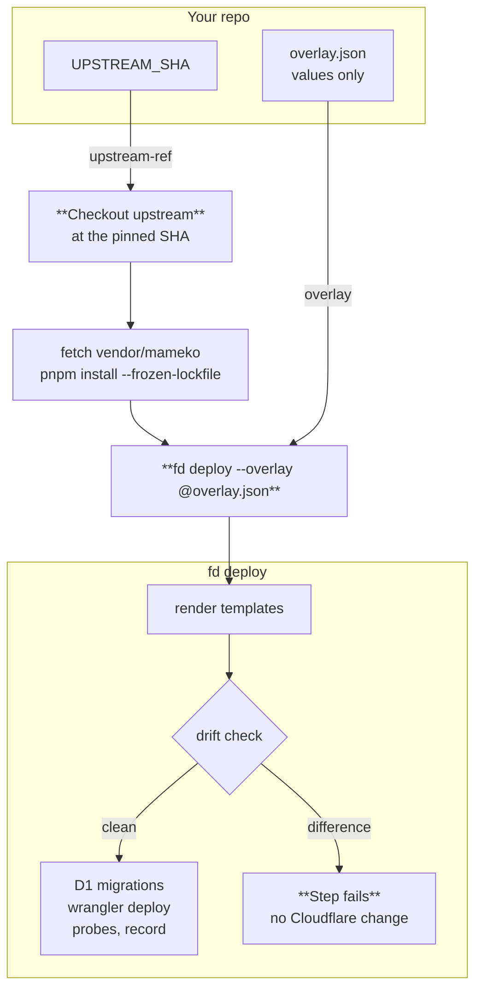

# `deploy-dispatcher-action`

Composite GitHub Action that deploys the FlareDispatch Workers into your
Cloudflare account with `fd deploy`. Your repository carries two files: the
**operator overlay**, a values-only JSON file, and `UPSTREAM_SHA`, the 40-char
commit SHA of the upstream tree to deploy.

The action:

1. Checks out the upstream repository at `inputs.upstream-ref`.
2. Fetches the `vendor/mameko` submodule with `inputs.mameko-deploy-key` and
   runs `pnpm install --frozen-lockfile` in the upstream tree.
3. Runs `fd deploy --overlay @<your overlay>` from the upstream tree
   (`fd deploy --dry-run` when `inputs.dry-run` is `true`).

`fd deploy` is the same deploy the upstream deploy workflow and a workstation
run ([operability.md § Deploy pipeline](../../specs/operability.md)): it
decodes the overlay against the value schema, renders each committed Worker
template through the one renderer, runs the drift check, applies the D1
migrations, deploys each Worker after every Worker it binds as a service,
probes each deployed Worker and stores the rendered configuration as the record
of the deploy. The action writes no Worker configuration of its own: every
topology setting comes from the upstream templates, and the overlay sets only
the values their placeholders name ([ADR-0012](../../specs/adr/0012-values-only-overlay.md)).



Sibling to [`flare-dispatch-action`](../flare-dispatch-action/): that action
**dispatches a run** from a consumer repo into the control plane; this one
**ships the Workers**.

---

## The operator overlay

The overlay holds values only. The value schema in
[`packages/ops/src/overlay.ts`](../../packages/ops/src/overlay.ts) declares
every path; a key it does not declare, or a missing required value, fails
`fd deploy` at the decode stage, before any Cloudflare call. An overlay that
renders the committed templates sets at least these values:

```json
{
  "accountId": "<32-hex account id>",
  "d1": { "DB": "<D1 database id>" },
  "kv": { "CONFIG": "<KV namespace id>" },
  "r2": {
    "CACHE": "<cache bucket name>",
    "ARTIFACTS": "<artifacts bucket name>"
  },
  "hostnames": {
    "dispatcher": "<control-plane hostname>",
    "docs": "<docs hostname>"
  },
  "access": {
    "teamDomain": "<team>.cloudflareaccess.com",
    "aud": "<Access application AUD>"
  },
  "operators": ["<operator email>"],
  "github": {
    "appId": "<GitHub App id>",
    "appSlug": "<GitHub App slug>",
    "fixtureRepo": "<owner>/<repo>"
  },
  "alerts": { "sink": "https://<alert webhook>" }
}
```

Bindings, Durable Object classes, migrations, cron schedules, container classes,
compatibility settings, limits and rollout settings live in the committed
templates; the overlay cannot set them.

---

## Usage

In your repo:

```
infra/flare-dispatch/
├── UPSTREAM_SHA       # 40-char hex commit SHA on the upstream repository
└── overlay.json       # your operator overlay
```

Workflow:

```yaml
# .github/workflows/deploy-flare-dispatch.yml
name: Deploy FlareDispatch
on:
  workflow_dispatch:

# One deploy per account at a time; a started deploy is never cancelled.
concurrency:
  group: flare-dispatch-deploy
  cancel-in-progress: false

permissions:
  contents: read

jobs:
  deploy:
    runs-on: ubuntu-latest
    steps:
      - uses: actions/checkout@v6

      - id: pin
        run: echo "sha=$(tr -d '[:space:]' < infra/flare-dispatch/UPSTREAM_SHA)" >> "$GITHUB_OUTPUT"

      - uses: fractalboxdev/flare-dispatch/actions/deploy-dispatcher-action@<sha>
        with:
          upstream-ref: ${{ steps.pin.outputs.sha }}
          overlay: infra/flare-dispatch/overlay.json
          cloudflare-api-token: ${{ secrets.CLOUDFLARE_API_TOKEN }}
          github-app-private-key: ${{ secrets.GITHUB_APP_PRIVATE_KEY }}
          mameko-deploy-key: ${{ secrets.MAMEKO_DEPLOY_KEY }}
```

Pin the action itself by SHA (not `@main`), for the same reason as the upstream
pin. To keep the overlay out of the repository, write it from a secret to a file
in an earlier step and pass that file's path as `overlay`.

The drift check reads the default branch's ruleset of the repository the
workflow runs in, through the GitHub App's installation on it, so run the deploy
workflow in a repository where the App is installed.

---

## Worker secrets: out of band

The action does not set Worker secrets. Set each once with `wrangler secret put`
and rotate it the same way, then run `fd doctor`. The drift check reports a
secret by name only, never its value.

---

## Inputs

See [`action.yml`](./action.yml).

| Input                    | Required | What                                                                                                                  |
| ------------------------ | -------- | --------------------------------------------------------------------------------------------------------------------- |
| `upstream-ref`           | yes      | A commit SHA on the upstream repository, usually the contents of `infra/flare-dispatch/UPSTREAM_SHA`.                 |
| `overlay`                | yes      | Path to your operator overlay JSON, relative to the repository root. A missing file fails the action before checkout. |
| `cloudflare-api-token`   | yes      | Account-scoped token: Workers Scripts:Edit, Workers R2 Storage:Edit, D1:Edit, Containers:Edit, Account Settings:Read. |
| `github-app-private-key` | yes      | The GitHub App's private key, for the drift check's App registration and ruleset reads.                               |
| `mameko-deploy-key`      | yes      | Read-only deploy key of the private mameko repository the upstream tree vendors as `vendor/mameko`.                   |
| `dry-run`                | no       | `true` runs decode, render and the drift check only, and changes no Cloudflare state. Default `false`.                |
| `node-version`           | no       | Default `22`.                                                                                                         |
| `upstream-repo`          | no       | Repository to check out. Default `fractalboxdev/flare-dispatch`; a mirror or fork overrides it.                       |
| `upstream-checkout-path` | no       | Directory the upstream tree is checked out into. Default `flare-dispatch-upstream`.                                   |

### Deploying from a private mirror

Run the deploy workflow **inside the mirror**, and point the action at the
mirror's own commit. A workflow's `GITHUB_TOKEN` always reads its own
repository, private or not, so no extra token is needed and nothing depends on
the upstream repository staying reachable. Commit the overlay into the mirror;
the upstream has no `infra/flare-dispatch/`, so syncing the mirror never
conflicts with it.

```yaml
steps:
  - uses: actions/checkout@v6
  - uses: ./actions/deploy-dispatcher-action
    with:
      upstream-repo: ${{ github.repository }}
      upstream-ref: ${{ github.sha }}
      overlay: infra/flare-dispatch/overlay.json
      cloudflare-api-token: ${{ secrets.CLOUDFLARE_API_TOKEN }}
      github-app-private-key: ${{ secrets.GITHUB_APP_PRIVATE_KEY }}
      mameko-deploy-key: ${{ secrets.MAMEKO_DEPLOY_KEY }}
```

Bumping upstream is then a mirror sync; the deployed SHA is the mirror commit
the workflow ran on. A deploy workflow in a _different_ repository cannot read a
private mirror, because `GITHUB_TOKEN` is scoped to the calling repository.

---

## Outputs

| Output         | What                                                                                                       |
| -------------- | ---------------------------------------------------------------------------------------------------------- |
| `upstream-sha` | The ref the upstream was checked out at (echo it into your step summary when `upstream-ref` was a branch). |

`fd deploy` prints each stage with its result. After a failed post-deploy probe
it prints each Worker's `wrangler rollback` command, or
`fix forward: rollback blocked by migration <tag>`, and never rolls a Worker
back itself.

---

## Bumping upstream

```sh
gh api repos/fractalboxdev/flare-dispatch/commits/main --jq '.sha' \
  > infra/flare-dispatch/UPSTREAM_SHA
git checkout -b chore/bump-flare-dispatch-$(cut -c1-7 infra/flare-dispatch/UPSTREAM_SHA)
git commit infra/flare-dispatch/UPSTREAM_SHA -m "chore: bump flare-dispatch to $(cut -c1-7 infra/flare-dispatch/UPSTREAM_SHA)"
gh pr create --draft --title "..." \
  --body "Compare: https://github.com/fractalboxdev/flare-dispatch/compare/<old>...<new>"
# After review and merge:
gh workflow run deploy-flare-dispatch.yml
```

A bump whose templates name a value your overlay does not set fails the next
deploy before any Cloudflare change, naming the missing path.
