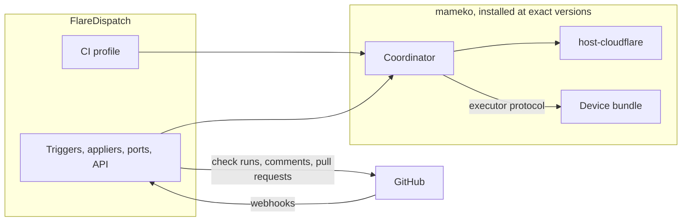

# ADR-0001: A Cloudflare-hosted CI application on mameko

Status: Superseded in part by mameko [ADR-0003](https://github.com/fractalboxdev/mameko/blob/88770c64b14818ad32aed9615f1cfaf4bbc1f591/specs/adr/0003-two-level-scheduling-owned-devices-first.md) · 2026-10-24

mameko's ADR-0003 decides fleet-first execution, the two scheduling levels and leases over the device's outbound connection; this record decides what FlareDispatch is and where its control plane runs.

## Context

- Cloudflare Containers carry most of the deploying organization's Cloudflare bill for CI; the control plane (Workers, Durable Objects, D1, R2) costs well under one cent per execution.
- GitHub does not redeliver a failed webhook on its own, and branch protection waits forever on a required check that nobody creates. The component that receives webhooks and posts required checks must stay up when any one machine is down.
- Teams that adopt FlareDispatch hold idle machines across members (workstations, a dedicated build machine), and want placement by member, device posture and workload class.
- mameko supplies the scheduling mechanism FlareDispatch needs as libraries: the coordinator, admission, spend, fenced leases, the outbox, the device executor and the `host-cloudflare` runtime adapter ([mameko ADR-0001](https://github.com/fractalboxdev/mameko/blob/88770c64b14818ad32aed9615f1cfaf4bbc1f591/specs/adr/0001-libraries-device-executor-protocol.md), [ADR-0002](https://github.com/fractalboxdev/mameko/blob/88770c64b14818ad32aed9615f1cfaf4bbc1f591/specs/adr/0002-host-neutral-core-two-hosts.md)). An application supplies a profile, appliers and its own deployment.

## Decision

- FlareDispatch is a CI application on mameko. It composes mameko's coordinator with `host-cloudflare`, its CI profile ([profile.md](../profile.md)) and its GitHub appliers, and specifies only what an application decides: its triggers, its GitHub output, its interfaces, its cache, its provenance, its implementations of mameko's application ports and its phases ([architecture.md](../architecture.md)).
- The control plane runs on Cloudflare in the deploying organization's account: the dispatcher Worker, the `host-cloudflare` Durable Object classes, FlareDispatch's own Durable Objects, D1, KV and R2. It receives every trigger, owns every check run and GitHub side effect, and holds every credential that can change GitHub or spend money.
- FlareDispatch installs mameko at exact versions and copies mameko's templates once ([mameko ADR-0018](https://github.com/fractalboxdev/mameko/blob/88770c64b14818ad32aed9615f1cfaf4bbc1f591/specs/adr/0018-installed-and-copied-code.md)); devices run mameko's device bundle on the platforms and job runtimes mameko supports ([mameko ADR-0019](https://github.com/fractalboxdev/mameko/blob/88770c64b14818ad32aed9615f1cfaf4bbc1f591/specs/adr/0019-device-platforms-and-job-runtimes.md)).
- FlareDispatch composes `host-cloudflare` only.

*FlareDispatch on mameko · FlareDispatch decides policy and GitHub behaviour; mameko owns the scheduling mechanism.*

## Options considered

| Option | Buys | Costs |
| --- | --- | --- |
| **A CI application on mameko, hosted on Cloudflare** | One specification and one implementation of scheduling, fencing, spend and the outbox, shared with other applications; FlareDispatch's specification holds only CI decisions | FlareDispatch waits on mameko's phases and pins a mameko commit in every citation |
| FlareDispatch owns its scheduler | No dependency on another repository's release cadence | Two copies of the same mechanism to specify, prove and keep in step |
| A device as the control plane | No cloud dependency for scheduling | The device's uptime becomes the system's uptime: a sleeping device drops webhooks and leaves required checks unposted |
| Self-hosted control plane on Postgres first | Provider independence from the first deploy | The operator runs a database and an always-on receiver; Durable Object hibernation and edge webhook receipt are lost |

## Criteria

1. A lost device costs latency or money, never a wrong or missing required check. This criterion decided against a device-hosted control plane.
2. One implementation of the scheduling mechanism, verified once. This criterion decided for composing mameko over owning a scheduler.

## Consequences

- Required checks depend on the Cloudflare control plane. A control-plane outage stops admission everywhere; the response is fail-closed, not failover.
- Each FlareDispatch phase waits on the matching mameko phase ([roadmap.md](../roadmap.md)), and a mameko change reaches FlareDispatch only through a new pinned commit.
- Results from a device reach at most the `platform` tier, and local work without an execution lease stays `device-signed`; releases stay pinned to the cloud ([ADR-0015](0015-provenance-tiers.md)).
- Moving to `host-node` is a composition change that FlareDispatch does not specify.

## Revisit triggers

- mameko cannot carry a value FlareDispatch's profile needs, and the open item stays unresolved past the FlareDispatch phase that needs it.
- The warm-state kill line of [roadmap.md](../roadmap.md) is crossed: median time to verdict on owned devices is less than 30% below the best cloud setup.
