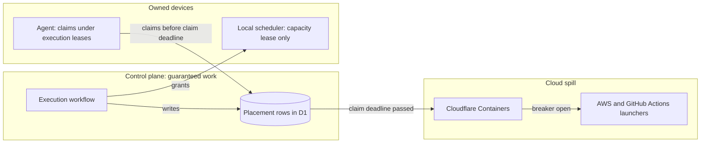

# ADR-0001: Local-first execution under a Cloudflare control plane

Status: Accepted · 2026-10-24

## Context

- Cloudflare Containers carry most of the deploying organization's Cloudflare bill for CI; the control plane (Workers, Durable Objects, D1, R2) costs well under one cent per execution.
- A container has at most 4 vCPU, 12 GiB of memory and 20 GB of ephemeral disk, runs Linux only, and starts cold: dependencies, build outputs, browsers and model weights are rebuilt or restored on every job. An eviction or a deploy rollout reruns the job from zero.
- Cloudflare offers no account-level spending cap. An owned machine has fixed capacity, so a runaway retry loop on it costs queue time, not money; hosted model calls still bill per token wherever the step runs.
- GitHub does not redeliver a failed webhook on its own, and branch protection waits forever on a required check that nobody creates. The component that receives webhooks and posts required checks must stay up when any one machine is down.
- Teams that adopt FlareDispatch hold idle machines across members (workstations, a dedicated build machine), and want placement by member, device posture and workload class.

## Decision

- The control plane runs on Cloudflare in the deploying organization's account: the dispatcher Worker, Durable Objects, D1 and R2. It receives every trigger, schedules every execution that carries a guarantee (P0–P3), owns every check run, deadline, spill and GitHub side effect, and holds every credential that can change GitHub or spend money ([architecture.md](../architecture.md)).
- Execution is fleet-first. An execution runs on an owned device when a present device can claim it before its claim deadline, and spills to Cloudflare Containers, then to outside launchers (AWS first, then GitHub Actions), when it cannot.
- Scheduling has two levels. No device schedules guaranteed work. Each device's local scheduler runs only work submitted to it, inside a capacity lease the control plane grants, and its results never post or conclude a check.
- Cloudflare carries execution leases and capacity leases over the agent's outbound connection. Tailscale carries only device-to-device traffic.

*two-level scheduling · a device claims or the cloud takes the execution; the local scheduler holds no guarantee.*

## Options considered

| Option | Buys | Costs |
| --- | --- | --- |
| Cloud only on Containers | One executor type, one meter, one egress point | Cold state on every job, Linux only, 4 vCPU per job, no hard spend ceiling, evictions rerun jobs |
| Cloudflare-dominant: owned machines as one more executor type, Containers the only floor | One meter and one identity system | Reaches only Cloudflare teams; one Linux-only floor; no device-aware placement across members |
| A device as the control plane | No cloud dependency for scheduling | The device's uptime becomes the system's uptime: a sleeping device drops webhooks and leaves required checks unposted |
| Self-hosted control plane on Postgres first | Provider independence from the first deploy | The operator runs a database and an always-on receiver; Durable Object hibernation and edge webhook receipt are lost |
| **Fleet-first under a Cloudflare control plane** | Warm state and fixed-cost capacity on owned devices; correctness independent of any device | Two queues, two class vocabularies and a capacity-lease protocol; a meter and an egress enforcer per spill provider |

## Criteria

1. A lost device costs latency or money, never a wrong or missing required check. This criterion decided against a device-hosted control plane.
2. Time to verdict on jobs dominated by cold state: dependency installs, unchanged builds, browser and model loads.
3. Cloud spend per month under a hard ceiling.
4. Reach: teams with idle machines on several members' devices. This criterion decided fleet-first over Cloudflare-dominant.

## Consequences

- The cost accepted is two scheduling levels and the capacity-lease protocol, plus a launcher, meter and egress enforcer per spill provider.
- Required checks still depend on the Cloudflare control plane. A control-plane outage stops admission everywhere; the response is fail-closed with an outbox on each executor, not failover.
- Results from a device reach at most the `platform` tier, and local work without an execution lease stays `device-signed`; releases stay pinned to the cloud ([ADR-0015](0015-provenance-tiers.md)).
- Reversing to cloud only is a placement-policy change: every run already executes on Containers.

## Revisit triggers

- The warm-state kill line of [roadmap.md](../roadmap.md) is crossed: median time to verdict on owned devices is less than 30% below the best cloud setup.
- Owned devices take under 50% of eligible control-plane executions over a month.
- Operator toil exceeds one manual intervention a week on the agent.
- Required-check p95 time to verdict exceeds the cloud-only p95 by more than 60 s.
