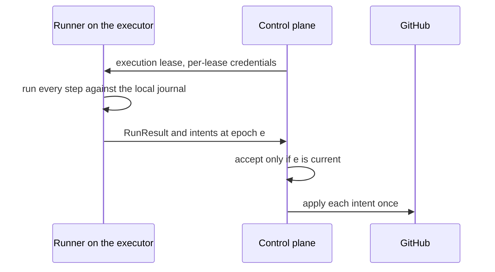

# ADR-0003: Run bodies execute in the executor; the control plane applies side effects as intents

Status: Accepted · 2026-10-24

## Context

- The current dispatcher runs each step body in the Workflow isolate and sends commands to the container one at a time. Cache and artifact bytes pass through Worker or SDK calls, measured at 1.5–2 MB/s for one archive.
- Several effects run outside a durable step and repeat on replay: a check progress update, email and chat sends, child-check closing and step bookkeeping.
- An owned device must run a whole job while the control plane may be unreachable for minutes, and must hold no credential that can write to GitHub, because pull-request code runs beside it.
- A reclaim moves an execution to another executor at a new epoch. Any effect the first executor already caused cannot be withdrawn.

## Decision

- An executor runs the whole run program in its runner, against a local SQLite journal, and returns one `RunResult` with a list of intents for its epoch ([run-model.md](../run-model.md)).
- The executor sends its intents during the run, and the executor Durable Object stages them per epoch ([executor-protocol.md](../executor-protocol.md) FD-PROTO-046). The control plane leases the work, meters it, accepts only a result for the current epoch, and applies the staged intents of that epoch through the outbox once per `(execution_id, intent_key)` ([architecture.md](../architecture.md)).
- Cache, artifact and log bytes move between the executor and R2 through presigned URLs; the dispatcher Worker carries none of them, except compile-cache objects of at most 100 MiB, which its compile-cache route streams without buffering ([cache-artifacts.md](../cache-artifacts.md) FD-CACHE-047).
- A run whose effect happens inside the job sandbox (a deploy command, a package publish) is pinned to the cloud, because fencing discards a result but cannot undo an effect.

*effect ownership · the executor computes, the control plane writes.*

## Options considered

| Option | Buys | Costs |
| --- | --- | --- |
| Control plane runs the body; the executor runs single commands | A credential-free executor; the current shape | A round trip per command; the Worker carries bytes; a device offline for one minute stalls every step; replay hazards stay in the control plane |
| Executor runs the body and writes GitHub itself | Mid-run effects with their results available to the run | A write credential beside pull-request code; a reclaim repeats effects; quota is spent from every executor without coordination |
| **Executor runs the body; the control plane applies intents** | No write credential on any executor; one place that dedups, budgets and orders GitHub writes; bytes off the Worker | A run cannot read the outcome of its own intent; mid-run effects need the cloud or a lease-channel call |

## Criteria

1. No executor holds a credential that can write to GitHub. This criterion decided against executor-side writes.
2. A replay or a reclaim produces no duplicate effect.
3. Bytes do not pass through the dispatcher Worker, outside the bounded compile-cache route. This criterion decided against the per-command shape.
4. A device keeps working through a control-plane gap until `deadline_at`.

## Consequences

- The cost accepted is that a run cannot branch on the outcome of a GitHub write it requested; a recipe that needs one splits into two executions.
- Child executions and model calls go over the lease channel during the run, not as intents, so the executor protocol carries them ([executor-protocol.md](../executor-protocol.md)).
- Every executor kind needs a runner that hosts the SQLite engine and the capability Layers.
- A reclaim discards all work of the previous epoch; the cache is the only thing that carries over.

## Revisit triggers

- A catalog recipe needs a GitHub write whose result it reads within the same execution, and splitting it into two executions costs more than 60 s of time to verdict.
- A recipe's intents exceed the per-result bounds in [run-model.md](../run-model.md).
