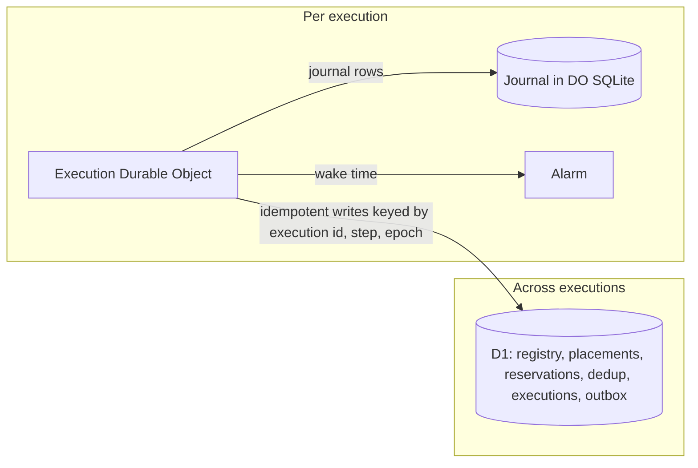

# ADR-0004: The per-execution journal lives in Durable Object SQLite; cross-execution state lives in D1

Status: Superseded by mameko [ADR-0006](https://github.com/fractalboxdev/mameko/blob/da1249e8318d7ac67eae38c4d1419613590ad18e/specs/adr/0006-journal-and-cross-execution-store.md) · 2026-10-24

## Context

- Each execution journals every step of its `Execution` workflow: tens of small writes per execution, read back on every replay.
- Admission, placement and dedup are decisions across executions: the class-line check sums every live reservation, the placement compare-and-set races a device claim against a cloud spill, and dedup needs one `UNIQUE` index over all executions. Each must be one conditional statement, or one D1 batch guarded on one, in one database to hold the atomic-admission assumption of the spend proof ([spend.md](../spend.md)).
- D1 is one database with one writer. A Durable Object's SQLite storage is local to the object, single-threaded, and pairs with an alarm that wakes the object.
- D1 binds at most 100 parameters per statement, which breaks queries over large `IN` lists.
- The dashboard and the sweeps query executions across repositories; they never need step-level journal detail in the same query.

## Decision

- Each execution's journal lives in the SQLite storage of the one Durable Object keyed by its execution id, and its timed waits use that object's alarm (mameko's [engine.md](https://github.com/fractalboxdev/mameko/blob/da1249e8318d7ac67eae38c4d1419613590ad18e/specs/engine.md)).
- Cross-execution state lives in D1: executor registry, placements, admission, reservations, dedup keys, `executions` and the outbox ([architecture.md](../architecture.md)). Per-executor state, including the intents staged for the current epoch, lives in that executor's Durable Object.
- `Execution` workflow steps are the only writers that bridge the two, and each D1 write they make is idempotent by execution id, step name and epoch.
- The portable control plane maps both to Postgres tables with the same columns.

*state split · hot per-execution writes stay off the shared writer that admission depends on.*

## Options considered

| Option | Buys | Costs |
| --- | --- | --- |
| Everything in D1 | One store, joins between journal and executions | Journal writes contend with the admission claim on the one writer; claim latency grows with step count |
| Everything in Durable Objects | No shared writer | Atomic admission needs a coordinator object per pool or a global one, which becomes the hot spot; cross-execution queries fan out to every object |
| Everything in Postgres | One portable store | A database to operate on every deploy; no hibernation or alarms |
| **Journal in DO SQLite, cross-execution state in D1** | Journal writes local to their execution; admission and dedup stay single statements | Two stores; a crash between them needs idempotent writes and reconciliation |

## Criteria

1. Admission, placement and dedup each remain one conditional statement or one batch guarded on one. This criterion decided against Durable Objects for all state.
2. Journal write latency does not depend on fleet-wide load. This criterion decided against D1 for all state.
3. Each store maps to Postgres tables for the portable control plane.

## Consequences

- The cost accepted is two stores that can disagree after a crash between a journal write and a D1 write. Idempotent step writes absorb the replay, and the settle sweep concludes `failure(infra: execution lost)` for an execution that holds no live lease once `deadline_at` plus the settle margin has passed ([github-output.md](../github-output.md) FD-GH-072, FD-GH-073).
- The dashboard reads D1 only; step-level detail needs a call to the execution's Durable Object.
- Journal retention is per object and runs on its alarm.

## Revisit triggers

- p95 latency of the claim batch in D1 exceeds 200 ms under the Phase 3 load.
- A Durable Object SQLite storage limit or request-duration limit blocks an `Execution` workflow.
- The portable control plane becomes the default deployment.
