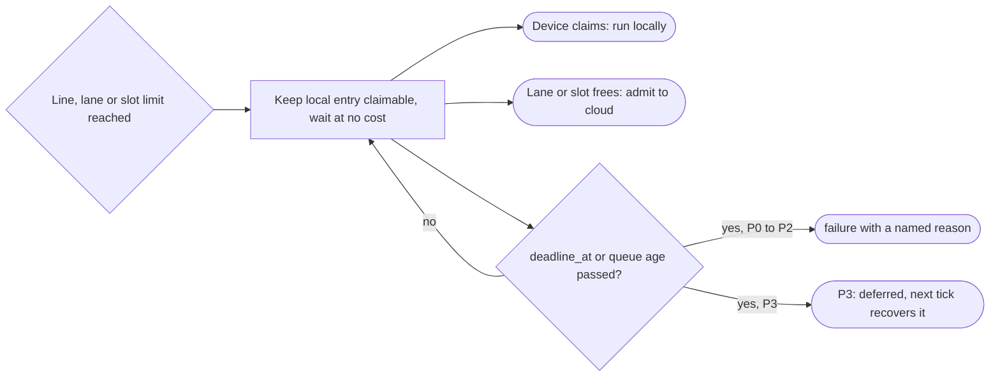

# ADR-0005: QoS classes P0–P3 and queue-then-fail

Status: Superseded by mameko [ADR-0007](https://github.com/fractalboxdev/mameko/blob/da1249e8318d7ac67eae38c4d1419613590ad18e/specs/adr/0007-classes-queue-then-fail.md) and [ADR-0017](https://github.com/fractalboxdev/mameko/blob/da1249e8318d7ac67eae38c4d1419613590ad18e/specs/adr/0017-application-profiles.md) · 2026-10-24

FlareDispatch's values for the classes P0 to P3 are in [profile.md](../profile.md).

## Context

- GitHub branch protection treats a `neutral` or `skipped` check-run conclusion as passing. A capacity outcome that concludes `neutral` therefore merges unverified code.
- Work differs in what a late or missing verdict costs: a stalled release, a blocked merge, a person waiting for advice, or a report that arrives at the next tick. One queue with one priority cannot reserve capacity or money for the first two without starving the last two, or the reverse.
- Execution moves between owned devices, which may sleep or disappear, and cloud executors, which bill per second. Placement must decide per execution whether to wait for a device or spend cloud money, and the answer depends on the work's class.
- Cloudflare offers no account-level spending cap, so the control plane's own admission is the only place a cap holds ([ADR-0006](0006-executor-aware-spend.md)).
- Some constraints on where work may run are security rules, not priorities: fork-PR code never runs on owned hardware, and `confidential-compute` code never runs in the cloud. Combined, they leave some requests with no eligible executor.

## Decision

1. Every execution carries one class set once at intake by `resolveClass`: P0 `release`, P1 `required`, P2 `interactive`, P3 `batch`. The class sets queue order, the claim deadline and which reserve the execution may draw on. Children take the lower of their parent's class and their own.
2. A gating run is P1 exactly when the target branch's ruleset or branch protection requires its check name. A transient lookup error resolves toward P1.
3. Placement constraints are a separate dimension from class. They remove executor kinds from the eligible set and never change rank. A request whose eligible set is empty is refused at intake with `failure` and reason `placement: no eligible executor`; the policy validator rejects any rule set that leaves a required check unplaceable.
4. **Queue, then fail.** At its budget line, burn lane or capacity limit, an execution keeps waiting at no cost: P1 keeps its local entry claimable by a device until `deadline_at`, P2 until its queue age, and P0, which no device may run, waits for a cloud slot until its queue age; then each concludes `failure` with a named reason. P3 is recorded `deferred` and recovered at the next tick.
5. No capacity, budget, deadline or operator-halt outcome concludes `neutral` or `skipped` for P0, P1, P2 or any required check. Supersession concludes `cancelled`. `skipped` means "not applicable" and nothing else.
6. Each execution has one absolute `deadline_at`, computed at intake from queue age, serial bound, lease wait, run ceiling and settle margin.

*Queue-then-fail: a limit turns into waiting, and waiting ends in a verdict a reviewer reads as red, never as passing.*

## Options considered

| Option | What it buys | What it costs |
| --- | --- | --- |
| Two classes (interactive, batch) in one admission semaphore | Simple FIFO with one bypass lane | No reservation per class; a required check can wait behind admitted batch work, and every capacity skip concluded `neutral` |
| **Four classes with queue-then-fail** | P1 has a reserve and a lane P2 and P3 cannot touch; every capacity outcome is visible as `failure` | Advisory P2 checks also turn red on capacity; a ruleset lookup per gating trigger |
| Keep spilling past the line, alert only | Merges never wait on money | The cap becomes a notification; a runaway loop spends until a person reacts |
| Fail the check at once at the line | Loud and immediate | Reads as a test failure; throws away the free wait for a device claim |
| Conclude `neutral` on capacity outcomes | No red checks during an outage | Branch protection passes the check, so unverified code merges |
| Class derived from labels or caller input alone | No ruleset permission needed | Any contributor can promote heavy work into the required reserve |

## Criteria

1. No capacity outcome produces a passing check (decided the choice between queue-then-fail, keep spilling and `neutral`).
2. A hard monthly cap on cloud spend with no platform cap behind it.
3. Required-check latency stays within 60 s of a cloud-only setup.
4. Promotion to the required reserve needs both a required-check ruleset and a run whose ceiling permits P1.
5. Security constraints hold for every request, including combinations no rule anticipated.

## Consequences

- A budget or capacity outage now blocks merges with red checks instead of passing them; that is an incident and pages.
- P2 advisory checks conclude `failure` on capacity, so one mapping covers every capacity path; teams see red advisory checks during a P2 shortage.
- The GitHub App needs `administration: read` and the `repository_ruleset` and `branch_protection_rule` events; every installation approves the permission change, and each lookup spends API quota.
- A required check whose run makes hosted model calls runs at P2 until an operator rule lifts it and the P1 reserve grows to cover it.
- A fork PR to a `confidential-compute` repository fails at once with `placement: no eligible executor`; the repository accepts that when it opts in.
- A burst larger than the P1 lane drains within `deadline_at` only up to its width; a tail beyond it fails `deadline: capacity`. Widening the lane costs a higher worst-case burn.
- Reversing to `neutral` conclusions would be cheap in code and expensive in trust: it reopens the path by which unverified code merges.

## Revisit triggers

- GitHub adds a check-run conclusion for infrastructure outcomes that branch protection does not treat as passing.
- Measured required-check p95 time to verdict exceeds the cloud-only p95 by more than 60 s for 2 consecutive weeks.
- Unmet P2 and P3 demand in `shed` rows exceeds 25% of admitted demand over 7 days.
- A class beyond P0–P3 is needed, for example a merge-queue lane with its own reserve.
