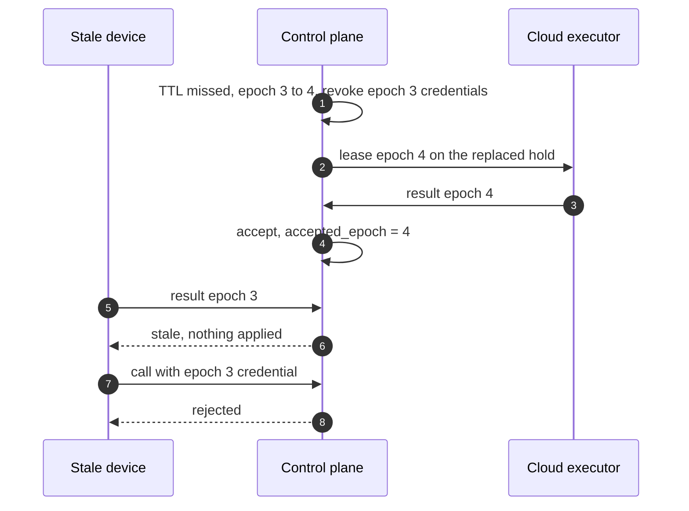

# ADR-0007: Fenced execution leases with epochs; a reclaim restarts the run

Status: Superseded by mameko [ADR-0009](https://github.com/fractalboxdev/mameko/blob/da1249e8318d7ac67eae38c4d1419613590ad18e/specs/adr/0009-fenced-execution-leases.md) · 2026-10-24

## Context

An execution can lose its executor at any instant. A device sleeps, reboots, loses power or its uplink. A Cloudflare Container is evicted on every deploy rollout and on host restart. A dispatcher deploy restarts every Durable Object and drops every socket. A partitioned device cannot tell whether the control plane has given its work to someone else, and the control plane cannot tell a dead device from a partitioned one.

The existing `container_leases` row is a mutex with a 10 min stale-heartbeat steal and no epoch. A holder whose heartbeat goes stale and then returns can still write logs and report a verdict after another holder has taken the execution. Two outcomes are unacceptable: a stale executor's verdict concluding a check, and a side effect applied twice.

Constraints:

- The control plane is the only component that writes to GitHub; runs request side effects as intents ([ADR-0003](0003-run-body-in-executor.md), [ADR-0011](0011-outbox-and-quota.md)).
- An execution's journal lives on the executor that runs it; no executor's disk is durable for the control plane.
- Budget safety holds only if no execution settles above its hold ([ADR-0006](0006-executor-aware-spend.md)), so a restart must replace the existing hold with one that covers the earlier epochs' metered cost and the new executor's remaining window, rather than add a second hold beside it.
- Device clocks are not trusted, and a Mac's `mach_absolute_time` stops during sleep.

## Decision

Every execution has one placement row in D1 carrying an integer `epoch`, starting at 1. An execution lease is the right to run that execution for one epoch, granted by one conditional `UPDATE` from `queued` to `leased`. Every move of the execution off an executor (reclaim, eviction, cancellation) is one conditional `UPDATE` that increments the epoch. The control plane accepts a result only when its epoch equals the row's epoch, the row is `leased` to the sender, and no result was accepted before; acceptance sets `accepted_epoch` once and no later event changes it.

- **Liveness.** The executor heartbeats every 15 s. The lease TTL is 90 s, counted from the later of the last heartbeat and the executor DO's restart anchor, so control-plane restarts never expire a lease. A lease whose job shows no step change and no log growth for its progress timeout (default 300 s) is reclaimed as if dead.
- **Restart, not resume.** A reclaimed execution starts again from its first step on the next executor with an empty journal, under a re-admission that replaces its hold ([spend.md](../spend.md) FD-SPD-043). Inside one lease, an agent that crashes resumes from its own journal for that epoch.
- **Fencing beyond the verdict.** Lease-scoped credentials carry the epoch and stop working when it changes. Log, artifact and cache-staging keys carry the epoch, so a late executor cannot overwrite the current epoch's objects. Intent batches carry the epoch and a stale batch writes no outbox row. Runs that cause effects inside the executor (a deploy with the `cf-api` grant) are pinned to the cloud, because fencing discards a result but cannot undo an effect.
- **Self-fence.** The executor times its lease on a monotonic clock that counts through sleep. A disconnected executor runs its job on to its local deadline and keeps the result in its outbox; it stops the job when it learns of a newer epoch, a cancel, or when the local deadline passes.
- **Every kind.** Cloudflare Container, device, AWS and GitHub Actions executors use the same lease, TTL, epoch and acceptance rules.

The fencing rule is the pure kernel `fenceKernel`, proved in Lean (`Fence.accepted_stable`, `Fence.accepted_is_current`) and tested against the TypeScript by differential testing ([ADR-0018](0018-formal-models.md)).

**A stale epoch can write nothing that the control plane reads**

*fencing · epoch 4 exists, so every epoch 3 write is refused at the control plane.*

## Options considered

| Option | What it buys | What it costs |
| --- | --- | --- |
| **Fenced lease with epochs, restart on reclaim (chosen)** | One accepted result per execution under any delay, sleep or reorder; no journal transfer between executors; restart replaces the hold instead of adding one | A reclaimed run loses all completed steps; a partitioned device keeps its slot busy until its local deadline |
| TTL mutex without an epoch (the existing `container_leases` shape) | Already built; one row per execution | A returning stale holder writes logs and verdicts after a steal; the 10 min steal window delays reclaim |
| Fenced lease, resume from a journal shipped to the next executor | Keeps completed steps after a reclaim | Every step result crosses the network to durable storage; resumed steps depend on executor-local state (workspace, caches) the next executor does not have, so resume fidelity needs its own proof |
| Hedged execution: run local and cloud copies at once, keep the first verdict | Lowest time to verdict on a device loss | Doubles cloud spend for every guaranteed execution, and two copies emit intents that dedup only by key |
| Wall-clock leases checked on the device | No restart anchor or monotonic-clock rules | Clock skew and sleep extend a lease on the device side; a waking Mac finishes stale work |
| An external lock service (etcd, a Raft group) | Mature fencing tokens | A second always-on control plane outside the deploying organization's Cloudflare account, against [ADR-0001](0001-local-first-control-plane.md) |

## Criteria

1. No stale result concludes a check, and no intent applies twice. This criterion decided between the fenced options and the TTL mutex.
2. Spend stays inside the hold: a restart replaces the existing reservation instead of adding one, and no option may run two paid copies by design. This ruled out hedging.
3. Time to verdict after an executor loss is bounded: at most the 90 s TTL plus the cloud run time.
4. Nothing new to operate outside the Cloudflare account. This ruled out an external lock service.
5. Executor-local state is not trusted across executors. This decided restart over resume.

## Consequences

- A reclaimed execution pays its full run time again. On a long run (a 45 min compile) a device loss near the end costs up to the whole run plus 90 s. That time is the cost accepted; no reclaim changes a verdict.
- The control plane carries the restart anchor, the epoch on every lease-scoped credential, and epoch-scoped object keys. Each is a requirement in [placement-leases.md](https://github.com/fractalboxdev/mameko/blob/da1249e8318d7ac67eae38c4d1419613590ad18e/specs/placement-leases.md) and [executor-protocol.md](../executor-protocol.md) with its own test.
- A partitioned device may run a job whose result is later refused. Its slot and power are spent for nothing; no cloud money is spent by the device.
- The 90 s TTL delays the reclaim of a crashed device by up to 90 s; a device that announces sleep releases its leases and is reclaimed at once.
- Changing the epoch rule later is expensive: it touches the Lean model, the TypeScript kernel, the D1 schema and every executor kind.

## Revisit triggers

- Epoch discards exceed 2 % of executions over 28 days, which means reclaims fire on live executors.
- The median work lost per reclaim exceeds 10 min for a class, which makes journal shipping worth its cost for that class.
- Executor DO restarts outside deploys exceed one per executor per day, which makes the restart anchor extend leases of dead devices too often.
- A run needs an effect inside the executor that cannot be pinned to the cloud.
