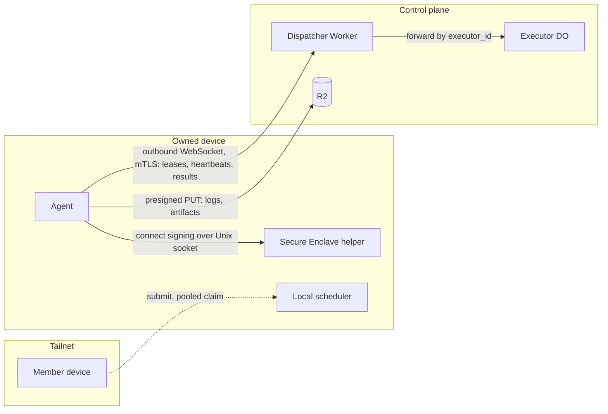

# ADR-0008: An outbound WebSocket to a per-executor Durable Object; Tailscale only between devices

Status: Accepted · 2026-10-24

## Context

The control plane must reach every executor with pushed messages (a cancel, a capacity-lease shrink, a revoke) within seconds, and must see each executor's heartbeat every 15 s ([ADR-0007](0007-fenced-execution-leases.md)). The executors sit in places that accept no inbound connection: a device behind a colocation or home network, a Cloudflare Container, an AWS task, a GitHub Actions runner.

Constraints:

- The control plane is Workers, Durable Objects, D1 and R2 in the deploying organization's Cloudflare account ([ADR-0001](0001-local-first-control-plane.md)). A Worker cannot join a tailnet.
- A device holds SSH keys and a logged-in operator account, so the agent must listen on no network port and must hold no long-lived bearer secret on disk.
- A Durable Object that holds a plain WebSocket bills duration for as long as the socket is open: about 324 000 GB-s per connected agent per month at 128 MB. The WebSocket Hibernation API lets the object leave memory between messages while the socket stays open. Duration is not billed while the object is idle and eligible for hibernation, and auto-responses are not billed; the executor DO stays eligible only if no handler leaves a pending `fetch`, timer or outgoing WebSocket.
- The device key is a non-exportable Secure Enclave key that only the Swift helper can use, and Node's TLS stack cannot present such a key as a TLS client identity ([ADR-0010](0010-agent-implementation.md)).
- Every dispatcher deploy resets every Durable Object and drops its sockets.
- Device-to-device traffic (submissions to a local scheduler, pooled claims, previews, peer cache) needs per-connection identity and posture, which Tailscale provides with WhoIs, grants and Tailnet Lock.

## Decision

Each executor opens one outbound WebSocket to the dispatcher's executor route. The dispatcher forwards it to that executor's own Durable Object, the executor DO, which accepts it through the WebSocket Hibernation API. Claims, leases, heartbeats, progress, intent batches, results, cancels, drains and every capacity-lease message ride that socket; logs and artifacts go straight to R2 through presigned upload grants and never cross it.

- **Identity.** A device authenticates in two layers. The agent opens the control-plane WebSocket over mTLS with a client certificate whose key is a P-256 key in a file readable only by the agent user; that key is not the Secure Enclave device key. The Cloudflare edge verifies the client certificate, and the dispatcher matches its fingerprint against the executor registry. The executor DO then sends a fresh challenge that the device key signs through the Swift helper with the `connect` purpose tag, and opens the session only on that signature, so a stolen client-certificate key alone opens no session. AWS tasks and GitHub Actions jobs authenticate with a credential bound to one `(execution_id, epoch)`; a Cloudflare Container is reached by its own Durable Object, which opens the socket into the container.
- **Versioning.** Messages are one `Schema.Union` per integer protocol version. Each dispatcher release accepts its own version and the one before; each agent release offers both; the executor DO picks the highest common version.
- **Deploys.** The lease TTL counts from the later of the last heartbeat and the executor DO's restart anchor, so a deploy costs each agent a reconnect inside 90 s and never a reclaim. Agents reconnect with full-jitter back-off and replay their outbox.
- **Tailscale.** Tailscale carries device-to-device traffic only. No execution-lease or capacity-lease message crosses the tailnet.

**One socket per executor; one Durable Object per socket**

*transport · lease authority on the Cloudflare socket; peers only on the tailnet.*

## Options considered

| Option | What it buys | What it costs |
| --- | --- | --- |
| **Outbound WebSocket to a per-executor DO with hibernation (chosen)** | Push in under 1 s; no inbound port; one stateful owner per executor for TTL alarms and standing claims; hibernation keeps idle cost near zero | Every deploy drops every socket; duration stays unbilled only while no handler leaves pending I/O; mTLS needs client-certificate configuration on the operator's zone, and the session check needs a native helper to sign with the Secure Enclave key |
| HTTP long-poll from the executor to a Worker | Stateless; survives deploys without a reconnect storm | Push waits for the next poll; every heartbeat is a Worker request and a D1 write with no object to hold TTL alarms; a cancel arrives up to one poll interval late |
| Tailscale between the control plane and devices | One fabric for everything; WireGuard identity per node | A Worker cannot join a tailnet, so a relay host must run inside the tailnet and becomes an always-on component outside the Cloudflare account; lease authority would depend on the coordination server |
| Cloudflare Tunnel to a port the agent listens on | Push without a socket held by the Worker | The agent listens on a port; the control plane must find and reach each device; a device's tunnel becomes an inbound path to a machine that holds keys |
| Cloudflare Queues with pull consumers | Durable delivery; built-in retries | No push for cancel and shrink; ordering per executor is not guaranteed; heartbeats as queue messages add latency and per-message cost |
| gRPC bidirectional streams | Typed streams | Workers serve no inbound gRPC bidirectional streams; a proxy would sit outside the account |

## Criteria

1. Pushed cancel and shrink reach a connected executor within 1 s. This ruled out long-poll and queues.
2. The agent listens on no network port and holds no long-lived bearer secret. This ruled out Tunnel to a listening agent.
3. No always-on component outside the deploying organization's Cloudflare account. This ruled out Tailscale for leases and a gRPC proxy.
4. Idle cost per connected executor stays below the cost of the device's own power. This is why hibernation is required and why its measurement gates phase 1.
5. A deploy must not reclaim any lease. The restart anchor meets it.

## Consequences

- One deploy produces one reconnect per executor within seconds. Full-jitter back-off and the recovery-mode token bucket bound the burst; the cost accepted is a short window in which pushes wait for the reconnect.
- If a handler leaves a pending `fetch`, timer or outgoing WebSocket, the executor DO stays ineligible for hibernation and each agent bills about 324 000 GB-s a month. The first remedy is removing that pending I/O; the fallback is a WebSocket auto-response ping for liveness and a 60 s heartbeat for progress; the measurement in phase 1 decides.
- The device connection depends on the Swift helper for the `connect` signature: a helper outage stops new sessions, though not an open socket, and the helper's code signature is part of the trusted path. The agent holds the TLS session and a second, file-held key for it.
- The operator configures client-certificate verification on the zone that serves the executor route, and enrolls each device's certificate fingerprint. This is a deploy step that a token-only design would not need.
- Two fabrics run: Cloudflare for authority, Tailscale for peers. Operating Tailscale (Tailnet Lock, grants, posture integrations) is a cost every team pooling devices pays.
- Moving the control plane to a portable Postgres deployment replaces the executor DO with a process that holds sockets itself; the message schemas and version rules carry over unchanged.

## Revisit triggers

- Measured executor DO duration exceeds 50 000 GB-s per connected agent per month after the auto-response fallback.
- Workers gain the ability to join a tailnet, which removes the relay objection to a single fabric.
- A fleet exceeds the number of sockets one dispatcher deploy can reconnect within the 90 s grace.
- A deploying organization cannot configure client-certificate verification on its zone.
