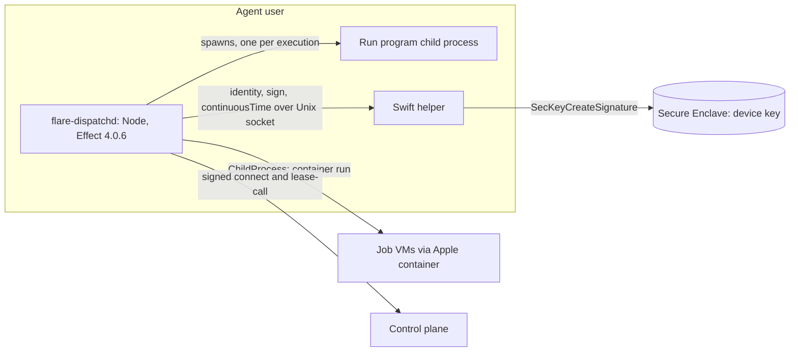

# ADR-0010: The agent is TypeScript on Effect v4, with a Swift Secure Enclave helper

Status: Superseded by mameko [ADR-0012](https://github.com/fractalboxdev/mameko/blob/8530203ba76ba00961e236b1fcea4f34b401bba1/specs/adr/0012-device-executor-implementation.md) · 2026-10-24

Device programs, the device executor and the key helper included, are Rust binaries from mameko's device bundle; FlareDispatch ships no device agent of its own.

## Context

The agent `flare-dispatchd` runs on every device. It holds the device's connection to the control plane, owns the slot ledger, starts one VM per job, and runs each leased execution's whole run program ([ADR-0003](0003-run-body-in-executor.md)). Run programs are typed Effect programs written with `defineRun`, journaled by the engine in mameko's [engine.md](https://github.com/fractalboxdev/mameko/blob/8530203ba76ba00961e236b1fcea4f34b401bba1/specs/engine.md), and every boundary type is a `Schema` shared with the control plane.

The agent also needs the device key: the hardware-bound P-256 key that the MDM ACME payload generates in the Secure Enclave, non-exportable, presented with Managed Device Attestation evidence at enrollment ([provenance.md](../provenance.md)). Only native macOS code reaches the Secure Enclave and the keychain through the Security framework; Node has no binding to either.

Two further platform facts constrain the choice:

- Node's monotonic clock on macOS comes from libuv, which reads `mach_absolute_time`. That clock stops during system sleep, so a deadline timed on it lets a waking Mac finish stale work. `mach_continuous_time` keeps counting through sleep.
- Node's TLS stack signs a client handshake only with a private key it holds in memory, so it cannot present a non-exportable Secure Enclave key as a TLS client identity.

## Decision

The agent is a TypeScript program on Effect 4.0.6, pinned exactly, running on Node and shipped as one Developer ID-signed single executable (Node SEA) with its own bundle identifier; run-program child processes start from a separately signed binary, so the helper can tell the agent from them. It reuses the run catalog, the engine's SQLite backend, the executor-protocol `Schema` definitions and the shared egress-decision package without translation. It spawns Apple `container` and each run program's child process through `ChildProcess` from `effect/process`, and models its services with `Context.Service` and its errors with `Schema.TaggedError`.

A small Swift helper, signed with a Developer ID certificate and notarized, holds the device key. It exposes three operations over a Unix socket owned by the agent user: `identity` (public key, certificate chain, attestation evidence), `sign` (a SHA-256 digest under one purpose tag from `connect`, `lease-call`, `statement` and `cache-entry`) and `continuousTime` (`mach_continuous_time`). It rejects any caller whose audit token does not identify the agent's signed single executable. The agent presents a TLS client certificate whose key is a separate P-256 key in a file readable only by the agent user; that key is not the device key and opens no session on its own. The agent authenticates each session with a `connect` signature and every lease-scoped call with a `lease-call` signature from the helper; its deadline clock is the `Clock` reference backed by `continuousTime`, replaced by `TestClock` in simulation.

**Only the helper touches the Secure Enclave; the agent asks it to sign digests**

*agent split · TypeScript runs runs; Swift signs and tells time.*

## Options considered

| Option | What it buys | What it costs |
| --- | --- | --- |
| **TypeScript on Effect v4 plus a Swift helper** | One language and one runtime for run programs on every executor kind; the engine, the wire `Schema` and the egress package are shared code, not ports; the Secure Enclave code is a few hundred lines with a narrow interface | Two languages on the device; Node's memory footprint per run program child; a native helper to sign, notarize and ship |
| Rust agent | Small static binary, low memory, strong process and network control | The agent runs TypeScript run programs, so it would embed or spawn a JavaScript runtime anyway, and the wire types and egress decision would exist twice. Still needs native bindings or a helper for the Secure Enclave |
| Pure Swift agent | Direct Secure Enclave, keychain, `launchd`, IOKit power and Virtualization framework access in one binary | Runs no Effect program without embedding JavaScriptCore; every `Schema`, the engine journal and the egress decision would be reimplemented and kept in lockstep by hand; limits contributors to Swift |
| TypeScript only, with a software key | One language, no native code | The device key becomes a file on disk, which breaks the no-long-lived-secret rule and the device-signed provenance tier |
| TypeScript with a Node native addon for the Secure Enclave | One process | An addon breaks on Node ABI changes, runs inside the process that also handles untrusted job output, and gives the Secure Enclave caller the agent's whole attack surface |

## Criteria

1. The run program executes the same code on a device as in a Cloudflare Container, an AWS task and a GitHub Actions job.
2. The device key never leaves the Secure Enclave, and the code that can ask for a signature is small enough to review in full.
3. Deadlines count through sleep.
4. Wire types and the egress decision exist once.

Criterion 1 decided between the agent languages: only a TypeScript agent runs run programs without a second runtime. Criterion 2 decided the helper: it keeps signing in a separately signed process with three operations, out of the process that parses job output.

## Consequences

- Two toolchains ship per agent release: the Node package and the notarized helper. The helper changes rarely; its designated requirement is part of device enrollment, so a helper re-sign forces re-enrollment.
- Device authentication has two layers: the edge checks the TLS client certificate, whose key is a file-held P-256 key distinct from the device key, and the executor Durable Object checks the device key's `connect` signature over its challenge ([executor-protocol.md](../executor-protocol.md)). A stolen client-certificate key alone opens no session.
- Every timer that decides a fence or a deadline reads `continuousTime` from the helper; a helper outage stops new claims.
- The agent inherits Effect 4.0.6's `@stability unstable` modules (`effect/process`, `effect/cli`, `effect/workflow` and others), so an Effect upgrade is gated by the upgrade gate in mameko's [engine.md](https://github.com/fractalboxdev/mameko/blob/8530203ba76ba00961e236b1fcea4f34b401bba1/specs/engine.md).
- Each execution's run program costs a Node child process, which counts against the device's memory headroom.

## Revisit triggers

- Node gains a supported way to sign a TLS handshake with an external key, which removes the separate client-certificate key, or to read `mach_continuous_time`, which shrinks the helper.
- Agent memory per run program child exceeds the share of a slot the device advertises.
- Devices other than Macs join the fleet, which needs a key holder for their platform's hardware keystore.
- Effect's workflow modules leave `@stability unstable` with breaking changes the engine conformance suite cannot absorb.
