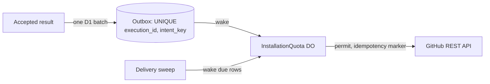

# ADR-0011: Transactional outbox and per-installation quota object for GitHub effects

Status: Accepted · 2026-10-24

## Context

- Run bodies execute inside the executor and return intents ([ADR-0003](0003-run-body-in-executor.md)); the control plane applies them. Something in the control plane must turn each intent into exactly one GitHub effect.
- The `Execution` workflow replays its body after a restart. A GitHub call made outside a journaled step repeats on every replay, and a call inside a step repeats when the isolate dies after the call and before the journal write. Check progress, comments, notifications and child-check closing are all exposed to this.
- GitHub quota belongs to the App installation, not to an isolate. Every execution of an installation draws on one bucket of primary rate limit plus secondary limits on content-creating requests, so a merge burst on one installation can starve its own verdicts.
- A required check that never concludes blocks the merge forever, and a verdict GitHub never received looks like a quiet week. Executions also end without a verdict when an executor and its engine instance both stop.
- GitHub has no idempotency-key header. Re-sending a `POST` after a timeout can create a second check run or comment.

## Decision

- Every GitHub write and every notification is an outbox row in D1, keyed `UNIQUE (execution_id, intent_key)`, the operability probes' canary push and webhook redelivery included. The executor DO stages the intents an executor sends; the `apply-outbox` step writes the accepted result's terminal status and its staged intents in one D1 batch, with every statement guarded in SQL on the accept compare-and-set, because a conditional `UPDATE` that matches 0 rows does not abort a D1 batch.
- One `InstallationQuota` Durable Object per installation holds the installation token, the rate-limit ledger and the permit queue, and runs the drain for that installation. Verdict delivery (`check.open`, `check.conclude`) keeps a reserve of the remaining quota; progress writes go last and coalesce.
- Each intent kind has an idempotency marker (`external_id` on a check run, a hidden marker in a comment, the head branch of a pull request, the tag of a release). Before the drain repeats a create whose outcome is unknown, it looks the object up by that marker.
- A delivery sweep wakes the drain for due rows and alarms on an undelivered P0, P1 or required verdict after 10 min. A settle sweep ends every execution that holds no live execution lease and has no verdict once its `deadline_at` plus the settle margin has passed, as `failure` `infra: execution lost`; it is the only sweep that ends a lost execution ([github-output.md](../github-output.md)).
- The `outboxKernel` is a pure transition function over row states, modelled in Lean and checked against the TypeScript by differential testing ([ADR-0018](0018-formal-models.md)).

**Intents reach GitHub through one serialized point per installation**

*Decision · the outbox gives at-most-once per key; the quota object gives one shared budget per installation.*

## Options considered

| Option | Buys | Costs |
| --- | --- | --- |
| **D1 outbox plus one quota object per installation** (chosen) | Replay inserts nothing new (`ON CONFLICT DO NOTHING` on the unique key); one fleet-wide view of each installation's quota; a sweep can find every undelivered row with one indexed query | A D1 row and one Durable Object wake per intent; the drain is a component to operate |
| GitHub calls inside journaled workflow steps, quota cached per isolate | No new table or object | A crash between the call and the journal write repeats the call; each isolate sees a different quota, so the reserve does not hold under fan-out |
| Cloudflare Queues as the delivery channel | Managed retries and back-off | At-least-once delivery still needs the idempotency markers; a queue consumer has no per-installation serialization or shared rate-limit state, so the quota object is still needed; no indexed view of undelivered rows for the alarm |
| Outbox inside each execution's DO-SQLite journal | The intent and its journal entry commit together | Rows are scattered across one object per execution, so neither the quota object nor the sweeps can select due rows across executions |

## Criteria

1. An intent produces at most one GitHub object under replay, retry and reclaim (property S2 in [verification.md](../verification.md), `V-REPLAY`). This criterion decided between the D1 outbox and in-step calls.
2. One quota budget per installation, shared by every execution, with verdicts served first. This decided between the quota object and Queues.
3. No verdict is dropped without an alarm.
4. The Cloudflare cost per execution stays well under one cent.

## Consequences

- Delivery is asynchronous: a check run concludes one Durable Object wake after the verdict batch commits, or within the 10 min sweep interval when a wake is lost; the wake latency is unmeasured.
- Every intent kind needs an idempotency marker before it can ship; a kind without one cannot be retried safely and is not accepted.
- Progress becomes coarse: at most one update per check per 60 s, dropped first under quota pressure.
- The drain's ambiguous-create lookup costs one extra read call per timed-out create.
- Executions that once stayed `running` indefinitely now end as `failure` `infra: execution lost`, which turns some silent losses into red checks.
- Reversing the decision means moving every effect back into workflow steps and checking each again for replay safety.

## Revisit triggers

- GitHub ships an idempotency-key header for REST writes, which removes the marker lookups.
- D1 write volume from the outbox exceeds 20% of the control plane's D1 writes.
- An installation sustains more GitHub calls than one Durable Object can issue at its concurrency limit.
