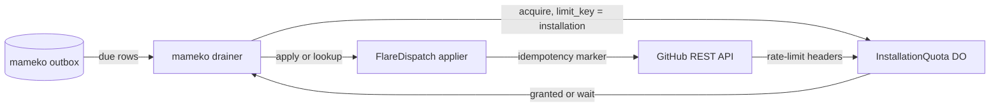

# ADR-0011: A per-installation quota object as the applier rate limit for GitHub effects

Status: Superseded in part by mameko [ADR-0013](https://github.com/fractalboxdev/mameko/blob/da1249e8318d7ac67eae38c4d1419613590ad18e/specs/adr/0013-outbox-and-effect-classes.md) · 2026-10-24

mameko's ADR-0013 decides the transactional outbox; this record decides the per-installation quota object.

## Context

- mameko's outbox delivers every intent through the application's effect applier, one permit per applier call from the applier rate limit the application implements ([mameko outbox.md § The applier port and the applier rate limit](https://github.com/fractalboxdev/mameko/blob/da1249e8318d7ac67eae38c4d1419613590ad18e/specs/outbox.md#the-applier-port-and-the-applier-rate-limit)). FlareDispatch must decide what that limit is for GitHub.
- GitHub quota belongs to the App installation, not to an isolate. Every execution of an installation draws on one bucket of primary rate limit plus secondary limits on content-creating requests, so a merge burst on one installation can starve its own verdicts.
- A required check that never concludes blocks the merge forever, and a verdict GitHub never received looks like a quiet week.
- GitHub has no idempotency-key header. Re-sending a `POST` after a timeout can create a second check run or comment.

## Decision

- The profile's `delivery.limit_key` binding names the GitHub App installation that serves a row's repository, so every applier call for one installation draws from one budget.
- One `InstallationQuota` Durable Object per installation implements mameko's applier rate limit for that key: it records what each GitHub response reports (limit, remaining, reset, `Retry-After`), bounds outstanding permits, keeps a reserve of the remaining budget for the kinds that draw it (`check.open`, `check.conclude`), holds `batch` work back first, and caps content-creating calls per minute and per hour ([github-output.md](../github-output.md) § Installation quota).
- Each GitHub intent kind is `adoptable` with an idempotency marker (`external_id` on a check run, a hidden marker in a comment, the head branch of a pull request, the tag of a release), so an ambiguous create is found again by `lookup` instead of being sent twice.

**Intents reach GitHub through one budget per installation**

*Decision · mameko's outbox gives at-most-once per key; the quota object gives one shared budget per installation.*

## Options considered

| Option | Buys | Costs |
| --- | --- | --- |
| **One quota object per installation as the applier rate limit** (chosen) | One fleet-wide view of each installation's quota; the reserve holds under fan-out; verdicts served first | One Durable Object call per permit |
| Quota cached per isolate | No new object | Each isolate sees a different quota, so the reserve does not hold under fan-out |
| Cloudflare Queues as the delivery channel | Managed retries and back-off | No per-installation serialization or shared rate-limit state, so a quota object is still needed |
| One limit for every installation | A single object | One busy installation starves every other installation's verdicts |

## Criteria

1. One quota budget per installation, shared by every execution, with verdicts served first. This decided between the quota object and Queues or a per-isolate cache.
2. No verdict is dropped without an alarm.
3. The Cloudflare cost per execution stays well under one cent.

## Consequences

- Every applier call, a `lookup` included, costs one Durable Object round trip for its permit; the added latency is unmeasured.
- Every intent kind needs an idempotency marker before it can ship as `adoptable`; a kind without one is `replay-safe` only when GitHub treats a repeat as the same request.
- Progress becomes coarse: `check.progress` is the last tier and coalesces per execution, so it is dropped first under quota pressure.
- The drain's ambiguous-create lookup costs one extra read call per timed-out create.

## Revisit triggers

- GitHub ships an idempotency-key header for REST writes, which removes the marker lookups.
- An installation sustains more GitHub calls than one Durable Object can issue at its concurrency limit.
