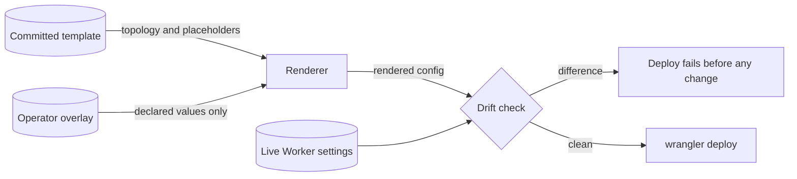

# ADR-0012: Values-only operator overlay and a deploy-time drift check

Status: Accepted · 2026-10-24

## Context

FlareDispatch is public and single-tenant: every deploying organization runs it in its own Cloudflare account. The committed `wrangler.jsonc` files therefore cannot carry account ids, database ids, bucket names or hostnames, and the deploying organization supplies them as an operator overlay.

The current overlay is a complete `wrangler.jsonc` that the deploy writes over the committed file. A merge script copies back only `limits`, container `rollout_*` settings and, under a migration-prefix rule, Durable Object bindings. Every other setting keeps whatever value the overlay held when it was written. A deployed admission cap, container `max_instances` or cron set can therefore differ from the committed values while every CI check passes, because the parity tests read the committed template, never the deployed configuration. The published deploy action merges nothing, and `keep_vars: true` keeps variables set in the dashboard across deploys. Cloudflare offers no deploy-time hook that compares a Worker's live settings with a file, so drift detection runs in the deploy tool.

## Decision

The overlay holds values only. A value schema, decoded with `Schema.decodeUnknownEffect` and `onExcessProperty: "error"`, declares every value path: account id, D1, KV and R2 identifiers, hostnames, Access settings, operators, GitHub App id, the alert sink, spend settings, per-pool `max_instances` and the launcher, egress, model and provenance settings [operability.md](../operability.md) lists. The committed template holds the whole topology and a placeholder for each value. One renderer replaces placeholders and changes nothing else, and every deploy path (the deploy workflow, `fd deploy` on a workstation, the published action) uses it.

Before any change, the drift check compares the live Worker settings, read through the Cloudflare API, with the rendered configuration the last deploy recorded; checks the template's own invariants (the single minute-tick cron trigger, admission caps strictly below `max_instances`, declared bindings, the placement policy validator); and compares the GitHub App registration with the committed manifest. Any difference fails the deploy. `fd doctor` runs the same checks read-only every 24 h. [operability.md](../operability.md) specifies both as FD-OPS-001 to FD-OPS-025.

*values-only overlay · one renderer, one comparison before every deploy.*

## Options considered

- **Whole-file overlay with a merge-back list.** The overlay replaces the committed file and a script restores named subtrees. It buys an overlay that can express anything. It costs silent drift for every setting the list omits, and each new topology field needs a merge rule that someone remembers to add; a cron set or a pool size drifts this way with no failing check.
- **Values-only overlay rendered into the template, plus a drift check.** Chosen. Topology has one source, the overlay cannot express a topology change, and the deploy refuses to run over live settings it did not set.
- **Committed `env.<name>` sections in `wrangler.jsonc`.** Wrangler's own environment mechanism. It puts each tenant's ids and hostnames in a public repository, and a BYOC product has one environment per deploying organization that this repository never knows.
- **Configuration generated from code (a TypeScript builder or an infrastructure-as-code tool).** A program emits the whole configuration from typed inputs. It solves drift between template and overlay equally well, at the cost of a second toolchain beside `wrangler` and a state file to host; the values-only render reaches the same guarantee with the files `wrangler` already reads.
- **The dashboard as the source of truth, with `keep_vars`.** Operators edit settings live. It costs any record of the deployed state in git and any way to detect drift; a stale cap set in the dashboard stays invisible.

## Criteria

1. No tenant identifier, hostname or capacity value enters the public repository.
2. Every topology setting has exactly one source, the committed template.
3. Drift between the live account and the last deploy fails the next deploy instead of persisting.
4. Every deploy path produces the same configuration from the same inputs.
5. The deploy stays on `wrangler` and its configuration files.

Criterion 3 decided between the chosen option and code generation: both satisfy 1, 2 and 4, and only an explicit live comparison catches a dashboard edit; the render keeps criterion 5 with no second toolchain.

## Consequences

- A setting that differs per organization needs a value-schema entry and a template placeholder before an overlay can set it. Adding a tenant-specific field is now a code change.
- A deploy fails after any dashboard edit until the operator moves the change into the overlay or the template. This is the intended cost: an emergency variable change made in the dashboard blocks the next deploy.
- The drift check needs a Cloudflare API token that can read Worker settings, and a GitHub App JWT to read the registration, in the deploy workflow.
- The renderer is a pure function, so a unit test with a fixture overlay covers it, and CI renders a placeholder overlay for `wrangler deploy --dry-run` on every pull request.
- Runtime operator changes (halts, force-admits, budget top-ups) live in D1 rows written by the operator API, not in Worker variables, so they never read as drift.
- The rendered configuration of each deploy is stored in the artifacts bucket; losing that record makes the next drift check compare against the current render instead.

## Revisit triggers

- `wrangler` gains native per-deploy value substitution that rejects undeclared keys, making the renderer redundant.
- The control plane ships hosted on Postgres outside Cloudflare and needs a second render target.
- The value schema grows past 40 paths, a sign that topology is leaking into values.
- The drift check fails a deploy on a setting Cloudflare changes on its own (a platform default), which needs an ignore list with a reason per entry.
