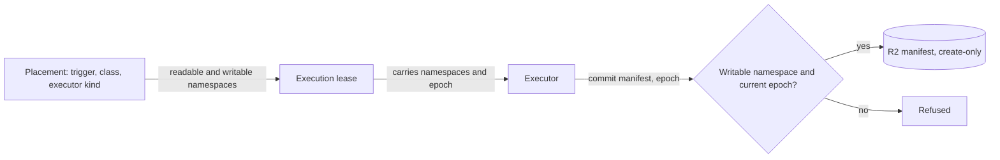

# ADR-0013: Cache trust namespaces and a two-level cache

Status: Accepted · 2026-10-24

## Context

- Cloudflare Containers start with an ephemeral disk and have no R2 binding inside the container, so every cloud execution starts cold unless bytes reach it over the network. Owned devices keep dependencies, compile outputs, browsers and model weights on local NVMe between runs; that warm state removes most of the minutes of a typical gate.
- A cache that trusts any holder of a write credential lets a pull request poison what a protected branch later builds. The CREEP flaw in bucket-backed remote caches (CVE-2025-36852) worked because the CI definition sat outside the cache key. A shared symmetric signature proves only that the writer holds the shared key.
- Executions move between executors: a reclaim restarts a device's `required` execution on a Cloudflare Container (mameko [ADR-0009](https://github.com/fractalboxdev/mameko/blob/3af65c59d5f30123eb55b468966b4975c7395ece/specs/adr/0009-fenced-execution-leases.md)). A late device must not overwrite what the new epoch wrote.
- Mac job sandboxes run `linux/arm64`; Cloudflare Containers run `linux/amd64`.
- Bytes that pass through a Worker or a container SDK file call move at about 1.5–2 MB/s for one archive.

## Decision

- **Two levels, caches only.** L1 is FlareDispatch's device extension on the device's local disk, partitioned by namespace; L2 is R2. A checkout, a workspace and a build-output directory never move between executors; a reclaim restarts from an empty workspace.
- **The control plane assigns namespaces.** Each execution gets readable namespaces and at most one writable namespace at each lease grant, from the profile's `cache_namespaces` binding, carried in its lease. Cache tiers: `protected-cloud`, `protected-device`, `pull-request`, `execution` and `content`. A protected-branch reader reads only protected tiers; a pull-request writer writes only its own pull request's namespace. A `release` execution builds cold. A `required` execution on a cloud executor restores only cloud-written entries.
- **Complete keys.** The key covers platform, image digest, toolchain versions, the producing primitive's digest and the declared-inputs digest, under a schema version.
- **Immutable, fenced, signed entries.** Objects upload first under a path carrying the execution id and epoch; the manifest commits last through the control plane, only at the current epoch, with a create-only write. A device signs its manifests with its device key; the control plane signs cloud writers' manifests. A failed verification reads as a miss.
- **Presigned URLs.** FlareDispatch's object-store presigner mints one URL per object and method, expiring within 15 min or at `deadline_at`, after the `CacheLedger` reserves the bytes. Bytes go between the executor and R2 without passing through the dispatcher Worker; on a Cloudflare Container they stream unbuffered through the Container class's outbound handler, which receives every request the Container makes ([isolation-egress.md](../isolation-egress.md)). Compile-cache objects are the exception: the compile-cache route on the dispatcher streams them between `sccache` and R2 without buffering ([cache-artifacts.md](../cache-artifacts.md)).

**Placement decides the namespaces, so the executor never chooses where it writes**

*Decision · the write rule lives in the control plane, not in the job.*

## Options considered

| Option | Buys | Costs |
| --- | --- | --- |
| **Control-plane namespaces by trust tier, L1 plus L2, fenced manifests** (chosen) | Non-interference between pull-request writers and protected readers (property S6 in [verification.md](../verification.md)); warm devices; a cloud placement reads an R2 cache instead of starting cold | Each tier stores its own copy; a first push to a new pull request hits only protected entries; cloud P1 cannot use device-written entries |
| One shared cache with write tokens per repository | Highest hit rate | Any pull request with a token poisons protected builds; the CREEP class of attack |
| Per-pull-request lanes in R2 only, no device level | Simple, already proven on the compile cache | No warm state on devices; no distinction between device and cloud writers for `required` |
| Device cache only, no R2 level | No R2 storage or presign cost | Every cloud placement and every `release` execution cold; reclaimed `required` runs pay the full cold start |
| Transfer the workspace or build outputs to the next executor | Skips work after a reclaim | Breaks restart-from-zero, moves untrusted bytes into the next executor, and multi-GB transfers through the control plane |

## Criteria

1. A pull-request writer cannot change what a protected-branch reader restores (property S6 in [verification.md](../verification.md)). This criterion ruled out the shared cache.
2. Cloud placement and reclaim latency for `required`: a cloud restart reads L2 instead of starting cold. This ruled out device-only.
3. Bytes never pass through the dispatcher Worker, except compile-cache objects of at most 100 MiB on the compile-cache route, which `sccache`'s WebDAV client reaches directly, and no Worker buffers them.
4. A stale epoch's writes never become visible.
5. Operating cost: R2 storage within the per-repository bound, default 20 GiB.

## Consequences

- Hit rates drop where tiers split: a device-written entry is a miss for a cloud `required` execution, and an entry written by one pull request is invisible to every other.
- R2 storage roughly doubles for repositories that build protected branches on both devices and cloud executors.
- A presigned URL cannot be revoked before it expires, so a reclaimed executor can still upload for up to 15 min; the epoch in the path and the fenced commit keep that upload an orphan, which the sweep deletes after 24 h.
- The `CacheLedger` and the hourly sweep are components to operate.
- `confidential-compute` repositories get L1 only, so their work that moves to another executor has no warm cache at all.

## Revisit triggers

- The measured L2 hit rate for cloud `required` executions stays below 20% over 28 days, which questions the R2 level's cost.
- Devices reach the provenance tier that lets a cloud `required` execution trust a device-written entry ([ADR-0015](0015-provenance-tiers.md)).
- `sccache` gains presigned-URL support, which removes the compile-cache route from the byte path.
