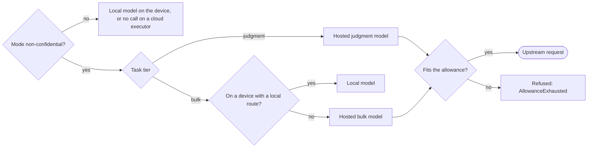

# ADR-0014: Model routing by confidentiality mode, task tier and data location

Status: Superseded by mameko [ADR-0014](https://github.com/fractalboxdev/mameko/blob/88770c64b14818ad32aed9615f1cfaf4bbc1f591/specs/adr/0014-model-routing.md) · 2026-10-24

## Context

Agentic recipes call models for two kinds of work. `bulk` calls classify, extract, summarize, embed and filter; they read large inputs (logs, diffs, traces) and write small outputs. `judgment` calls review, plan and write code; a person reads their output, and their quality decides whether the recipe is worth running.

The constraints:

- **Confidentiality.** Some repositories hold code that must not reach a model provider, and some must not leave owned hardware at all. A repository whose owner has not classified it gives no signal either way.
- **Spend.** Hosted models bill per token wherever the call starts. Budget safety holds only if no execution settles above its hold ([spend.md](../spend.md)), so every hosted call must fit inside the execution's allowance before it starts.
- **Data location.** Since run bodies execute inside the executor ([ADR-0003](0003-run-body-in-executor.md)), a call's input already sits on the executor that runs it. Moving a large input to a model costs upload time and exposure; moving it back from a cloud executor to a device costs more.
- **Local capacity.** An open-weight model on a device serves `bulk` work well, holds few concurrent streams and processes long prompts slowly. Its prompt-processing speed on a typical diff plus log is unmeasured.
- **Credentials.** Executors run untrusted code. Pull-request code on an executor reads any provider key placed there.

## Decision

Every model call goes through the model gateway, which decides its route with one pure function, `routeModelCall`, in this order:

1. **Confidentiality mode.** A repository that is not `non-confidential` (that is, `unclassified`, `confidential-model` or `confidential-compute`) gets local models only, on an owned device, reached through the agent's egress proxy. On a cloud executor its runs make no model call. Classification fails closed: `unclassified` routes as `confidential-model`.
2. **Task tier.** For a `non-confidential` repository, `judgment` calls go to a hosted judgment model.
3. **Data location.** A `bulk` call runs where its execution runs: on a device with a local route it uses the local model; on a cloud executor it uses a hosted bulk model.
4. **Allowance.** The gateway reserves each hosted call's maximum cost against the execution's allowance before the upstream request and refuses a call that does not fit. A refused `bulk` call on a device retries once on the local model; a refused `judgment` call fails the run with `BudgetExhausted`.

Providers are configuration values: each model entry names its provider, route kind, tier and prices. The gateway holds every provider credential; executors carry only a per-lease token bound to the execution's epoch.

*Routing order · confidentiality first, then tier, then data location, then the allowance.*

## Options considered

| Option | What it buys | What it costs |
| --- | --- | --- |
| **Tiered routing by mode, tier and location (chosen)** | Confidential code never reaches a provider; frontier quality where a person reads the output; `bulk` work stays next to its data; every hosted call is bounded by the allowance | Confidential repositories get model-backed recipes only on devices with a local route; `unclassified` repositories get no hosted model until an operator marks them `non-confidential` |
| All calls hosted through the gateway | One route, highest quality, provider-grade availability | Confidential code reaches a provider; every `bulk` call bills per token and uploads its full input |
| All calls local on devices | No per-token bill; no data leaves owned hardware | `judgment` quality falls to open-weight models; a fleet with no local route runs no agentic recipe; long-prompt throughput is unmeasured |
| Each recipe picks its model and provider in its own code | No central policy to maintain | Confidentiality and allowance enforcement depend on every recipe getting them right; when a model-id prefix and a configured backend label disagree, the call takes a route nobody configured |
| Classification fails open: `unclassified` routes as `non-confidential` | Agentic recipes work on a new repository with no setup step | The first call on a confidential repository that nobody classified sends its code to a provider |

## Criteria

1. **Confidentiality holds by construction.** No route sends data of a repository that is not `non-confidential` to a hosted model, under any error or fallback. This criterion decided the order: mode first, and no later branch returns to a hosted model.
2. **Every hosted call fits the hold.** The proof that settled plus reserved spend stays within the budget needs every execution to settle at or below its hold, so allowance enforcement must sit before the upstream request, not after.
3. **Output quality where a person reads it.** `judgment` output is what reviewers act on.
4. **Cost and latency of moving data.** `bulk` inputs are large, so a route that keeps them in place wins.
5. **No provider key on an executor.**

All-hosted lost on criterion 1. All-local lost on criterion 3. Per-recipe routing lost on criteria 1 and 2, because enforcement spread across recipes is enforcement nobody tests once. Fail-open classification lost on criterion 1.

## Consequences

- Confidentiality routing becomes part of the `placementPolicy` kernel, proved in Lean (`Placement.unclassified_not_hosted`) and differentially tested ([verification.md](../verification.md)).
- An operator classifies each repository before hosted models serve it. This is the cost accepted for failing closed: a newly enrolled repository runs no hosted-model recipe until it is marked `non-confidential`.
- A confidential repository's model-backed recipes wait for a device with a local route and conclude `failure` with `capacity: confidential executor unavailable` at `deadline_at`; with no such device in the fleet, they never run. A fork pull request on such a repository has no eligible executor and concludes `failure` with `placement: no eligible executor` at intake.
- The gateway reserves on a byte-count upper bound of input tokens, so allowances close earlier than metered usage alone would close them.
- Adding a provider is a configuration change, not a code change; a provider with a new wire format needs a new route kind.
- [model-gateway.md](../model-gateway.md) and [runs/agentic.md](../runs/agentic.md) specify the requirements that follow.

## Revisit triggers

- Measured prompt-processing speed and review quality of a local model on a reference device match a hosted judgment model on this repository's pull requests; then `judgment` may route locally for `non-confidential` repositories.
- A provider offers inference whose confidentiality a verifier checks by attestation, which would make a hosted route acceptable for `confidential-model`.
- Allowance refusals from the byte-count bound exceed 5% of hosted calls in a month, which argues for a tokenizer-exact bound.
- Enrolled repositories stay `unclassified` for more than 30 days on average, which argues for a classification step at enrollment.
