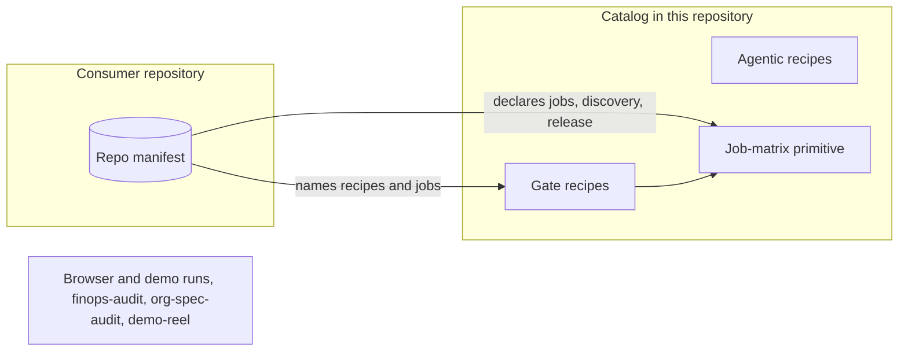

# ADR-0016: Run catalog scope

Status: Accepted · 2026-10-24

## Context

The run tree holds about 30 runs. They fall into five groups:

- generic gates (`check`, `oxlint`, `offload-test`, `worker-deploy`, `deploy-smoke`);
- agentic runs (`pr-review`, `improve-pr`, `spec-drift-pr`, triage and maintenance runs);
- a family of gate, cache-warm, measurement, protocol and release runs written for one consumer repository, with its name and discovery command hard-coded;
- browser and demo runs (`playwright-demo`, `playwright-e2e`, `cdp-acceptance`, `product-demo`, `email-otp-login`, `demo-reel`);
- reporting runs (`finops-audit`, `org-spec-audit`).

Several are unarmed, inert or green on failure: `matrix-fanout` and `vitest-shard` return success on red shards and share one container across shards; `playwright-demo` is green on a non-zero exit; `demo-reel` runs unpinned third-party code with account credentials. Public comments and tests name consumer deployments. The registry is maintained by hand, so an exported run can be missing from it with no signal.

Every run in the tree costs a typed program, tests, a class assignment, placement constraints and a review whenever the run model changes. The product is BYOC: a run that only one consumer can use is maintenance that every deploying organization carries.

## Decision

The catalog holds two families of recipes and one primitive:

- **Gate recipes:** `check`, `oxlint`, `offload-test`, `worker-deploy`, `deploy-smoke` and `sandbox-image` ([runs/gate.md](../runs/gate.md)).
- **Agentic recipes:** `pr-review`, `improve-pr`, `self-heal-pr`, `spec-drift-pr`, `triage-issues`, `triage-prs`, `ci-triage-pr` and `release-notes` ([runs/agentic.md](../runs/agentic.md)).
- **The job-matrix primitive:** a matrix of separately placed jobs with windows, shards, `needs`, discovery, heavy jobs and release gates. It replaces `matrix-fanout` and `vitest-shard`.

Consumer-specific gates, release graphs and browser suites are repo manifests in the consumer's repository that compose these recipes and the job matrix. Browser and demo runs, the single-consumer family, `org-spec-audit`, `finops-audit` and `demo-reel` leave the tree. Canaries and the verdict audit are operations runs inside the control plane ([operability.md](../operability.md)), not catalog recipes. The registry is derived from the catalog module, so a recipe that exists is dispatchable.

*catalog scope · two recipe families and one primitive; consumer specifics live in manifests.*

## Options considered

- **Keep every run in the tree.** No consumer loses a run. It costs a public repository that names consumers, a maintenance load that grows with each consumer, and runs that conclude `success` on failure staying reachable.
- **Gate and agentic recipes plus the job matrix in tree; consumer specifics as manifests.** Chosen. Every recipe in the tree applies to any repository, and a consumer's particulars live where the consumer controls them.
- **Primitives only, no recipes.** Ship capabilities and the job matrix and let each organization write every run. It costs every organization rewriting `check` and `pr-review`, the runs every deploying organization uses first, and leaves the product with nothing that works on install.
- **Keep browser runs as generic recipes.** A `browser-e2e` recipe on Browser Rendering. It costs a cloud-pinned run that holds a browser session per shard, and owned devices advertise no browser slots yet; a manifest-declared matrix on a browser-capable image covers the same suites without a recipe.

## Criteria

1. Every recipe in the tree applies to any repository without a code change.
2. No consumer name, repository or deployment appears in the public tree.
3. Every recipe maps each job outcome to a verdict, with no path from a failed job to `success`.
4. The maintenance cost of the catalog does not grow with the number of consumers.
5. A deploying organization gets working gate and review checks on install.

Criterion 1 removed the single-consumer family; criterion 3 removed `matrix-fanout`, `vitest-shard` and the browser runs in their current form; criterion 5 ruled out shipping primitives only.

## Consequences

- A consumer that used the single-consumer family or a browser run rebuilds it as a repo manifest. A release graph that built darwin cells on Linux now declares them as release-matrix jobs; native macOS cells wait for the `apple-build` placement constraint.
- Cost reporting moves from a model-written pull request to the reservation and usage rows in D1 ([spend.md](../spend.md)) and the dashboard, which already hold container and model cost.
- The `demo-bundle/v1` contract stays for external presenters; nothing in the tree produces a reel.
- A pattern that three or more consumer manifests repeat is a candidate recipe; until it is promoted, each consumer maintains its own copy.
- Removing a run from the tree is reversible only by a new recipe with its own requirements; git keeps the old code but no requirement points at it.

## Revisit triggers

- Owned devices advertise browser slots and two or more deploying organizations declare browser suites in their manifests.
- Three or more consumer manifests declare the same job shape.
- A deploying organization needs cost reporting that the reservation and usage rows and the dashboard cannot answer.
