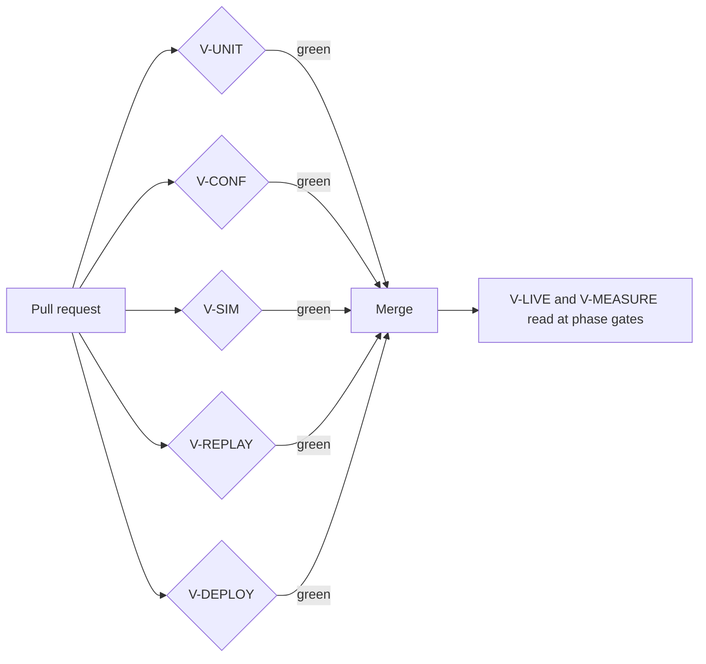

# ADR-0017: Conformance suites, deterministic simulation and a replay harness are merge gates

Status: Superseded in part by mameko [ADR-0015](https://github.com/fractalboxdev/mameko/blob/8530203ba76ba00961e236b1fcea4f34b401bba1/specs/adr/0015-verification-strategy.md) · 2026-10-24

mameko's conformance, simulation and replay suites gate mameko's own changes. The merge gates this repository's CI runs on its own pull requests, and the rule that live canaries and phase-gate metrics gate phases rather than merges, stand ([verification.md](../verification.md)).

## Context

- The current CI runs only on push to the default branch and on dispatch; apart from the docs workflow, nothing runs on a pull request.
- No harness proves that a replay makes zero extra GitHub or D1 calls, so each new feature can reintroduce duplicate effects.
- Tests run against in-memory fakes and mocked HTTP; nothing checks that a fake behaves like the live Layer it replaces. A defect before the terminal write can leave an `executions` row `running` indefinitely, and no test reaches that path.
- The target design adds behaviour that unit tests do not reach: four engine backends, four executor kinds, epoch fencing under sleep and message reorder, a claim-versus-spill race, and reconnect after a control-plane deploy.
- The formal models cover a few pure kernels; each proof counts only when every model assumption it uses has its own conformance or simulation test ([ADR-0018](0018-formal-models.md)).

## Decision

Three suites run on every pull request and block the merge when they fail ([verification.md](../verification.md)):

- **Conformance (`V-CONF`).** One suite per interface runs against every backend of that interface: the engine against DO-SQLite, SQLite, Postgres and memory; the executor contract against the Cloudflare Container and the fake, and nightly against an owned device and each launcher; each store against D1, SQLite and Postgres. A fake is a backend and passes the same suite.
- **Deterministic simulation (`V-SIM`).** The fleet runs under `TestClock` with fault injection: sleep mid-step, executor Durable Object restart during a deploy, a late result after reclaim, the claim-versus-spill race, clock skew and a dropped socket.
- **Replay (`V-REPLAY`).** Every registered workflow runs twice over its cached journal; any extra GitHub call, D1 write, outbox row or intent fails it (mameko's [engine.md](https://github.com/fractalboxdev/mameko/blob/8530203ba76ba00961e236b1fcea4f34b401bba1/specs/engine.md)).

Unit tests, the local end-to-end stack and the deploy dry run also gate merges. Live canaries and phase-gate metrics gate phases, not merges.

*merge gates · every pull request passes all five; live evidence decides phases.*

## Options considered

| Option | Buys | Costs |
| --- | --- | --- |
| Unit tests on fakes only | Fast, no infrastructure | Fakes drift from live Layers; replay and race classes go unseen until production |
| A shared staging deployment as the gate | Real platform behaviour | Each BYOC deploy has its own account, so no shared staging exists; slow and flaky per pull request; spends money per run |
| Model-check or prove everything | Exhaustive for what is modelled | Cost far above return outside small kernels; models drift from code without a link |
| **Conformance, simulation and replay as merge gates** | Catch backend drift, lease and epoch errors and replay duplication before merge, with no network | The fakes, the simulator and the recorded journals are code to maintain; CI minutes per pull request |

## Criteria

1. The gate catches the replay, container-loss and verdict-trust classes before merge. This criterion decided against unit tests alone.
2. The gate runs with no network and no cloud account. This criterion decided against a staging deployment.
3. The p50 wall time of the full pull-request gate stays under 15 min.

## Consequences

- The cost accepted is maintaining a fake for every interface as a conformance target, the simulator with its fault catalog, and one recorded journal per workflow version.
- A simulation finds only the faults it injects; a production incident of a new class adds a fault to the catalog.
- Every new backend, executor kind or store joins its conformance suite before any code path selects it.

## Revisit triggers

- A production incident whose class no gate covers.
- The p50 wall time of the pull-request gate exceeds 15 min for two consecutive weeks.
