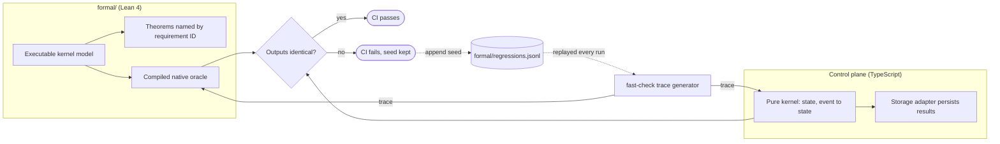

# ADR-0018: Formal models for the spend, placement, outbox, staged-write and fencing kernels

Status: Superseded in part by mameko [ADR-0016](https://github.com/fractalboxdev/mameko/blob/3af65c59d5f30123eb55b468966b4975c7395ece/specs/adr/0016-formal-models.md) · 2026-10-24

mameko's ADR-0016 covers the Lean 4 models of the spend, fencing, placement and outbox kernels, their differential testing, the tested assumptions, the axiom gate and Veil for the lease protocols: decisions 1 to 5 and 7 here. Decision 6, Tamarin for the provenance protocol, stands, and so does decision 1's Lean model of the staged-write allowlist, which mameko does not model.

## Context

- A few decisions in the control plane are small, pure and high-stakes: whether an admission fits its class line (`spendKernel`), which executor kinds a request may use (`placementPolicy`), whether an intent applies once (`outboxKernel`), whether a model-authored change touches a protected path (the staged-write allowlist), and whether a result carries the current epoch (`fenceKernel`). A wrong answer in any of them overspends, runs fork code on an owned device, repeats a GitHub write or accepts a stale result.
- Tests sample these decisions; they do not cover every trace or every combination of constraints. The placement constraints in particular conflict: a fork PR to a `confidential-compute` repository has no eligible executor, a case `Placement.placeable_iff` characterizes exactly.
- No mature verifier for TypeScript exists, so a proof cannot target the shipped code directly.
- Budget safety holds only under runtime assumptions (atomic admission, deadline enforcement, allowance enforcement) that no model can enforce on its own.
- The lease protocol is a concurrent transition system over unreliable messages, and provenance is a cryptographic protocol against a network attacker; both differ in kind from integer invariants.

## Decision

1. **Lean 4 models of the pure kernels.** `formal/` at the repository root is a Lean 4 project with no Mathlib and an exactly pinned `lean-toolchain`. It holds executable models of `spendKernel` and `placementPolicy`, the outbox and the staged-write allowlist in phase 0, and `fenceKernel` after them. Each theorem is named by the requirement ID it covers.
2. **Differential testing links model and code.** Each kernel is a pure TypeScript function `(state, event) → state` in integer micro-USD with the Lean model's event alphabet and no Effect services. The Lean model compiles to a native oracle; `fast-check` generates traces, and CI requires identical output from the TypeScript kernel and the oracle: 10,000 traces per pull request and 1,000,000 nightly. Every failing seed is appended to `formal/regressions.jsonl` and replayed on every run.
3. **Assumptions are tested, not assumed.** A `V-PROOF` counts only when each model assumption it uses has its own `V-CONF` or `V-SIM` test: atomic admission, enforcement of `deadline_at`, enforcement of the model allowance.
4. **CI gate.** `lake build` fails on `sorry`, on `native_decide`, and on any axiom beyond `propext`, `Classical.choice` and `Quot.sound` in `#print axioms`.
5. **Veil for the lease protocol.** The execution-lease and capacity-lease protocols are model-checked in Veil before any interactive proof of them.
6. **Tamarin for provenance.** The provenance protocol is analysed in Tamarin, with `tamarin-prover --prove` in CI on a pinned prover; expected attacks are stated as `exists-trace` lemmas, and every acceptance check a lemma depends on has a negative `V-CONF` test.
7. Properties that are an exhaustive mapping over a closed union, such as "no capacity outcome concludes `neutral`", are covered by an exhaustive match and a unit test, not a proof.

*Model and code: the proof covers the model, and the generated traces hold the TypeScript kernel to the model.*

## Options considered

| Option | What it buys | What it costs |
| --- | --- | --- |
| Model-only proofs | Catches design errors such as the placement conflict | The model drifts from the code unnoticed |
| **Lean oracle plus differential random testing** | A model change and a code change must agree on every generated trace | Three artefacts per kernel change: model, proofs and TypeScript |
| Lean compiled to WASM and run inside the Worker | One implementation, no drift | Immature toolchain; a second runtime in the control plane |
| Verifying the TypeScript directly | Proof about shipped code | No mature verifier exists |
| ProVerif for provenance | Fully automatic and fast when the model fits | Single-use nonces, epoch counters and revocation produce false attacks or need encodings; the state-dependent lemmas are the ones most likely to find a flaw |
| Interactive proofs of the full lease protocol | Strongest guarantee | Cost far above return before model checking has found the cheap errors |

## Criteria

1. The guarantee reaches the code that runs, not only a model of it (decided differential testing over model-only proofs).
2. No second runtime in the control plane (decided against Lean in WASM).
3. Each tool fits its property class: integer invariants and finite policies in Lean, concurrent protocols in a model checker, cryptographic protocols in a protocol prover (decided Tamarin over ProVerif).
4. Proofs are checkable by the Lean kernel, so the gate trusts the checker, not the author.
5. The verified kernels stay few and small.

## Consequences

- A change to a verified kernel changes the Lean model, its proofs and the TypeScript kernel together; reviewers of those files read Lean.
- Kernels stay pure functions with no Effect services, and their storage adapters only persist results; logic that reads services lives outside the kernel.
- Toolchain churn breaks builds on upgrade, so `lean-toolchain` and the Tamarin prover are pinned exactly, as Effect is.
- A proof covers the model under its assumptions. Meter calibration against the bill, Cloudflare platform behaviour, HMAC, ES256 and TLS stay outside it and are covered by conformance tests.
- CI gains `lake build`, the axiom gate, the trace comparison and, from phase 4, the Tamarin run.

## Revisit triggers

- A TypeScript verifier reaches production use on code of this shape.
- Lean-to-WASM compilation becomes a supported, maintained target.
- The nightly trace run finds a model-code divergence that the per-PR run missed more than once in a quarter.
- A verified kernel grows past the point where its proofs take longer to maintain than the tests they replace.
