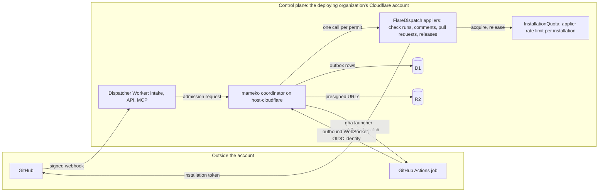

# Architecture

FlareDispatch is a CI application on mameko. It composes mameko's coordinator with the `host-cloudflare` runtime adapter, its CI profile ([profile.md](profile.md)) and its GitHub appliers, and deploys the result into the deploying organization's own Cloudflare account. This file specifies FlareDispatch's Cloudflare deployment, the triggers it accepts, the GitHub credentials it holds and where each of them may travel, and FlareDispatch's values on mameko's architecture.

## Scope

mameko's [architecture.md](https://github.com/fractalboxdev/mameko/blob/88770c64b14818ad32aed9615f1cfaf4bbc1f591/specs/architecture.md) specifies the coordinator, the runtime adapter model, the trust zones, the `Execution` workflow and its stages, the `executions` record and the state split; FlareDispatch inherits them unchanged. This file adds what FlareDispatch decides as an application:

- the Workers, Durable Object classes and storage it deploys;
- the trigger kinds its dispatcher Worker accepts ([intake.md](intake.md));
- which GitHub credential each component holds, and the route every GitHub write takes ([github-output.md](github-output.md));
- the byte routes outside presigned URLs ([cache-artifacts.md](cache-artifacts.md)).

[ADR-0001](adr/0001-local-first-control-plane.md) records why FlareDispatch is a Cloudflare-hosted application on mameko; mameko's [ADR-0003](https://github.com/fractalboxdev/mameko/blob/88770c64b14818ad32aed9615f1cfaf4bbc1f591/specs/adr/0003-two-level-scheduling-owned-devices-first.md), [ADR-0005](https://github.com/fractalboxdev/mameko/blob/88770c64b14818ad32aed9615f1cfaf4bbc1f591/specs/adr/0005-run-body-in-executor.md) and [ADR-0006](https://github.com/fractalboxdev/mameko/blob/88770c64b14818ad32aed9615f1cfaf4bbc1f591/specs/adr/0006-journal-and-cross-execution-store.md) record two-level scheduling, run bodies in the executor and the journal split.

Not specified: a deploy on `host-node`. FlareDispatch composes `host-cloudflare` only.

## Model

### Components

| Component | Zone | Runs | Holds |
| --- | --- | --- | --- |
| Dispatcher Worker | Control plane | Intake for every trigger, the HTTP API, the MCP server, the dashboard, the model gateway route, the compile-cache route and the coordinator | The GitHub App private key, model provider keys, the provenance key, the `gha` launcher credential |
| Documentation Worker | Control plane | The documentation site on its own hostname | Nothing |
| `ExecutionEngine` Durable Object | Control plane | One `Execution` workflow on the DO-SQLite engine backend, keyed by execution id ([MAMEKO-HOST-049](https://github.com/fractalboxdev/mameko/blob/88770c64b14818ad32aed9615f1cfaf4bbc1f591/specs/hosts.md)) | That execution's journal |
| `ExecutorChannel` Durable Object | Control plane | One executor's outbound WebSocket: claims, heartbeats, progress, staged intents and results | That executor's connection state and the intents staged for its current epoch |
| `EpochAnchor`, `PoolController`, `LivenessMonitor` Durable Objects | Control plane | The epoch anchor, one Container pool each, and the liveness monitor of [operability.md](operability.md) | The epoch floor, the pool's instances, the last recorded tick |
| `InstallationQuota` Durable Object | Control plane | FlareDispatch's applier rate limit, one instance per GitHub App installation ([github-output.md](github-output.md) § Installation quota) | The installation's budget ledger and outstanding permits |
| `CacheLedger` Durable Object | Control plane | Byte reservations before every cache and artifact upload of one repository ([cache-artifacts.md](cache-artifacts.md)) | The per-object, per-execution and per-repository byte counts |
| `TransparencyLog` Durable Object | Control plane | From phase 4, the only writer of the private transparency log ([provenance.md](provenance.md) FD-PROV-074) | The leaf index |
| Container classes | Control plane | One Cloudflare Container class per pool of the `cloudflare` executor kind, with its outbound handler | That pool's container instances |
| D1 | Control plane | — | The `host-cloudflare` store: executor registry, placements, admission, reservations, dedup keys, `executions`, outbox |
| KV | Control plane | — | The profile document and runtime configuration |
| R2 | Control plane | — | L2 cache, artifacts, logs, staged-write blobs |
| `gha` launcher | Control plane | FlareDispatch's launcher port for the `gha` kind: starts, cancels and verifies a GitHub Actions job that runs one runner ([executors.md](executors.md)) | Nothing beyond the launcher credential the dispatcher Worker holds |
| Device executor, key helper, local scheduler, runner, job sandbox | Device and executor | As mameko's [§ Components](https://github.com/fractalboxdev/mameko/blob/88770c64b14818ad32aed9615f1cfaf4bbc1f591/specs/architecture.md#components) specifies, from mameko's device bundle | Per-lease credentials only, as mameko specifies |

The executor kinds are `cloudflare`, `device`, `aws` and `gha`; `gha` is the launcher kind FlareDispatch registers ([profile.md](profile.md)).

### Around the coordinator

**FlareDispatch supplies the trigger surface and the GitHub appliers; mameko's coordinator sits between them**

*FlareDispatch around mameko · every GitHub write leaves through an applier under the installation's permit; no executor holds a GitHub write credential.*

| Crossing | Control | Specified in |
| --- | --- | --- |
| GitHub → dispatcher Worker | Signature over the raw body before any parse | [intake.md](intake.md) |
| Outbox row → GitHub | FlareDispatch's applier, under one `InstallationQuota` permit per call | [github-output.md](github-output.md) |
| Staged write → GitHub | The staged-write gate in the `pr.propose` applier | [runs/agentic.md](runs/agentic.md) |
| `gha` runner → control plane | The launcher port's `verify` of the job's OIDC token | [executors.md](executors.md) |
| Every other crossing | As mameko's [§ Trust zones](https://github.com/fractalboxdev/mameko/blob/88770c64b14818ad32aed9615f1cfaf4bbc1f591/specs/architecture.md#trust-zones) specifies | mameko |

### Byte routes

| Bytes | Route |
| --- | --- |
| Cache entries, artifacts, logs, staged-write blobs | R2 presigned URLs from FlareDispatch's object-store presigner ([MAMEKO-HOST-048](https://github.com/fractalboxdev/mameko/blob/88770c64b14818ad32aed9615f1cfaf4bbc1f591/specs/hosts.md), [cache-artifacts.md](cache-artifacts.md)) |
| Compile-cache objects of at most 100 MiB | The dispatcher Worker's compile-cache route, streamed without buffering ([cache-artifacts.md](cache-artifacts.md) FD-CACHE-047) |
| Every byte on executor kind `cloudflare` | The Container class's outbound handler, streamed without buffering ([MAMEKO-ARCH-016](https://github.com/fractalboxdev/mameko/blob/88770c64b14818ad32aed9615f1cfaf4bbc1f591/specs/architecture.md)) |

### Composition

The dispatcher Worker builds the coordinator's context from two sources. `cloudflareRuntimeLayer`, the one runtime Layer of `host-cloudflare`, supplies every store and the epoch anchor over the D1 binding and the `EpochAnchor` stub; the journal and the executor channel are the Durable Object classes of § Components. FlareDispatch supplies one Layer for each application port mameko's [hosts.md § Application ports](https://github.com/fractalboxdev/mameko/blob/88770c64b14818ad32aed9615f1cfaf4bbc1f591/specs/hosts.md#application-ports) requires of it:

| Port | FlareDispatch's Layer | Required from | Specified in |
| --- | --- | --- | --- |
| Effect applier | One `EffectApplier` Layer whose `apply`, `lookup` and `reconcile` select by `row.kind` the handler the profile's `applier` field names | Phase 0 | [github-output.md](github-output.md) |
| Gate decision source | Answers no decision, because no kind is `gated` | Phase 0 | FD-ARCH-040 |
| Configuration source | `configurationSourceLayer(deployment)`; `ConfigurationSourceLive` for `production` | Phase 0 | [profile.md](profile.md) FD-PROF-001 |
| Alarm port | The dashboard and the alert sink | Phase 0 | [operability.md](operability.md) FD-OPS-053 |
| Applier rate limit | `InstallationQuota` | Phase 0 | [github-output.md](github-output.md) § Installation quota |
| Object-store presigner | R2 presigned URLs | Phase 0 | [cache-artifacts.md](cache-artifacts.md) |
| Credential minter | Read-only per-lease installation tokens | Phase 0 | [github-output.md](github-output.md) FD-GH-002 |
| Posture source | Open; see § Open items | Phase 1 | — |
| Attestation verifier | Managed Device Attestation; a `development` deployment supplies none | Phase 1 | [provenance.md](provenance.md) FD-PROV-028 |
| Local registration port, reuse policy, writeback gate | Rehearsal registration, rehearsal reuse, local writeback | Phase 1 and phase 2 | [local-scheduler.md](local-scheduler.md) |
| Launcher, kind `gha` | The GitHub Actions launcher | Phase 4 | [executors.md](executors.md) |
| Result-acceptance check | The acceptance table | Phase 4 | [provenance.md](provenance.md) § Acceptance |

## Requirements

### Components

- **FD-ARCH-001** · phase 0 · `V-DEPLOY` — The control plane must consist of the dispatcher Worker, the documentation Worker, the `host-cloudflare` Durable Object classes `ExecutionEngine`, `ExecutorChannel`, `EpochAnchor`, `PoolController` and `LivenessMonitor` re-exported under those names ([MAMEKO-HOST-049](https://github.com/fractalboxdev/mameko/blob/88770c64b14818ad32aed9615f1cfaf4bbc1f591/specs/hosts.md), [MAMEKO-HOST-050](https://github.com/fractalboxdev/mameko/blob/88770c64b14818ad32aed9615f1cfaf4bbc1f591/specs/hosts.md)), the Durable Object classes `InstallationQuota` and `CacheLedger`, from phase 4 the `TransparencyLog` class, one Container class per cloud pool, one D1 database, the KV namespaces and the R2 buckets, deployed into the deploying organization's Cloudflare account by `wrangler deploy`.
- **FD-ARCH-002** · phase 0 · `V-UNIT` `V-E2E-LOCAL` — When a trigger arrives from a webhook, an Actions dispatch, a cron tick, a local submit or an MCP call, the dispatcher Worker must be the component that accepts it.
- **FD-ARCH-003** · phase 0 · `V-UNIT` `V-E2E-LOCAL` — Every GitHub write made with an installation token, the `canary.push` ops intent of [operability.md](operability.md) FD-OPS-038 included, must be an applier call under a permit from the `InstallationQuota` object of that installation, and the only GitHub write made with the App JWT must be the `delivery.redeliver` ops intent of FD-OPS-045.

### Credentials

- **FD-ARCH-004** · phase 0 · `V-UNIT` `V-E2E-LOCAL` — An executor must not hold a credential with write access to GitHub; every installation token an executor holds is the read-only per-lease token of [github-output.md](github-output.md) FD-GH-002 ([MAMEKO-ARCH-010](https://github.com/fractalboxdev/mameko/blob/88770c64b14818ad32aed9615f1cfaf4bbc1f591/specs/architecture.md)).
- **FD-ARCH-005** · phase 0 · `V-UNIT` — The control plane must not send the GitHub App private key, a model provider key, the `gha` launcher credential or the provenance key to any executor, and no executor wire message schema may carry one ([MAMEKO-ARCH-011](https://github.com/fractalboxdev/mameko/blob/88770c64b14818ad32aed9615f1cfaf4bbc1f591/specs/architecture.md), [MAMEKO-ARCH-012](https://github.com/fractalboxdev/mameko/blob/88770c64b14818ad32aed9615f1cfaf4bbc1f591/specs/architecture.md)).
- **FD-ARCH-007** · phase 0 · `V-E2E-LOCAL` — The dispatcher Worker must carry no cache, artifact or log bytes except compile-cache objects of at most 100 MiB, which the compile-cache route streams without buffering ([cache-artifacts.md](cache-artifacts.md) FD-CACHE-047); every other transfer uses presigned R2 URLs ([MAMEKO-ARCH-014](https://github.com/fractalboxdev/mameko/blob/88770c64b14818ad32aed9615f1cfaf4bbc1f591/specs/architecture.md), [MAMEKO-ARCH-015](https://github.com/fractalboxdev/mameko/blob/88770c64b14818ad32aed9615f1cfaf4bbc1f591/specs/architecture.md)).

### FlareDispatch values on mameko's architecture

- **FD-ARCH-015** · phase 3 · `V-E2E-LOCAL` — Where the executor kind is `gha`, FlareDispatch's launcher must start a runner that connects to an executor channel and holds one execution lease ([MAMEKO-ARCH-028](https://github.com/fractalboxdev/mameko/blob/88770c64b14818ad32aed9615f1cfaf4bbc1f591/specs/architecture.md), [MAMEKO-ARCH-029](https://github.com/fractalboxdev/mameko/blob/88770c64b14818ad32aed9615f1cfaf4bbc1f591/specs/architecture.md), [MAMEKO-HOST-044](https://github.com/fractalboxdev/mameko/blob/88770c64b14818ad32aed9615f1cfaf4bbc1f591/specs/hosts.md)).
- **FD-ARCH-018** · phase 1 · `V-UNIT` `V-E2E-LOCAL` — Work in a capacity lease must open, update or conclude no check run ([MAMEKO-ARCH-033](https://github.com/fractalboxdev/mameko/blob/88770c64b14818ad32aed9615f1cfaf4bbc1f591/specs/architecture.md), [MAMEKO-ARCH-034](https://github.com/fractalboxdev/mameko/blob/88770c64b14818ad32aed9615f1cfaf4bbc1f591/specs/architecture.md)).
- **FD-ARCH-019** · phase 0 · `V-UNIT` `V-CONF` — The coordinator must run every `Execution` workflow on the DO-SQLite engine backend in `ExecutionEngine`, and must start one at admission for every `release`, `required` and `interactive` execution, the classes whose deadline outcome is not `deferred` ([MAMEKO-ARCH-035](https://github.com/fractalboxdev/mameko/blob/88770c64b14818ad32aed9615f1cfaf4bbc1f591/specs/architecture.md), [MAMEKO-ENG-026](https://github.com/fractalboxdev/mameko/blob/88770c64b14818ad32aed9615f1cfaf4bbc1f591/specs/engine.md)).

### Composition

- **FD-ARCH-039** · phase 0 · `V-DEPLOY` `V-CONF` — The dispatcher Worker must run the coordinator on `cloudflareRuntimeLayer` and one Layer for each application port of § Composition that the current phase requires ([MAMEKO-HOST-002](https://github.com/fractalboxdev/mameko/blob/88770c64b14818ad32aed9615f1cfaf4bbc1f591/specs/hosts.md), [MAMEKO-HOST-043](https://github.com/fractalboxdev/mameko/blob/88770c64b14818ad32aed9615f1cfaf4bbc1f591/specs/hosts.md)).
- **FD-ARCH-040** · phase 0 · `V-UNIT` — FlareDispatch's gate decision source must answer no decision for every row, because the profile declares no `gated` kind ([profile.md](profile.md) FD-PROF-048).

## Open items

- TODO(operator): name what FlareDispatch's posture source reads to answer `attested-dedicated`, `managed-workstation`, `unmanaged` or `failing` before phase 1. mameko requires the port wherever a plane registers `device` executors, `registerDevice` calls it, and the `reproduction` constraint reads its tier.
