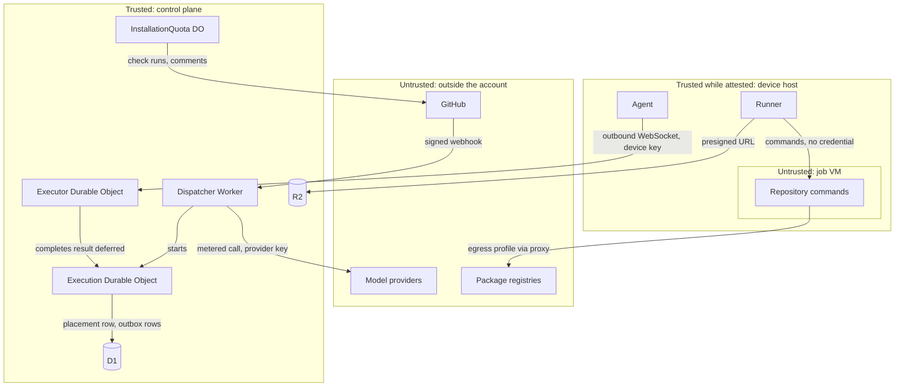
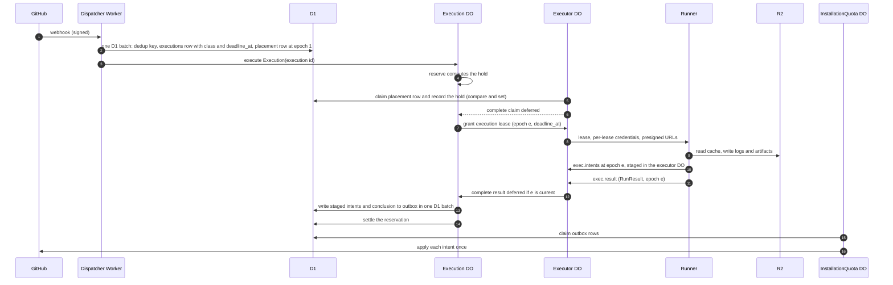
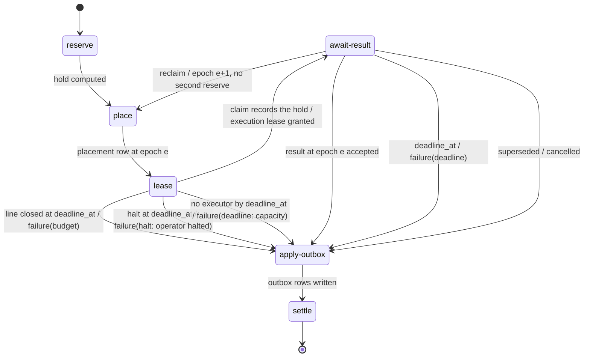

# Architecture

FlareDispatch splits into a control plane that the deploying organization runs in its own Cloudflare account and a fleet of executors that run the work. The control plane receives every trigger, classifies, meters and places each execution, grants execution leases and applies every side effect; an executor runs the whole run program and returns one verdict with its intents. This file specifies the components, the trust zones between them, the `Execution` workflow that carries one execution from trigger to settle, and what runs where.

## Scope

This file covers the component set, the trust zones and the controls on each crossing, the data flow of one execution, the `Execution` workflow stages, the `executions` record and the split between per-execution and cross-execution state. Each component's behaviour lives in its own file:

- the run program, its verdict and its intents: [run-model.md](run-model.md);
- the engine that journals both the `Execution` workflow and the run program: [engine.md](engine.md);
- triggers and dedup: [intake.md](intake.md); classes, deadlines and constraints: [qos-admission.md](qos-admission.md); holds and settle: [spend.md](spend.md);
- placement rows, epochs and reclaim: [placement-leases.md](placement-leases.md); the wire messages: [executor-protocol.md](executor-protocol.md); each executor kind: [executors.md](executors.md); sandboxes and credentials: [isolation-egress.md](isolation-egress.md);
- R2, presigned URLs and the `CacheLedger` object: [cache-artifacts.md](cache-artifacts.md); the outbox and the `InstallationQuota` object: [github-output.md](github-output.md); model calls: [model-gateway.md](model-gateway.md);
- the device's own scheduler: [local-scheduler.md](local-scheduler.md); deploy and overlay: [operability.md](operability.md).

The decisions behind this shape are [ADR-0001](adr/0001-local-first-control-plane.md) (local-first execution under a Cloudflare control plane), [ADR-0003](adr/0003-run-body-in-executor.md) (run bodies execute in the executor) and [ADR-0004](adr/0004-engine-state-split.md) (journal in Durable Object SQLite, cross-execution state in D1).

Not specified: a deploy-time switch between two execution paths. One execution path exists, through the executor contract.

## Model

### Components

| Component | Zone | Runs | Holds |
| --- | --- | --- | --- |
| Dispatcher Worker | Control plane | Intake for every trigger, the HTTP API, the MCP server, the dashboard and the model gateway route | The GitHub App private key, model provider keys, the provenance key, cloud launcher credentials |
| Documentation Worker | Control plane | The documentation site on its own hostname | Nothing |
| Execution Durable Object | Control plane | One `Execution` workflow on the DO-SQLite engine, keyed by execution id | That execution's journal |
| Executor Durable Object | Control plane | One executor's outbound WebSocket, accepted through the WebSocket Hibernation API; claims, heartbeats, progress and results | That executor's connection state and the intents staged for its current epoch |
| `InstallationQuota` Durable Object | Control plane | The outbox drain for one GitHub App installation, under that installation's rate-limit quota | The installation token, the quota ledger |
| `CacheLedger` Durable Object | Control plane | Byte reservations before every cache and artifact upload of one repository | The per-object, per-execution and per-repository byte counts |
| `LivenessMonitor` Durable Object | Control plane | The alarm that checks the minute tick ([operability.md](operability.md) FD-OPS-037) | The last recorded tick time |
| `TransparencyLog` Durable Object | Control plane | From phase 4, the only writer of the private transparency log ([provenance.md](provenance.md) FD-PROV-074) | The leaf index |
| Container Durable Object | Control plane | One Cloudflare Container class per cloud pool, and its outbound handler | That pool's container instances |
| D1 | Control plane | — | Executor registry, placements, admission, reservations, dedup keys, `executions`, outbox |
| KV | Control plane | — | Runtime configuration |
| R2 | Control plane | — | L2 cache, artifacts, logs |
| Launcher | Control plane | Starts a runner for one execution lease on AWS or GitHub Actions | Nothing beyond the launcher credentials in the dispatcher Worker |
| Agent | Device host | `flare-dispatchd`: the control-plane connection, the slot ledger, job VM launch, device signing | The device key, execution-lease tokens |
| Local scheduler | Device host | Unguaranteed work inside a capacity lease | A capacity-lease credential |
| Runner | Executor | The run program on the SQLite engine | The per-lease credentials of its execution, the local journal |
| Job sandbox | Executor | Repository commands: a VM per job on a device, the container on Cloudflare, the task on AWS, the job on GitHub Actions | Nothing beyond the per-lease credentials of its execution |

The executor kinds are `cloudflare`, `device`, `aws` and `gha`. A Cloudflare Container pool is an executor in the registry like a device, whose capacity is its pool's admission cap, strictly below its `max_instances` ([qos-admission.md](qos-admission.md) FD-QOS-040).

### Trust zones

The control plane is trusted. A device host is trusted while its boot state attests clean. Everything that runs repository code, and everything outside the deploying organization's account, is untrusted. No credential that can change GitHub or spend money crosses into an untrusted zone.

*trust zones · every crossing into the control plane carries a signature, a device key or a per-lease credential.* On the `cloudflare`, `aws` and `gha` kinds the runner shares the job sandbox with repository commands, so the whole sandbox is the untrusted zone and holds only per-lease credentials.

| Crossing | Control | Specified in |
| --- | --- | --- |
| GitHub → dispatcher Worker | Signature over the raw body before any parse | [intake.md](intake.md) |
| Agent → executor Durable Object | Outbound connection, device key, versioned protocol | [executor-protocol.md](executor-protocol.md) |
| Runner → control plane | Per-lease credential bound to execution id and epoch | [isolation-egress.md](isolation-egress.md) |
| Result → `Execution` workflow | Epoch check against the placement row | [placement-leases.md](placement-leases.md) |
| Intent → GitHub | Outbox, staged-write gate, installation quota | [github-output.md](github-output.md), [runs/agentic.md](runs/agentic.md) |
| Job sandbox → network | Egress profile through the proxy | [isolation-egress.md](isolation-egress.md) |
| Control plane → model provider | Confidentiality mode, task tier, allowance | [model-gateway.md](model-gateway.md) |

### Data flow of one execution

*data flow · the dispatcher Worker carries no artifact or log bytes and no cache bytes outside the compile-cache route; only the `InstallationQuota` object writes to GitHub.*

### The `Execution` workflow

Intake resolves the class, the placement constraints and `deadline_at`, and writes the first placement row in its D1 batch ([intake.md](intake.md) FD-INT-002, [qos-admission.md](qos-admission.md)). The control plane then runs one `Execution` workflow per admitted P0, P1 or P2 execution; a P3 execution starts its `Execution` workflow when a device claims it or its `stale_at` passes ([intake.md](intake.md) FD-INT-007). An unplaceable request never starts an `Execution` workflow ([intake.md](intake.md) FD-INT-013). The stages are journaled steps. Their waits are `DurableDeferred` values completed by the executor Durable Object, and `DurableClock.sleep` waits whose duration until `cloud_eligible_at` or `deadline_at` comes from a clock read journaled in an activity ([engine.md](engine.md) FD-ENG-050).

| Stage | Does | Owner file |
| --- | --- | --- |
| `reserve` | Computes the hold ([spend.md](spend.md) FD-SPD-014) | [spend.md](spend.md) |
| `place` | At epoch 1 writes nothing, because intake wrote the placement row; after a reclaim, rewrites the placement row for epoch e+1, and the next claim replaces the reservation ([spend.md](spend.md) FD-SPD-043) | [placement-leases.md](placement-leases.md) |
| `lease` | Waits for a device claim or the claim batch, each of which reserves the hold in the statement that assigns the placement epoch ([qos-admission.md](qos-admission.md) FD-QOS-038, [spend.md](spend.md) FD-SPD-016), and grants the execution lease | [placement-leases.md](placement-leases.md) |
| `await-result` | Waits for the current epoch's result, a reclaim or `deadline_at` | [executor-protocol.md](executor-protocol.md) |
| `apply-outbox` | Writes the accepted intents and the conclusion intent to the outbox | [github-output.md](github-output.md) |
| `settle` | Replaces the reservation with the metered cost, or releases it | [spend.md](spend.md) |

*Execution workflow · every path passes through `apply-outbox` and `settle`; a reclaim returns to `place` without running `reserve`, and the next claim replaces the reservation.*

### What runs where

| Work | Control plane | Executor |
| --- | --- | --- |
| Trigger receipt, signature check, dedup | Dispatcher Worker | — |
| Class, constraints, `deadline_at`, first placement row | Intake, D1 | — |
| Hold, claim, execution lease, reclaim | `Execution` workflow, D1 | — |
| The run program and its steps | — | Runner, on the SQLite engine |
| Repository commands | — | Job sandbox |
| Cache, artifact and log bytes | Issues presigned URLs; on `cloudflare`, the Container's outbound handler streams them; the compile-cache route streams compile-cache objects | Reads and writes R2 through presigned URLs, and compile-cache objects through the compile-cache route |
| Check runs, comments, PRs, releases | Outbox, `InstallationQuota` object | Emits intents only |
| Model calls | Gateway route: meters, enforces allowance, holds keys | Calls the gateway with its per-lease credential |
| Unguaranteed local work | Grants the capacity lease | Local scheduler |

## Requirements

### Components

- **FD-ARCH-001** · phase 0 · `V-DEPLOY` — The control plane must consist of the dispatcher Worker, the documentation Worker, the Durable Object classes `Execution`, `Executor`, `InstallationQuota`, `CacheLedger` and `LivenessMonitor`, from phase 4 the `TransparencyLog` class, one Container class per cloud pool, one D1 database, the KV namespaces and the R2 buckets, deployed into the deploying organization's Cloudflare account by `wrangler deploy`.
- **FD-ARCH-002** · phase 0 · `V-UNIT` `V-E2E-LOCAL` — When a trigger arrives from a webhook, an Actions dispatch, a cron tick, a local submit or an MCP call, the dispatcher Worker must be the component that accepts it.
- **FD-ARCH-003** · phase 0 · `V-UNIT` `V-E2E-LOCAL` — Every GitHub write made with an installation token, the canary push of [operability.md](operability.md) FD-OPS-038 included, must go through the `InstallationQuota` object of that installation, and the only GitHub write made with the App JWT must be the webhook redelivery request of FD-OPS-045.
- **FD-ARCH-004** · phase 0 · `V-UNIT` `V-E2E-LOCAL` — An executor must not hold a credential with write access to GitHub.
- **FD-ARCH-005** · phase 0 · `V-UNIT` — The control plane must not send the GitHub App private key, a model provider key, a cloud launcher credential or the provenance key to any executor; every executor wire message schema must have no field that carries one.
- **FD-ARCH-006** · phase 0 · `V-UNIT` — Every message, row and payload that crosses a boundary in the components table must be defined by one `Schema` in a shared package that both sides import.
- **FD-ARCH-007** · phase 0 · `V-E2E-LOCAL` — When an executor reads or writes cache entries, artifacts or logs, it must transfer the bytes to and from R2 through presigned URLs that the control plane issues, and the bytes must not pass through the dispatcher Worker, except compile-cache objects of at most 100 MiB, which the compile-cache route streams without buffering ([cache-artifacts.md](cache-artifacts.md) FD-CACHE-047); on executor kind `cloudflare` they pass through the Container class's outbound handler, which streams them without buffering ([isolation-egress.md](isolation-egress.md)).

### Executors and devices

- **FD-ARCH-008** · phase 1 · `V-E2E-LOCAL` — An executor must reach the control plane only over a connection that the executor opens.
- **FD-ARCH-009** · phase 1 · `V-E2E-LOCAL` — The agent must not listen on any network port.
- **FD-ARCH-010** · phase 1 · `V-UNIT` `V-E2E-LOCAL` — The control plane must not join a tailnet, and execution-lease and capacity-lease messages must travel only over the agent's connection to its executor Durable Object.
- **FD-ARCH-011** · phase 0 · `V-CONF` `V-E2E-LOCAL` — An executor must run the whole run program in its runner, against a local SQLite journal, and must return one `RunResult` with its intents for each epoch it holds.
- **FD-ARCH-012** · phase 1 · `V-E2E-LOCAL` — Where the executor kind is `device`, the runner must run outside the job VM under the agent's user, and every repository command must run inside the job VM.
- **FD-ARCH-013** · phase 0 · `V-UNIT` `V-E2E-LOCAL` — A job sandbox must hold no credential other than the per-lease credentials minted for its execution.
- **FD-ARCH-014** · phase 1 · `V-SIM` — The control plane must not depend on any file on an executor after that executor's execution lease ends.
- **FD-ARCH-015** · phase 3 · `V-E2E-LOCAL` — Where the executor kind is `aws` or `gha`, the launcher must start a runner that connects to an executor Durable Object and holds one execution lease, so the control plane treats it with the same protocol as a device.

### Two-level scheduling

- **FD-ARCH-016** · phase 1 · `V-SIM` — The control plane must schedule every P0–P3 execution it admits, including every P3 execution that a device runs.
- **FD-ARCH-017** · phase 1 · `V-SIM` — A device must run a control-plane execution only under an execution lease that the control plane granted.
- **FD-ARCH-018** · phase 1 · `V-UNIT` `V-E2E-LOCAL` — A local scheduler must run only work submitted to it, inside a capacity lease, and must not post or conclude a check run.

### The `Execution` workflow

- **FD-ARCH-019** · phase 0 · `V-UNIT` `V-CONF` — When intake admits a P0, P1 or P2 execution, the control plane must run one `Execution` workflow for it on the DO-SQLite engine, started through `WorkflowEngine.execute` with the FlareDispatch execution id as the engine execution id ([engine.md](engine.md)).
- **FD-ARCH-020** · phase 0 · `V-UNIT` `V-REPLAY` — The `Execution` workflow must run its stages in the order `reserve`, `place`, `lease`, `await-result`, `apply-outbox`, `settle`, each as named steps.
- **FD-ARCH-021** · phase 0 · `V-UNIT` — If `reserve`, `place` or `lease` ends the execution with a verdict, then the `Execution` workflow must run `apply-outbox` and then `settle`, and must skip every other stage.
- **FD-ARCH-022** · phase 0 · `V-SIM` `V-REPLAY` — While an execution is in `lease` or `await-result`, the `Execution` workflow must wait with `DurableDeferred.raceAll` over the epoch's result deferred and a `DurableClock.sleep` until `deadline_at`, so a replay returns the recorded winner, and must not read D1 in a loop.
- **FD-ARCH-023** · phase 0 · `V-SIM` — When the executor Durable Object accepts a result for the current epoch, it must complete the execution's result deferred for that epoch with the `RunResult`, and must keep that epoch's intents staged as [executor-protocol.md](executor-protocol.md) FD-PROTO-046 specifies.
- **FD-ARCH-024** · phase 1 · `V-SIM` `V-PROOF` `V-DIFF` — If a result carries an epoch other than the current epoch of the placement row, then the executor Durable Object must discard it and must not complete any deferred.
- **FD-ARCH-025** · phase 1 · `V-SIM` `V-REPLAY` — When a reclaim increments the epoch, the `Execution` workflow must return to `place` without running `reserve` again, keeping the existing reservation until the claim at the new epoch replaces it ([spend.md](spend.md) FD-SPD-043).
- **FD-ARCH-026** · phase 0 · `V-SIM` — If `deadline_at` passes before a result for the current epoch is accepted, then the `Execution` workflow must end the execution `failure(deadline)`, with reason `deadline: capacity` when no execution lease was granted.
- **FD-ARCH-027** · phase 0 · `V-UNIT` `V-REPLAY` `V-PROOF` `V-DIFF` — When `apply-outbox` runs, it must write every intent the executor Durable Object staged for the accepted epoch ([executor-protocol.md](executor-protocol.md) FD-PROTO-046) and the conclusion intent into the outbox in one D1 batch (`db.batch()`), guarded as [github-output.md](github-output.md) FD-GH-033 specifies.
- **FD-ARCH-028** · phase 0 · `V-SIM` `V-PROOF` `V-DIFF` — The `Execution` workflow must run `settle` on every path that admitted a hold, including `failure`, `cancelled` and reclaim paths.
- **FD-ARCH-029** · phase 0 · `V-UNIT` — Every `Execution` workflow step must finish within 30 s of wall time; work that takes longer must run on an executor.
- **FD-ARCH-030** — Removed; see [intake.md](intake.md) FD-INT-007.

### Execution record

- **FD-ARCH-031** · phase 0 · `V-CONF` `V-UNIT` — The control plane must keep one `executions` row per execution id.
- **FD-ARCH-032** · phase 0 · `V-CONF` `V-UNIT` — The control plane must write an execution's terminal status at most once, with an update conditional on a non-terminal status.
- **FD-ARCH-033** · phase 0 · `V-UNIT` — If a terminal write finds the status `cancelled`, then the control plane must keep `cancelled` and discard the later verdict.
- **FD-ARCH-034** · phase 0 · `V-CONF` — The `executions` table must restrict `status` to `pending`, `running`, `success`, `failure`, `cancelled`, `skipped` and `deferred` with a CHECK constraint, where every status except `pending` and `running` is terminal, and `deferred` carries no `RunResult` and posts no conclusion; a deferred P3 execution that owns a check run is recorded `failure` with the reason `capacity: deferred` instead ([qos-admission.md](qos-admission.md) § Verdicts for capacity outcomes).

### State split

- **FD-ARCH-035** · phase 0 · `V-UNIT` `V-CONF` — The control plane must keep each execution's journal only in that execution's Durable Object SQLite storage.
- **FD-ARCH-036** · phase 0 · `V-UNIT` `V-CONF` — The control plane must keep cross-execution state (executor registry, placements, admission, reservations, dedup keys, `executions`, outbox) only in D1.
- **FD-ARCH-037** · phase 0 · `V-REPLAY` — Every D1 write that an `Execution` workflow step makes must be idempotent under a replay of that step, keyed by execution id, step name and epoch.
- **FD-ARCH-038** · phase 4 · `V-CONF` — Where the operator deploys the portable control plane, the control plane must run the same `Execution` workflow on the Postgres engine and keep cross-execution state in Postgres tables with the same columns and constraints as the D1 tables.

## Open items

None.
