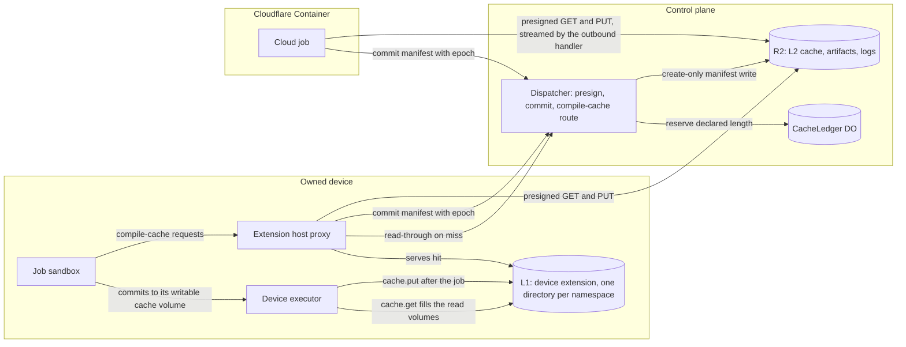
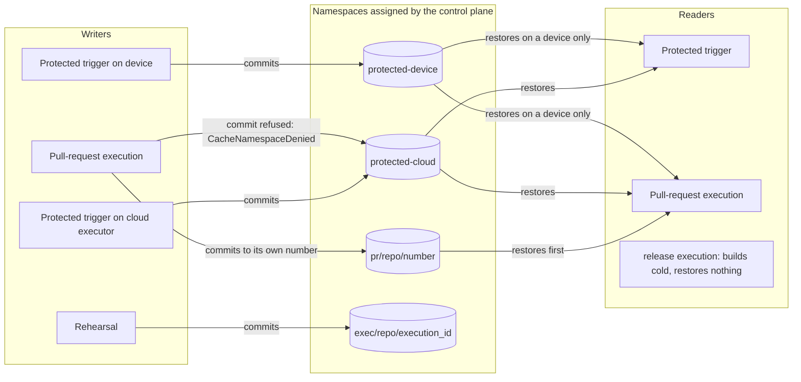
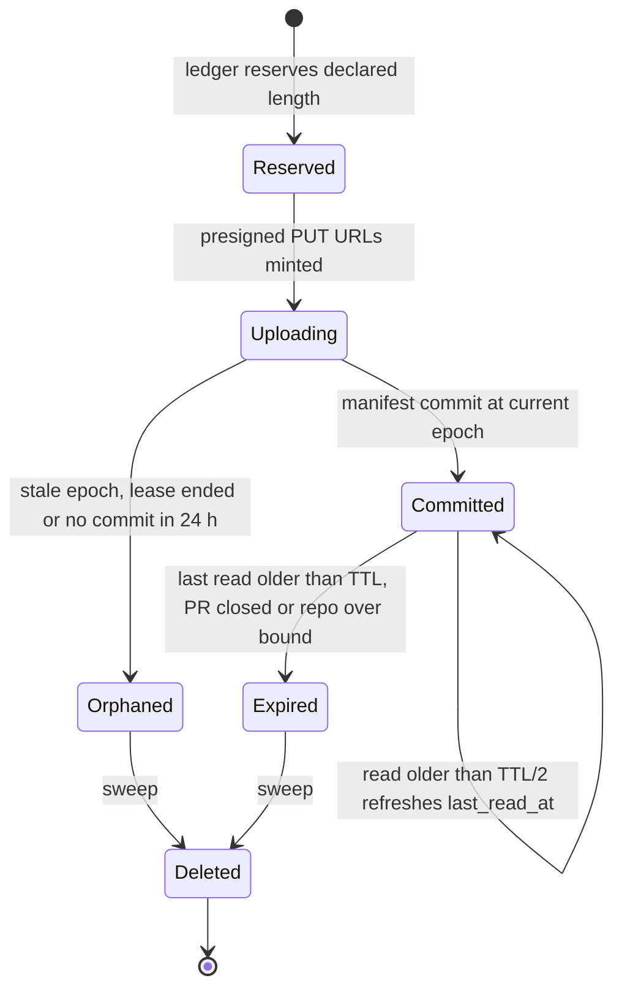
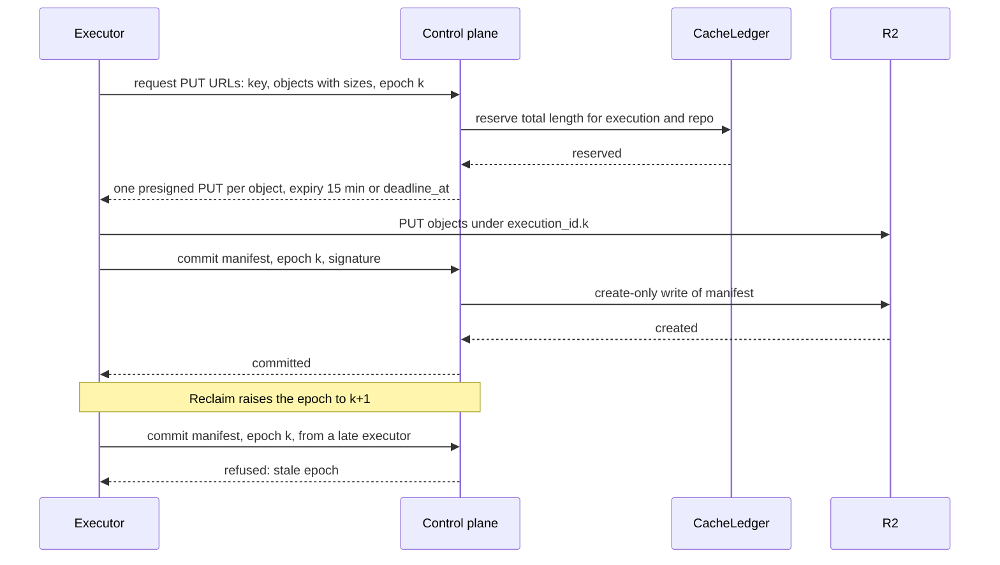

# Cache and artifacts

This file specifies the two-level cache (L1 on an owned device's local disk, L2 in R2), the cache namespaces and cache tiers that keep a pull-request writer from changing what a protected-branch reader restores, the cache key, the presigned URLs that move bytes between an executor and R2, the artifact and log stores, and retention for each.

## Scope

This file covers cache entries, artifacts and logs from the moment an executor asks to read or write them until a sweep deletes them. It depends on:

- mameko's [placement-leases.md § Execution lease](https://github.com/fractalboxdev/mameko/blob/3af65c59d5f30123eb55b468966b4975c7395ece/specs/placement-leases.md#execution-lease) and [§ Capacity lease](https://github.com/fractalboxdev/mameko/blob/3af65c59d5f30123eb55b468966b4975c7395ece/specs/placement-leases.md#capacity-lease) for the leases that carry an execution's cache namespaces and epoch, set from the profile's `cache_namespaces` and `capacity.grant` bindings ([MAMEKO-LEASE-085](https://github.com/fractalboxdev/mameko/blob/3af65c59d5f30123eb55b468966b4975c7395ece/specs/placement-leases.md), [MAMEKO-LEASE-086](https://github.com/fractalboxdev/mameko/blob/3af65c59d5f30123eb55b468966b4975c7395ece/specs/placement-leases.md));
- mameko's [executor-protocol.md § Intents and results](https://github.com/fractalboxdev/mameko/blob/3af65c59d5f30123eb55b468966b4975c7395ece/specs/executor-protocol.md#intents-and-results) for `exec.presign`, which FlareDispatch's object-store presigner answers ([MAMEKO-HOST-048](https://github.com/fractalboxdev/mameko/blob/3af65c59d5f30123eb55b468966b4975c7395ece/specs/hosts.md));
- mameko's [executors.md § Run user and device extensions](https://github.com/fractalboxdev/mameko/blob/3af65c59d5f30123eb55b468966b4975c7395ece/specs/executors.md#run-user-and-device-extensions) for the device extension that holds L1, and [executors.md](executors.md) for each executor's workspace, disk image and free-disk floor, and for the redaction of logs before upload ([MAMEKO-EXEC-019](https://github.com/fractalboxdev/mameko/blob/3af65c59d5f30123eb55b468966b4975c7395ece/specs/executors.md), [MAMEKO-EXEC-020](https://github.com/fractalboxdev/mameko/blob/3af65c59d5f30123eb55b468966b4975c7395ece/specs/executors.md));
- [isolation-egress.md](isolation-egress.md) for the job sandbox's cache volumes and for the Container outbound handler that carries a `cloudflare` executor's presigned requests ([MAMEKO-ISO-022](https://github.com/fractalboxdev/mameko/blob/3af65c59d5f30123eb55b468966b4975c7395ece/specs/isolation-egress.md));
- [local-scheduler.md](local-scheduler.md) for offline mode and for rehearsal reuse, whose reuse key (base commit, tree hash, run-definition digest) is separate from the cache key in this file;
- [provenance.md](provenance.md) for the retention of artifacts a provenance statement references;
- [interfaces.md](interfaces.md) for the route catalog and the viewer gate.

## Model

### Components

| Component | Role |
| --- | --- |
| L1 | FlareDispatch's device extension's cache on a device's local disk: one directory per cache namespace, served to the device executor through `cache.get`, `cache.put` and `cache.evict` ([MAMEKO-EXEC-109](https://github.com/fractalboxdev/mameko/blob/3af65c59d5f30123eb55b468966b4975c7395ece/specs/executors.md)). |
| L2 | The R2 cache bucket in the control plane. It is the only cache a Cloudflare Container or AWS task reads. |
| `CacheLedger` | One Durable Object per repository. It reserves bytes before any write and holds the per-object, per-execution and per-repository bounds. |
| Extension host proxy | The device extension's proxy that serves the compile-cache protocol to job sandboxes from L1 and reads through to the control plane on a miss; the device executor exposes it to a job as a socket ([MAMEKO-EXEC-111](https://github.com/fractalboxdev/mameko/blob/3af65c59d5f30123eb55b468966b4975c7395ece/specs/executors.md)). |
| Compile-cache route | `/v1/compile-cache/<owner>/<name>/<path>` on the dispatcher: the WebDAV endpoint `sccache` uses. It streams compile-cache objects of at most 100 MiB between the caller and R2 without buffering, the one byte path through the dispatcher Worker. |
| Object-store presigner | FlareDispatch's implementation of mameko's object-store presigner port: it signs every presigned R2 URL the executor channel hands out ([MAMEKO-HOST-048](https://github.com/fractalboxdev/mameko/blob/3af65c59d5f30123eb55b468966b4975c7395ece/specs/hosts.md)). |
| Artifact store | R2 objects under `artifacts/` plus one D1 row per artifact. |
| Log store | R2 objects under `logs/`, named by step identity and epoch. |

The cache holds caches only: dependency stores, compile-cache objects, prebuilt binaries, browser and toolchain downloads, and model weights. A checkout, a workspace and a job's build-output directory live inside the execution's job sandbox and never leave it. A reclaimed execution restarts from an empty workspace on its new executor; the cache only makes that restart faster.

**Two levels, caches only: bytes move between an executor and R2 by presigned URL; only manifests and compile-cache objects pass through the dispatcher**

*Cache data path · L1 on the device, L2 in R2, the control plane signs URLs and commits manifests.*

### Cache namespaces and cache tiers

The profile's `cache_namespaces` binding gives each execution, at every lease grant, a set of readable namespaces and at most one writable namespace, from the execution and the claiming executor's kind; the `capacity.grant` binding does the same for a capacity lease ([MAMEKO-LEASE-085](https://github.com/fractalboxdev/mameko/blob/3af65c59d5f30123eb55b468966b4975c7395ece/specs/placement-leases.md), [MAMEKO-LEASE-086](https://github.com/fractalboxdev/mameko/blob/3af65c59d5f30123eb55b468966b4975c7395ece/specs/placement-leases.md)). The executor takes them from its execution lease or capacity lease; a run or a job never names a namespace. Each namespace has one cache tier, which records who may write it.

| Namespace | Cache tier | Written by | Read by |
| --- | --- | --- | --- |
| `protected/<repo>/cloud` | `protected-cloud` | An execution of a protected trigger on executor kind `cloudflare` or `aws` | Every execution of the repository except `release` |
| `protected/<repo>/device` | `protected-device` | An execution of a protected trigger on executor kind `device` | Executions on a device |
| `pr/<repo>/<number>` | `pull-request` | Executions triggered by pull request `<number>` | Executions of pull request `<number>` |
| `exec/<repo>/<execution_id>` | `execution` | One rehearsal, or one execution on executor kind `gha` | That execution only |
| `cas/<sha256>` | `content` | Any execution | Any execution that already holds the expected digest from a trusted input |

A **protected trigger** ([README.md](README.md) § Glossary) decides cache writes only; `release` eligibility follows its own trigger list ([profile.md](profile.md) § Class resolution, step 1). A `merge_group` event and a `gh-readonly-queue/*` push carry code from several pull requests, so their executions read protected tiers and write nothing.

**A pull-request writer reaches only its own namespace, so nothing it writes reaches a protected-branch reader**

*Cache namespaces · the write rule and the read rule together give non-interference (property S6 in [verification.md](verification.md): a pull-request writer cannot change what a protected-branch reader restores).*

A `required` execution on a cloud executor additionally restores only entries whose manifest records a cloud writer kind, so a device-written entry in its own pull-request namespace is a miss there.

### Cache entries

An entry is a set of immutable objects plus one manifest. Objects go up first under a path that carries the writer's execution id and epoch; the manifest goes last, through the control plane, with a create-only conditional write. A reader that finds objects without a manifest sees a miss, so a torn write and a stale epoch's upload never become an entry.

| Manifest field | Content |
| --- | --- |
| `key` | The cache key (below) |
| `namespace`, `tier` | Where the entry lives and who could write it |
| `writer` | Executor id, executor kind, execution id, epoch |
| `objects` | Path, size in bytes and SHA-256 digest of each object |
| `created_at`, `last_read_at` | Control-plane clock |
| `signature` | The device key's signature under the `cache-entry` signing purpose for a device writer; the control plane's cache-signing key for a cloud writer |

The cache key is the SHA-256 of the canonical JSON of these fields: key-schema version, repository id, cache kind, namespace, platform (OS and architecture), image digest, toolchain versions (including the native libraries built into the image), the producer digest (the producing primitive's name, version and parameters), and the declared-inputs digest (for example the lockfile's SHA-256). An arm64 entry therefore never answers an amd64 read.

**An entry exists only once its manifest commits under the current epoch**

*Cache entry · objects without a committed manifest are never restored.*

**A late executor's commit carries an old epoch and is refused, so its upload stays an orphan**

*Fenced commit · the manifest write is the only step that makes an entry visible.*

### Artifacts and logs

An artifact is a named output of an execution kept for people and tools to fetch: reports, bundles, release files. It is stored at `artifacts/<execution_id>/<epoch>/<name>` and described by one D1 row: `artifact_id`, `execution_id`, `epoch`, `name`, `size`, `sha256`, `content_type`, producer executor id and kind, `expires_at`. The `artifact_id` is the public handle; the R2 path is never exposed.

A log object is `logs/<execution_id>/<epoch>/<step_key>/<stream>-<start>-<end>.ndjson`, where `step_key` is the first 24 hex characters of the SHA-256 of the step's journal name and `<start>`, `<end>` are byte offsets in that stream. The name depends only on the step and the epoch, so a replay writes the same names and a reclaimed epoch never overwrites the previous one.

## Requirements

### Two-level cache

- **FD-CACHE-001** · phase 0 · `V-UNIT` — The executor must store in the cache only entries of the kinds `dependency`, `compile`, `prebuilt-binary`, `download` and `model-weights`, and must not store a checkout or a workspace there.
- **FD-CACHE-002** · phase 0 · `V-SIM` `V-CONF` — The control plane must not transfer an execution's checkout, workspace or build-output directory from one executor to another.
- **FD-CACHE-003** · phase 0 · `V-SIM` `V-CONF` — When an executor starts an execution at an epoch above 1, the executor must start from an empty workspace and fetch the commit again.
- **FD-CACHE-004** · phase 1 · `V-CONF` — FlareDispatch's device extension must keep L1 on the device's local disk, with one directory per cache namespace, and must serve `cache.get`, `cache.put` and `cache.evict` to the device executor ([MAMEKO-EXEC-109](https://github.com/fractalboxdev/mameko/blob/3af65c59d5f30123eb55b468966b4975c7395ece/specs/executors.md)).
- **FD-CACHE-006** · phase 1 · `V-UNIT` — When `cache.get` names a key that L1 lacks, the device extension must fetch the entry from L2 and verify every object's SHA-256 digest against the manifest before it places the entry in L1 and returns it ([MAMEKO-EXEC-126](https://github.com/fractalboxdev/mameko/blob/3af65c59d5f30123eb55b468966b4975c7395ece/specs/executors.md)).
- **FD-CACHE-007** · phase 1 · `V-UNIT` — When the device executor passes a committed entry to `cache.put` ([MAMEKO-EXEC-127](https://github.com/fractalboxdev/mameko/blob/3af65c59d5f30123eb55b468966b4975c7395ece/specs/executors.md)), the device extension must write the entry to L1 and then upload it to L2.
- **FD-CACHE-008** · phase 1 · `V-UNIT` `V-CONF` — While a repository's confidentiality mode is `confidential-compute`, the executor must not read from or write to L2 for that repository.
- **FD-CACHE-009** · phase 1 · `V-UNIT` — The device extension must cap L1 at a configurable share of the free disk measured at its start, default 20%, and must evict the least recently read entry first when a write would exceed the cap.
- **FD-CACHE-010** · phase 1 · `V-SIM` — When the device executor calls `cache.evict(target_bytes)` because free disk fell below the device's free-disk floor, default 20 GiB ([MAMEKO-EXEC-113](https://github.com/fractalboxdev/mameko/blob/3af65c59d5f30123eb55b468966b4975c7395ece/specs/executors.md)), the device extension must evict L1 entries, least recently read first, until it has freed `target_bytes` or L1 is empty, and must return the bytes freed.
- **FD-CACHE-011** · phase 0 · `V-UNIT` `V-CONF` — If a cache read fails at L1, L2, the `CacheLedger` or the compile-cache route, then the reader must treat the read as a miss and the run must continue.
- **FD-CACHE-012** · phase 0 · `V-UNIT` — If a cache write fails, then the executor must log the failure with the key and continue, and the failure must not change the verdict.
- **FD-CACHE-013** · phase 1 · `V-UNIT` — While a capacity lease is in offline mode, the device extension must treat every L2 read for that lease as a miss.
- **FD-CACHE-014** · phase 2 · `V-UNIT` `V-E2E-LOCAL` — Where peer cache is enabled, a device extension may fetch an L1 entry from another device of the same member over the tailnet, and must verify the manifest signature and every object digest before it places the entry in its own L1.

### Namespaces and cache tiers

- **FD-CACHE-015** · phase 0 · `V-UNIT` `V-PROOF` — The profile's `cache_namespaces` binding must return an execution's readable namespaces and its writable namespace from the execution and the claiming executor's kind under FD-CACHE-017 to FD-CACHE-028, and the `capacity.grant` binding must return a capacity lease's namespaces under FD-CACHE-021 ([profile.md](profile.md) FD-PROF-062, [MAMEKO-LEASE-085](https://github.com/fractalboxdev/mameko/blob/3af65c59d5f30123eb55b468966b4975c7395ece/specs/placement-leases.md), [MAMEKO-LEASE-086](https://github.com/fractalboxdev/mameko/blob/3af65c59d5f30123eb55b468966b4975c7395ece/specs/placement-leases.md)).
- **FD-CACHE-016** · phase 0 · `V-UNIT` `V-CONF` — The executor must take its namespaces from its execution lease or capacity lease, and must ignore any namespace a run input or a job names.
- **FD-CACHE-017** · phase 0 · `V-UNIT` `V-PROOF` — The control plane must assign a writable namespace of cache tier `protected-cloud` only to an execution of a protected trigger on executor kind `cloudflare` or `aws`.
- **FD-CACHE-018** · phase 1 · `V-UNIT` `V-PROOF` — The control plane must assign a writable namespace of cache tier `protected-device` only to an execution of a protected trigger on executor kind `device`.
- **FD-CACHE-019** · phase 0 · `V-UNIT` `V-PROOF` — When a pull request triggers an execution, the control plane must assign it the writable namespace `pr/<repo>/<number>` of that pull request.
- **FD-CACHE-020** · phase 0 · `V-UNIT` — When a `merge_group` event or a `gh-readonly-queue/*` push triggers an execution, the control plane must assign it no writable namespace.
- **FD-CACHE-021** · phase 1 · `V-UNIT` — When the control plane registers a rehearsal or places an execution on executor kind `gha`, it must assign at most the writable namespace `exec/<repo>/<execution_id>`.
- **FD-CACHE-022** · phase 0 · `V-UNIT` `V-PROOF` — The control plane must give an execution of a protected trigger only readable namespaces of cache tiers `protected-cloud`, `protected-device` and `content`.
- **FD-CACHE-023** · phase 0 · `V-UNIT` `V-PROOF` — The control plane must give a pull-request execution only its own `pr/<repo>/<number>` namespace, the protected tiers of the same repository and `content` as readable namespaces.
- **FD-CACHE-024** · phase 0 · `V-UNIT` — When a pull-request execution looks up a key, the reader must try its own pull-request namespace before any protected tier.
- **FD-CACHE-025** · phase 1 · `V-UNIT` — The control plane must give an execution on a cloud executor no readable namespace of cache tier `protected-device`.
- **FD-CACHE-026** · phase 0 · `V-UNIT` — The control plane must not give an execution a readable or writable namespace of another repository.
- **FD-CACHE-027** · phase 1 · `V-UNIT` `V-PROOF` — While an execution of class `required` runs on executor kind `cloudflare` or `aws`, the reader must restore only entries whose manifest records a writer of executor kind `cloudflare` or `aws`.
- **FD-CACHE-028** · phase 0 · `V-UNIT` — When an execution is class `release` or carries the `cloud-only` constraint, the executor must restore no cache entry.
- **FD-CACHE-029** · phase 0 · `V-UNIT` `V-PROOF` — If an executor commits an entry to a namespace other than its execution's writable namespace, then the control plane must refuse the commit with `CacheNamespaceDenied`.
- **FD-CACHE-030** · phase 1 · `V-UNIT` — When a reader restores from the `content` tier, the reader must request only a digest taken from its own image manifest or lockfile, and must treat the entry as a miss unless the restored bytes hash to that digest.

### Cache keys

- **FD-CACHE-031** · phase 0 · `V-UNIT` — The executor must compute each cache key as the SHA-256 of the canonical JSON of the key-schema version, repository id, cache kind, namespace, platform OS and architecture, image digest, toolchain versions, producer digest and declared-inputs digest.
- **FD-CACHE-032** · phase 0 · `V-UNIT` — If a primitive cannot compute every field of a cache key, then the primitive must skip both the cache read and the cache write for that entry.
- **FD-CACHE-033** · phase 0 · `V-UNIT` — The `installCached` primitive must use the SHA-256 of the lockfile as the declared-inputs digest for `pnpm`, `npm`, `cargo` and `uv`, and must cache install outputs only.
- **FD-CACHE-034** · phase 0 · `V-UNIT` — The prebuilt-binary primitive must take as declared inputs the git object ids of its key files, its path dependencies and its `include!` targets, together with the `rustc` and `cargo` versions.
- **FD-CACHE-035** · phase 0 · `V-UNIT` — If the prebuilt-binary primitive misses or fails to restore, then the primitive must fall back to `cargo run`, and the miss must not fail the run.
- **FD-CACHE-036** · phase 1 · `V-UNIT` `V-DEPLOY` — The sandbox image must carry each prebuilt native library for both `linux/amd64` and `linux/arm64`, each pinned by SHA-256, and the library version must be one of the image's toolchain versions in the cache key.
- **FD-CACHE-037** · phase 0 · `V-UNIT` `V-E2E-LOCAL` — The compile-cache wrapper must set `sccache` as `RUSTC_WRAPPER`, set `CARGO_INCREMENTAL=0` and prefix keys with `<repo>/<rustc version>/<target triple>`.
- **FD-CACHE-038** · phase 0 · `V-UNIT` — If the compile-cache endpoint is unreachable, then the compile-cache wrapper must compile without the cache, and the outage must not fail the run.

### Entries, commit and verification

- **FD-CACHE-039** · phase 0 · `V-UNIT` — The executor must write each object of an entry under `cache/<namespace>/<key>/<execution_id>.<epoch>/` and must upload every object before it commits the manifest.
- **FD-CACHE-040** · phase 0 · `V-UNIT` `V-SIM` — When an executor commits a manifest, the control plane must accept the commit only if it carries the execution's current epoch.
- **FD-CACHE-041** · phase 0 · `V-UNIT` `V-CONF` — The control plane must write each manifest with `put(key, body, { onlyIf: { etagDoesNotMatch: "*" } })` on the R2 binding, treating a `null` result as an existing manifest, so that the first committed manifest for a key in a namespace stays and every later commit for that key is refused; the conformance test for this requirement must run against a real R2 bucket as well as Miniflare.
- **FD-CACHE-042** · phase 0 · `V-UNIT` — The control plane must record in each manifest the key, namespace, cache tier, writer executor id and kind, execution id, epoch, creation time, and the path, size and SHA-256 digest of every object.
- **FD-CACHE-043** · phase 1 · `V-UNIT` — The control plane must accept a manifest from a device only with a valid signature by that device's registered key under the `cache-entry` signing purpose the profile lists, and must sign a cloud executor's manifest with the control plane's cache-signing key.
- **FD-CACHE-044** · phase 0 · `V-UNIT` — If a reader finds objects for a key and no committed manifest, then the reader must treat the key as a miss.
- **FD-CACHE-045** · phase 0 · `V-UNIT` — If a manifest signature or an object digest fails verification, then the reader must treat the entry as a miss and log `cache.verify_failed` with the key and writer executor id.
- **FD-CACHE-046** · phase 0 · `V-UNIT` — Before the `save` primitive uploads an entry, it must check for a committed manifest for the key and skip the upload when one exists.

### Presigned URLs and byte bounds

- **FD-CACHE-047** · phase 0 · `V-UNIT` `V-CONF` — The executor must move cache objects and artifacts between itself and R2 only through presigned URLs from FlareDispatch's object-store presigner ([MAMEKO-HOST-048](https://github.com/fractalboxdev/mameko/blob/3af65c59d5f30123eb55b468966b4975c7395ece/specs/hosts.md)), and those bytes must not pass through the dispatcher Worker, except compile-cache objects of at most 100 MiB (FD-CACHE-053), which the compile-cache route streams between the caller and R2 without buffering (FD-CACHE-056); on executor kind `cloudflare` they stream unbuffered through the Container class's outbound handler ([MAMEKO-ISO-022](https://github.com/fractalboxdev/mameko/blob/3af65c59d5f30123eb55b468966b4975c7395ece/specs/isolation-egress.md)).
- **FD-CACHE-048** · phase 0 · `V-UNIT` — The object-store presigner must mint each presigned URL for one object key and one method, `GET` or `PUT`, with an expiry no later than the earlier of 15 min after minting and the execution's `deadline_at`.
- **FD-CACHE-049** · phase 0 · `V-UNIT` — The object-store presigner must mint a `PUT` URL only for an object key under the execution's writable namespace and current epoch, with the declared `Content-Length` in the signature.
- **FD-CACHE-050** · phase 0 · `V-UNIT` — The object-store presigner must mint a `GET` URL only for an object listed in a committed manifest of a namespace the execution may read.
- **FD-CACHE-051** · phase 0 · `V-SIM` — When the control plane reclaims or revokes an execution lease, it must refuse every later URL request that carries the old epoch; URLs already issued for the old epoch stay valid until their expiry, at most 15 min, and the epoch-scoped object path (FD-CACHE-039) and the epoch-checked manifest commit (FD-CACHE-040) keep their uploads from becoming an entry.
- **FD-CACHE-052** · phase 0 · `V-UNIT` `V-CONF` — Before the control plane mints a `PUT` URL, it must reserve the object's declared length in the repository's `CacheLedger`.
- **FD-CACHE-053** · phase 0 · `V-UNIT` — If an object's declared length exceeds the per-object bound, default 100 MiB for a compile-cache object and 4 GiB for any other object, then the control plane must refuse the request with `413`.
- **FD-CACHE-054** · phase 0 · `V-UNIT` — If a reservation would raise an execution's reserved bytes above the per-execution bound, default 10 GiB, or the repository's stored bytes above the per-repository bound, default 20 GiB, then the `CacheLedger` must refuse it and the control plane must answer `507`.
- **FD-CACHE-055** · phase 0 · `V-UNIT` — When an execution reaches a terminal status, the control plane must refuse every later write request for that execution with `403` and release its unused reservations in the `CacheLedger`.
- **FD-CACHE-091** · phase 0 · `V-DEPLOY` `V-UNIT` — The object-store presigner must sign presigned URLs only with an R2 API token scoped to the cache and artifact buckets with Object Read & Write, held as a Worker secret used for nothing else, and must issue them on the bucket's S3 endpoint `<account_id>.r2.cloudflarestorage.com`, because presigned URLs do not work on a custom domain.

### Compile-cache route

- **FD-CACHE-056** · phase 0 · `V-UNIT` `V-E2E-LOCAL` — The dispatcher must serve `GET`, `HEAD`, `PUT`, `PROPFIND` with `Depth: 0` and `MKCOL` on `/v1/compile-cache/<owner>/<name>/<path>` for a caller holding a valid compile-cache token, and must stream each `GET` and `PUT` body between the caller and R2 without buffering it in the Worker.
- **FD-CACHE-057** · phase 0 · `V-UNIT` — The control plane must bind each compile-cache token to the repository, execution id, epoch, readable namespaces, writable namespace and an expiry no later than the execution's `deadline_at`.
- **FD-CACHE-058** · phase 0 · `V-UNIT` `V-PROOF` — The compile-cache route must take the namespaces from the token and must ignore any namespace in the request path or headers.
- **FD-CACHE-059** · phase 0 · `V-UNIT` — If a compile-cache token is missing, expired, malformed or bound to another repository, then the compile-cache route must answer `403` and touch no object.
- **FD-CACHE-060** · phase 1 · `V-E2E-LOCAL` — On a device, the extension host proxy must serve the compile-cache protocol to job sandboxes from L1 and forward a miss to the compile-cache route under the execution's token.

### Retention and sweeps

- **FD-CACHE-061** · phase 0 · `V-UNIT` — When a reader restores an L2 entry whose `last_read_at` is older than half the TTL, the control plane must set `last_read_at` to the current time.
- **FD-CACHE-062** · phase 0 · `V-UNIT` `V-SIM` — The cache sweep must delete every L2 entry whose `last_read_at` is older than the TTL, default 14 days.
- **FD-CACHE-063** · phase 0 · `V-UNIT` — When a repository's stored L2 bytes exceed its per-repository bound, the cache sweep must delete entries in order of oldest `last_read_at` until the stored bytes are at most 90% of the bound, then reconcile the `CacheLedger` with the remaining bytes.
- **FD-CACHE-064** · phase 0 · `V-UNIT` — The cache sweep must delete a `pr/<repo>/<number>` namespace a configurable delay after the pull request closes, default 24 h.
- **FD-CACHE-065** · phase 1 · `V-UNIT` — The cache sweep must delete an `exec/<repo>/<execution_id>` namespace 7 days after its creation.
- **FD-CACHE-066** · phase 0 · `V-UNIT` — The cache sweep must delete objects under an `<execution_id>.<epoch>` path that no committed manifest lists, once they are older than 24 h.
- **FD-CACHE-067** · phase 0 · `V-UNIT` `V-DEPLOY` — The cache sweep must run at least once per hour, list at most 500 pages of 1000 objects per run, and resume from a cursor it persists between runs.

### Artifacts

- **FD-CACHE-068** · phase 0 · `V-UNIT` — When a run uploads an artifact, the control plane must record one D1 row with `artifact_id`, `execution_id`, `epoch`, `name`, `size`, `sha256`, `content_type`, producer executor id and kind, and `expires_at`.
- **FD-CACHE-069** · phase 0 · `V-UNIT` — The control plane must generate each `artifact_id` from 128 random bits of a cryptographically secure generator.
- **FD-CACHE-070** · phase 0 · `V-UNIT` — If an artifact name does not match `^[A-Za-z0-9][A-Za-z0-9._/-]{0,199}$` or contains a `..` segment, then the control plane must reject the upload with `InvalidArtifactName`.
- **FD-CACHE-071** · phase 0 · `V-UNIT` `V-SIM` — When an executor commits an artifact, the control plane must accept the commit only if it carries the execution's current epoch.
- **FD-CACHE-072** · phase 0 · `V-UNIT` — The executor must upload an artifact body of at most 16 MiB in one `PUT`, and a larger body as a multipart upload whose parts all have one size of at least 8 MiB except the last, which the control plane creates with the R2 binding's `createMultipartUpload`, presigns as one `PUT` UploadPart URL per part (`partNumber`, `uploadId`), and completes with `resumeMultipartUpload(...).complete()` when the executor commits the artifact with the part ETags.
- **FD-CACHE-073** · phase 0 · `V-UNIT` — If a directory artifact uploaded with browse expansion holds an entry over 32 MiB, totals over 256 MiB or holds over 4000 entries, then the control plane must reject it with `ArtifactTooLarge`.
- **FD-CACHE-074** · phase 0 · `V-UNIT` — If an execution's artifacts would total more than the per-execution artifact bound, default 2 GiB, then the control plane must reject the upload with `ArtifactTooLarge`.
- **FD-CACHE-075** · phase 0 · `V-UNIT` — The dispatcher must serve `GET /v1/artifacts/<artifact_id>` and its browse paths with `Cache-Control: immutable` once the producing execution is terminal.
- **FD-CACHE-076** · phase 0 · `V-UNIT` — If the artifact belongs to a private repository and the request carries neither a viewer identity with read access to that repository nor a capability token bound to that `artifact_id` and unexpired, then the dispatcher must answer `404`.
- **FD-CACHE-077** · phase 0 · `V-UNIT` — The control plane must issue an artifact capability token with an expiry of at most 7 days, derive its key with a domain-separation label for artifacts, and compare it in constant time.
- **FD-CACHE-078** · phase 0 · `V-UNIT` — The dispatcher must list an execution's artifacts in pages of at most 100 rows with a cursor, and must list artifact rows only, never the files inside a browse expansion.
- **FD-CACHE-079** · phase 0 · `V-UNIT` — The artifact sweep must delete an artifact and its row when `expires_at` passes, with `expires_at` set to a configurable retention after creation, default 30 days, unless [provenance.md](provenance.md) extends it.
- **FD-CACHE-080** · phase 1 · `V-UNIT` `V-CONF` — While a repository's confidentiality mode is `confidential-compute`, the executor must keep artifacts on the device, and the control plane must store a row that names the executor and holds no R2 path.

### Logs

- **FD-CACHE-081** · phase 0 · `V-UNIT` `V-REPLAY` — The executor must name each log object `logs/<execution_id>/<epoch>/<step_key>/<stream>-<start>-<end>.ndjson`, with `step_key` derived from the step's journal name, and must not use a process-local counter in a log name.
- **FD-CACHE-082** · phase 0 · `V-UNIT` — If a log object name does not match that grammar, then the log reader must reject it.
- **FD-CACHE-083** · phase 0 · `V-UNIT` — The dispatcher must serve `GET /v1/executions/<id>/logs/<file>` as NDJSON, as plain text with `?format=text`, and as one aggregate of every file in step order, paging through R2 listings past 1000 objects.
- **FD-CACHE-084** · phase 0 · `V-UNIT` — The HTML log viewer must send a nonce-based `Content-Security-Policy` with `default-src 'none'`, insert log text only as text content, and strip ANSI escape sequences.
- **FD-CACHE-085** · phase 0 · `V-UNIT` — When an execution is terminal, the dispatcher must serve its log objects with `Cache-Control: immutable`.
- **FD-CACHE-086** · phase 0 · `V-UNIT` — The log viewer must show, for each log object, the executor id, executor kind and epoch that produced it.
- **FD-CACHE-087** · phase 0 · `V-UNIT` — The control plane must issue a log capability token bound to one execution id, with an expiry of at most 7 days and a domain-separation label for logs.
- **FD-CACHE-088** · phase 1 · `V-UNIT` `V-CONF` — While a repository's confidentiality mode is `confidential-compute`, the executor must keep logs on the device, and the log viewer must show the executor id and execution id as a pointer and fetch no log content.
- **FD-CACHE-089** · phase 0 · `V-UNIT` — The log sweep must delete log objects a configurable retention after the execution ends, default 30 days.

### Measurement

- **FD-CACHE-090** · phase 0 · `V-MEASURE` — The control plane must record, per execution, each cache lookup's level (L1, L2), cache tier, hit or miss and bytes restored, and the compile-cache route's hit and miss counts, and must report the 28-day hit rate per cache tier and executor kind on the dashboard.

## Open items

- TODO(maintainer): confirm whether the `sccache` WebDAV client follows a `302` to a presigned R2 URL; if it does, the compile-cache route answers `GET` with a redirect instead of streaming the body, and the exception in FD-CACHE-047 narrows to `PUT`.
- TODO(maintainer): confirm whether R2 enforces a signed `x-amz-checksum-sha256` header on a presigned `PUT`; if it does, the digest check moves from read time (FD-CACHE-045) to write time.
- TODO(operator): set artifact and log retention for repositories under a compliance obligation longer than the 30-day default.
