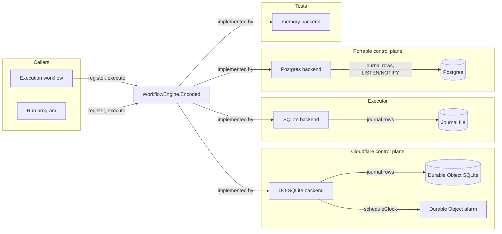
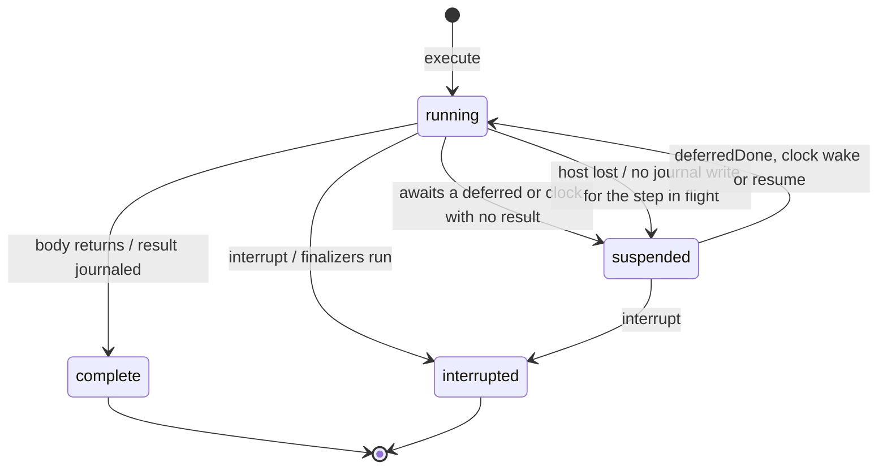
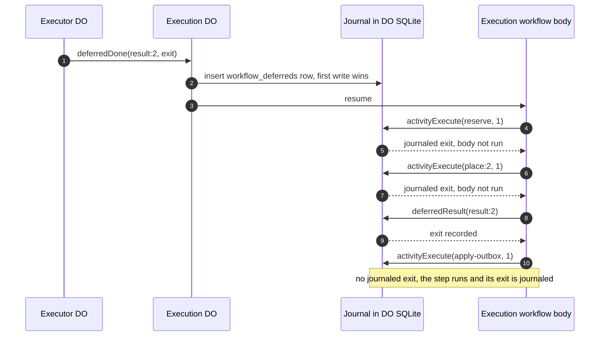
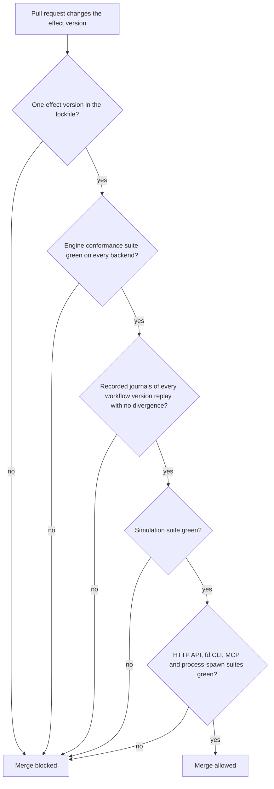

# Engine

The engine is the `WorkflowEngine` implementation from `effect/workflow` that journals every step of the control plane's `Execution` workflow and of every run program. This file specifies the engine contract, its four backends (DO-SQLite, SQLite, Postgres and memory), the journal schema they share, the determinism rules that make a replay safe, and the gate that an Effect version change passes before it merges.

## Scope

This file covers the engine and nothing above it. The `Execution` workflow's stages are in [architecture.md](architecture.md); the run program, its steps and its verdict are in [run-model.md](run-model.md); the replay harness, the conformance suites and the simulation harness are listed with their gates in [verification.md](verification.md). [ADR-0002](adr/0002-effect-workflow-engine.md) records the choice of `effect/workflow` with backends built in this repository, [ADR-0004](adr/0004-engine-state-split.md) the split between the journal and cross-execution state, and [ADR-0017](adr/0017-verification-strategy.md) why conformance, simulation and replay are merge gates.

The engine module is `effect/workflow` from `effect` 4.0.6, marked `@stability unstable`. The names in this file are the ones that version ships: `Workflow.make`, `Activity.make`, `Activity.retry`, `Activity.idempotencyKey`, `DurableDeferred`, `DurableClock.sleep`, `Workflow.addFinalizer`, `Workflow.CaptureDefects`, `WorkflowEngine.Encoded`, `WorkflowEngine.makeUnsafe`.

## Model

### Contract

Each backend implements `WorkflowEngine.Encoded` and is turned into the typed `WorkflowEngine` service by `WorkflowEngine.makeUnsafe`. The contract works on encoded payloads and results; the typed layer encodes and decodes them with each workflow's and activity's schemas.

The dispatcher Worker, its sweeps included, and every runner start executions with the `WorkflowEngine` service's `execute(workflow, { executionId, payload, discard })`, never with `Workflow.execute`, which derives a hashed id from `idempotencyKey`. The engine execution id of an `Execution` workflow is therefore the FlareDispatch execution id, and that of a run program is `<execution id>:<epoch>`. `Workflow.make` still requires an `idempotencyKey`, but no stored id derives from it.

Every `WorkflowEngine.Encoded` method has error type `never`, so a backend ends a call it cannot complete with a defect. `JournalVersionUnsupported` and `DuplicateActivityName` are tagged errors defined in this repository and carried as such defects.

`WorkflowEngine.register` takes no version and keys registrations by the workflow's tag, which is the run name ([run-model.md](run-model.md) FD-RUN-002). Each workflow is registered once per name, and its registered body dispatches on the payload's `workflow_version` to the version bodies the code retains. The version stays out of the tag, because the tag feeds `DurableDeferred` tokens and hashed ids.

| Method | Contract |
| --- | --- |
| `register` | Binds a workflow name to its body for the lifetime of the scope |
| `execute` | Starts an execution by id, or joins the existing one; with `discard: true` the encoded method returns `void` and the typed service returns the execution id; `parent` links a child execution for interrupt and completion wake; `detached` requires `discard` |
| `poll` | Returns the current `Workflow.Result` (`Complete` or `Suspended`) or none, without changing state |
| `interrupt` | Interrupts an execution and runs its finalizers |
| `interruptUnsafe` | Interrupts an execution without running finalizers |
| `resume` | Runs a suspended execution again from its journal |
| `activityExecute` | Returns the journaled exit of an activity attempt, or runs it and journals the exit |
| `deferredResult` | Returns the recorded exit of a `DurableDeferred`, or none |
| `deferredDone` | Records the exit of a `DurableDeferred` and wakes every execution waiting on it |
| `scheduleClock` | Persists a `DurableClock` wake time and resumes the execution at that time |
| `awaitComplete` | Optional; completes when a suspended execution has a non-`Suspended` result |

### Backends

| Backend | Used by | Journal storage | Clock wake | Deferred wake | Single writer per execution |
| --- | --- | --- | --- | --- | --- |
| DO-SQLite | The control plane on Cloudflare | SQLite storage of one Durable Object per execution | Durable Object alarm | RPC to the execution's Durable Object | An invocation lease in DO SQLite (`workflow_executions.status = 'running'` plus an in-memory invocation id), checked and set synchronously before the body starts |
| SQLite | Every runner and each local scheduler | One SQLite file in WAL mode | Process timer re-armed from `workflow_clocks` on start | In-process call | One process holds an exclusive lock on the file |
| Postgres | The portable control plane | Tables in one Postgres database | Poll of `workflow_clocks` every 5 s | `LISTEN/NOTIFY`, poll fallback every 5 s | Row lock on the `workflow_executions` row |
| memory | Unit tests and the replay harness | Process memory | Effect `Clock`, driven by `TestClock` in tests | In-process call | One fiber per execution |



*engine backends · each backend passes one conformance suite; storage and wake mechanism are the only differences.*

### Journal schema

The DO-SQLite, SQLite and Postgres backends store the same tables. Timestamps are integer epoch milliseconds (`INTEGER` on SQLite, `BIGINT` on Postgres). Encoded values are JSON text produced by the owning schema.

```sql
CREATE TABLE journal_meta (
  key   TEXT PRIMARY KEY,             -- engine_schema_version, effect_version
  value TEXT NOT NULL
);

CREATE TABLE workflow_executions (
  execution_id        TEXT PRIMARY KEY,
  workflow_name       TEXT NOT NULL,
  workflow_version    INTEGER NOT NULL CHECK (workflow_version >= 1),
  payload             TEXT NOT NULL,  -- encoded with the workflow's payload schema
  status              TEXT NOT NULL CHECK (status IN ('running', 'suspended', 'complete', 'interrupted')),
  result              TEXT,           -- encoded Workflow.Result, set when status = 'complete'
  parent_execution_id TEXT,
  created_at_ms       INTEGER NOT NULL,
  updated_at_ms       INTEGER NOT NULL,
  CHECK ((status = 'complete') = (result IS NOT NULL))
);

CREATE TABLE workflow_activities (
  execution_id    TEXT NOT NULL REFERENCES workflow_executions (execution_id),
  activity_name   TEXT NOT NULL,
  attempt         INTEGER NOT NULL CHECK (attempt >= 1),
  exit            TEXT NOT NULL,      -- encoded with the activity's success and error schemas
  completed_at_ms INTEGER NOT NULL,
  PRIMARY KEY (execution_id, activity_name, attempt)
);

CREATE TABLE workflow_deferreds (
  execution_id    TEXT NOT NULL,
  deferred_name   TEXT NOT NULL,
  exit            TEXT NOT NULL,      -- encoded with the deferred's schemas; the first write wins
  completed_at_ms INTEGER NOT NULL,
  PRIMARY KEY (execution_id, deferred_name)
);

CREATE TABLE workflow_clocks (
  execution_id TEXT NOT NULL REFERENCES workflow_executions (execution_id),
  clock_name   TEXT NOT NULL,
  wake_at_ms   INTEGER NOT NULL,
  fired_at_ms  INTEGER,
  PRIMARY KEY (execution_id, clock_name)
);
```

`workflow_deferreds` has no foreign key: a deferred may complete before its execution reaches the await, and before the row for a child execution exists.

### Execution lifecycle



*execution lifecycle · losing the host is a suspension, never a failure; only `complete` and `interrupted` are terminal.*

### Replay and wake

A suspended execution replays its body from the start. Each completed step returns its journaled exit without running; the first step with no journaled exit runs for real.



*replay · journaled steps return without side effects; the first new step runs once and is journaled before the body continues.*

### Upgrade gate

`effect` is pinned at exactly 4.0.6. A change to that version passes this gate before it merges. The gate covers every `@stability unstable` module the repository uses: `effect/workflow` through the engine suites, and the HTTP API, `fd` CLI and MCP modules ([interfaces.md](interfaces.md)) and the agent's process-spawn module ([executors.md](executors.md)) through their own suites.



*upgrade gate · a version change that alters journal encoding fails at the replay check, before any in-flight execution meets it.*

## Requirements

### Contract

- **FD-ENG-001** · phase 0 · `V-CONF` — Every backend must implement `WorkflowEngine.Encoded` and be provided as the `WorkflowEngine` service through `WorkflowEngine.makeUnsafe`.
- **FD-ENG-002** · phase 0 · `V-CONF` — When `execute` is called with an execution id that already exists, the backend must join the existing execution and must not start a second run of its body.
- **FD-ENG-003** · phase 0 · `V-CONF` `V-SIM` — While an execution's body is running, the backend must not start a second invocation of that body.
- **FD-ENG-004** · phase 0 · `V-CONF` — When an activity attempt completes, the backend must journal its encoded exit before the workflow body observes that exit.
- **FD-ENG-005** · phase 0 · `V-CONF` `V-REPLAY` — When a body replays, `activityExecute` must return the journaled exit of an activity attempt that has one and must not run that activity's body.
- **FD-ENG-006** · phase 0 · `V-CONF` `V-SIM` — If the host stops after an activity's side effect and before its journal write, then the backend must run that activity again on replay.
- **FD-ENG-007** · phase 0 · `V-UNIT` `V-REPLAY` — Every activity whose body has an effect outside the journal must pass `Activity.idempotencyKey(<step name>)`, without `includeAttempt`, to that effect as its idempotency key, so retries of one step reuse one key within an epoch.
- **FD-ENG-008** · phase 0 · `V-CONF` — When `deferredDone` is called for a deferred name that already has an exit, the backend must keep the first exit and return without error.
- **FD-ENG-009** · phase 0 · `V-CONF` — When `deferredDone` is called before the body awaits that deferred, `deferredResult` must return the recorded exit when the body reaches the await.
- **FD-ENG-010** · phase 0 · `V-CONF` — When `deferredDone` records an exit for an execution suspended on that deferred, the DO-SQLite and SQLite backends must resume the execution within 1 s and the Postgres backend within 5 s.
- **FD-ENG-011** · phase 0 · `V-CONF` `V-SIM` — When `scheduleClock` is called, the backend must persist the wake time and resume the execution no earlier than the wake time and no later than 5 s after it, across a restart of the host.
- **FD-ENG-048** · phase 0 · `V-CONF` `V-REPLAY` — When `scheduleClock` is called for an `(execution_id, clock_name)` that already has a row, the backend must keep the stored `wake_at_ms` and return, and when that clock has fired it must not re-arm it.
- **FD-ENG-012** · phase 0 · `V-CONF` — When `interrupt` is called, the backend must run the finalizers that the body registered with `Workflow.addFinalizer` and then mark the execution `interrupted`.
- **FD-ENG-013** · phase 0 · `V-CONF` — `poll` must return the current `Workflow.Result` or none and must not change any journal row.
- **FD-ENG-014** · phase 0 · `V-CONF` — The backend must store payloads, activity exits, deferred exits and results in the encoded form of their schemas, and decoding a stored value with the same schemas must reproduce the original value.
- **FD-ENG-015** · phase 0 · `V-UNIT` — Every workflow that the control plane or a runner registers must run with `Workflow.CaptureDefects` set to true, so a defect ends in a recorded result.
- **FD-ENG-016** · phase 0 · `V-UNIT` — When the dispatcher Worker starts an `Execution` workflow, it must call the `WorkflowEngine` service's `execute` with `executionId` set to the execution id and `discard: true`.

### Backends

- **FD-ENG-017** · phase 0 · `V-CONF` — The DO-SQLite backend must store each execution's journal in the SQLite storage of the one Durable Object keyed by that execution id.
- **FD-ENG-018** · phase 0 · `V-CONF` `V-SIM` — The DO-SQLite backend must keep its one alarm at the minimum of (a) the earliest unfired `wake_at_ms` in `workflow_clocks`, (b) now + 5 s while an execution is `running`, and (c) the retention deletion time of a terminal execution (FD-ENG-032), and must recompute it after every change to any of the three.
- **FD-ENG-047** · phase 0 · `V-CONF` `V-SIM` — The DO-SQLite backend must set the execution `running` with a synchronous `sql.exec` before it starts the body, and while that row is `running` in this activation it must make `execute`, `resume`, `deferredDone` and the alarm join the running invocation instead of starting another.
- **FD-ENG-019** · phase 0 · `V-CONF` `V-SIM` — If the host is lost while a body runs (a Durable Object reset, a process exit, a lost Postgres connection), then the backend must leave the execution `suspended`, write no exit for the step in flight and write no terminal status.
- **FD-ENG-020** · phase 0 · `V-SIM` — When a DO-SQLite execution was suspended by a lost host, the backend must resume it on the next request or alarm, and the Durable Object's alarm must follow FD-ENG-018 while it holds a `running` execution.
- **FD-ENG-021** · phase 0 · `V-CONF` — The SQLite backend must keep the journal in one SQLite file in WAL mode with `synchronous=FULL`, opened by one process holding an exclusive lock.
- **FD-ENG-022** · phase 0 · `V-CONF` — When the SQLite backend starts, it must re-arm a timer for every unfired clock and resume every suspended execution whose deferred or clock already has a result.
- **FD-ENG-023** · phase 1 · `V-SIM` — When a runner restarts inside one execution lease, the runner must call `execute` with `executionId` `<execution id>:<epoch>`, and the SQLite backend must resume that execution from its journal.
- **FD-ENG-024** · phase 1 · `V-SIM` — When a runner receives an execution lease at a new epoch, it must start a new execution with `executionId` `<execution id>:<new epoch>` and an empty journal.
- **FD-ENG-049** · phase 1 · `V-CONF` `V-SIM` — When a step fails with `LeaseOffline` ([local-scheduler.md](local-scheduler.md)), the SQLite backend must leave the execution `suspended` and must not count an attempt.
- **FD-ENG-025** · phase 4 · `V-CONF` — The Postgres backend must serialize invocations of one execution with a row lock on its `workflow_executions` row.
- **FD-ENG-026** · phase 4 · `V-CONF` — The Postgres backend must wake executions waiting on a deferred through `LISTEN/NOTIFY`, and must poll `workflow_deferreds` and `workflow_clocks` every 5 s as the fallback.
- **FD-ENG-027** · phase 0 · `V-CONF` `V-UNIT` — The memory backend must keep the journal in process memory, read time only from the Effect `Clock`, and pass the same conformance suite as the durable backends.

### Journal

- **FD-ENG-028** · phase 0 · `V-CONF` — The DO-SQLite, SQLite and Postgres backends must store the journal in the tables of the journal schema, with integer epoch-millisecond timestamps and its CHECK constraints.
- **FD-ENG-029** · phase 0 · `V-CONF` — Every journal must record the engine schema version and the `effect` version in `journal_meta`.
- **FD-ENG-030** · phase 0 · `V-CONF` — If a journal records an engine schema version that the running code has no forward migration for, then the backend must leave the execution `suspended`, end the resume with a defect carrying `JournalVersionUnsupported`, and raise the alert `journal-version-unsupported`.
- **FD-ENG-031** · phase 0 · `V-DEPLOY` — Journal schema migrations must be forward-only and must apply before any code that reads the migrated schema runs.
- **FD-ENG-032** · phase 0 · `V-CONF` — The DO-SQLite backend must delete an execution's journal when 30 days have passed since the execution became `complete` or `interrupted`; the retention period is a configurable value with that default.
- **FD-ENG-033** · phase 0 · `V-CONF` — The backend must journal a failed step's error with its tag, message and cause, so a failure summary built after a replay reads the original error.

### Determinism

- **FD-ENG-034** · phase 0 · `V-REPLAY` `V-UNIT` — A workflow body must read the clock, randomness, the environment and external state only inside an activity, a `DurableClock` or a `DurableDeferred`, and a lint rule must reject `Date.now`, `Math.random` and `crypto.randomUUID` in workflow bodies and in `runs/`.
- **FD-ENG-050** · phase 0 · `V-REPLAY` `V-UNIT` — A workflow body that waits until an instant must pass `DurableClock.sleep` a duration computed from a clock read journaled in an activity, and a clock name unique per instant and epoch.
- **FD-ENG-035** · phase 0 · `V-CONF` `V-UNIT` — If a body starts an activity whose name and attempt already started in the same invocation of that execution, then the backend must complete the execution with a failure exit whose defect is `DuplicateActivityName`.
- **FD-ENG-036** · phase 0 · `V-UNIT` — An activity body must not await a `DurableDeferred` or a `DurableClock`; every durable wait must sit in the workflow body.
- **FD-ENG-037** · phase 0 · `V-UNIT` `V-SIM` — The control plane must call `DurableClock.sleep` with `inMemoryThreshold` set to 0, so every wait survives a Durable Object reset.
- **FD-ENG-038** · phase 0 · `V-REPLAY` `V-CONF` — Every workflow payload must carry `workflow_version`, and the registered body must run the version body named by the payload's `workflow_version`.
- **FD-ENG-039** · phase 0 · `V-UNIT` `V-E2E-LOCAL` — A deploy must keep in the registered body the version body of every workflow version that has an execution in `running` or `suspended`.
- **FD-ENG-040** · phase 0 · `V-CONF` — If an execution names a workflow version that the registered body does not retain, then the backend must leave it `suspended` and raise the alert `workflow-version-missing`.

### Replay harness

- **FD-ENG-041** · phase 0 · `V-REPLAY` — The replay harness must run every registered workflow on the memory backend, then run it again over the journal the first run wrote, and fail if the second run makes any GitHub call, D1 write, outbox row or intent that the first run did not make.
- **FD-ENG-042** · phase 0 · `V-REPLAY` — The replay harness must run on every pull request and must block the merge when it fails.

### Conformance and upgrade gate

- **FD-ENG-043** · phase 0 · `V-CONF` — The engine conformance suite must run against every backend present in the repository on every pull request and must block the merge when any backend fails.
- **FD-ENG-044** · phase 0 · `V-DEPLOY` `V-UNIT` — Every package must depend on `effect` at exactly `4.0.6` with no version range, and CI must fail when the lockfile resolves more than one `effect` version.
- **FD-ENG-045** · phase 0 · `V-CONF` `V-REPLAY` — A change to the `effect` version must merge only when the engine conformance suite passes on every backend, the recorded journals replay with no divergence, the simulation suite passes, and the suites of the HTTP API, the `fd` CLI and the MCP tools ([interfaces.md](interfaces.md)) and of the agent's process spawning ([executors.md](executors.md)) pass.
- **FD-ENG-046** · phase 0 · `V-REPLAY` — The repository must keep at least one recorded journal per registered workflow version, written by the pinned `effect` version, as input to the upgrade gate.

## Open items

- TODO(maintainer): measure the DO-SQLite wake latency from `deferredDone` to resume under load, and confirm the 1 s bound in FD-ENG-010.
- TODO(operator): confirm the 30-day journal retention default in FD-ENG-032 against the dashboard's need to show step detail for old executions.
