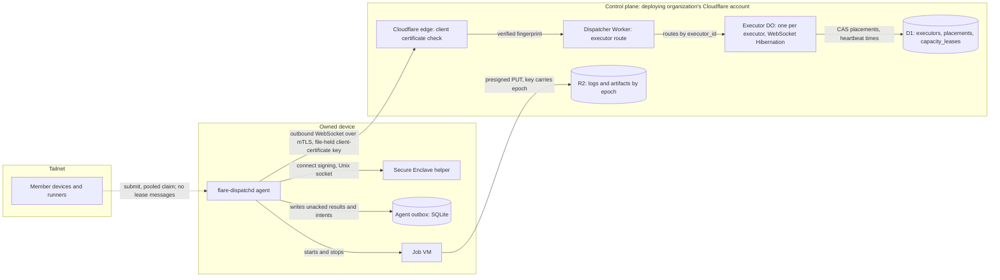
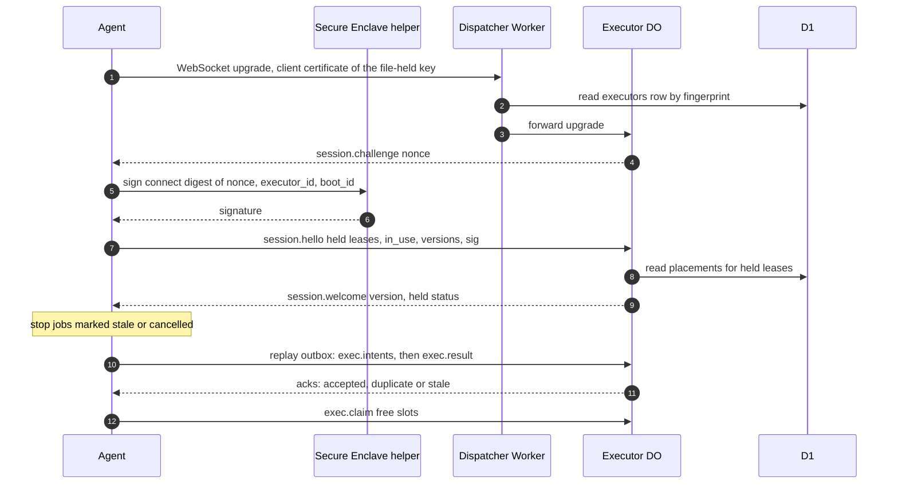
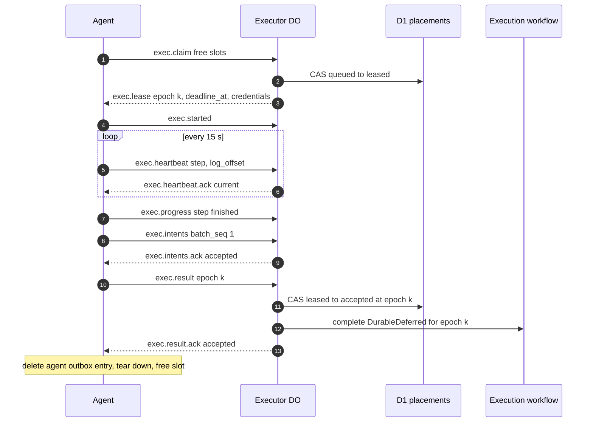
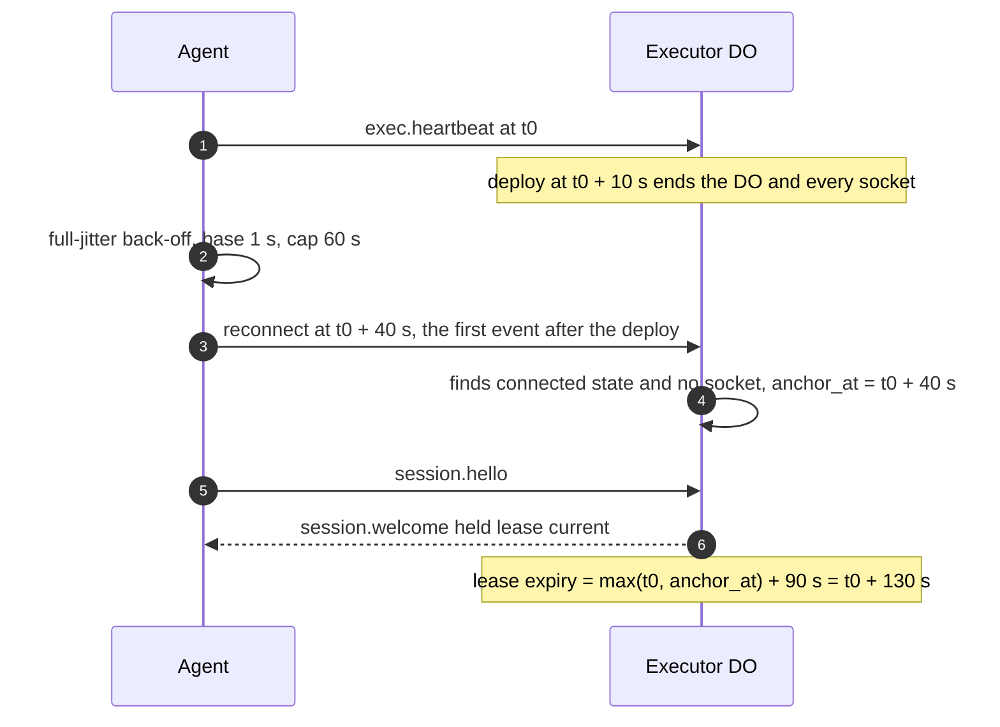
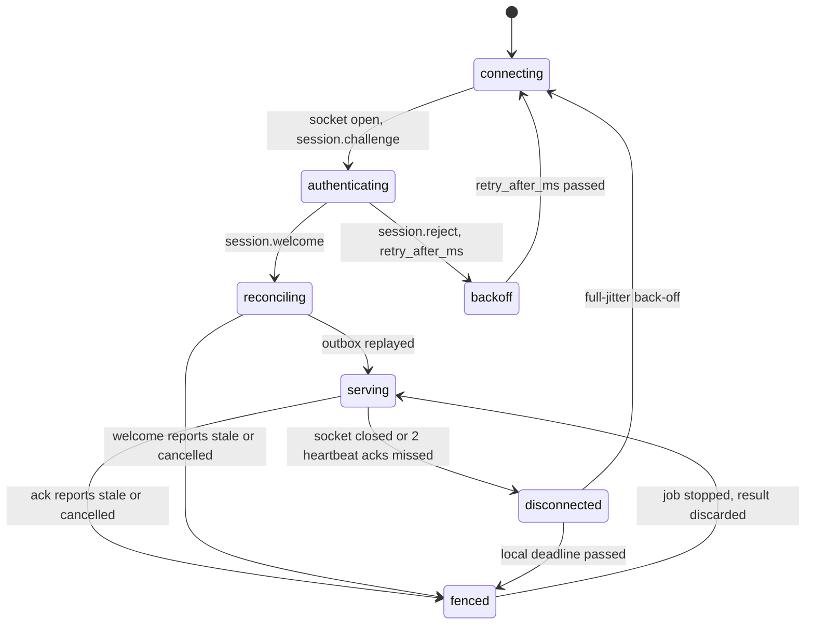

# Executor protocol

This file specifies the wire protocol between an executor and the control plane: the outbound WebSocket from the agent to its executor Durable Object, mutual authentication, the message types and their fields, version negotiation, heartbeat and progress, intent and result submission, the agent outbox and its replay on reconnect, reconnect grace across a dispatcher deploy, and the self-fence rules an executor applies when it cannot reach the control plane.

## Scope

This file covers every message that crosses between an executor and the control plane, and the connection that carries it. What the control plane decides from those messages (placement, epochs, reclaim, result acceptance, the capacity lease) is in [placement-leases.md](placement-leases.md). What an executor does with a lease once it holds one (job sandboxes, commands, logs, the stop at `deadline_at`) is in [executors.md](executors.md).

It depends on:

- [placement-leases.md](placement-leases.md) for the placement row, the execution lease, epochs, the capacity lease and the slot ledger;
- [executors.md](executors.md) for the executor kinds, the runner, the Secure Enclave helper and its `connect` purpose tag, the agent's TLS client-certificate key and the stop at `deadline_at`;
- [isolation-egress.md](isolation-egress.md) for the per-lease credentials a lease message carries;
- [run-model.md](run-model.md) for `RunResult`, intents and child executions;
- [github-output.md](github-output.md) for the outbox that applies intents;
- [cache-artifacts.md](cache-artifacts.md) for the presigned URLs that carry logs, cache objects and artifacts, and for cache and artifact manifest commits;
- [local-scheduler.md](local-scheduler.md) for the work behind `capacity.*` and `local.*` messages;
- [model-gateway.md](model-gateway.md) for the gateway route that model calls use instead of the socket;
- [provenance.md](provenance.md) for the statement a result carries from phase 4.

The decisions behind this file are [ADR-0008](adr/0008-executor-transport.md) (executor transport) and [ADR-0007](adr/0007-fenced-execution-leases.md) (fenced execution leases).

## Model

### Connection and trust zones

Every executor connection is opened by the executor side. On a device, the agent dials out over mTLS with a client certificate whose key is a P-256 key in a file readable only by the agent user ([executors.md](executors.md) FD-EXEC-101). That key is not the Secure Enclave device key, because Node's TLS stack cannot present a non-exportable Secure Enclave key as a TLS client identity ([ADR-0010](adr/0010-agent-implementation.md)). The edge checks the certificate, and a session opens only after the device key, through the Secure Enclave helper, signs the `connect` challenge (FD-PROTO-007), so the certificate key alone opens no session. Neither the agent nor the helper listens on a network port. Device-to-device traffic (submissions to a local scheduler, pooled claims, previews, peer cache) uses Tailscale and never carries an execution-lease or capacity-lease message, because a Worker cannot join a tailnet and lease authority stays in the control plane.

**The agent dials out over mTLS and the device key signs the session; only the control plane decides, and logs bypass the socket**

*executor connection · one outbound socket per executor; leases never ride the tailnet.*

### Transport per executor kind

| Kind | Peer on the control-plane side | Transport | Identity |
| --- | --- | --- | --- |
| `device` | Executor DO named by `executor_id` | Outbound WebSocket over TLS 1.3 with a client certificate, opened by the agent | Client certificate whose key is a file-held P-256 key distinct from the device key, plus a `connect` signature by the Secure Enclave device key over the session challenge |
| `cloudflare` | The Container's Durable Object | WebSocket that the Container's Durable Object opens to the in-container runner's port | The Durable Object started the Container; the runner holds a per-lease credential |
| `aws` | Executor DO of the AWS launcher's executor row | Outbound WebSocket from the task | A launch credential bound to `(execution_id, epoch)` |
| `gha` | Executor DO of the GitHub Actions launcher's executor row | Outbound WebSocket from the runner job | A GitHub Actions OIDC token, checked as in [executors.md](executors.md) |

Every kind exchanges the same `exec.*` messages under the same version rules. Only `device` executors exchange `session.*` challenge signatures, `capacity.*` and `local.*` messages.

### Framing

Each frame is one WebSocket text message holding one JSON object of at most 1 MiB. Every object carries `type` (the message type), `id` (a UUID the receiver echoes as `ref` in its answer) and the fields of that type. One `Schema.Union` of `Schema.Struct` members, each with a literal discriminator `type: Schema.tag("<message type>")`, defines every message of a protocol version; the agent and the dispatcher import the same schema package. Receivers ignore fields their version does not define.

Logs, file contents, cache objects and artifacts never cross the socket. The executor uploads them to R2 through presigned URLs under keys that carry the epoch ([cache-artifacts.md](cache-artifacts.md)); only the requests for those URLs and the manifest commits ride the socket, and `exec.progress` carries the log offset and at most a 16 KiB redacted tail. Model calls do not ride the socket either: they go to the gateway route with the per-lease credential ([model-gateway.md](model-gateway.md)).

The agent outbox is the executor-side store of frames sent and not yet acknowledged; on a `device` it is the agent's SQLite database, and on every other kind the runner keeps it.

### Message catalog

| Type | Direction | Fields | Answer |
| --- | --- | --- | --- |
| `session.challenge` | CP → executor | `nonce` (32 random bytes), `versions` the dispatcher accepts | `session.hello` |
| `session.hello` | executor → CP | `executor_id`, `boot_id`, `agent_version`, `versions` {`min`, `max`}, `held` [{`execution_id`, `epoch`, `step`}], `capacity` {`lease_id`, `epoch`, `seq`} or null, `in_use` per pool and class, `outbox_depth`, `sig` | `session.welcome` or `session.reject` |
| `session.welcome` | CP → executor | `version`, `server_now`, `heartbeat_ms` (15 000), `lease_ttl_ms` (90 000), `held` [{`execution_id`, `epoch`, `status`: `current`, `stale` or `cancelled`}], `drain` | — |
| `session.reject` | CP → executor | `reason` (`version-unsupported`, `identity`, `removed`, `quarantined`), `supported`, `retry_after_ms` | Socket closes |
| `session.error` | either | `code` (`malformed`, `unknown-type`, `too-large`, `out-of-order`), `ref` | — |
| `exec.claim` | executor → CP | `free` slots per pool and class | `exec.lease` per grant, or `exec.idle` |
| `exec.idle` | CP → executor | — | The claim stands until the next `exec.claim` or heartbeat |
| `exec.lease` | CP → executor | `execution_id`, `epoch`, `run`, `run_digest`, `image_digest`, `repo`, `sha`, `inputs`, `class`, `deadline_at`, `server_now`, `progress_timeout_ms`, `credentials`, `cache_namespaces`, `upload_grant`, `nonce` | `exec.started` or `exec.refused` |
| `exec.started` | executor → CP | `execution_id`, `epoch` | — |
| `exec.refused` | executor → CP | `execution_id`, `epoch`, `reason` (`image-not-pinned`, `slot-gone`, `probe-failed`, `label-missing`) | Reclaim |
| `exec.heartbeat` | executor → CP | `leases` [{`execution_id`, `epoch`, `step`, `log_offset`, `output_bytes`}], `in_use`, `activity`, `memory_pressure`, `thermal`, `power`, `free_disk_bytes`, `teardowns` | `exec.heartbeat.ack` |
| `exec.heartbeat.ack` | CP → executor | `leases` [{`execution_id`, `epoch`, `status`}] | — |
| `exec.progress` | executor → CP | `execution_id`, `epoch`, `step`, `event` (`started`, `finished`), `log_offset`, `tail` | — |
| `exec.intents` | executor → CP | `execution_id`, `epoch`, `batch_seq`, `intents` [{`intent_key`, `kind`, `payload`}] | `exec.intents.ack` with `status` (`accepted`, `duplicate`, `stale`) |
| `exec.result` | executor → CP | `execution_id`, `epoch`, `result_id`, `verdict`, `usage`, `artifacts`, `statement` | `exec.result.ack` with `status` (`accepted`, `duplicate`, `stale`) |
| `exec.cancel` | CP → executor | `execution_id`, `epoch`, `reason`, `grace_ms` | `exec.cancelled` |
| `exec.cancelled` | executor → CP | `execution_id`, `epoch` | — |
| `exec.release` | executor → CP | `execution_id`, `epoch`, `reason` (`sleep`, `drain`, `shutdown`, `container-lost`) | Reclaim |
| `exec.credentials` | CP → executor | `execution_id`, `epoch`, `credentials` | — |
| `executor.drain` | either | `reason` (`operator`, `vm-unhealthy`, `disk-full`, `os-update`) | — |
| `executor.undrain` | CP → executor | — | — |
| `executor.drained` | executor → CP | — | — |
| `capacity.request`, `capacity.resume`, `capacity.renew`, `capacity.shrunk`, `capacity.release`, `capacity.settle` | device → CP | As in § Capacity-lease messages | `capacity.grant`, `capacity.deny` or `capacity.renewed` |
| `capacity.grant`, `capacity.deny`, `capacity.renewed`, `capacity.shrink`, `capacity.revoke` | CP → device | As in § Capacity-lease messages | — |
| `exec.child.spawn` | executor → CP | `execution_id`, `epoch`, `child_run`, `input` | `exec.child.spawned` with `child_execution_id` |
| `exec.child.status` | executor → CP | `execution_id`, `epoch`, `child_execution_ids` | `exec.child.statuses` with `children` [{`child_execution_id`, `state`, `verdict` or null}] |
| `exec.presign` | executor → CP | `execution_id`, `epoch`, `objects` [{`key`, `method` (`GET`, `PUT`), `length`}] | `exec.presigned` with `urls` [{`key`, `url`, `expires_at`}], or `status` `stale` |
| `exec.cache.commit` | executor → CP | `execution_id`, `epoch`, `manifest` | `exec.cache.commit.ack` with `status` (`accepted`, `duplicate`, `stale`) |
| `exec.artifact.commit` | executor → CP | `execution_id`, `epoch`, `manifest` | `exec.artifact.commit.ack` with `status` (`accepted`, `duplicate`, `stale`) |
| `local.register` | device → CP | `lease_id`, `epoch`, `run`, `reuse_key`, `inputs_digest` | `local.registered` with `execution_id` and `nonce`, or `status` (`lease_stale`, `proof_invalid`) |
| `local.writeback` | device → CP | `execution_id`, `intents` [{`intent_key`, `kind`, `payload`}] | `local.writeback.ack` with `status` (`accepted`, `duplicate`, `rejected`, `rate_limited`) and `retry_after_ms` |

### Session

**A session starts with a signed challenge and a reconciliation of every lease the agent still holds**

*session · authenticate, reconcile, replay, then claim; a claim never precedes reconciliation.*

### Lease on the wire

**One lease, from claim to accepted result**

*lease on the wire · every write the agent sends carries the epoch; every ack names a status.*

### Restart anchor

A deploy ends every executor DO and its sockets; the DO runs again on the next event that addresses it (a reconnect or its alarm). The executor DO keeps two values in its own storage: `connection_state` (`connected` or `disconnected`) and `anchor_at`. On that first event it finds `connection_state` = `connected` and no socket in `ctx.getWebSockets()`, so the sockets ended with a restart: it sets `anchor_at` to that event's time and `connection_state` to `disconnected`. An activation that resumes from hibernation still finds its sockets, and an event after a normal close finds `disconnected`, so neither moves the anchor. A lease expires at max(last heartbeat, `anchor_at`) + 90 s; when the first event is the lease alarm, the anchor it sets pushes the expiry 90 s past the alarm.

**A deploy costs each agent one reconnect and reclaims no lease**

*restart anchor · the 90 s grace restarts at the first event after the DO's restart, a reconnect or the lease alarm, so a deploy never expires a lease.*

### Agent connection states

**While disconnected the agent keeps leased jobs running, starts nothing and holds every result**

*agent connection · `fenced` applies to one lease; the other leases keep their own state.*

### Self-fence

The agent stops a job and discards its result without being told only when it knows the lease is gone or its time is spent. It never stops a job because it is merely disconnected: a job that cannot reach the control plane runs on to its local deadline and holds its result in the agent outbox, and the control plane accepts that result if the epoch is unchanged.

| Trigger | Agent action |
| --- | --- |
| `exec.cancel` | Stop at the next step boundary within `grace_ms`, then stop the VM; answer `exec.cancelled` |
| `session.welcome` or `exec.heartbeat.ack` reports `stale` or `cancelled` | Stop the job within 10 s; delete its agent outbox entries for that epoch |
| `exec.result.ack` or `exec.intents.ack` reports `stale` | Delete the entry; stop the job if it still runs |
| Local deadline passed | Stop the VM within 10 s; submit `failure(deadline)` ([executors.md](executors.md) FD-EXEC-002, FD-EXEC-003, timed on the local deadline of FD-PROTO-032) |
| System sleep notification | Send `exec.release` for each lease and `capacity.release` before acknowledging |

The local deadline is the agent's monotonic time when it sent the `exec.claim` that produced the lease, plus `deadline_at` − `server_now` from the lease. The send precedes the grant, so the local deadline falls at or before `deadline_at` whatever the clock skew.

### Capacity-lease messages

Capacity-lease messages ride the same socket as execution-lease messages. The agent relays them to and from the local scheduler over local IPC. `seq` is monotonic per `lease_id` across epochs.

| Type | Body | Rule |
| --- | --- | --- |
| `capacity.request` | `executor_id`, `node_id`, `cnf`, pools wanted, `memory_mib`, `in_use` per pool, registered `execution_id`s in flight, `sent_mono` | Sent when no live capacity lease exists |
| `capacity.resume` | `lease_id`, `epoch`, `seq`, `in_use`, `sent_mono` | Sent on reconnect while the device-side deadline has not passed |
| `capacity.grant` | All capacity-lease fields and a credential signed over `lease_id`, `epoch`, `executor_id`, `node_id`, `cnf`, `exp`; the registrations re-bound and rejected | — |
| `capacity.deny` | `reason`, `retry_after_ms` | — |
| `capacity.renew` | `lease_id`, `epoch`, `seq`, `in_use`, usage delta, advisory results | Every 150 s |
| `capacity.renewed` | `expires_at`, fresh credential, remaining allowance, `slots`, revoked-peer list | A smaller `slots` is a shrink |
| `capacity.shrink` | Target `slots` per pool, target `memory_mib`, `return_by`, `reason` | Pushed at once |
| `capacity.shrunk` | `lease_id`, `epoch`, `in_use`, memory in use | Sent when the target is met |
| `capacity.release` | `lease_id`, `epoch`, `seq`, final usage | Scheduler exit, sleep, drain |
| `capacity.revoke` | `lease_id`, `epoch`, `reason` | — |
| `capacity.settle` | Final usage, advisory results, `seq` | Once per `(lease_id, epoch)` |

## Requirements

### Connection and authentication

- **FD-PROTO-001** · phase 1 · `V-E2E-LOCAL` — The agent and the Secure Enclave helper must not listen on any network port for control-plane traffic, and the device's control-plane connection must be one outbound WebSocket from the agent to the dispatcher's executor route, with the client-certificate key of [executors.md](executors.md) FD-EXEC-101 as the TLS client identity and never the device key.
- **FD-PROTO-002** · phase 1 · `V-CONF` `V-E2E-LOCAL` — The dispatcher must accept a WebSocket upgrade on the executor route from a `device` executor only when `request.cf.tlsClientAuth.certVerified` is `SUCCESS` and the certificate's SHA-256 fingerprint equals the `key_fingerprint` of an `executors` row.
- **FD-PROTO-003** · phase 1 · `V-CONF` — If a `device` upgrade presents no client certificate, an unverified one or one whose fingerprint matches no `executors` row, then the dispatcher must answer `403` and must not forward the request to any executor DO.
- **FD-PROTO-004** · phase 1 · `V-UNIT` — The dispatcher must forward each accepted upgrade to the executor DO whose name is the matched row's `executor_id`.
- **FD-PROTO-005** · phase 1 · `V-E2E-LOCAL` `V-MEASURE` — The executor DO must accept each socket through the WebSocket Hibernation API (`ctx.acceptWebSocket`), keep per-socket state only in the socket's serialized attachment and its own storage, and schedule timed work only through its alarm.
- **FD-PROTO-006** · phase 1 · `V-CONF` `V-UNIT` — When a socket opens, the executor DO must send `session.challenge` with a fresh 32-byte random nonce before any other message.
- **FD-PROTO-007** · phase 1 · `V-CONF` — If the first message on a `device` socket is not a `session.hello` whose `sig` verifies against the registered device key over the `connect`-tagged digest of the nonce, `executor_id` and `boot_id`, then the executor DO must close the socket with code 4003.
- **FD-PROTO-008** · phase 1 · `V-UNIT` `V-SIM` — If a second authenticated socket opens for an executor, then the executor DO must close the older socket with code 4009.
- **FD-PROTO-009** · phase 1 · `V-UNIT` — If an executor's row is removed or quarantined, then the executor DO must send `session.reject` with `reason` `removed` or `quarantined` and close the socket with code 4010.
- **FD-PROTO-010** · phase 1 · `V-UNIT` — If the agent receives `session.reject`, then the agent must not reconnect before `retry_after_ms` has passed.
- **FD-PROTO-011** · phase 1 · `V-E2E-LOCAL` `V-UNIT` — The agent must not send or accept any `exec.*`, `capacity.*` or `local.*` message over the tailnet.
- **FD-PROTO-012** · phase 0 · `V-CONF` — Where the executor kind is `cloudflare`, the Container's Durable Object must open the protocol WebSocket to the in-container runner's port and must exchange `exec.*` messages with it under the version, epoch and acknowledgement rules of this file.
- **FD-PROTO-013** · phase 3 · `V-CONF` — Where the executor kind is `aws`, the executor DO must accept a socket only with a launch credential bound to one `(execution_id, epoch)` whose epoch is current, and must grant that socket only that lease.
- **FD-PROTO-014** · phase 4 · `V-CONF` — Where the executor kind is `gha`, the executor DO must accept a socket only with a GitHub Actions OIDC token that passes the checks in [executors.md](executors.md), and must grant that socket only the `(execution_id, epoch)` its launch named.

### Framing and versioning

- **FD-PROTO-015** · phase 0 · `V-UNIT` — Every frame must be one WebSocket text message holding one JSON object that carries `type` and `id` and decodes against the `Schema.Union` of the negotiated protocol version.
- **FD-PROTO-016** · phase 0 · `V-UNIT` — If a frame does not decode, then the receiver must answer `session.error` with `code` `malformed` and the frame's `id` when one is readable, and must not act on the frame.
- **FD-PROTO-017** · phase 0 · `V-UNIT` — If the executor DO receives 3 frames that do not decode within 60 s on one socket, then it must close the socket with code 4000.
- **FD-PROTO-018** · phase 0 · `V-UNIT` — If a frame's `type` is not defined in the negotiated version, then the receiver must answer `session.error` with `code` `unknown-type` and must not act on the frame.
- **FD-PROTO-019** · phase 0 · `V-UNIT` — The receiver must ignore every field that the negotiated version does not define for a known `type`.
- **FD-PROTO-020** · phase 0 · `V-UNIT` — If a frame exceeds 1 MiB, then the receiver must close the socket with code 1009 and must not act on the frame.
- **FD-PROTO-021** · phase 0 · `V-UNIT` — The protocol version must be an integer that increases by 1 with every change that removes a message type, removes a field, or changes a field's type or meaning.
- **FD-PROTO-022** · phase 1 · `V-UNIT` `V-CONF` — When the executor DO receives `session.hello`, it must select the highest version inside both the agent's `versions` range and the range it accepts, and must state it in `session.welcome`.
- **FD-PROTO-023** · phase 1 · `V-UNIT` — If the agent's `versions` range and the executor DO's range share no version, then the executor DO must send `session.reject` with `reason` `version-unsupported` and its supported range, and close the socket with code 4001.
- **FD-PROTO-024** · phase 1 · `V-CONF` `V-DEPLOY` — Each dispatcher release must accept its own protocol version and the one before it, and each agent release must offer its own protocol version and the one before it.

### Session

- **FD-PROTO-025** · phase 1 · `V-UNIT` `V-E2E-LOCAL` — The agent must list in `session.hello` every execution lease it still holds with its epoch and current step, its capacity lease with `lease_id`, `epoch` and `seq`, and its true slot ledger `in_use`.
- **FD-PROTO-026** · phase 1 · `V-UNIT` `V-SIM` — When the executor DO answers `session.hello`, it must mark each held lease `current`, `stale` or `cancelled` from the lease's placement row as read in that same activation.
- **FD-PROTO-027** · phase 1 · `V-SIM` `V-E2E-LOCAL` — When `session.welcome` marks a held lease `stale` or `cancelled`, the agent must stop that job within 10 s and delete its journal and agent outbox entries for that epoch.
- **FD-PROTO-028** · phase 1 · `V-UNIT` `V-SIM` — The agent must not send `exec.claim` on a socket before it has received `session.welcome` and replayed its agent outbox on that socket.

### Claim and lease

- **FD-PROTO-029** · phase 1 · `V-UNIT` `V-SIM` — When the executor DO receives `exec.claim`, it must answer with one `exec.lease` per placement its claim CAS won, or with `exec.idle` when it won none, and must hold the claim's free slots as a standing claim until the next `exec.claim` or heartbeat from that executor.
- **FD-PROTO-030** · phase 2 · `V-SIM` `V-MEASURE` — When intake writes a placement with `local_open` true, the control plane must signal, within 1 s of the write, each executor DO whose executor is present, eligible for the placement and holds a standing claim, so that it runs the claim CAS.
- **FD-PROTO-031** · phase 0 · `V-UNIT` — The control plane must send in `exec.lease` the `execution_id`, `epoch`, run name, run-definition digest, image digest, repository, commit SHA, inputs, class, `deadline_at`, `server_now`, progress timeout, credentials, cache namespaces, upload grant and provenance nonce.
- **FD-PROTO-032** · phase 1 · `V-UNIT` `V-SIM` — When the agent receives `exec.lease`, the agent must set the job's local deadline to its monotonic time at sending the matching `exec.claim` plus `deadline_at` − `server_now`.
- **FD-PROTO-033** · phase 1 · `V-UNIT` `V-SIM` — The agent must time every lease interval on a monotonic clock that counts through system sleep and must not compare its wall clock with the control plane's for any lease decision.
- **FD-PROTO-034** · phase 1 · `V-UNIT` — When the agent starts a leased job's sandbox, the agent must send `exec.started`.
- **FD-PROTO-035** · phase 1 · `V-SIM` — If the agent cannot start a leased job's sandbox within 30 s of `exec.lease`, then the agent must send `exec.refused` with one reason from `image-not-pinned`, `slot-gone`, `probe-failed` and `label-missing`.

### Heartbeat and progress

- **FD-PROTO-036** · phase 1 · `V-UNIT` `V-E2E-LOCAL` — While the socket is open, the agent must send `exec.heartbeat` every 15 s, listing every held lease with its epoch, step, log offset and output bytes, and its `in_use`, activity, memory pressure, thermal state, power source and free disk.
- **FD-PROTO-037** · phase 1 · `V-UNIT` `V-SIM` — When the executor DO receives `exec.heartbeat`, it must record the heartbeat time for each listed lease whose epoch is current, write `last_heartbeat_at` to the executor's registry row, and answer `exec.heartbeat.ack` with each listed lease's status.
- **FD-PROTO-038** · phase 1 · `V-UNIT` — When the run program starts or finishes a step, the agent must send `exec.progress` with the step name, the event and the log offset.
- **FD-PROTO-039** · phase 1 · `V-UNIT` — When a heartbeat or `exec.progress` shows a step change or a larger log offset for a current lease, the executor DO must update that lease's progress time and the registry row's `last_progress_at`.
- **FD-PROTO-040** · phase 1 · `V-UNIT` — The agent must not put log bodies, file contents or artifact bytes in any frame, and must limit an `exec.progress` tail to the last 16 KiB of redacted output.
- **FD-PROTO-041** · phase 1 · `V-MEASURE` — The control plane must record executor DO duration in GB-s per connected executor per day.

### Restart anchor and expiry

- **FD-PROTO-042** · phase 0 · `V-SIM` `V-E2E-LOCAL` — When an executor DO handles an event (a reconnect, an RPC or its alarm) and finds `connection_state` = `connected` in its storage and no socket in `ctx.getWebSockets()`, it must set `anchor_at` to that event's time and `connection_state` to `disconnected` before it handles the event further.
- **FD-PROTO-043** · phase 0 · `V-SIM` — The executor DO must not change `anchor_at` on an activation that finds `connection_state` = `disconnected` or that resumes from hibernation with its sockets, or on a socket close that its own close handler recorded.
- **FD-PROTO-044** · phase 0 · `V-SIM` — The executor DO must keep its alarm set to the earliest expiry among its leases, computed as max(last heartbeat, `anchor_at`) + 90 s, and must request a reclaim only for a lease past that expiry when the alarm runs.

### Intents and results

- **FD-PROTO-045** · phase 0 · `V-SIM` `V-UNIT` — The executor must write each `exec.intents` batch and each `exec.result` to the agent outbox before it sends the frame.
- **FD-PROTO-046** · phase 0 · `V-REPLAY` `V-UNIT` — When the executor DO receives `exec.intents` at the current epoch, it must stage each intent in its own Durable Object storage keyed by `(execution_id, epoch, intent_key)` and answer `exec.intents.ack` with `accepted`, or `duplicate` when every key was already staged, and must not write the D1 outbox; `apply-outbox` ([architecture.md](architecture.md) FD-ARCH-027) writes the staged intents of the accepted epoch.
- **FD-PROTO-047** · phase 0 · `V-SIM` `V-PROOF` — If `exec.intents` carries an epoch below the placement's `epoch`, then the executor DO must answer `exec.intents.ack` with `stale` and stage nothing, under the discard rule of [placement-leases.md](placement-leases.md) FD-LEASE-038.
- **FD-PROTO-048** · phase 0 · `V-SIM` `V-UNIT` — When the control plane receives `exec.result`, it must answer `exec.result.ack` with `accepted` when the result-acceptance rule in [placement-leases.md](placement-leases.md) accepts it, `duplicate` when a result with the same `result_id` is already accepted, and `stale` otherwise.
- **FD-PROTO-049** · phase 0 · `V-SIM` `V-CONF` — The executor must delete an agent outbox entry only on an acknowledgement that references it, and must keep unacknowledged entries across its own restarts.
- **FD-PROTO-050** · phase 0 · `V-UNIT` — The executor must set `result_id` to the SHA-256 of the canonical JSON of the result's `execution_id`, `epoch`, `verdict` and `artifacts`, so a replayed result carries the same `result_id`.

- **FD-PROTO-078** · phase 0 · `V-SIM` `V-UNIT` — When the executor DO receives `exec.child.spawn`, `exec.child.status`, `exec.presign`, `exec.cache.commit` or `exec.artifact.commit`, it must act on it only when its epoch equals the placement's `epoch` and the row is `leased` to the sending executor, and must otherwise answer with `status` `stale` and act on nothing.

### Agent outbox replay and reconnect

- **FD-PROTO-051** · phase 1 · `V-SIM` — When a session reaches `session.welcome`, the agent must replay its unacknowledged agent outbox entries for `current` leases in the order it wrote them, intent batches before the result of the same lease.
- **FD-PROTO-052** · phase 1 · `V-UNIT` `V-SIM` — If a connection attempt or a replayed frame fails, then the agent must retry with full-jitter exponential back-off, base 1 s and cap 60 s.
- **FD-PROTO-053** · phase 1 · `V-SIM` — While the control plane is in recovery mode ([qos-admission.md](qos-admission.md)), each executor DO must admit replayed frames through a token bucket, default 10 frames per second per executor.
- **FD-PROTO-054** · phase 1 · `V-SIM` — If the agent receives no `exec.heartbeat.ack` for 2 consecutive heartbeats, then the agent must close the socket and reconnect.

### Self-fence

- **FD-PROTO-055** · phase 1 · `V-SIM` `V-CONF` — While the agent has no open session, the agent must keep each job of a held lease running until its local deadline.
- **FD-PROTO-074** · phase 1 · `V-SIM` `V-CONF` — While the agent has no open session, the agent must start no new job.
- **FD-PROTO-075** · phase 1 · `V-SIM` `V-CONF` — While the agent has no open session, the agent must hold every result and intent batch in the agent outbox.
- **FD-PROTO-056** — Removed; see [executors.md](executors.md) FD-EXEC-002.
- **FD-PROTO-057** · phase 1 · `V-SIM` — When `exec.heartbeat.ack`, `exec.intents.ack` or `exec.result.ack` reports a lease `stale` or `cancelled`, the agent must stop that job within 10 s and delete its agent outbox entries for that epoch.
- **FD-PROTO-058** · phase 1 · `V-SIM` `V-E2E-LOCAL` — When the agent receives `exec.cancel`, it must stop the job at its next step boundary within `grace_ms`, stop the VM when the grace passes, and answer `exec.cancelled`.
- **FD-PROTO-059** · phase 1 · `V-E2E-LOCAL` — When the agent receives a system sleep notification, it must send `exec.release` with `reason` `sleep` for each held lease and `capacity.release` for its capacity lease before it acknowledges the notification.
- **FD-PROTO-060** · phase 0 · `V-SIM` — If a Cloudflare Container exits before its runner submits a result, then the Container's Durable Object must send `exec.release` with `reason` `container-lost` for the current epoch.

### Credentials and drain

- **FD-PROTO-061** · phase 1 · `V-CONF` — When a lease credential is within 5 min of its `exp` and the lease's epoch is current, the control plane must send `exec.credentials` with fresh credentials for that epoch.
- **FD-PROTO-062** · phase 1 · `V-UNIT` `V-SIM` — When the agent receives `executor.drain`, it must send no `exec.claim` until it receives `executor.undrain`.
- **FD-PROTO-076** · phase 1 · `V-UNIT` `V-SIM` — When the agent receives `executor.drain`, it must let its held leases run until each ends.
- **FD-PROTO-077** · phase 1 · `V-UNIT` — While a drain is in force, when the agent holds no lease, it must send `executor.drained`.
- **FD-PROTO-063** · phase 1 · `V-UNIT` — When the agent drains itself for `vm-unhealthy`, `disk-full` or `os-update`, it must send `executor.drain` with that reason.
- **FD-PROTO-064** · phase 1 · `V-UNIT` — When the executor DO receives `executor.drain` from an executor, it must set that executor's `drain` flag in the registry.

### Capacity-lease messages

- **FD-PROTO-065** · phase 1 · `V-UNIT` — The agent must send `capacity.request` only while it holds no live capacity lease, and must declare its true `in_use` in it.
- **FD-PROTO-066** · phase 1 · `V-UNIT` `V-SIM` — When the agent reconnects before its device-side capacity-lease deadline, it must send `capacity.resume`; when it reconnects after that deadline, it must send `capacity.request`.
- **FD-PROTO-067** · phase 1 · `V-UNIT` — When the control plane receives `capacity.resume` for a capacity lease in state `active` or `shrinking`, it must resume that capacity lease at the same epoch.
- **FD-PROTO-068** · phase 1 · `V-UNIT` — If the control plane receives `capacity.resume` for a capacity lease in any other state, then it must answer it as a `capacity.request`.
- **FD-PROTO-069** · phase 1 · `V-UNIT` `V-SIM` — The agent must measure a capacity lease's device-side deadline from the `sent_mono` of the request or renewal that produced the current grant, on the monotonic clock.
- **FD-PROTO-070** · phase 1 · `V-UNIT` — The agent must send `capacity.renew` every 150 s while it holds a capacity lease.
- **FD-PROTO-071** · phase 1 · `V-SIM` — When the control plane decides a shrink, the executor DO must push `capacity.shrink` without waiting for the next `capacity.renew`.
- **FD-PROTO-072** · phase 1 · `V-SIM` — When `in_use` reaches or falls below a pushed shrink target, the agent must send `capacity.shrunk`.
- **FD-PROTO-073** · phase 1 · `V-UNIT` — If `capacity.settle` carries a registration or a writeback request, then the control plane must reject it.

## Open items

- TODO(maintainer): measure executor DO GB-s per connected executor (FD-PROTO-041); if it exceeds 50 000 GB-s per month, find the pending I/O (a `fetch`, a timer or an outgoing WebSocket) that blocks hibernation eligibility before moving liveness to `ctx.setWebSocketAutoResponse` with `getWebSocketAutoResponseTimestamp` as the heartbeat time and sending `exec.heartbeat` every 60 s.
- TODO(operator): choose the CA that signs device client certificates: the zone's Cloudflare-managed CA (all plans; the agent submits a CSR signed by its client-certificate key) or the organization's own CA (Enterprise only, at most 5 per account), and record it in the operator overlay.
- TODO(maintainer): decide how the AWS launcher delivers the launch credential to the task without a long-lived secret in the task definition.
