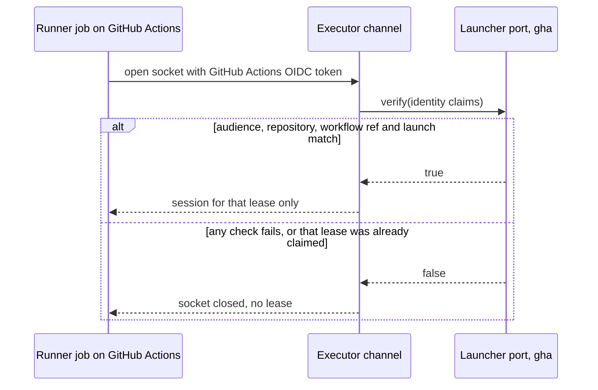

# Executor protocol

FlareDispatch speaks mameko's executor protocol unchanged. This file specifies the one rule FlareDispatch adds to it: how the control plane authenticates a socket that a GitHub Actions runner job opens, as the `verify` method of FlareDispatch's launcher port for the `gha` kind.

## Scope

mameko's [executor-protocol.md](https://github.com/fractalboxdev/mameko/blob/88770c64b14818ad32aed9615f1cfaf4bbc1f591/specs/executor-protocol.md) specifies every message between an executor and the control plane: the connection and its authentication for the `device`, `cloudflare` and `aws` kinds, framing and version negotiation, the session, the lease on the wire, heartbeat and progress, intents and results, the executor outbox and its replay, the restart anchor, the self-fence and the capacity-lease messages. FlareDispatch's lease inputs, the repository as scope id and the commit SHA, are profile values ([profile.md](profile.md)).

This file depends on:

- [executors.md](executors.md) § GitHub Actions launcher for the launch, the OIDC claims the launcher port checks and the claim rules;
- mameko's [hosts.md](https://github.com/fractalboxdev/mameko/blob/88770c64b14818ad32aed9615f1cfaf4bbc1f591/specs/hosts.md) § Application ports for the launcher port.

The decision behind the protocol is mameko's [ADR-0010](https://github.com/fractalboxdev/mameko/blob/88770c64b14818ad32aed9615f1cfaf4bbc1f591/specs/adr/0010-executor-transport.md).

## Model

### `gha` socket authentication

`gha` is a launcher kind FlareDispatch registers in its profile. mameko starts, cancels and authenticates every execution of a launcher kind only through the application's launcher port for that kind ([MAMEKO-HOST-044](https://github.com/fractalboxdev/mameko/blob/88770c64b14818ad32aed9615f1cfaf4bbc1f591/specs/hosts.md)). The runner job in a GitHub Actions run presents a GitHub Actions OIDC token when it opens its socket; the executor channel passes the token's claims to the port's `verify`, which answers `true` only for the one launch the claims name, and the socket receives only that launch's `(execution_id, epoch)`.

**The executor channel asks FlareDispatch's launcher port whether a `gha` socket may claim a lease**

*`gha` sockets · the launcher port's `verify` decides; the socket never reaches a lease its launch did not name.*

## Requirements

### `gha` sockets

- **FD-PROTO-014** · phase 4 · `V-CONF` — Where the executor kind is `gha`, the `verify` method of FlareDispatch's launcher port ([MAMEKO-HOST-044](https://github.com/fractalboxdev/mameko/blob/88770c64b14818ad32aed9615f1cfaf4bbc1f591/specs/hosts.md)) must answer `true` only for a GitHub Actions OIDC token that passes [executors.md](executors.md) FD-EXEC-088 to FD-EXEC-090 and only for the `(execution_id, epoch)` its launch named.

## Open items

None.
