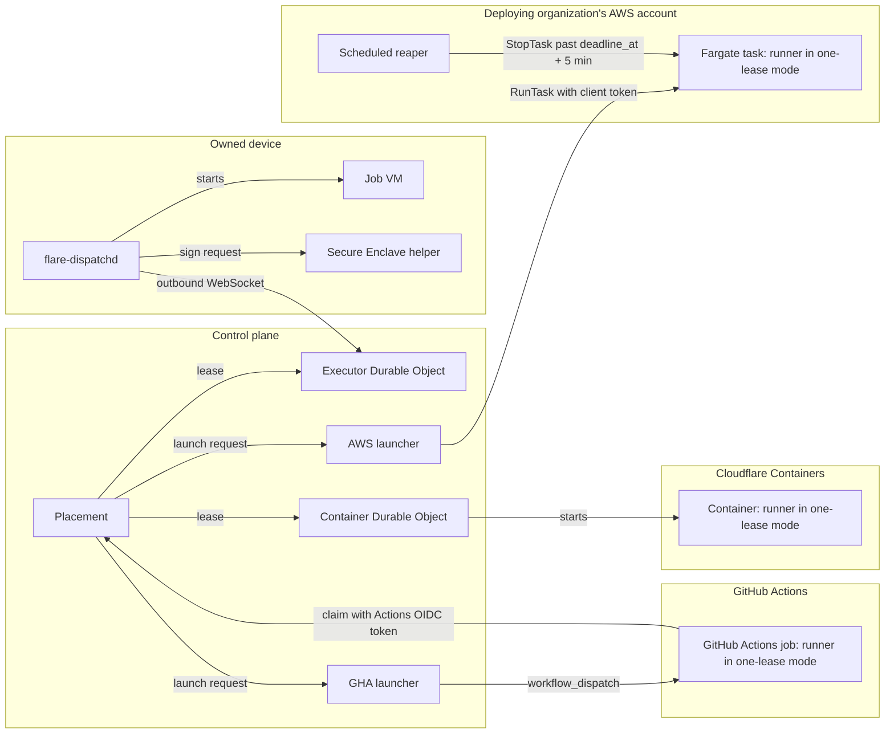
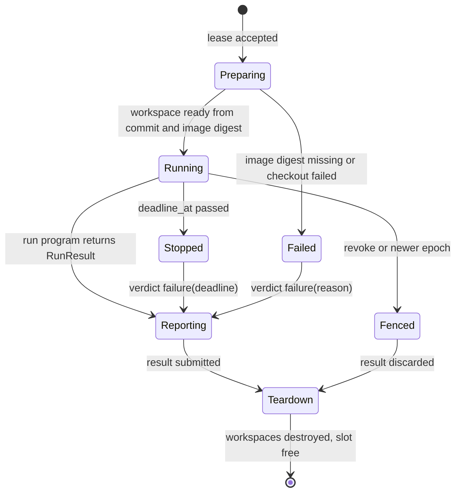
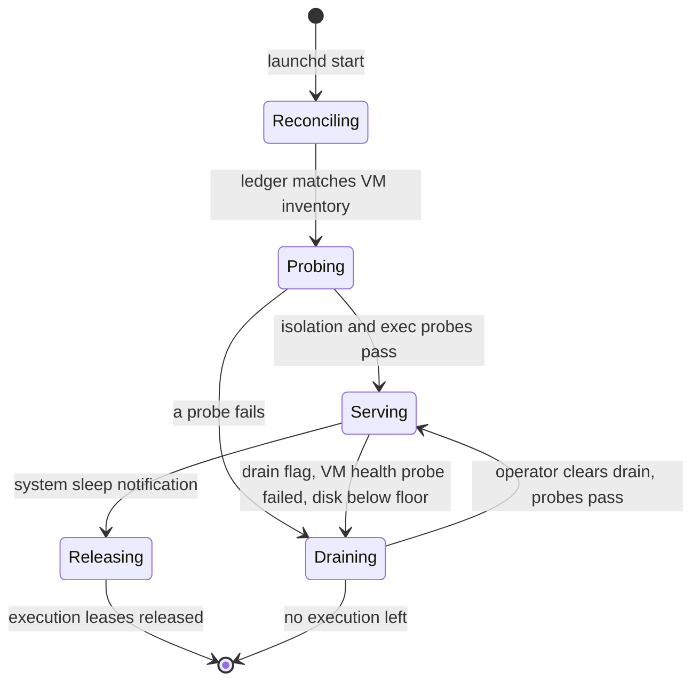
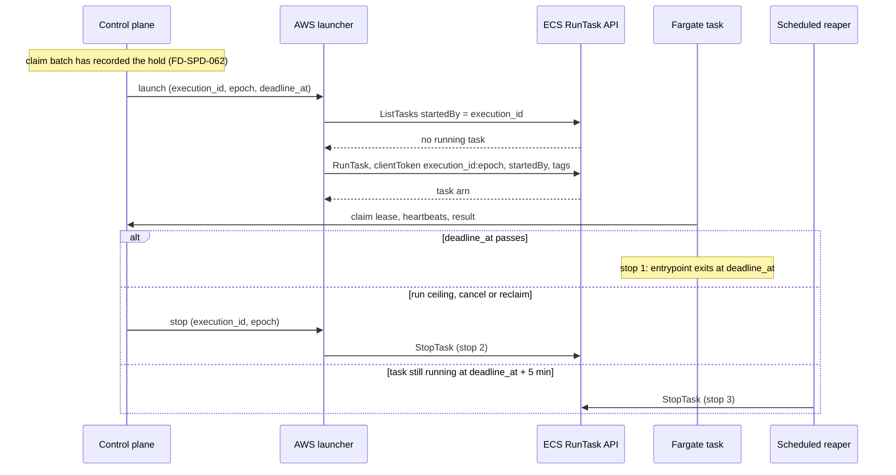

# Executors

This file specifies the four executor kinds — the Cloudflare Container pool, the owned device, the AWS launcher and the GitHub Actions launcher — and the contract every one of them meets: it runs a leased execution's whole run program, stops the job at `deadline_at`, executes commands under one exec contract, and reports a capability manifest the control plane places against.

## Scope

This file covers what happens on an executor between the moment it holds an execution lease and the moment its slot is free again: workspace creation, command execution, logs and receipts, stopping at `deadline_at`, teardown, probes, capability labels and images, and the per-kind mechanics of each backend. It also covers the agent `flare-dispatchd` and its Secure Enclave helper on a device.

It depends on:

- [placement-leases.md](placement-leases.md) for the executor registry, placement, the execution lease, epochs, reclaim, the capacity lease and the slot ledger;
- [executor-protocol.md](executor-protocol.md) for the wire messages, heartbeat, result submission, agent outbox replay, reconnect grace and self-fence;
- [isolation-egress.md](isolation-egress.md) for the VM boundary, the agent user, network isolation, egress profiles and per-lease credentials;
- [spend.md](spend.md) for the hold, settle and the drift alarm that fires on a settle above its hold;
- [qos-admission.md](qos-admission.md) for classes, placement constraints and retry rules;
- [cache-artifacts.md](cache-artifacts.md) for the L1 and L2 caches and the artifact store;
- [provenance.md](provenance.md) for device registration, attestation checks and statements;
- [local-scheduler.md](local-scheduler.md) for work a device runs under a capacity lease;
- [run-model.md](run-model.md) for `RunResult` and the error taxonomy.

The decisions behind this file are [ADR-0003](adr/0003-run-body-in-executor.md) (the run body executes inside the executor), [ADR-0009](adr/0009-device-isolation.md) (device isolation) and [ADR-0010](adr/0010-agent-implementation.md) (agent implementation).

Not specified: a per-repository sandbox transport pin; every Cloudflare Container uses the streaming transport, and a device has no SDK transport.

## Model

### Executor kinds

| Kind | What runs one job | Capacity | Job sandbox | Price on the meter | Phase |
| --- | --- | --- | --- | --- | --- |
| `cloudflare` | One Container instance of a class pool | The pool's admission cap ([qos-admission.md](qos-admission.md) FD-QOS-040) | The Container | The instance type's list rate | 0 |
| `cloudflare`, `control` pool | One run program on a runner inside the pool's Durable Object, with no Container | The `control` pool's admission cap | None: the run program executes no command | 0 for compute ([qos-admission.md](qos-admission.md) FD-QOS-042) | 0 |
| `device` | One Linux VM, started by Apple `container`, launched by the agent; a macOS VM for `macos-arm64` jobs | The device's slot ledger | The VM | 0 for compute; hosted model calls still count | 1 |
| `aws` | One Fargate task that runs the runner for one lease | The launch cap in the operator overlay | The task | The task's list rate, priced before launch | 3 |
| `gha` | One GitHub Actions job, started by `workflow_dispatch`, that runs the runner for one lease | The concurrency cap in the operator overlay | The GitHub Actions runner VM | The GitHub Actions runner's per-minute rate, rounded up to whole minutes | 4 |

Every kind runs the same runner: the TypeScript package that executes a run program against a SQLite journal local to one execution. On a device the agent hosts it for many leases at once, one child process per execution under the agent user, outside the job VM. In a Container, an AWS task and a GitHub Actions job it runs inside the job sandbox in one-lease mode and exits when the lease ends; in the `control` pool it runs in one-lease mode inside the pool's Durable Object.

**The control plane leases; each kind starts the job its own way**

*executor kinds · one runner, four ways to start it; only the device agent hosts several leases.*

### Capability labels

An executor's capability manifest lists its kind, the capability services its Layers serve ([run-model.md](run-model.md) § Layers), its capability labels, its platform and the image digests that passed the exec probe. A run's `requires` names the services it uses and its `labels` name the features it needs; placement removes every executor whose manifest lacks a service in `requires` or a declared label ([run-model.md](run-model.md) FD-RUN-015, [placement-leases.md](placement-leases.md) FD-LEASE-007).

| Label | Meaning | Advertised by |
| --- | --- | --- |
| `linux-amd64` | Runs linux/amd64 images | `cloudflare`, `aws`, `gha` |
| `linux-arm64` | Runs linux/arm64 images | `device`, `aws` |
| `macos-arm64` | Runs a macOS guest image | `device` (at most 2 slots), `gha` |
| `xcode` | The macOS image carries Xcode | `device`, `gha` |
| `browser` | A Chromium the job drives over CDP | `device` (inside the job VM), `cloudflare` (Browser Rendering through the dispatcher's CDP relay) |
| `detached-process` | A process that outlives the command that started it | every kind |
| `expose-port` | A port reachable from outside the executor | `cloudflare` only |
| `container-artifact` | An OCI image built by the job and exported as an artifact | `cloudflare`, `aws` |
| `local-model` | An OpenAI-compatible model server on the executor | `device` |

### A job on an executor

A job is the work an executor does for one execution at one epoch. Its lifecycle is the same on every kind; only the job sandbox differs (a Container, a VM, a Fargate task, a GitHub Actions runner VM).

**A job ends in exactly one of three ways, and every path frees the slot only after teardown**

*job lifecycle · stop at `deadline_at`, fence on revoke, teardown before the slot frees.*

### The agent on a device

The agent `flare-dispatchd` is TypeScript on Effect 4.0.6 running on Node, installed as a `launchd` service under its own macOS user ([isolation-egress.md](isolation-egress.md)). It holds one outbound WebSocket to its executor Durable Object, owns the slot ledger, starts every job VM through Apple `container`, and runs each execution's run program in its own child process. A small Swift helper, signed and notarized, holds the device key in the Secure Enclave and is the only component that signs with it ([ADR-0010](adr/0010-agent-implementation.md)).

The device key is the hardware-bound key that the MDM ACME payload generates in the Secure Enclave with `HardwareBound` and `Attest` set; the helper reaches it as a `SecIdentity` through the payload's keychain access, and Managed Device Attestation attests it. The agent's TLS client certificate carries a separate P-256 key in a file readable only by the agent user, because Node's TLS stack cannot sign with a Secure Enclave key. That key is not the device key: the edge checks the certificate ([executor-protocol.md](executor-protocol.md) FD-PROTO-002), and a session opens only after a `connect` signature by the device key (FD-PROTO-007).

**The agent claims nothing until its ledger matches the VMs that are actually running**

*agent lifecycle · reconcile, probe, serve; sleep releases leases first.*

### The AWS launcher

AWS has no hard spend stop, so three independent stops bound every task. The latest of them falls at `deadline_at` + 6 min + `stopTimeout`, and the hold the claim batch records before launch ([spend.md](spend.md) FD-SPD-062) covers it; the launcher reserves no hold of its own.

**Three stops bound an AWS task; the reaper works while the control plane is down**

*AWS stops · entrypoint, dispatcher, reaper; the last stop lands by `deadline_at` + 6 min + `stopTimeout`.*

## Requirements

### Executor contract

- **FD-EXEC-001** · phase 0 · `V-CONF` `V-E2E-LOCAL` — When an executor accepts an execution lease, the executor must run the execution's whole run program against a SQLite journal local to that execution and submit its `RunResult` and intents through the messages in [executor-protocol.md](executor-protocol.md).
- **FD-EXEC-002** · phase 0 · `V-CONF` `V-SIM` — When `deadline_at` passes, every executor must stop the job it runs for that execution within 10 s, whether or not it is connected to the control plane.
- **FD-EXEC-003** · phase 0 · `V-CONF` — If an executor stops a job at `deadline_at`, then the executor must submit the verdict `failure` with the reason `deadline`.
- **FD-EXEC-004** · phase 0 · `V-CONF` `V-SIM` — When the control plane revokes an execution lease, the executor must stop that execution's job and destroy its workspaces within 30 s.
- **FD-EXEC-005** · phase 1 · `V-UNIT` — The executor must name each workspace with an id derived deterministically from the lease id and epoch, using only `[a-z0-9-]` and at most 40 characters.
- **FD-EXEC-006** · phase 1 · `V-UNIT` — Where a run opens a keyed auxiliary workspace, the executor must derive its id from the lease id, epoch and key under the rule in FD-EXEC-005.
- **FD-EXEC-007** · phase 1 · `V-CONF` — The executor must build each workspace from the execution's commit SHA and the image digest the lease names, and must not restore a workspace written by another execution except through an L1 or L2 cache entry that [cache-artifacts.md](cache-artifacts.md) admits for the execution's trust namespace.
- **FD-EXEC-008** · phase 1 · `V-CONF` — When the executor finishes a checkout, the executor must verify that `HEAD` equals the commit SHA the lease names.
- **FD-EXEC-009** · phase 1 · `V-CONF` — If the checked-out `HEAD` differs from the leased commit SHA, then the executor must fail the step with `CheckoutFailed`.
- **FD-EXEC-010** · phase 1 · `V-UNIT` — The executor must return file contents to the run program only from the run's declared output paths, at most 4 MiB per file.
- **FD-EXEC-011** · phase 1 · `V-UNIT` — If a read names a path outside the run's declared output paths, then the executor must reject it with `ReadRefused`.
- **FD-EXEC-012** · phase 1 · `V-CONF` — When an execution's lease ends, the executor must destroy every workspace of that execution, keyed auxiliary workspaces included, before it reports the slot free.
- **FD-EXEC-013** · phase 1 · `V-UNIT` — The executor must report the exit code and stop reason of each workspace teardown in its next heartbeat or, while disconnected, in its agent outbox.

### Exec contract

- **FD-EXEC-014** · phase 1 · `V-UNIT` `V-CONF` — When a command exits with a non-zero code, the executor must return an `ExecResult` carrying that code and must not retry the command.
- **FD-EXEC-015** · phase 1 · `V-UNIT` `V-CONF` — If a command runs past its timeout, then the executor must fail it with `ExecTimeout` and must not retry it.
- **FD-EXEC-016** · phase 1 · `V-UNIT` — If a command fails to launch, then the executor must fail it with `ExecFailed` and exit code −1.
- **FD-EXEC-017** · phase 1 · `V-UNIT` — If a command's working directory does not exist, then the executor must fail it with `ExecFailed` and exit code −1.
- **FD-EXEC-018** · phase 1 · `V-CONF` — When the executor stops a command, the executor must send `SIGTERM` to the command's process group and `SIGKILL` 1 s later.
- **FD-EXEC-019** — Removed; see [cache-artifacts.md](cache-artifacts.md) FD-CACHE-081.
- **FD-EXEC-020** · phase 1 · `V-UNIT` — The executor must apply redaction before truncation on every durable surface: log streams, the recorded command, `ExecTimeout.command` and the stderr tail.
- **FD-EXEC-021** · phase 1 · `V-UNIT` — The executor must redact a secret that spans a log chunk boundary, using a cross-chunk window of 16 KiB.
- **FD-EXEC-022** · phase 1 · `V-UNIT` — The executor must return at most the last 16 KiB of stdout and the last 4 KiB of stderr inline in an `ExecResult`.
- **FD-EXEC-023** · phase 1 · `V-UNIT` — If a command's output exceeds 64 MiB, then the executor must stop the command, fail the step with `OutputLimitExceeded` and publish no verdict derived from that output.
- **FD-EXEC-024** · phase 1 · `V-CONF` `V-REPLAY` — The executor must launch a durable command at most once per handle, where the handle id covers the execution id, epoch, step name, command, working directory, environment variable names, timeout and redaction policy.
- **FD-EXEC-025** · phase 1 · `V-CONF` — While a receipt for a handle is in flight, the executor must join a retried exec call for that handle to the running process instead of starting a second one.
- **FD-EXEC-026** · phase 1 · `V-REPLAY` — When a step replays over a finalized receipt, the executor must return the recorded `ExecResult` unchanged and must not run the command again.
- **FD-EXEC-027** · phase 1 · `V-CONF` `V-SIM` — If a durable command's process is lost inside one lease, then the executor must relaunch it under a new handle at most 2 times and then fail the step with `SandboxProcessLost`.
- **FD-EXEC-028** · phase 1 · `V-CONF` — Where an executor advertises `detached-process`, the executor must run each detached process under the durable-command handle rules and stop it when the lease ends.

### Capabilities, images and probes

- **FD-EXEC-029** · phase 1 · `V-UNIT` — Each executor must register a capability manifest that lists its kind, the capability services its Layers serve, its labels from the set in § Capability labels, its platform and the image digests that passed the exec probe.
- **FD-EXEC-030** · phase 1 · `V-UNIT` — A device must not advertise `expose-port` in the capability manifest it registers for execution leases.
- **FD-EXEC-031** · phase 1 · `V-CONF` — The executor must start a workspace only from an image referenced by digest.
- **FD-EXEC-032** · phase 1 · `V-UNIT` — If a lease names an image without a digest, then the executor must reject the lease with `ImageNotPinned`.
- **FD-EXEC-033** · phase 1 · `V-DEPLOY` — The committed image definitions must pin every base image, toolchain and download by version and SHA-256 digest, with no floating channel such as `stable` or `latest`.
- **FD-EXEC-034** · phase 1 · `V-DEPLOY` — The committed image definitions must build every Linux image of the family for both linux/amd64 and linux/arm64.
- **FD-EXEC-035** · phase 1 · `V-E2E-LOCAL` `V-LIVE` — When an executor first runs an image digest, the executor must pass an exec probe on that digest — create a workspace, run a command, replay the same handle and observe the deduplicated receipt, then abort — before it advertises slots for that digest.
- **FD-EXEC-036** · phase 1 · `V-UNIT` — If an exec probe fails, then the executor must leave that image digest out of its capability manifest.
- **FD-EXEC-037** · phase 4 · `V-E2E-LOCAL` — Where a run needs `browser` on a device, the agent must serve it from a Chromium inside the job VM.
- **FD-EXEC-038** · phase 1 · `V-UNIT` `V-LIVE` — Where a run needs `browser` on a Cloudflare executor, the control plane must mint its own CDP-proxy token for that execution alone, expiring at `deadline_at`, and the dispatcher must relay CDP between the job and a Browser Rendering session it opens through the binding with `keep_alive` of at most 20 min, opening a new session when that one closes.
- **FD-EXEC-039** · phase 1 · `V-UNIT` — The control plane must accept a CDP-proxy token only in the `Authorization` header, and must reject a token passed in a URL query string.

### Cloudflare Container

- **FD-EXEC-040** · phase 0 · `V-DEPLOY` `V-UNIT` — Each Cloudflare Container class must register as one executor of kind `cloudflare` whose capacity is its pool's admission cap in the deployed configuration.
- **FD-EXEC-041** — Removed; see [qos-admission.md](qos-admission.md) FD-QOS-040.
- **FD-EXEC-042** · phase 0 · `V-CONF` — The Cloudflare executor must run at most one execution per Container instance.
- **FD-EXEC-043** · phase 0 · `V-CONF` `V-SIM` — When a Container's job starts, its Durable Object must call `this.schedule(deadline_at, 'destroyAtDeadline')`, which calls `destroy()` whether or not the in-container runner has exited, and must not call `ctx.storage.setAlarm` or override `alarm()`, which the `Container` class uses for its own lifecycle.
- **FD-EXEC-044** · phase 0 · `V-CONF` — When the control plane accepts a Cloudflare execution's result, the Container's Durable Object must destroy the Container within 30 s, without waiting for `sleepAfter`.
- **FD-EXEC-045** · phase 0 · `V-SIM` — If a Container exits before its runner submits a result, then the Container's Durable Object must send `exec.release` with the reason `container-lost` for the current epoch within 30 s ([executor-protocol.md](executor-protocol.md) FD-PROTO-060), and must not report `SandboxProcessLost`, which FD-EXEC-027 reserves for a lost durable command.
- **FD-EXEC-046** · phase 0 · `V-DEPLOY` — The committed configuration must set each Container class's rollout grace period to at least the longest `maxDurationSec` among the runs that class serves.
- **FD-EXEC-047** — Removed; see [qos-admission.md](qos-admission.md) FD-QOS-039.
- **FD-EXEC-094** · phase 0 · `V-CONF` `V-SIM` — The `control` pool must be an executor of kind `cloudflare` whose runner runs each run program inside a Durable Object with no Container, serves no `Exec` or `Workspace` capability, holds one execution lease per run under the rules of [placement-leases.md](placement-leases.md), and stops the run at `deadline_at`.

### Owned device

- **FD-EXEC-048** · phase 1 · `V-E2E-LOCAL` — The agent must run as one `launchd` service per device and must start every job VM on that device itself.
- **FD-EXEC-049** · phase 1 · `V-UNIT` — If the host is not Apple silicon running macOS 26 or later, then the agent must exit with `UnsupportedHost` and register no slots.
- **FD-EXEC-050** · phase 1 · `V-E2E-LOCAL` — The agent must run each execution's run program in its own child process with its own SQLite journal file.
- **FD-EXEC-051** · phase 1 · `V-E2E-LOCAL` `V-SIM` — If a run program's child process exits without submitting a result, then the agent must restart it once from that execution's journal while the lease is current.
- **FD-EXEC-052** · phase 1 · `V-SIM` `V-E2E-LOCAL` — When the agent starts, the agent must load its persisted slot ledger and reconcile it against the running VM inventory before it claims any execution.
- **FD-EXEC-053** · phase 1 · `V-E2E-LOCAL` — If a running VM has no entry in the slot ledger, then the agent must stop that VM before it claims any execution.
- **FD-EXEC-054** — Removed; see [executor-protocol.md](executor-protocol.md) FD-PROTO-033.
- **FD-EXEC-055** — Removed; see [executors.md](executors.md) FD-EXEC-002.
- **FD-EXEC-056** · phase 1 · `V-E2E-LOCAL` — The agent must create each job's workspace as an APFS copy-on-write clone of a block image and must attach it to the VM as a block device, not as a virtiofs share.
- **FD-EXEC-057** · phase 1 · `V-UNIT` — The agent must advertise VM memory that sums to at most the host's RAM minus the local model server's reservation minus the interactive reserve, default 16 GiB, set per device.
- **FD-EXEC-058** · phase 4 · `V-UNIT` — The agent must advertise at most 2 slots with the label `macos-arm64`.
- **FD-EXEC-059** · phase 1 · `V-E2E-LOCAL` — The agent must start P1 job VMs at Apple QoS `user-initiated`, P2 job VMs at `utility`, and P3 and capacity-lease VMs at `background`.
- **FD-EXEC-060** · phase 1 · `V-E2E-LOCAL` — If the agent fails to verify at start that the QoS class it sets reaches the VM's process, then the agent must report `qos-unsupported` in its registration and rely on slot shrink alone.
- **FD-EXEC-061** · phase 1 · `V-UNIT` — While the device runs on battery power, the agent must advertise 0 slots.
- **FD-EXEC-062** · phase 1 · `V-E2E-LOCAL` — While the agent holds an execution lease, the agent must hold an `IOPMAssertion` of type `PreventSystemSleep`.
- **FD-EXEC-063** — Removed; see [executor-protocol.md](executor-protocol.md) FD-PROTO-059.
- **FD-EXEC-064** · phase 1 · `V-UNIT` — The agent must report its activity signal, power source, memory-pressure level and thermal state in every heartbeat.
- **FD-EXEC-065** · phase 1 · `V-E2E-LOCAL` — If a job VM fails the agent's health probe, then the agent must drain the device.
- **FD-EXEC-066** — Removed; see [cache-artifacts.md](cache-artifacts.md) FD-CACHE-010.
- **FD-EXEC-067** · phase 1 · `V-E2E-LOCAL` — If free disk space stays below the floor after L1 eviction, then the agent must drain the device.

### Secure Enclave helper

- **FD-EXEC-068** · phase 1 · `V-E2E-LOCAL` — The helper must use as the device key only the hardware-bound P-256 key that the MDM ACME payload generates in the Secure Enclave with `HardwareBound` and `Attest` set, reached as a `SecIdentity` through the payload's keychain access, and must never return its private part.
- **FD-EXEC-069** · phase 1 · `V-UNIT` — The helper must expose only the operations `identity`, `sign` and `continuousTime`, over a Unix socket owned by the agent user.
- **FD-EXEC-070** · phase 1 · `V-E2E-LOCAL` — If the calling process's audit token (`LOCAL_PEERTOKEN`) does not identify the agent's signed single executable by its bundle identifier and designated requirement, then the helper must reject the call.
- **FD-EXEC-071** · phase 1 · `V-UNIT` — The helper must sign only a SHA-256 digest prefixed with one purpose tag from the set `connect`, `lease-call`, `statement` and `cache-entry`.
- **FD-EXEC-072** · phase 1 · `V-DEPLOY` — The release build must sign the helper binary with a Developer ID certificate and notarize it, must fail when `codesign --verify` or `spctl --assess` rejects the built helper, and must give the helper the code-signing requirement that device enrollment checks.
- **FD-EXEC-073** · phase 1 · `V-UNIT` — The `identity` operation must return the device key's public key, its certificate chain and the Managed Device Attestation evidence that enrollment produced.
- **FD-EXEC-101** · phase 1 · `V-UNIT` `V-E2E-LOCAL` — The agent must present as its TLS client identity a P-256 key distinct from the device key, stored in a file readable only by the agent user, and must not use the device key for TLS.
- **FD-EXEC-102** · phase 1 · `V-E2E-LOCAL` — The agent must ship as a Developer ID-signed single executable (Node SEA) with its own bundle identifier, and must start each run program's child process from a separately signed binary whose identifier the helper rejects.

### AWS launcher

- **FD-EXEC-074** · phase 3 · `V-CONF` `V-SIM` — When the control plane places an execution on `aws`, the AWS launcher must start one Fargate task for that (execution, epoch), passing `RunTask` `startedBy` set to the execution id (a 26-character ULID) and `clientToken` set to `<execution_id>:<epoch>`.
- **FD-EXEC-075** · phase 3 · `V-UNIT` — The AWS launcher must tag every task it starts with the execution id, the epoch and `deadline_at`.
- **FD-EXEC-076** · phase 3 · `V-SIM` — Before it launches a task for an execution, the AWS launcher must call `ListTasks` with `startedBy` set to the execution id and `desiredStatus` `RUNNING`, and confirm that it returns no task.
- **FD-EXEC-077** · phase 3 · `V-SIM` — If the listing finds a running task for the execution, then the AWS launcher must not launch a second task.
- **FD-EXEC-078** · phase 3 · `V-SIM` — If a `RunTask` call times out, then the AWS launcher must retry `RunTask` with the same `clientToken` and identical parameters, and must treat a returned task, or a `ConflictException` carrying `resourceIds`, as the launched task.
- **FD-EXEC-079** · phase 3 · `V-UNIT` `V-PROOF` `V-DIFF` — The AWS launcher must launch a task only for an execution whose claim batch has recorded its hold under [spend.md](spend.md) FD-SPD-062, must reserve no hold of its own, and must not launch when that hold is below the task's list rate × (the time from launch to `deadline_at` + the reaper grace of 5 min + the reaper period of 1 min + the task's `stopTimeout`) or below the 60 s minimum billed duration.
- **FD-EXEC-095** · phase 3 · `V-DEPLOY` — The AWS task definition must set each container's `stopTimeout` to at most 30 s.
- **FD-EXEC-080** · phase 3 · `V-CONF` — The task entrypoint must exit at `deadline_at`.
- **FD-EXEC-081** · phase 3 · `V-SIM` — When the run ceiling passes, or the control plane cancels or reclaims an AWS execution, the AWS launcher must stop the task with `StopTask`.
- **FD-EXEC-082** · phase 3 · `V-SIM` `V-LIVE` — A reaper scheduled every 1 min in the deploying organization's AWS account must stop every FlareDispatch-tagged task whose tagged `deadline_at` is more than 5 min past, whether or not the control plane is reachable.
- **FD-EXEC-083** · phase 3 · `V-DEPLOY` — The deploying organization's AWS account must carry an AWS Budgets action that denies new task launches when spend reaches the AWS limit set in the operator overlay, and the drift check in [operability.md](operability.md) must read that action and fail when it is missing.
- **FD-EXEC-084** · phase 3 · `V-UNIT` — The control plane must call AWS only with credentials from `AssumeRoleWithWebIdentity` on its own OIDC token, valid at most 900 s, and must store no AWS access key.

### Breakers and spill order

- **FD-EXEC-096** · phase 0 · `V-UNIT` `V-SIM` — If 3 Container launches of one Container class fail within 5 min, where a launch fails when the start request errors or the in-container runner does not open the protocol connection ([executor-protocol.md](executor-protocol.md) FD-PROTO-012) within 60 s, then the control plane must open that class's `cloudflare` breaker for 5 min.
- **FD-EXEC-097** · phase 0 · `V-UNIT` `V-SIM` — While a class's `cloudflare` breaker is open, the control plane must start no Container of that class, and must record `failure` with the reason `capacity: cloud degraded` for each P0, P1 or P2 execution that no other executor can take when its wait under [qos-admission.md](qos-admission.md) ends: `deadline_at` for P1, its queue age for P0 and P2.
- **FD-EXEC-098** · phase 0 · `V-UNIT` — The control plane must spill an execution of class P2 or P3 only to executor kind `cloudflare`, and an execution of class P1 to `cloudflare` first and then to `aws` where an `aws` executor is eligible.
- **FD-EXEC-099** · phase 3 · `V-UNIT` `V-SIM` — While the `cloudflare` breaker of a P1 execution's pool is open, the control plane must place that execution on `aws` where an `aws` executor is eligible.
- **FD-EXEC-100** · phase 3 · `V-UNIT` `V-SIM` — If 3 AWS task launches fail within 5 min, then the control plane must open the `aws` breaker for 5 min, start no AWS task while it is open, and record `failure` with the reason `capacity: aws launch failed` for each P1 execution that no other executor can take when its wait under [qos-admission.md](qos-admission.md) ends at `deadline_at`.

### GitHub Actions launcher

- **FD-EXEC-085** · phase 4 · `V-CONF` — When the control plane places an execution on `gha`, the GitHub Actions launcher must start one `workflow_dispatch` run of the runner workflow, in the runner repository the operator overlay names, for that (execution, epoch).
- **FD-EXEC-086** · phase 4 · `V-UNIT` — The `workflow_dispatch` inputs must carry only the execution id, the epoch and the minutes until `deadline_at`, and no credential.
- **FD-EXEC-087** · phase 4 · `V-UNIT` — The runner workflow must set the job's `timeout-minutes` from the minutes-until-`deadline_at` input, and the runner in the job must exit at `deadline_at`.
- **FD-EXEC-088** · phase 4 · `V-UNIT` — The runner job must claim its lease with a GitHub Actions OIDC token whose audience is the control plane.
- **FD-EXEC-089** · phase 4 · `V-UNIT` — If the OIDC token's repository or workflow ref differs from the runner repository and workflow the operator overlay names, then the control plane must reject the claim.
- **FD-EXEC-090** · phase 4 · `V-UNIT` `V-SIM` — If a claim for an (execution, epoch) was already accepted, then the control plane must reject every later claim for it.
- **FD-EXEC-091** · phase 4 · `V-DEPLOY` — The runner workflow must grant its `GITHUB_TOKEN` no permission except `id-token: write`.
- **FD-EXEC-092** · phase 4 · `V-SIM` — When the control plane cancels or reclaims a `gha` execution, the GitHub Actions launcher must cancel the workflow run through the Actions API.
- **FD-EXEC-093** · phase 4 · `V-UNIT` — The `gha` executor's registration must price a job at its GitHub Actions runner's per-minute rate rounded up to whole minutes, with a rate of 0 for standard GitHub-hosted runners serving a public repository.

## Open items

- TODO(maintainer): measure Apple `container` VM start latency per job, p50 and p95, on a phase 1 device, and decide whether a pool of pre-booted VMs is needed to keep P1 claims inside the claim deadline in [qos-admission.md](qos-admission.md).
- TODO(operator): set the AWS launch cap and the GitHub Actions concurrency cap in the operator overlay before phase 3 and phase 4.
