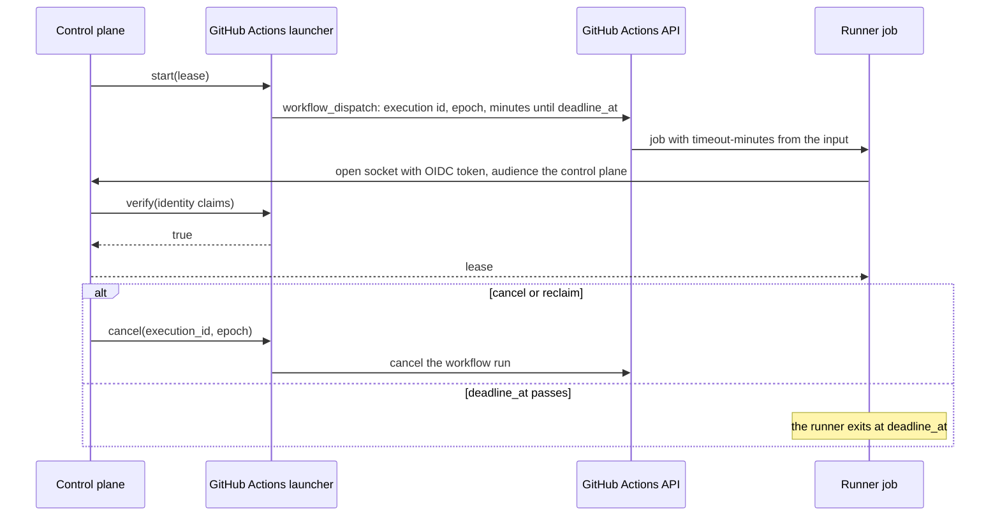

# Executors

FlareDispatch runs every execution on mameko's executor kinds, and adds one launcher kind of its own, `gha`, that runs a job on GitHub Actions. This file specifies the GitHub Actions launcher as FlareDispatch's implementation of mameko's launcher port, and FlareDispatch's values for the `cloudflare`, `device` and `aws` kinds: which cache entries a workspace may restore from, the CPU priority each class gets on a device and the AWS budget check.

## Scope

mameko's [executors.md](https://github.com/fractalboxdev/mameko/blob/3af65c59d5f30123eb55b468966b4975c7395ece/specs/executors.md) specifies the executor contract, the exec contract, capability labels, images and probes, the Cloudflare Container pool, the device executor and its job runtimes, the key helper, the AWS launcher, the device extensions and the breakers. FlareDispatch inherits them unchanged. The class catalogue, each class's cloud executor preference order, the signing purposes, the device key stores and the rate card are profile values ([profile.md](profile.md)).

This file depends on:

- [profile.md](profile.md) for the classes, their cloud kinds, the launcher kind `gha`, the signing purposes, `registration.key_stores` and the `gha` price;
- [cache-artifacts.md](cache-artifacts.md) for the cache namespaces and the L1 and L2 caches;
- [executor-protocol.md](executor-protocol.md) for the `verify` method that authenticates a `gha` socket;
- [isolation-egress.md](isolation-egress.md) for the egress firewall on a `gha` runner job;
- [operability.md](operability.md) for the deploy drift check;
- mameko's [hosts.md](https://github.com/fractalboxdev/mameko/blob/3af65c59d5f30123eb55b468966b4975c7395ece/specs/hosts.md) § Application ports for the launcher port.

The decisions behind the executors are mameko's [ADR-0005](https://github.com/fractalboxdev/mameko/blob/3af65c59d5f30123eb55b468966b4975c7395ece/specs/adr/0005-run-body-in-executor.md) (the run body executes inside the executor), [ADR-0011](https://github.com/fractalboxdev/mameko/blob/3af65c59d5f30123eb55b468966b4975c7395ece/specs/adr/0011-device-isolation.md) (device isolation), [ADR-0012](https://github.com/fractalboxdev/mameko/blob/3af65c59d5f30123eb55b468966b4975c7395ece/specs/adr/0012-device-executor-implementation.md) (device programs in Rust) and [ADR-0019](https://github.com/fractalboxdev/mameko/blob/3af65c59d5f30123eb55b468966b4975c7395ece/specs/adr/0019-device-platforms-and-job-runtimes.md) (device platforms and job runtimes).

## Model

### Executor kinds

| Kind | Owner of the mechanism | What runs one job | Phase |
| --- | --- | --- | --- |
| `cloudflare` | mameko | One Container instance of a class pool; the `control` pool runs a run program in its Durable Object with no Container | 0 |
| `device` | mameko | One job sandbox started by mameko's device executor on an owned device | 1 |
| `aws` | mameko | One Fargate task in the deploying organization's AWS account | 3 |
| `gha` | FlareDispatch, as a launcher kind | One GitHub Actions job, started by `workflow_dispatch`, that runs the runner for one lease | 4 |

Each class tries the cloud kinds in the order the profile gives it. Every class lists `gha` last, and the profile's placement constraints remove `gha` from every run except a release-matrix job and an `apple-build` run of class `required` ([profile.md](profile.md) § Placement).

### Devices

A device runs mameko's device bundle for its platform: the device executor, the local scheduler, the key helper, the sandbox relay and the runner, all from one mameko release ([MAMEKO-REL-047](https://github.com/fractalboxdev/mameko/blob/3af65c59d5f30123eb55b468966b4975c7395ece/specs/releases.md), [MAMEKO-REL-049](https://github.com/fractalboxdev/mameko/blob/3af65c59d5f30123eb55b468966b4975c7395ece/specs/releases.md)), with FlareDispatch's run-catalogue bundle ([run-model.md](run-model.md) § Runner entry) and device extension beside it. The device programs are Rust binaries ([MAMEKO-EXEC-119](https://github.com/fractalboxdev/mameko/blob/3af65c59d5f30123eb55b468966b4975c7395ece/specs/executors.md)); FlareDispatch adds only `fd`, mameko's `<cli>` built with the command name `fd` from the same release ([interfaces.md](interfaces.md)). The key helper holds the device key and is the only process that signs with it; that key is the device's only credential for the control plane ([MAMEKO-EXEC-068](https://github.com/fractalboxdev/mameko/blob/3af65c59d5f30123eb55b468966b4975c7395ece/specs/executors.md), [interfaces.md](interfaces.md) § Device connection and enrollment).

FlareDispatch's profile admits device keys only from the `secure-enclave` key store ([profile.md](profile.md) FD-PROF-052), so only a Mac with a Secure Enclave registers. On a Mac the job runtime is `apple-container`, which needs Apple `container` 1.6.0 or later ([MAMEKO-EXEC-129](https://github.com/fractalboxdev/mameko/blob/3af65c59d5f30123eb55b468966b4975c7395ece/specs/executors.md)). No FlareDispatch class declares `isolation: container`, so a device under `oci-engine` would also need a VM-backed OCI runtime to advertise `isolation:vm` and take any FlareDispatch execution ([MAMEKO-EXEC-098](https://github.com/fractalboxdev/mameko/blob/3af65c59d5f30123eb55b468966b4975c7395ece/specs/executors.md)).

### The GitHub Actions launcher

The GitHub Actions launcher is FlareDispatch's implementation of mameko's launcher port for the kind `gha` ([MAMEKO-HOST-044](https://github.com/fractalboxdev/mameko/blob/3af65c59d5f30123eb55b468966b4975c7395ece/specs/hosts.md)):

| Port method | FlareDispatch's implementation | Requirements |
| --- | --- | --- |
| `start(lease)` | One `workflow_dispatch` run of the runner workflow in the runner repository the operator overlay names, with the execution id, the epoch and the minutes until `deadline_at` as its only inputs | FD-EXEC-085 to FD-EXEC-087 |
| `cancel(execution_id, epoch)` | Cancels that workflow run through the Actions API | FD-EXEC-092 |
| `verify(identity claims)` | Answers `true` for the runner job's GitHub Actions OIDC token of the one launch it names, `false` otherwise | FD-EXEC-088 to FD-EXEC-090, [executor-protocol.md](executor-protocol.md) FD-PROTO-014 |

**The launcher starts a workflow run; the runner job claims its lease with its OIDC token**

*`gha` launcher · the dispatch inputs carry no credential; the OIDC token is the job's only identity.*

## Requirements

### Workspaces

- **FD-EXEC-007** · phase 1 · `V-CONF` — The cache entries from which [MAMEKO-EXEC-007](https://github.com/fractalboxdev/mameko/blob/3af65c59d5f30123eb55b468966b4975c7395ece/specs/executors.md) lets an executor restore a workspace must be only the L1 or L2 entries that [cache-artifacts.md](cache-artifacts.md) admits for a cache namespace the execution may read.

### Device CPU priority

- **FD-EXEC-059** · phase 1 · `V-E2E-LOCAL` — Under [MAMEKO-EXEC-055](https://github.com/fractalboxdev/mameko/blob/3af65c59d5f30123eb55b468966b4975c7395ece/specs/executors.md) and the class catalogue of [profile.md](profile.md), the device executor must start `required` (P1) job sandboxes at `user-initiated`, `interactive` (P2) at `utility`, and `batch` (P3) and capacity-lease sandboxes at `background` under `apple-container`.

### AWS budget check

- **FD-EXEC-083** · phase 3 · `V-DEPLOY` — The drift check in [operability.md](operability.md) must read the AWS Budgets action that [MAMEKO-EXEC-087](https://github.com/fractalboxdev/mameko/blob/3af65c59d5f30123eb55b468966b4975c7395ece/specs/executors.md) requires in the deploying organization's AWS account, and must fail when it is missing.

### GitHub Actions launcher

- **FD-EXEC-085** · phase 4 · `V-CONF` — When the control plane calls `start` on the `gha` launcher port for an (execution, epoch), the GitHub Actions launcher must start one `workflow_dispatch` run of the runner workflow, in the runner repository the operator overlay names, for that (execution, epoch).
- **FD-EXEC-086** · phase 4 · `V-UNIT` — The `workflow_dispatch` inputs must carry only the execution id, the epoch and the minutes until `deadline_at`, and no credential.
- **FD-EXEC-087** · phase 4 · `V-UNIT` — The runner workflow must set the job's `timeout-minutes` from the minutes-until-`deadline_at` input, and the runner in the job must exit at `deadline_at`.
- **FD-EXEC-088** · phase 4 · `V-UNIT` — The runner job must claim its lease with a GitHub Actions OIDC token whose audience is the control plane.
- **FD-EXEC-089** · phase 4 · `V-UNIT` — If the OIDC token's repository or workflow ref differs from the runner repository and workflow the operator overlay names, then `verify` must reject the claim.
- **FD-EXEC-090** · phase 4 · `V-UNIT` `V-SIM` — If a claim for an (execution, epoch) was already accepted, then `verify` must reject every later claim for it.
- **FD-EXEC-091** · phase 4 · `V-DEPLOY` — The runner workflow must grant its `GITHUB_TOKEN` no permission except `id-token: write`.
- **FD-EXEC-092** · phase 4 · `V-SIM` — When the control plane calls `cancel` on the `gha` launcher port, the GitHub Actions launcher must cancel the workflow run of that (execution, epoch) through the Actions API.

## Open items

- TODO(operator): set the AWS launch cap and the GitHub Actions concurrency cap in the operator overlay before phase 3 and phase 4.
