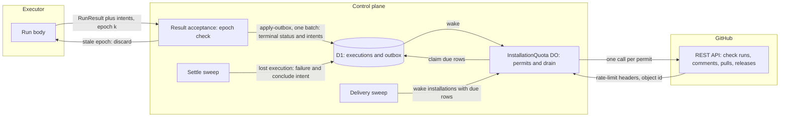
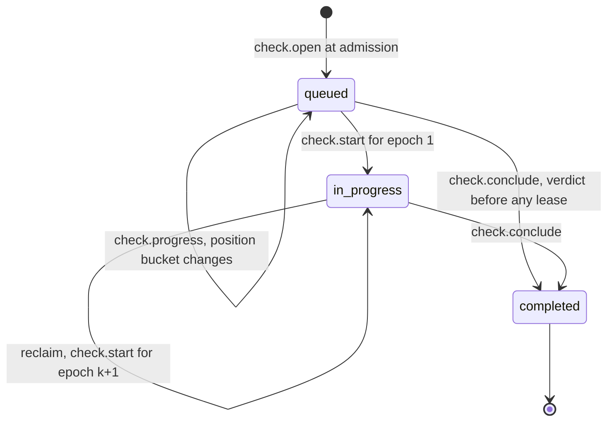
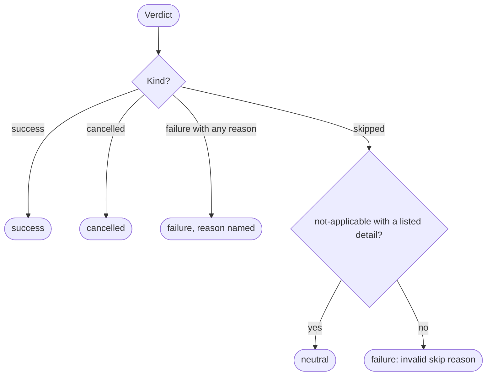
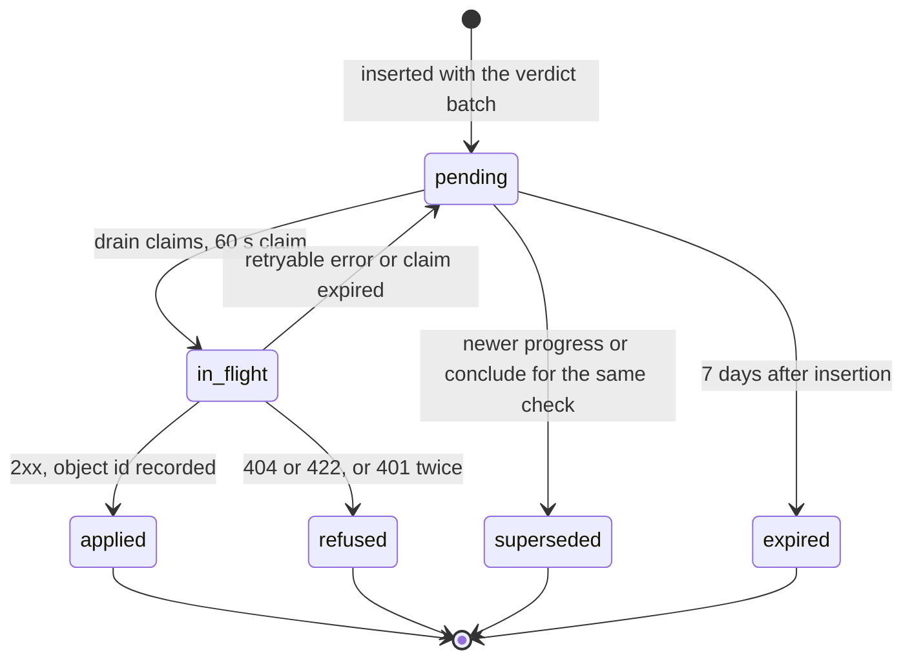
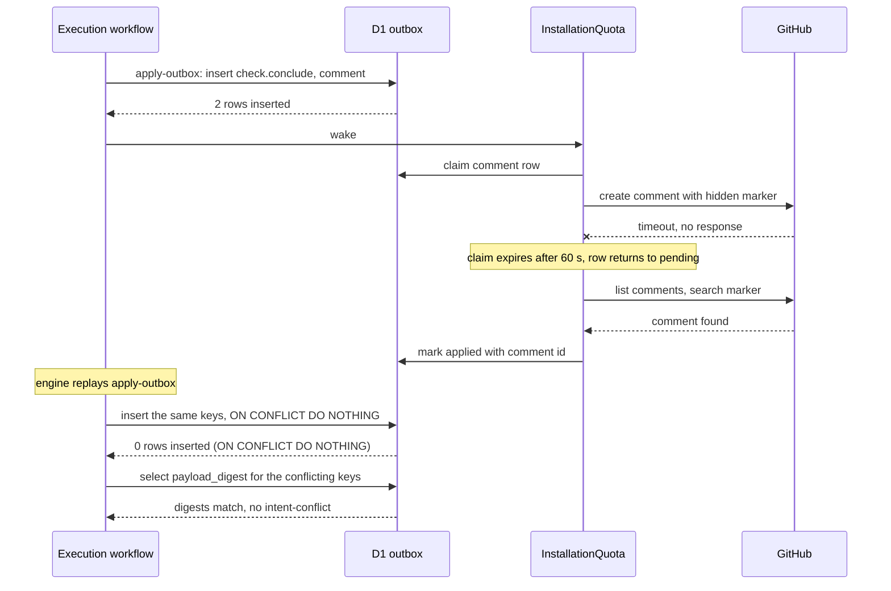

# GitHub output

This file specifies how the control plane turns executions into GitHub effects: the check-run lifecycle, the one mapping from verdict to conclusion, the transactional outbox that applies each intent once per `(execution_id, intent_key)`, the per-installation quota object that paces every GitHub call, the delivery and settle sweeps, merge-queue support, and the side outputs (comments, pull requests, releases, notifications).

## Scope

This file covers every write the control plane makes to GitHub or to a notification channel on behalf of an execution. It depends on:

- [run-model.md](run-model.md) for the verdict partition (`success`, `failure(reason)`, `cancelled`, `skipped`), the failure reasons and the intents a run returns;
- [engine.md](engine.md) for the `Execution` workflow, its journal and its replay rules;
- [placement-leases.md](placement-leases.md) for epochs, reclaim and result acceptance;
- [qos-admission.md](qos-admission.md) for the class, the required flag and supersession;
- [spend.md](spend.md) for settling and releasing a reservation;
- [intake.md](intake.md) for installation resolution, the `merge_group` and `gh-readonly-queue/*` triggers, check re-runs and missed-webhook re-dispatch;
- [isolation-egress.md](isolation-egress.md) for per-lease credentials;
- [runs/agentic.md](runs/agentic.md) for the staged-write gate that validates a writeback manifest before this file applies it;
- [operability.md](operability.md) for the drift check that fails a deploy whose minute tick does not enqueue the sweeps, and for alarm delivery.

Deferred: appending git notes to a commit has no caller and returns as an intent kind with its first caller.

## Model

### Components

| Component | Role |
| --- | --- |
| Outbox | The D1 table `outbox`, one row per intent, `UNIQUE (execution_id, intent_key)`. |
| `InstallationQuota` | One Durable Object per GitHub App installation. It holds the installation token, the rate-limit ledger and the permit queue, and it runs the drain for that installation's GitHub intents. |
| Drain | The code that applies an outbox row. For GitHub kinds it runs inside the installation's `InstallationQuota`; for notification kinds and `dispatch.followOn` it runs in the `apply-outbox` step of the `Execution` workflow and in the delivery sweep. |
| Delivery sweep | A unit of work the minute tick enqueues every 10 min by default ([intake.md](intake.md) FD-INT-067), which wakes the drain for rows that are due and raises the undelivered-verdict alarm. |
| Settle sweep | A unit of work the minute tick enqueues every 10 min by default, which ends every execution that holds no live execution lease and has no recorded verdict once its `deadline_at` plus the settle margin has passed or its engine instance has ended. It is the only sweep that ends a lost execution. |

The control plane is the only GitHub writer. An executor holds a per-lease installation token with read permissions only, so every write a run wants reaches GitHub as an intent in the run's result. The executor DO stages each intent batch it receives ([executor-protocol.md](executor-protocol.md) FD-PROTO-046), and the `apply-outbox` step writes the staged intents of the accepted epoch into the outbox ([architecture.md](architecture.md) FD-ARCH-027).

**Every GitHub write passes through the outbox and one quota object per installation**

*Write path · results become intents in one D1 batch; the quota object applies them.*

### Intents

Every intent has a kind, a key and a payload. [run-model.md](run-model.md) § Intents owns the list of kinds a run may emit; this table adds the kinds the control plane generates (`check.open`, `check.start`, `check.progress`, `check.conclude`, and the operability probes' `canary.push` and `delivery.redeliver`) and gives each kind's stored key, the call that applies it and its idempotency marker. A run keys each intent `<step name>:<index>` (FD-RUN-042), and the control plane stores it as `run:<step name>:<index>`; every intent the control plane generates has a key prefixed `cp:`. The idempotency marker is how the drain finds an object an earlier attempt created when that attempt ended without a response.

| Kind | Stored key | Call that applies it | Idempotency marker |
| --- | --- | --- | --- |
| `check.open` | `cp:check:open` | Create check run, status `queued` | `external_id` = execution id |
| `check.start` | `cp:check:start:<epoch>` | Update status to `in_progress` | Update is idempotent |
| `check.progress` | `cp:check:progress:<seq>` | Update title and summary | Update is idempotent; newer rows supersede older ones |
| `check.conclude` | `cp:check:conclude` | Update to `completed` with conclusion | Update is idempotent; `external_id` when it creates |
| `check.summary` | `run:<step name>:<index>` | Title and Markdown of the conclusion, sent with the `check.conclude` update | Update is idempotent |
| `check.annotations` | `run:<step name>:<index>` | Annotations on the check run, at most 50 per request | Annotations read back by check-run id before a repeat |
| `comment` | `run:<step name>:<index>` | Create issue or pull-request comment | Hidden marker `<!-- flare-dispatch:intent <execution_id>/<intent_key> -->` |
| `review` | `run:<step name>:<index>` | Create pull-request review, event `COMMENT` | Hidden marker in the body |
| `issue` | `run:<step name>:<index>` | Create or update an issue | Hidden marker in the body |
| `label` | `run:<step name>:<index>` | Add or remove labels | Set semantics |
| `pr.propose` | `cp:writeback:<branch>` | Git Data API commit and a pull request, a draft unless the intent sets `draft` to false | Head branch name |
| `pr.close` | `run:<step name>:<index>` | Close a pull request whose head branch is under `flare-dispatch/` | Update is idempotent |
| `release.draft` | `run:<step name>:<index>` | Create a draft release and upload assets | Tag name |
| `release.publish` | `run:<step name>:<index>` | Publish the draft release for the tag | Update is idempotent |
| `dispatch.followOn` | `run:<step name>:<index>` | Submit a trigger to intake for the named run on the same commit; no GitHub call | Intake dedup key `<execution_id>/<intent_key>` |
| `notify.email` | `cp:notify:email` or `run:<step name>:<index>` | Email binding | Message id derived from the key |
| `notify.slack` | `cp:notify:slack` or `run:<step name>:<index>` | Signed `POST` to the configured endpoint | Delivery id header derived from the key |
| `notice.publish` | `run:<step name>:<index>` | Notice channel | Delivery id `<run>:<use case>:<dedupe key>` |
| `canary.push` | `cp:canary:<tick time>` | Empty commit on the canary branch of the fixture repository ([operability.md](operability.md) FD-OPS-038) | Tick time in the commit message, read back from the branch head before a repeat |
| `delivery.redeliver` | `cp:redeliver:<delivery id>` | Redelivery request for one failed webhook delivery, made with the App JWT ([operability.md](operability.md) FD-OPS-045) | Delivery id; the drain reads the delivery's attempts before a repeat |

### App registration

The committed App manifest requests these permissions and subscribes to these events, and nothing else. The drift check in [operability.md](operability.md) compares the registered App against this list.

| Permission | Level | Needed for |
| --- | --- | --- |
| `checks` | `write` | Check runs and annotations; `check_run` and `check_suite` events |
| `contents` | `write` | `pr.propose` commits and refs, `release.draft`, `release.publish`; `push` events |
| `pull_requests` | `write` | `pr.propose`, `pr.close`, `review`, pull-request comments; `pull_request` events |
| `issues` | `write` | `comment`, `issue`, `label` |
| `metadata` | `read` | Repository lookup for every call |
| `actions` | `read` | Per-lease read tokens (FD-GH-002); `write` from phase 4 for the GitHub Actions launcher's `workflow_dispatch` and cancel calls ([executors.md](executors.md)) |
| `administration` | `read` | Rulesets and branch protection for the required set ([ADR-0005](adr/0005-qos-classes-queue-then-fail.md)); `repository_ruleset` and `branch_protection_rule` events |
| `deployments` | `read` | `deployment_status` events |
| `merge_queues` | `read` | `merge_group` events |

| Event | Consumer |
| --- | --- |
| `pull_request`, `push`, `merge_group`, `check_run`, `check_suite`, `deployment_status` | [intake.md](intake.md) |
| `installation`, `installation_repositories` | Token and mapping eviction (FD-GH-066) |
| `repository_ruleset`, `branch_protection_rule` | Required-set refresh ([qos-admission.md](qos-admission.md)) |

### Check-run lifecycle

Each execution that owns a check has exactly one check run, named `flare-dispatch/<run>` or `flare-dispatch/<run>:<checkLabel>`. Branch protection keys on that name, so it stays the same across attempts; only the title adds ` (attempt N)`.

**One check run per execution: opened at admission, started per epoch, concluded once**

*Check run · `completed` is final; a re-run is a new execution with the same name.*

### Conclusion mapping

`checkConclusion(verdict, required, qosClass)` is the only function that produces a conclusion. Its input is a closed union that matches a failure on the category of its reason kind ([run-model.md](run-model.md) § Verdict partition), and the compiler rejects a missing case. The control plane emits four conclusions: `success`, `failure`, `cancelled` and `neutral`.

| Verdict and reason | Conclusion |
| --- | --- |
| `success` | `success` |
| `failure(reason)` whose kind is in category `finding` | `failure`, reason in the title |
| `failure(reason)` whose kind is in category `infra`, `budget`, `capacity`, `deadline`, `halt`, `placement`, `unrecorded`, `config`, `policy` or `provenance` | `failure`, reason in the title, for every class and whether or not the check is required |
| `cancelled(cause)` with a cause in the closed set of [run-model.md](run-model.md) § Verdict partition: `superseded`, `pr-closed`, `merge-group-destroyed`, `parent-ended`, `operator-cancel` | `cancelled`, cause in the title |
| `skipped(not-applicable: <detail>)` with a detail in the closed detail set of [run-model.md](run-model.md) § Verdict partition | `neutral` |
| `skipped` with any other reason or detail | `failure` "internal: invalid skip reason" |
| Terminal status not recorded (category `unrecorded`) | `failure` "internal: terminal write not recorded" |
| Execution lost (settle sweep, category `infra`) | `failure` "infra: execution lost" |

A P3 execution that [qos-admission.md](qos-admission.md) records `deferred` (FD-QOS-034, FD-QOS-035, FD-QOS-055) produces no conclusion unless it owns a check, which concludes `failure` with the reason `capacity: deferred`.

**`neutral` has one source: a skip whose reason says the check does not apply**

*Conclusion mapping · no budget, capacity, deadline or halt path reaches `neutral`.*

### Outbox rows

An outbox row holds `execution_id`, `intent_key`, `kind`, `installation_id`, `repo`, `class`, `required`, `payload_json`, `payload_digest`, `state`, `attempts`, `next_attempt_at`, `claim_token`, `claim_expires_at`, `inserted_at`, `applied_at`, `github_object_id` and `last_error`.

**An outbox row is applied at most once and always reaches a final state**

*Outbox row · `applied`, `refused`, `superseded` and `expired` are final.*

**A replay finds the intents already in the outbox, and a retry adopts the object an ambiguous attempt created**

*Replay safety · the `UNIQUE` key stops a second row and the marker stops a second object (property S2 in [verification.md](verification.md): an intent applies at most once under engine replay).*

## Requirements

### Write authority

- **FD-GH-001** · phase 0 · `V-UNIT` `V-E2E-LOCAL` — The control plane must be the only component that sends a write request to the GitHub API for an execution.
- **FD-GH-002** · phase 0 · `V-UNIT` `V-CONF` — When the control plane mints an installation token for an execution lease, it must scope the token to the one repository the execution targets and to read permissions only: `metadata`, `contents`, `pull_requests`, `issues`, `checks` and `actions`, each at `read`.
- **FD-GH-003** · phase 0 · `V-UNIT` — If a run calls a GitHub read for an execution that has no resolved installation, then the GitHub capability must fail with the tagged error `GithubUncredentialed` and must not return an empty result.
- **FD-GH-004** · phase 0 · `V-UNIT` — If the control plane cannot resolve an installation for an execution that owns a check, then it must record the execution's delivery as refused with the reason "installation: not found" and raise the `installation-lost` page alarm.

### Check-run lifecycle

- **FD-GH-005** · phase 0 · `V-UNIT` `V-REPLAY` — When the control plane writes the queued row of an execution that owns a check, it must insert one `cp:check:open` intent in the same D1 batch, which creates the check run with status `queued` on the execution's head SHA.
- **FD-GH-006** · phase 0 · `V-UNIT` — The control plane must name each check run `flare-dispatch/<run>`, or `flare-dispatch/<run>:<checkLabel>` when the run declares a `checkLabel`.
- **FD-GH-007** · phase 0 · `V-UNIT` — If a run declares a `checkLabel` that does not match `^[A-Za-z0-9][A-Za-z0-9._-]{0,31}$`, then the control plane must reject the run definition at registration with `InvalidCheckLabel`.
- **FD-GH-008** · phase 0 · `V-UNIT` — The control plane must keep a check run's name identical across every attempt of its check family, and must append ` (attempt N)` to the title only when N is greater than 1.
- **FD-GH-009** · phase 0 · `V-UNIT` `V-REPLAY` — The control plane must set every check run's `external_id` to its execution id.
- **FD-GH-010** · phase 0 · `V-REPLAY` `V-SIM` — The control plane must create at most one check run per execution across engine replays, outbox retries and reclaims.
- **FD-GH-011** · phase 0 · `V-UNIT` — When the control plane grants an execution lease for epoch k, it must insert the intent `cp:check:start:<k>`, which sets the status to `in_progress` and states the executor kind and the epoch in the summary.
- **FD-GH-012** · phase 0 · `V-UNIT` `V-SIM` — While an execution waits for placement, the control plane must insert a `check.progress` intent stating the execution's class, its queue-position bucket and its `deadline_at`, at most once per 60 s and only when that bucket changes among `1`, `2–5`, `6–20` and `more than 20`.
- **FD-GH-013** · phase 0 · `V-UNIT` — The control plane must set each check run's details URL to the execution's log viewer URL carrying a log capability token ([cache-artifacts.md](cache-artifacts.md)).
- **FD-GH-014** · phase 0 · `V-UNIT` `V-REPLAY` — When the control plane records an execution's verdict, it must insert one `cp:check:conclude` intent carrying the conclusion from `checkConclusion` in the same D1 batch.
- **FD-GH-015** · phase 0 · `V-UNIT` — The control plane must state in every concluded check run's summary the class, the executor kind and the placement reason, the queue age, the reserved and settled cost, and the named reason of any `failure` or `cancelled` verdict.
- **FD-GH-016** · phase 0 · `V-UNIT` — When a verdict is `failure`, the control plane must open the summary with the failing step name and error tag, before any run-authored markdown.
- **FD-GH-017** · phase 0 · `V-UNIT` — If a check run's summary or text exceeds 65535 characters, then the control plane must cut it to 65535 characters including a final truncation line that links the log viewer.
- **FD-GH-018** · phase 0 · `V-UNIT` — The drain must send check-run annotations in batches of at most 50 per request.
- **FD-GH-019** · phase 1 · `V-UNIT` `V-CONF` — While a repository's confidentiality mode is `confidential-compute`, the control plane must limit check-run output to the verdict, the conclusion reason, the class, the executor id and a log pointer, with no source, diff, log line or model output.
- **FD-GH-020** · phase 0 · `V-UNIT` `V-SIM` — When a fan-out parent reaches its verdict, the control plane must insert a `cp:check:conclude` intent for every child check run not yet concluded, with the child's recorded verdict or, when the child has none, `failure` "parent closed before this part settled".

### Conclusion mapping

- **FD-GH-021** · phase 0 · `V-UNIT` — The control plane must derive every conclusion through `checkConclusion(verdict, required, qosClass)`, whose input union the type checker requires to be handled in full.
- **FD-GH-022** · phase 0 · `V-UNIT` — When the verdict is `success`, `checkConclusion` must return `success`.
- **FD-GH-023** · phase 0 · `V-UNIT` — When the verdict is `failure(reason)`, `checkConclusion` must return `failure` with the reason in the check-run title.
- **FD-GH-024** · phase 0 · `V-UNIT` — When the verdict is `cancelled`, `checkConclusion` must return `cancelled`.
- **FD-GH-025** · phase 0 · `V-UNIT` — When the verdict is `skipped` with the reason `not-applicable` and a detail in the closed detail set of [run-model.md](run-model.md) § Verdict partition, `checkConclusion` must return `neutral`.
- **FD-GH-026** · phase 0 · `V-UNIT` — If the verdict is `skipped` with a reason other than `not-applicable`, or with a detail outside that closed set, then `checkConclusion` must return `failure` with the reason "internal: invalid skip reason".
- **FD-GH-027** · phase 0 · `V-UNIT` `V-SIM` — `checkConclusion` must not return `neutral` for a verdict whose reason kind is in category `budget`, `capacity`, `deadline`, `halt` or `placement`, `capacity: context overflow` and `capacity: model unavailable` included, for any class, required or not.
- **FD-GH-028** · phase 0 · `V-UNIT` — If the control plane cannot record an execution's terminal status, then it must conclude the check run `failure` with the reason "internal: terminal write not recorded".
- **FD-GH-029** · phase 0 · `V-UNIT` — The control plane must emit only the conclusions `success`, `failure`, `cancelled` and `neutral`.
- **FD-GH-030** · phase 0 · `V-SIM` `V-PROOF` `V-DIFF` — If a result arrives with an epoch older than the execution's current epoch, then the control plane must discard the result and insert no intent from it.
- **FD-GH-031** · phase 0 · `V-UNIT` `V-LIVE` — If a check run concludes `neutral` while its execution's recorded verdict is not `skipped(not-applicable: <detail>)` with a detail in the closed detail set of [run-model.md](run-model.md) § Verdict partition, then the control plane must raise the `neutral-invariant` page alarm, for every class, required or not.

### Outbox

- **FD-GH-032** · phase 0 · `V-UNIT` `V-CONF` — The outbox table must enforce `UNIQUE (execution_id, intent_key)`.
- **FD-GH-033** · phase 0 · `V-UNIT` `V-CONF` — When `apply-outbox` writes an accepted result's terminal status and intents in its one D1 batch ([architecture.md](architecture.md) FD-ARCH-027), the control plane must guard every intent insert, terminal-status write and settle statement in that batch in SQL on the result's accept compare-and-set ([placement-leases.md](placement-leases.md) FD-LEASE-037), for example `INSERT ... SELECT ... WHERE EXISTS (SELECT 1 FROM placements WHERE execution_id = ? AND state = 'accepted' AND accepted_epoch = ?)`, because a conditional `UPDATE` that matches 0 rows does not abort a D1 batch.
- **FD-GH-034** · phase 0 · `V-REPLAY` `V-PROOF` `V-DIFF` — The control plane must insert intents with `INSERT ... ON CONFLICT (execution_id, intent_key) DO NOTHING`, so that an intent whose `(execution_id, intent_key)` already has an outbox row leaves that row unchanged, is not applied again and does not abort its batch.
- **FD-GH-035** · phase 0 · `V-UNIT` — If an insert under FD-GH-034 inserts no row and the stored `payload_digest` for that key, which the control plane must select after the insert, differs from the arriving intent's digest, then the control plane must keep the stored row and raise the `intent-conflict` notify alarm with the execution id and intent key.
- **FD-GH-036** · phase 0 · `V-UNIT` — The control plane must store each run-authored intent under the key `run:` followed by the run's `<step name>:<index>` key (FD-RUN-042), and each intent it generates itself under a key prefixed `cp:`.
- **FD-GH-037** · phase 0 · `V-UNIT` — If a result carries an intent key longer than 128 bytes or containing a byte outside `[A-Za-z0-9:._/-]`, then the control plane must insert none of that result's intents and conclude the execution `failure` with the reason "internal: invalid intent key".
- **FD-GH-038** · phase 0 · `V-REPLAY` — When the engine replays an `Execution` workflow, the replay must make zero GitHub API calls and insert zero outbox rows beyond those of the first run.
- **FD-GH-039** · phase 0 · `V-UNIT` `V-PROOF` `V-DIFF` — Every outbox row must hold exactly one of the states `pending`, `in_flight`, `applied`, `refused`, `superseded` and `expired`, and must change state only along the transitions in the outbox lifecycle above.
- **FD-GH-040** · phase 0 · `V-SIM` `V-PROOF` `V-DIFF` — Every outbox row must reach `applied`, `refused`, `superseded` or `expired` within 7 days of insertion.
- **FD-GH-041** · phase 0 · `V-UNIT` `V-SIM` — When the drain takes a `pending` row, it must move the row to `in_flight` with a fresh claim token and a claim expiry 60 s ahead in one conditional update, so that at most one drain holds the row.
- **FD-GH-042** · phase 0 · `V-UNIT` — The drain must record a row's outcome with a conditional update that matches the row's claim token, and must discard the outcome when the token no longer matches.
- **FD-GH-043** · phase 0 · `V-SIM` — If an `in_flight` row's claim expires, then the drain must return the row to `pending`.
- **FD-GH-044** · phase 0 · `V-UNIT` `V-CONF` — Before the drain repeats a create request whose earlier attempt ended without a response, it must search for an existing object by the intent's idempotency marker and must record that object instead of creating a second one.
- **FD-GH-045** · phase 0 · `V-UNIT` — When GitHub answers an intent with `404` or `422`, the drain must mark the row `refused` with the status and message, and must keep applying the installation's other rows.
- **FD-GH-046** · phase 0 · `V-UNIT` — When GitHub answers an intent with a `5xx`, a `429` or a secondary-rate-limit `403`, or the call fails at the network, the drain must return the row to `pending` with `next_attempt_at` set by full-jitter exponential back-off from 1 s, capped at 10 min.
- **FD-GH-047** · phase 0 · `V-UNIT` — When GitHub answers an intent with `401`, the drain must mint a new installation token and retry once.
- **FD-GH-048** · phase 0 · `V-UNIT` — If the retry after a new token also answers `401`, then the drain must mark the row `refused` with the reason "installation: unauthorized" and raise the `installation-lost` page alarm.
- **FD-GH-049** · phase 0 · `V-UNIT` — If a row is still `pending` or `in_flight` 7 days after insertion, then the drain must mark it `expired` and raise the `undelivered-intent` notify alarm.
- **FD-GH-050** · phase 0 · `V-UNIT` — When the control plane inserts a `check.progress` or `check.conclude` intent, it must mark every older `pending` `check.progress` row of the same check run `superseded`.
- **FD-GH-051** · phase 0 · `V-UNIT` — The drain must apply a check run's intents in insertion order and must not apply a `check.start` or `check.progress` row after that check run's `check.conclude` row is applied.
- **FD-GH-052** · phase 0 · `V-UNIT` — When the drain applies a `check.conclude` row whose check run has no applied `check.open` row, it must create the check run with status `completed` and the conclusion, and mark the `check.open` row `superseded`.
- **FD-GH-053** · phase 0 · `V-UNIT` — When a row reaches `applied`, the drain must record the GitHub object id it produced on the row, and for a `check.conclude` row it must also stamp `delivered_at` and `check_run_id` on the execution row.
- **FD-GH-054** · phase 0 · `V-UNIT` — When a `check.conclude` row reaches `refused` or `expired`, the drain must stamp `delivery_refused_at` on the execution row.
- **FD-GH-055** · phase 0 · `V-UNIT` — A side output that reaches `refused` or `expired` must not change the execution's verdict or conclusion.

### Installation quota

- **FD-GH-056** · phase 0 · `V-UNIT` `V-CONF` — The control plane must send every GitHub API call for an installation through that installation's one `InstallationQuota` object, which grants one permit per call.
- **FD-GH-057** · phase 0 · `V-UNIT` — When a GitHub response carries `x-ratelimit-remaining` and `x-ratelimit-reset`, the `InstallationQuota` object must store both as the installation's remaining count and reset time.
- **FD-GH-058** · phase 0 · `V-UNIT` `V-SIM` — While an installation's remaining count is at or below the reserve fraction of its limit, default 0.1, the `InstallationQuota` object must grant permits only to `check.open` and `check.conclude` rows.
- **FD-GH-059** · phase 0 · `V-UNIT` — While an installation's remaining count is at or below 30% of its limit, the `InstallationQuota` object must grant no permit to a row of class P3 other than `check.open` and `check.conclude`.
- **FD-GH-060** · phase 0 · `V-UNIT` — When a GitHub response carries `Retry-After` as seconds or as an HTTP date, the `InstallationQuota` object must grant no permit for that installation until that instant.
- **FD-GH-061** · phase 0 · `V-UNIT` — While an installation's remaining count is 0, the `InstallationQuota` object must grant no permit until the reset time and must leave the rows `pending`.
- **FD-GH-062** · phase 0 · `V-UNIT` `V-SIM` — The `InstallationQuota` object must grant at most a configurable number of permits for content-creating requests (`POST`, `PATCH`, `PUT`, `DELETE`), default 80 per minute and 500 per hour.
- **FD-GH-063** · phase 0 · `V-UNIT` — The `InstallationQuota` object must hold at most a configurable number of concurrent GitHub requests per installation, default 8.
- **FD-GH-064** · phase 0 · `V-UNIT` `V-SIM` — The `InstallationQuota` object must grant permits in kind order `check.conclude`, `check.open`, `check.start`, the other GitHub kinds, then `check.progress`, and within one kind in class order P0 to P3, then by insertion time.
- **FD-GH-065** · phase 0 · `V-UNIT` — The `InstallationQuota` object must keep the installation token in its storage and must not use a token within 60 s of its `expires_at`.
- **FD-GH-066** · phase 0 · `V-UNIT` — When the control plane receives an `installation` webhook with action `deleted` or `suspend`, or an `installation_repositories` webhook that removes repositories, it must evict the cached token and the affected repository-to-installation mappings before it answers the webhook.
- **FD-GH-067** · phase 0 · `V-UNIT` — The control plane must sign each GitHub App JWT with RS256, with `iat` 60 s before the current time and `exp` at most 600 s after `iat`.
- **FD-GH-068** · phase 0 · `V-UNIT` — The control plane must accept the GitHub App private key in both PKCS#1 and PKCS#8 PEM encodings.

### Sweeps

- **FD-GH-069** · phase 0 · `V-UNIT` `V-SIM` — The delivery sweep must run every 10 min by default, as a unit the minute tick enqueues under [intake.md](intake.md) FD-INT-067, select outbox rows that are `pending` with `next_attempt_at` at or before the current time or `in_flight` with an expired claim, and wake each affected installation's `InstallationQuota` object.
- **FD-GH-070** · phase 0 · `V-UNIT` `V-SIM` — The delivery sweep must apply due notification and follow-on rows (`notify.email`, `notify.slack`, `notice.publish`, `dispatch.followOn`) itself, at most 50 per run, oldest first.
- **FD-GH-071** · phase 0 · `V-UNIT` `V-LIVE` — If the delivery sweep finds a `check.conclude` row of class P0 or P1, or of a required check, not `applied` 10 min after insertion, then it must raise the `undelivered-verdict` page alarm.
- **FD-GH-072** · phase 0 · `V-UNIT` `V-SIM` — The settle sweep must run every 10 min by default, as a unit the minute tick enqueues under [intake.md](intake.md) FD-INT-067, and select, at most 50 per run in order of `deadline_at`, every execution that is neither terminal nor `deferred`, holds no live execution lease, and whose `deadline_at` plus the settle margin of [qos-admission.md](qos-admission.md) FD-QOS-045 and FD-QOS-086 has passed or whose engine instance has ended without a recorded verdict.
- **FD-GH-073** · phase 0 · `V-SIM` `V-CONF` — When the settle sweep selects an execution, it must in one D1 batch increment the execution's epoch, mark its lease credentials revoked, record the verdict `failure` with the reason `infra: execution lost`, insert its `cp:check:conclude` intent, and either settle its reservation at the known metered cost or mark it `unresolved` as [spend.md](spend.md) specifies, with every statement guarded in SQL on the execution's status still being non-terminal, so that a verdict recorded first stays and the batch changes nothing for that execution.
- **FD-GH-074** · phase 0 · `V-DEPLOY` — If the rendered configuration or the deployed Worker does not register the delivery sweep and the settle sweep among the units the minute tick enqueues ([intake.md](intake.md) FD-INT-050, FD-INT-067), then the drift check of [operability.md](operability.md) must fail the deploy.

### Merge queue

- **FD-GH-075** · phase 0 · `V-UNIT` `V-E2E-LOCAL` — When the control plane receives a `merge_group` event with action `checks_requested`, it must open the check runs of the base branch's required gating runs on `merge_group.head_sha`.
- **FD-GH-076** · phase 0 · `V-UNIT` — When the control plane receives a `merge_group` event with action `destroyed`, it must end every non-terminal execution for that `head_sha` `cancelled(merge-group-destroyed)` and conclude its check run `cancelled`.
- **FD-GH-077** · phase 2 · `V-UNIT` — Where a gate run reports quarantined test failures, the control plane must render each one as a check-run annotation with level `warning` and list each in the summary.

### Side outputs

- **FD-GH-078** · phase 0 · `V-UNIT` `V-REPLAY` — The control plane must deliver every email, Slack verdict post and notice for an execution only by applying an outbox row.
- **FD-GH-079** · phase 0 · `V-UNIT` — The drain must sign each Slack verdict `POST` with HMAC-SHA256 over a timestamp and the body, and must send the timestamp with it.
- **FD-GH-080** · phase 0 · `V-UNIT` — The control plane must apply a `pr.propose` intent only after the staged-write gate in [runs/agentic.md](runs/agentic.md) accepts its manifest, and only for a verdict that [run-model.md](run-model.md) FD-RUN-046 admits.
- **FD-GH-081** · phase 0 · `V-UNIT` — When the drain applies a `pr.propose` intent, it must create each blob from the file's raw bytes in base64, so that binary files arrive unchanged.
- **FD-GH-082** · phase 0 · `V-UNIT` — The drain must commit a `pr.propose` intent only to a branch under the prefix `flare-dispatch/`, and must not update the default branch or any protected branch.
- **FD-GH-083** · phase 0 · `V-UNIT` — When the drain applies a `pr.propose` intent, it must reuse the open pull request whose head is the intent's branch, and otherwise open a new pull request, as a draft unless the intent sets `draft` to false.
- **FD-GH-084** · phase 0 · `V-UNIT` — If the target branch holds a commit whose author is not the App, then the drain must mark the `pr.propose` row `refused` with the reason `writeback: human-commits-present` and must not update the branch.
- **FD-GH-085** · phase 0 · `V-UNIT` — When the drain applies a `release.draft` intent, it must create the draft release only when no release exists for the tag, and must not modify a published release.
- **FD-GH-086** · phase 0 · `V-UNIT` — When the drain applies a `release.publish` intent, it must publish only a draft release for the intent's tag, and must leave a release that is already published unchanged.
- **FD-GH-087** · phase 0 · `V-UNIT` — When the drain applies a `pr.close` intent, it must close the pull request only when its head branch is under the prefix `flare-dispatch/` and carries no commit whose author is not the App, and otherwise must mark the row `refused` with the reason `writeback: human-commits-present`.
- **FD-GH-088** · phase 0 · `V-UNIT` `V-REPLAY` — When the control plane applies a `dispatch.followOn` intent, it must submit one trigger to intake with the dedup key `<execution_id>/<intent_key>`, so that a repeated apply starts no second execution.
- **FD-GH-089** · phase 0 · `V-UNIT` `V-LIVE` — The control plane must store each `canary.push` and `delivery.redeliver` row, which belongs to no execution, with an empty `execution_id`, class P1 and the `installation_id` its probe names ([operability.md](operability.md) FD-OPS-038, FD-OPS-045), and the `InstallationQuota` object of that installation must apply it, with the App JWT for a `delivery.redeliver` row and the installation token for every other row ([architecture.md](architecture.md) FD-ARCH-003).

## Open items

- TODO(maintainer): confirm GitHub's current secondary rate limits for content-creating requests and set the defaults of FD-GH-062 from them.
- TODO(operator): decide whether a `check.conclude` row that reaches `expired` on a P1 or required check also opens a tracking issue in an operator repository.
