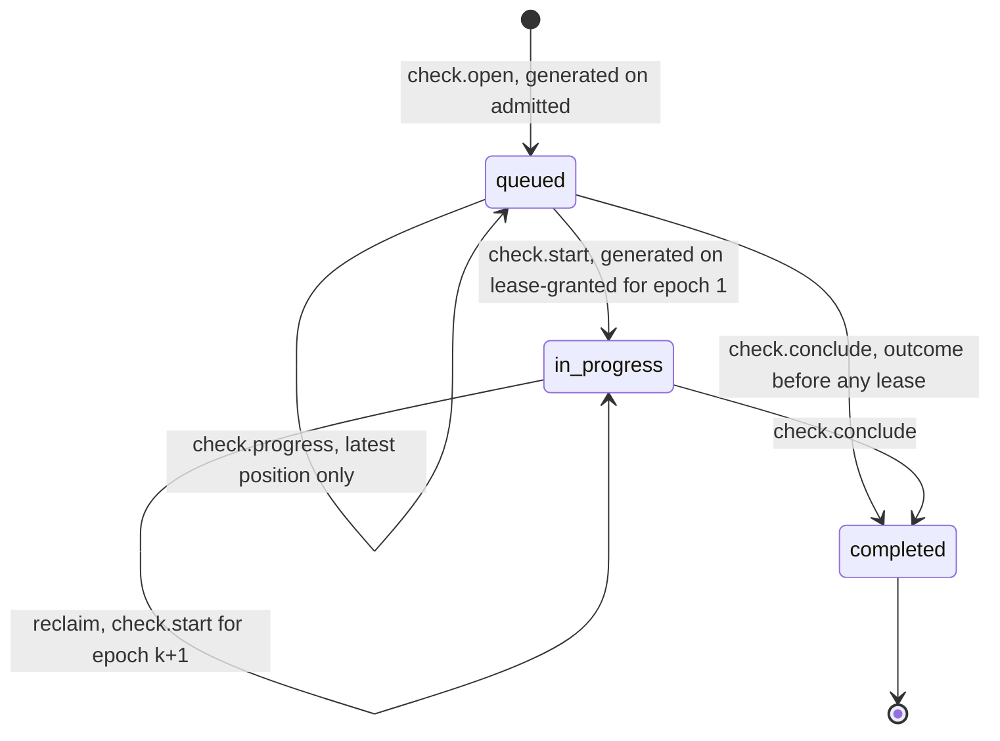
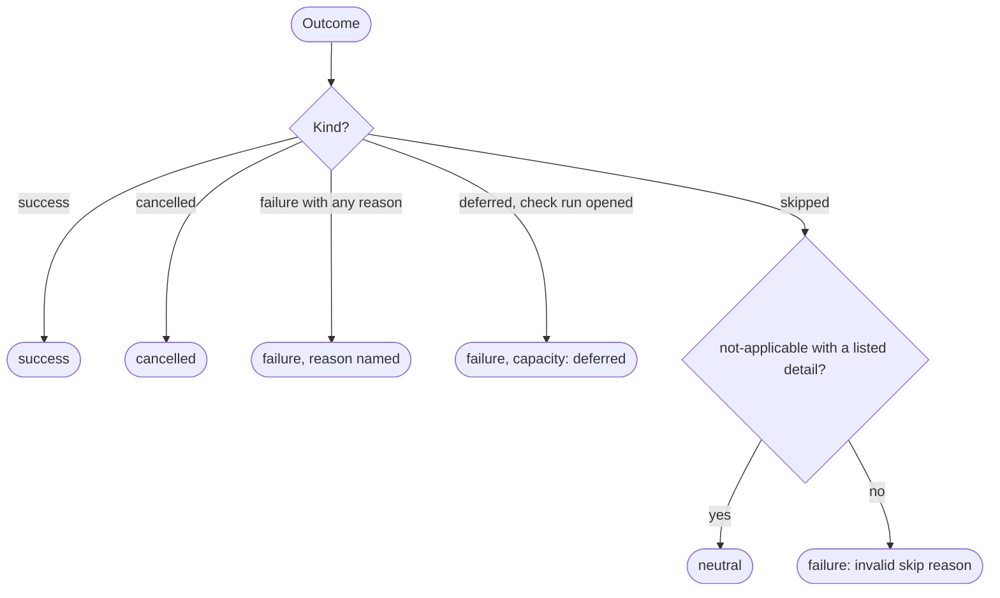

# GitHub output

This file specifies how FlareDispatch turns executions into GitHub effects: the check-run lifecycle as lifecycle intents, the one mapping from outcome to check conclusion, FlareDispatch's effect appliers for each GitHub intent kind, the `InstallationQuota` applier rate limit keyed by GitHub App installation, merge-queue support and the side outputs (comments, pull requests, releases, notifications). `packages/github` implements the check-run appliers, `checkConclusion` and the installation rate limit.

## Scope

mameko's [outbox.md](https://github.com/fractalboxdev/mameko/blob/88770c64b14818ad32aed9615f1cfaf4bbc1f591/specs/outbox.md) specifies the outbox: rows and their states, the effect classes, lifecycle and ops intents, the drainer, the applier and applier rate limit ports, and the delivery and settle sweeps. FlareDispatch inherits that mechanism and supplies, as an application:

- the intent kinds and their delivery settings, declared in [profile.md](profile.md);
- one `EffectApplier` Layer that selects a handler by `row.kind` and classifies every GitHub response into one answer of the applier port;
- the applier rate limit, keyed by installation;
- the outcome mapping onto check conclusions.

It depends on [run-model.md](run-model.md) for the intents a run returns, [intake.md](intake.md) for installation resolution, the `merge_group` and `gh-readonly-queue/*` triggers and check re-runs, [runs/agentic.md](runs/agentic.md) for the staged-write gate the `pr.propose` applier runs, and [operability.md](operability.md) for the drift check and alarm delivery.

Deferred: appending git notes to a commit has no caller and returns as an intent kind with its first caller.

## Model

### Intents

The profile declares every kind the control plane accepts ([profile.md](profile.md) § Intent kinds). mameko stores a run-authored intent under `run:<step name>:<index>` and generates the lifecycle kinds under `cp:` keys ([§ Lifecycle intents](https://github.com/fractalboxdev/mameko/blob/88770c64b14818ad32aed9615f1cfaf4bbc1f591/specs/outbox.md#lifecycle-intents)); an ops kind belongs to no execution and is keyed `ops:<intent_key>` ([§ Ops intents](https://github.com/fractalboxdev/mameko/blob/88770c64b14818ad32aed9615f1cfaf4bbc1f591/specs/outbox.md#ops-intents)). The idempotency marker is what the applier's `lookup` searches for when an earlier attempt ended without an answer.

| Kind | Origin, generated | Stored key | Call that applies it | Idempotency marker |
| --- | --- | --- | --- | --- |
| `check.open` | control plane, `on: admitted` | `cp:check:open` | Create check run, status `queued` | `external_id` = execution id |
| `check.start` | control plane, `on: lease-granted` | `cp:check:start:<epoch>` | Update status to `in_progress` | Update is idempotent |
| `check.progress` | control plane, `on: progress`, coalesced per execution | `cp:` key per row | Update title and summary | Update is idempotent |
| `check.conclude` | control plane, the outcome mapping's `surface_kind` | `cp:check:conclude` | Update to `completed` with conclusion; create completed when no check run exists | `external_id` = execution id |
| `check.summary` | run | `run:<step name>:<index>` | Title and Markdown on the check run | The check run found by `external_id` |
| `check.annotations` | run | `run:<step name>:<index>` | Annotations on the check run, at most 50 per request | Annotations read back by check-run id |
| `comment` | run | `run:<step name>:<index>` | Create issue or pull-request comment | Hidden marker `<!-- flare-dispatch:intent <execution_id>/<intent_key> -->` |
| `review` | run | `run:<step name>:<index>` | Create pull-request review, event `COMMENT` | Hidden marker in the body |
| `issue` | run | `run:<step name>:<index>` | Create or update an issue | Hidden marker in the body |
| `label` | run | `run:<step name>:<index>` | Add or remove labels | Set semantics |
| `pr.propose` | control plane, `on: accepted` for `success` | `cp:pr:propose` | The staged-write gate, then Git Data API commit and a pull request, a draft unless the manifest sets `draft` to false | Head branch name |
| `pr.close` | run | `run:<step name>:<index>` | Close a pull request whose head branch is under `flare-dispatch/` | Update is idempotent |
| `release.draft` | run | `run:<step name>:<index>` | Create a draft release and upload assets | Tag name |
| `release.publish` | run | `run:<step name>:<index>` | Publish the draft release for the tag | Update is idempotent |
| `dispatch.followOn` | run | `run:<step name>:<index>` | Submit a request to admission for the named run on the same commit; no GitHub call | Admission dedup key `<execution_id>/<intent_key>` |
| `notify.email` | both | `cp:notify:email` or `run:<step name>:<index>` | Email binding | Message id derived from the key |
| `notify.slack` | both | `cp:notify:slack` or `run:<step name>:<index>` | Signed `POST` to the configured endpoint | Delivery id header derived from the key |
| `notice.publish` | both | `run:<step name>:<index>` | Notice channel | Delivery id `<run>:<use case>:<dedupe key>` |
| `canary.push` | ops | `ops:canary:<tick time>` | Empty commit on the canary branch of the fixture repository ([operability.md](operability.md) FD-OPS-038) | Tick time in the commit message, read back from the branch head |
| `delivery.redeliver` | ops | `ops:redeliver:<delivery id>` | Redelivery request for one failed webhook delivery, made with the App JWT ([operability.md](operability.md) FD-OPS-045) | The delivery's attempts, read back before a repeat |

`check.conclude` is the one kind of delivery tier `outcome` and `check.progress` the one of tier `progress`; every other kind is `effect`, with `check.open` at priority 0, `check.start` at 1 and every other kind at 2, so the installation grants permits in the order `check.conclude`, `check.open`, `check.start`, the other GitHub kinds, then `check.progress` ([MAMEKO-OUT-042](https://github.com/fractalboxdev/mameko/blob/88770c64b14818ad32aed9615f1cfaf4bbc1f591/specs/outbox.md)). `check.open` and `check.conclude` draw the reserve. The four check kinds are `in_order`, so a check run's create precedes its updates, and `check.start` and `check.progress` are `void_after_outcome`, so neither applies after the conclusion ([MAMEKO-OUT-059](https://github.com/fractalboxdev/mameko/blob/88770c64b14818ad32aed9615f1cfaf4bbc1f591/specs/outbox.md), [MAMEKO-OUT-060](https://github.com/fractalboxdev/mameko/blob/88770c64b14818ad32aed9615f1cfaf4bbc1f591/specs/outbox.md)).

### App registration

The committed App manifest requests these permissions and subscribes to these events, and nothing else. The drift check in [operability.md](operability.md) compares the registered App against this list.

| Permission | Level | Needed for |
| --- | --- | --- |
| `checks` | `write` | Check runs and annotations; `check_run` and `check_suite` events |
| `contents` | `write` | `pr.propose` commits and refs, `release.draft`, `release.publish`; `push` events |
| `pull_requests` | `write` | `pr.propose`, `pr.close`, `review`, pull-request comments; `pull_request` events |
| `issues` | `write` | `comment`, `issue`, `label` |
| `metadata` | `read` | Repository lookup for every call |
| `actions` | `read` | Per-lease read tokens (FD-GH-002); `write` from phase 4 for the `gha` launcher's `workflow_dispatch` and cancel calls ([executors.md](executors.md)) |
| `administration` | `read` | Rulesets and branch protection for the required set, the `protection-snapshot` input of class resolution ([profile.md](profile.md)); `repository_ruleset` and `branch_protection_rule` events |
| `deployments` | `read` | `deployment_status` events |
| `merge_queues` | `read` | `merge_group` events |

| Event | Consumer |
| --- | --- |
| `pull_request`, `push`, `merge_group`, `check_run`, `check_suite`, `deployment_status` | [intake.md](intake.md) |
| `installation`, `installation_repositories` | Token and mapping eviction (FD-GH-066) |
| `repository_ruleset`, `branch_protection_rule` | Required-set refresh for class resolution ([profile.md](profile.md)) |

### Check-run lifecycle

Each execution that owns a check has exactly one check run, named `flare-dispatch/<run>` or `flare-dispatch/<run>:<checkLabel>`. Branch protection keys on that name, so it stays the same across attempts; only the title adds ` (attempt N)`.

**One check run per execution: opened at admission, started per epoch, concluded once**

*Check run · `completed` is final; a re-run is a new execution with the same name.*

### Applier answers

Each applier classifies a GitHub response into one answer of mameko's applier port ([§ The applier port and the applier rate limit](https://github.com/fractalboxdev/mameko/blob/88770c64b14818ad32aed9615f1cfaf4bbc1f591/specs/outbox.md#the-applier-port-and-the-applier-rate-limit)); the drainer never sees a status code.

| GitHub response | Answer |
| --- | --- |
| `2xx` | `applied`, with the object id as the row's external reference ([MAMEKO-OUT-016](https://github.com/fractalboxdev/mameko/blob/88770c64b14818ad32aed9615f1cfaf4bbc1f591/specs/outbox.md)) |
| `401`, after one retry with a newly minted token | `refused`, `installation: unauthorized`, and the `installation-lost` page alarm |
| `5xx`, `429`, or a `403` that GitHub sent for a rate limit | `retryable` |
| Any other status | `refused`, with the status and message |
| Network failure before the request left | `retryable` |
| Network failure after the request may have left | `unknown`, so the row becomes `ambiguous` and the next attempt is a `lookup` |

Every GitHub kind is `adoptable` except `label`, `pr.close`, `dispatch.followOn` and the notification kinds, which are `replay-safe`; no kind is `reconcile-only` or gated.

### Conclusion mapping

`checkConclusion(verdict)` is the only function that produces a conclusion. Its input is a closed union that matches a failure on the category of its reason kind ([run-model.md](run-model.md)), and the compiler rejects a missing case. It emits four conclusions: `success`, `failure`, `cancelled` and `neutral`. The profile's outcome mapping states the same table as `by_outcome` ([profile.md](profile.md) § Outcome mapping).

| Outcome and reason | Conclusion |
| --- | --- |
| `success` | `success` |
| `failure(reason)` in any category: `finding`, `infra`, `budget`, `capacity`, `deadline`, `halt`, `placement`, `unrecorded`, `config`, `policy` (`provenance: <check>` included) | `failure`, reason in the title, for every class and whether or not the check is required |
| Terminal status not recorded (category `unrecorded`) | `failure` "internal: terminal write not recorded" |
| Execution lost (settle sweep, category `infra`) | `failure` "infra: execution lost" |
| `cancelled(cause)` with a cause from `superseded`, `pr-closed`, `merge-group-destroyed`, `parent-ended`, `operator-cancel` | `cancelled`, cause in the title |
| `skipped(not-applicable: <detail>)` with a detail in the closed detail set | `neutral` |
| `skipped` with any other reason or detail | `failure` "internal: invalid skip reason" |
| `deferred`, for an execution that opened a check run | `failure` "capacity: deferred" |
| `deferred`, for an execution that opened none | No check run |
| `expired` | `failure` "deadline: expired"; no FlareDispatch class declares it |

The closed detail set is `draft-pr`, `author-excluded`, `path-filter`, `not-configured`, `nothing-to-lint`, `every-job-skipped` and `empty-range`.

**`neutral` has one source: a skip whose reason says the check does not apply**

*Conclusion mapping · no budget, capacity, deadline or halt path reaches `neutral`.*

### Installation quota

`InstallationQuota` is FlareDispatch's implementation of mameko's applier rate limit. The profile's `delivery.limit_key` binding `installationOf` names the GitHub App installation that serves a row's repository, so every applier call for one installation asks the same `InstallationQuota` for its permit. The GitHub client reports every response's rate-limit headers to it. It decides each permit request in the order the drainer sends them, with these checks in order:

1. a `Retry-After` instant not yet passed: `wait` until it;
2. the installation's outstanding permits at the concurrency bound: `wait` 1 s;
3. remaining budget 0: `wait` until the reset time;
4. remaining budget at or below 0.1 of the limit and the kind draws no reserve: `wait` until the reset time;
5. remaining budget at or below 0.3 of the limit, class `batch` and the kind draws no reserve: `wait` until the reset time;
6. an `apply` call over the per-minute or per-hour cap: `wait` until that window rolls;
7. otherwise `granted`, spending one unit of the installation's budget.

Every call, `lookup` included, spends budget; only `apply` calls count against the per-minute and per-hour caps.

## Requirements

### Write authority

- **FD-GH-001** · phase 0 · `V-UNIT` `V-E2E-LOCAL` — FlareDispatch's appliers must be the only code that sends a write request to the GitHub API for an execution, each call made by the drainer for one outbox row ([MAMEKO-OUT-001](https://github.com/fractalboxdev/mameko/blob/88770c64b14818ad32aed9615f1cfaf4bbc1f591/specs/outbox.md)).
- **FD-GH-002** · phase 0 · `V-UNIT` `V-CONF` — When the credential minter port mints an installation token for an execution lease ([MAMEKO-HOST-045](https://github.com/fractalboxdev/mameko/blob/88770c64b14818ad32aed9615f1cfaf4bbc1f591/specs/hosts.md)), it must scope the token to the one repository the execution targets and to read permissions only: `metadata`, `contents`, `pull_requests`, `issues`, `checks` and `actions`, each at `read`.
- **FD-GH-003** · phase 0 · `V-UNIT` — If a run calls a GitHub read for an execution that has no resolved installation, then the GitHub capability must fail with the tagged error `GithubUncredentialed` and must not return an empty result.
- **FD-GH-004** · phase 0 · `V-UNIT` — If the `InstallationDirectory` resolves no installation for a check-run row's repository, then the applier must answer `refused` with the reason `installation: not found` and raise the `installation-lost` page alarm.

### Check-run lifecycle

- **FD-GH-005** · phase 0 · `V-UNIT` `V-REPLAY` — The `check.open` payload binding must return a payload for every execution that owns a check and `none` for every other, so that admission inserts `cp:check:open` for exactly the executions that own a check ([MAMEKO-OUT-050](https://github.com/fractalboxdev/mameko/blob/88770c64b14818ad32aed9615f1cfaf4bbc1f591/specs/outbox.md)), and its applier must create the check run with status `queued` on the execution's head SHA.
- **FD-GH-006** · phase 0 · `V-UNIT` — The control plane must name each check run `flare-dispatch/<run>`, or `flare-dispatch/<run>:<checkLabel>` when the run declares a `checkLabel`.
- **FD-GH-007** · phase 0 · `V-UNIT` — If a run declares a `checkLabel` that does not match `^[A-Za-z0-9][A-Za-z0-9._-]{0,31}$`, then the control plane must reject the run definition at registration with `InvalidCheckLabel`.
- **FD-GH-008** · phase 0 · `V-UNIT` — The control plane must keep a check run's name identical across every attempt of its check family, and must append ` (attempt N)` to the title only when N is greater than 1.
- **FD-GH-009** · phase 0 · `V-UNIT` `V-REPLAY` — The check-run appliers must set every check run's `external_id` to its execution id.
- **FD-GH-010** · phase 0 · `V-REPLAY` `V-SIM` — The control plane must create at most one check run per execution across engine replays, outbox retries and reclaims: every attempt of a check-run kind, the first included, searches the check runs of the head SHA and name by `external_id` before it writes, and works on the oldest one it finds, because `IntentRow.attempts` keeps its insertion value and does not tell an applier that an earlier attempt ran.
- **FD-GH-011** · phase 0 · `V-UNIT` — The `check.start` applier must set the check run's status to `in_progress` and state the executor kind and the epoch in the summary, and must answer `refused` with the reason `superseded: check run already completed` when the check run is `completed`.
- **FD-GH-012** · phase 0 · `V-UNIT` `V-SIM` — The `check.progress` payload must state the execution's class, its queue-position bucket among `1`, `2–5`, `6–20` and `more than 20`, and its `deadline_at`.
- **FD-GH-013** · phase 0 · `V-UNIT` — The check-run appliers must set each check run's details URL to the execution's log viewer URL carrying a log capability token ([cache-artifacts.md](cache-artifacts.md)).
- **FD-GH-014** · phase 0 · `V-UNIT` `V-REPLAY` — The `check.conclude` row the control plane inserts with an execution's terminal write must carry the conclusion `checkConclusion` returns for that outcome.
- **FD-GH-015** · phase 0 · `V-UNIT` — The control plane must state in every concluded check run's summary the class, the executor kind and the placement reason, the queue age, the reserved and settled cost, and the named reason of any `failure` or `cancelled` outcome.
- **FD-GH-016** · phase 0 · `V-UNIT` — When an outcome is `failure` and names a failing step, the control plane must open the summary with the failing step name and error tag, before any run-authored markdown.
- **FD-GH-017** · phase 0 · `V-UNIT` — If a check run's summary or text exceeds 65535 characters, then the control plane must cut it to 65535 characters including a final truncation line that links the log viewer.
- **FD-GH-018** · phase 0 · `V-UNIT` — The `check.annotations` applier must send annotations in batches of at most 50 per request, must send only the annotations the check run does not yet carry, and must keep the check run's existing title and summary.
- **FD-GH-019** · phase 1 · `V-UNIT` `V-CONF` — While a repository's confidentiality mode is `confidential-compute`, the control plane must limit check-run output to the outcome, the conclusion reason, the class, the executor id and a log pointer, with no source, diff, log line or model output.
- **FD-GH-020** · phase 0 · `V-UNIT` `V-SIM` — When a fan-out parent reaches its outcome, the control plane must insert a `check.conclude` intent for every child check run not yet concluded, with the child's recorded outcome or, when the child has none, `failure` "parent closed before this part settled".
- **FD-GH-052** · phase 0 · `V-UNIT` — When the `check.conclude` applier finds no check run that carries the execution id, it must create the check run with status `completed` and the conclusion.

### Conclusion mapping

- **FD-GH-021** · phase 0 · `V-UNIT` — The control plane must derive every conclusion through `checkConclusion(verdict)`, whose input union the type checker requires to be handled in full.
- **FD-GH-022** · phase 0 · `V-UNIT` — When the outcome is `success`, `checkConclusion` must return `success`.
- **FD-GH-023** · phase 0 · `V-UNIT` — When the outcome is `failure(reason)`, `checkConclusion` must return `failure` with the reason in the check-run title.
- **FD-GH-024** · phase 0 · `V-UNIT` — When the outcome is `cancelled`, `checkConclusion` must return `cancelled`.
- **FD-GH-025** · phase 0 · `V-UNIT` — When the outcome is `skipped` with the reason `not-applicable` and a detail in the closed detail set, `checkConclusion` must return `neutral`.
- **FD-GH-026** · phase 0 · `V-UNIT` — If the outcome is `skipped` with a reason other than `not-applicable`, or with a detail outside that closed set, then `checkConclusion` must return `failure` with the reason "internal: invalid skip reason" ([MAMEKO-RUN-061](https://github.com/fractalboxdev/mameko/blob/88770c64b14818ad32aed9615f1cfaf4bbc1f591/specs/run-model.md)).
- **FD-GH-027** · phase 0 · `V-UNIT` `V-SIM` — `checkConclusion` must not return `neutral` for an outcome whose reason kind is in category `budget`, `capacity`, `deadline`, `halt` or `placement`, `capacity: context overflow` and `capacity: model unavailable` included, for any class, required or not ([MAMEKO-PROF-018](https://github.com/fractalboxdev/mameko/blob/88770c64b14818ad32aed9615f1cfaf4bbc1f591/specs/profiles.md)).
- **FD-GH-028** · phase 0 · `V-UNIT` — When the outcome is `failure` in category `unrecorded`, `checkConclusion` must return `failure` with the title "internal: terminal write not recorded".
- **FD-GH-029** · phase 0 · `V-UNIT` — The control plane must emit only the conclusions `success`, `failure`, `cancelled` and `neutral`.
- **FD-GH-031** · phase 0 · `V-UNIT` `V-LIVE` — If a check run concludes `neutral` while its execution's recorded outcome is not `skipped(not-applicable: <detail>)` with a detail in the closed detail set, then the control plane must raise the `neutral-invariant` page alarm, for every class, required or not.

### Appliers

- **FD-GH-045** · phase 0 · `V-UNIT` — When GitHub answers an applier call with a status other than `2xx`, `401`, `429` or `5xx`, and other than a `403` sent for a rate limit, the applier must answer `refused` with the status and message ([MAMEKO-OUT-017](https://github.com/fractalboxdev/mameko/blob/88770c64b14818ad32aed9615f1cfaf4bbc1f591/specs/outbox.md)).
- **FD-GH-046** · phase 0 · `V-UNIT` — When GitHub answers with a `5xx`, a `429` or a `403` sent for a rate limit, or the call fails at the network before the request left, the applier must answer `retryable` ([MAMEKO-OUT-018](https://github.com/fractalboxdev/mameko/blob/88770c64b14818ad32aed9615f1cfaf4bbc1f591/specs/outbox.md)); when the call fails at the network after the request may have left, the applier must answer `unknown` ([MAMEKO-OUT-022](https://github.com/fractalboxdev/mameko/blob/88770c64b14818ad32aed9615f1cfaf4bbc1f591/specs/outbox.md)).
- **FD-GH-047** · phase 0 · `V-UNIT` — When GitHub answers an applier call with `401`, the applier must mint a new installation token and retry the call once.
- **FD-GH-048** · phase 0 · `V-UNIT` — If the retry after a new token also answers `401`, then the applier must answer `refused` with the reason `installation: unauthorized` and raise the `installation-lost` page alarm.
- **FD-GH-090** · phase 0 · `V-UNIT` — When the drainer calls `lookup` on a check-run row, the applier must answer `found` only when exactly one check run carries the execution id and the row's effect is visible on it, `absent` when none carries it or the effect is not visible, and `undetermined` when the read fails or more than one check run carries the execution id ([MAMEKO-OUT-024](https://github.com/fractalboxdev/mameko/blob/88770c64b14818ad32aed9615f1cfaf4bbc1f591/specs/outbox.md), [MAMEKO-OUT-025](https://github.com/fractalboxdev/mameko/blob/88770c64b14818ad32aed9615f1cfaf4bbc1f591/specs/outbox.md)).
- **FD-GH-091** · phase 0 · `V-UNIT` — If a row of a check-run kind has no execution id, a kind the check-run applier does not serve, or a payload its kind's schema rejects, then the applier must answer `refused` without a GitHub call.
- **FD-GH-092** · phase 0 · `V-UNIT` `V-CONF` — When the drainer calls `lookup` on a row of `comment`, `review`, `issue`, `pr.propose`, `release.draft`, `release.publish`, `canary.push` or `delivery.redeliver`, the applier must search for the object by the kind's idempotency marker in the intents table, and must answer `found` with the object's id when exactly one object carries the marker, `absent` when none does, and `undetermined` when the read fails ([MAMEKO-OUT-024](https://github.com/fractalboxdev/mameko/blob/88770c64b14818ad32aed9615f1cfaf4bbc1f591/specs/outbox.md), [MAMEKO-OUT-025](https://github.com/fractalboxdev/mameko/blob/88770c64b14818ad32aed9615f1cfaf4bbc1f591/specs/outbox.md)).

### Installation quota

- **FD-GH-056** · phase 0 · `V-UNIT` `V-CONF` — The profile's `delivery.limit_key` binding must return the id of the GitHub App installation that serves the row's repository, so that every applier call for one installation takes its permit from that installation's `InstallationQuota` ([MAMEKO-OUT-038](https://github.com/fractalboxdev/mameko/blob/88770c64b14818ad32aed9615f1cfaf4bbc1f591/specs/outbox.md), [MAMEKO-OUT-057](https://github.com/fractalboxdev/mameko/blob/88770c64b14818ad32aed9615f1cfaf4bbc1f591/specs/outbox.md)).
- **FD-GH-057** · phase 0 · `V-UNIT` — When a GitHub response carries `x-ratelimit-limit`, `x-ratelimit-remaining` or `x-ratelimit-reset`, the `InstallationQuota` object must store each as the installation's limit, remaining count and reset time.
- **FD-GH-058** · phase 0 · `V-UNIT` `V-SIM` — The `InstallationQuota` reserve fraction must be 0.1 of the installation's limit by default, and the kinds that draw the reserve must be `check.conclude` and `check.open` ([MAMEKO-OUT-041](https://github.com/fractalboxdev/mameko/blob/88770c64b14818ad32aed9615f1cfaf4bbc1f591/specs/outbox.md)).
- **FD-GH-059** · phase 0 · `V-UNIT` — While an installation's remaining count is at or below 0.3 of its limit, the `InstallationQuota` object must answer `wait` to every permit request of class `batch` whose kind draws no reserve.
- **FD-GH-060** · phase 0 · `V-UNIT` — When a GitHub response carries `Retry-After` as seconds or as an HTTP date, the `InstallationQuota` object must answer `wait` to every permit request for that installation until that instant.
- **FD-GH-061** · phase 0 · `V-UNIT` — While an installation's remaining count is 0, the `InstallationQuota` object must answer `wait` until the reset time ([MAMEKO-OUT-040](https://github.com/fractalboxdev/mameko/blob/88770c64b14818ad32aed9615f1cfaf4bbc1f591/specs/outbox.md)).
- **FD-GH-062** · phase 0 · `V-UNIT` `V-SIM` — The `InstallationQuota` object must grant at most a configurable number of permits for `apply` calls, default 80 per minute and 500 per hour.
- **FD-GH-063** · phase 0 · `V-UNIT` — The `InstallationQuota` object must hold at most a configurable number of outstanding permits per installation, default 8, and must count a permit outstanding from its grant until the drainer releases it ([MAMEKO-OUT-039](https://github.com/fractalboxdev/mameko/blob/88770c64b14818ad32aed9615f1cfaf4bbc1f591/specs/outbox.md)).
- **FD-GH-065** · phase 0 · `V-UNIT` — The installation-token source must cache each installation's token and must not use a token within 60 s of its `expires_at`.
- **FD-GH-066** · phase 0 · `V-UNIT` — When the control plane receives an `installation` webhook with action `deleted` or `suspend`, or an `installation_repositories` webhook that removes repositories, it must evict the cached token and the affected repository-to-installation mappings before it answers the webhook.
- **FD-GH-067** · phase 0 · `V-UNIT` — The control plane must sign each GitHub App JWT with RS256, with `iat` 60 s before the current time and `exp` at most 600 s after `iat`.
- **FD-GH-068** · phase 0 · `V-UNIT` — The control plane must accept the GitHub App private key in both PKCS#1 and PKCS#8 PEM encodings.

### Merge queue

- **FD-GH-075** · phase 0 · `V-UNIT` `V-E2E-LOCAL` — When the control plane receives a `merge_group` event with action `checks_requested`, it must open the check runs of the base branch's required gating runs on `merge_group.head_sha`.
- **FD-GH-076** · phase 0 · `V-UNIT` — When the control plane receives a `merge_group` event with action `destroyed`, it must end every non-terminal execution for that `head_sha` `cancelled(merge-group-destroyed)` and conclude its check run `cancelled`.
- **FD-GH-077** · phase 2 · `V-UNIT` — Where a gate run reports quarantined test failures, the control plane must render each one as a check-run annotation with level `warning` and list each in the summary.

### Side outputs

- **FD-GH-078** · phase 0 · `V-UNIT` `V-REPLAY` — The control plane must deliver every email, Slack verdict post and notice for an execution only through the applier of an outbox row.
- **FD-GH-079** · phase 0 · `V-UNIT` — The `notify.slack` applier must sign each Slack verdict `POST` with HMAC-SHA256 over a timestamp and the body, and must send the timestamp with it.
- **FD-GH-080** · phase 0 · `V-UNIT` — The profile must declare `pr.propose` generated `on: accepted` and applied for `success` only, and its applier must run the staged-write gate before any GitHub call as [runs/agentic.md](runs/agentic.md) FD-AGT-016 and FD-AGT-018 specify.
- **FD-GH-081** · phase 0 · `V-UNIT` — When the `pr.propose` applier applies an accepted manifest, it must create each blob from the file's raw bytes in base64, so that binary files arrive unchanged.
- **FD-GH-082** · phase 0 · `V-UNIT` — The `pr.propose` applier must commit only to a branch under the prefix `flare-dispatch/`, and must not update the default branch or any protected branch.
- **FD-GH-083** · phase 0 · `V-UNIT` — When the `pr.propose` applier applies a manifest, it must reuse the open pull request whose head is the manifest's branch, and otherwise open a new pull request, as a draft unless the manifest sets `draft` to false.
- **FD-GH-084** · phase 0 · `V-UNIT` — If the target branch holds a commit whose author is not the App, then the `pr.propose` applier must answer `refused` with the reason `writeback: human-commits-present` and must not update the branch.
- **FD-GH-085** · phase 0 · `V-UNIT` — The `release.draft` applier must create the draft release only when no release exists for the tag, and must not modify a published release.
- **FD-GH-086** · phase 0 · `V-UNIT` — The `release.publish` applier must publish only a draft release for the intent's tag, and must leave a release that is already published unchanged.
- **FD-GH-087** · phase 0 · `V-UNIT` — The `pr.close` applier must close the pull request only when its head branch is under the prefix `flare-dispatch/` and carries no commit whose author is not the App, and otherwise must answer `refused` with the reason `writeback: human-commits-present`.
- **FD-GH-088** · phase 0 · `V-UNIT` `V-REPLAY` — The `dispatch.followOn` applier must submit one request to admission whose `follow-on` dedup recipe yields `<execution_id>/<intent_key>`, so that a repeated apply starts no second execution.
- **FD-GH-089** · phase 0 · `V-UNIT` `V-LIVE` — The control plane must insert each `canary.push` and `delivery.redeliver` row through `insertOpsIntent` with the repository its probe names as the scope ([MAMEKO-OUT-056](https://github.com/fractalboxdev/mameko/blob/88770c64b14818ad32aed9615f1cfaf4bbc1f591/specs/outbox.md), [operability.md](operability.md) FD-OPS-038, FD-OPS-045), and its applier must use the App JWT for a `delivery.redeliver` row and the installation token for a `canary.push` row ([architecture.md](architecture.md) FD-ARCH-003).

## Open items

- TODO(maintainer): confirm GitHub's current secondary rate limits for content-creating requests and set the defaults of FD-GH-062 from them.
- TODO(operator): decide whether a `check.conclude` row that reaches `expired` on a `release` or `required` execution also opens a tracking issue in an operator repository.
- TODO(maintainer): bound `check.progress` to one row per 60 s and per bucket change; mameko generates an `on: progress` kind at every step and placement-state change, and its payload binding sees no earlier row.
- TODO(maintainer): Until mameko gates an `on: accepted` kind before acceptance (mameko [outbox.md § Open items](https://github.com/fractalboxdev/mameko/blob/88770c64b14818ad32aed9615f1cfaf4bbc1f591/specs/outbox.md#open-items)), `pr.propose` is keyed `cp:pr:propose`, the staged-write gate runs in its applier, and a rejected manifest ends the row `refused` while the outcome stands; with that gate, the row is keyed `cp:writeback:<branch>` and a rejected manifest concludes the execution `failure` with `writeback: <first reason kind>`.
