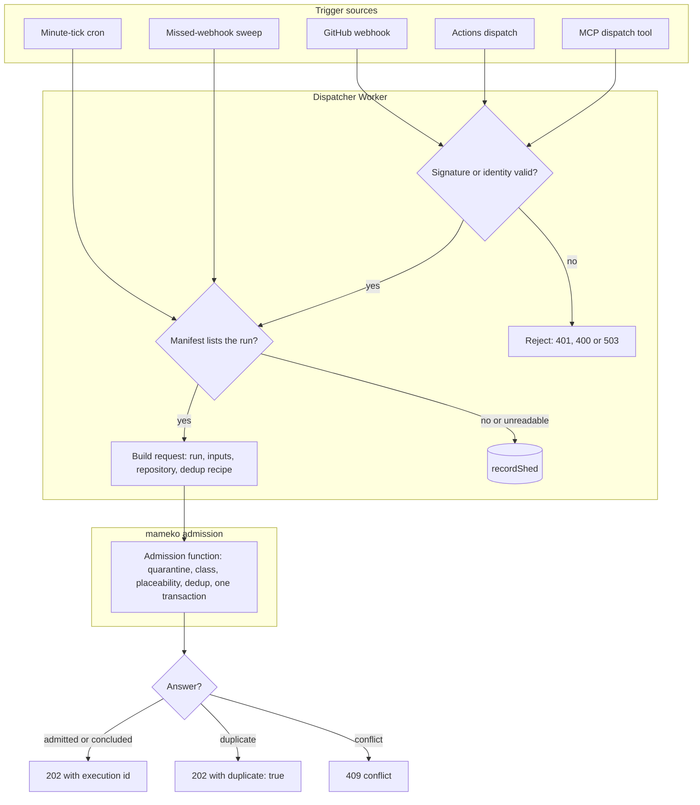
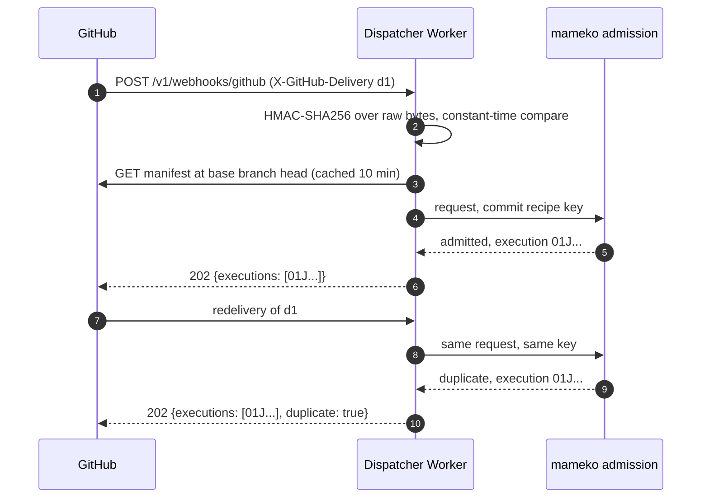
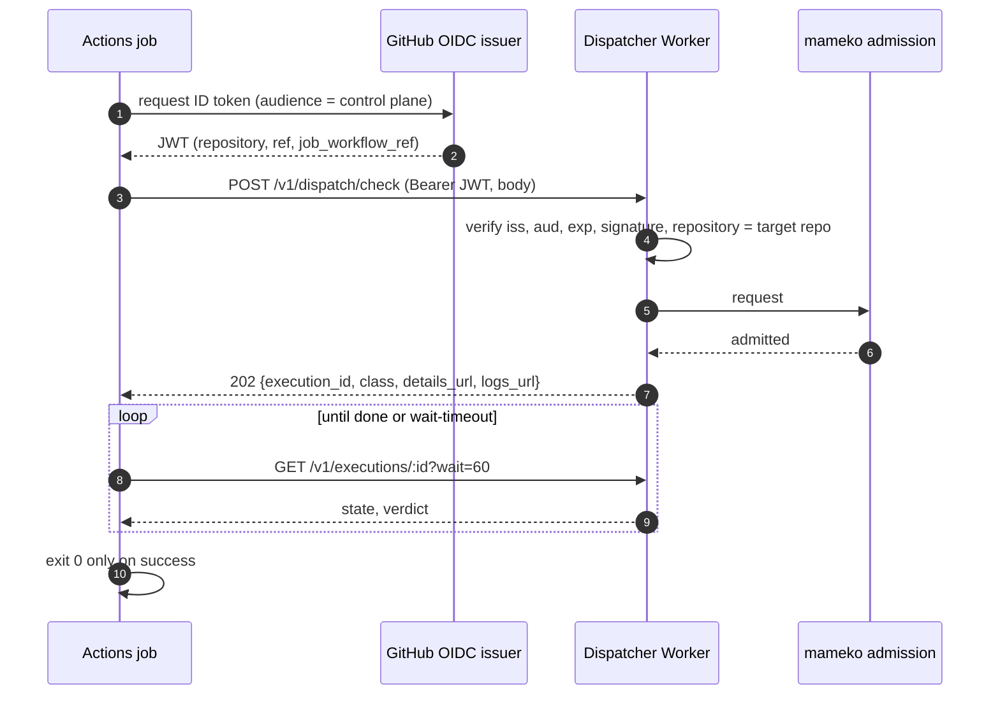

# Intake

Intake turns a trigger into one request to mameko's admission function. It authenticates the caller, reads the repo manifest, builds the request and its dedup key from FlareDispatch's recipes, and maps admission's answer onto the HTTP response. This file specifies FlareDispatch's trigger kinds, their authentication, repo manifests, the dedup recipes' key forms, the release-approval event, cooldowns and the answers each trigger receives.

## Scope

mameko's [admission-qos.md](https://github.com/fractalboxdev/mameko/blob/88770c64b14818ad32aed9615f1cfaf4bbc1f591/specs/admission-qos.md) specifies the admission function: the one door ([MAMEKO-ADM-024](https://github.com/fractalboxdev/mameko/blob/88770c64b14818ad32aed9615f1cfaf4bbc1f591/specs/admission-qos.md)), the admission transaction, dedup storage and request digests, placeability, quarantine, intake bounds and `shed` rows. This file covers what FlareDispatch puts in front of it:

- the five trigger kinds (webhook, Actions dispatch, cron, local submit, MCP call) and the three control-plane sources that reuse the same path (the missed-webhook sweep, check re-runs and the `dispatch.followOn` applier of [github-output.md](github-output.md) FD-GH-088);
- the `DispatchEvent` union, webhook signature and dispatch token checks;
- repo manifests;
- the canonical strings FlareDispatch's dedup recipes return ([profile.md](profile.md) § Dedup recipes and supersession);
- the release-approval event that starts a `release-notes` publish execution.

It depends on [profile.md](profile.md) for class resolution and placement constraints, on [operability.md](operability.md) for repository quarantine, on [interfaces.md](interfaces.md) for the HTTP API surface, the error model, the dispatch response, the dispatch action and MCP tools, on [local-scheduler.md](local-scheduler.md) for local registrations, and on [runs/agentic.md](runs/agentic.md) for the release approval rules.

This file does not specify an external-signals webhook, chat-originated dispatch or inbound-mail triggers; none of them is a trigger kind in this system.

## Model

### Trigger kinds

| Trigger kind | Source | Authenticated by | Default class source | Phase |
| --- | --- | --- | --- | --- |
| `webhook` | GitHub App webhook delivery | HMAC-SHA256 over the raw body | `resolveClass` | 0 |
| `dispatch` | GitHub Actions step or a server caller, `POST /v1/dispatch/:run` | Actions OIDC token, or an Access JWT of a member of the dispatch group ([interfaces.md](interfaces.md) FD-IFC-027) | `resolveClass`, then the `class` input | 0 |
| `cron` | One minute-tick cron trigger on the control plane | The platform | `resolveClass` (scheduled runs default to `batch`) | 0 |
| `local` | A device's `local.register` under a capacity lease, through FlareDispatch's local registration port | The capacity lease, checked by mameko ([MAMEKO-PROTO-081](https://github.com/fractalboxdev/mameko/blob/88770c64b14818ad32aed9615f1cfaf4bbc1f591/specs/executor-protocol.md)) | Always advisory, `local-only` | 1 |
| `mcp` | The control plane's MCP `dispatch` tool | The identity gate of the HTTP API | `resolveClass`, lower-only override | 2 |

The missed-webhook sweep, check re-runs and the `dispatch.followOn` applier are not trigger kinds. The sweep and check re-runs submit the trigger kind of the event they replace (`webhook`) through the same intake function, so they share the dedup key and every check below. The `dispatch.followOn` applier submits its request through the same intake function, where the `follow-on` recipe keys it.

### Records

- **`DispatchEvent`.** A `Schema.Union` tagged by trigger kind, which every trigger function in [run-model.md](run-model.md) receives decoded. Its members: `webhook` {event, action, delivery id, payload decoded per event}, `dispatch` {run, repo, ref, sha, inputs, class, caller}, `cron` {scheduled minute, repo, schedule}, `local` {`lease_id`, epoch, run, tree hash, inputs digest} and `mcp` {caller identity, run, repo, ref, sha, inputs}.
- **Tenant scope.** The repository, `<owner>/<repo>`; mameko sees it as an opaque scope id.
- **Dedup key.** The canonical string the first matching recipe of [profile.md](profile.md) § Dedup recipes and supersession returns; mameko stores its SHA-256 under a `UNIQUE` constraint ([MAMEKO-ADM-035](https://github.com/fractalboxdev/mameko/blob/88770c64b14818ad32aed9615f1cfaf4bbc1f591/specs/admission-qos.md)).

| Recipe | Trigger | Canonical dedup key |
| --- | --- | --- |
| `idempotency-key` | `dispatch` with an `Idempotency-Key` header | `idem:<owner>/<repo>:<Idempotency-Key>`, with a request digest over the dispatch body |
| `follow-on` | A `dispatch.followOn` intent | `<execution_id>/<intent_key>` ([github-output.md](github-output.md) FD-GH-088) |
| `commit` | Commit-scoped (`webhook`, `dispatch`, `mcp`) | `<run>[:<label>]:<owner>/<repo>:<sha>` |
| `commit` | Check re-run, attempt *n* ≥ 2 | `<run>[:<label>]:<owner>/<repo>:<sha>:attempt-<n>` |
| `commit` | `cron` | `<run>:<owner>/<repo>:cron:<scheduled minute, ISO 8601 UTC>` |
| `commit` | `local` | `local:<lease_id>:<run>:<tree hash>:<inputs digest>` |

The commit-scoped key omits the trigger kind, so a webhook and an Actions dispatch for one run on one commit resolve to one execution. A child execution's key derives from its parent's ([mameko run-model.md § Children](https://github.com/fractalboxdev/mameko/blob/88770c64b14818ad32aed9615f1cfaf4bbc1f591/specs/run-model.md#children)).

- **Repo manifest.** `.github/flare-dispatch.json` in the consumer repository, decoded by the `RepoManifest` schema (`version: 1`). Each entry names a recipe, an optional label, the triggers it answers, its parameters and, for cron, its schedule. A run dispatches for a repository only when the manifest lists it.

### Intake path

Every trigger passes the same checks in the same order; the first refusal ends intake for that (trigger, run) pair. A refusal before admission records a `shed` row through `recordShed` ([MAMEKO-ADM-086](https://github.com/fractalboxdev/mameko/blob/88770c64b14818ad32aed9615f1cfaf4bbc1f591/specs/admission-qos.md)).

*Intake path · authentication and the manifest come before the request; quarantine, class, placeability and dedup are mameko's admission.*

### Webhook delivery and redelivery

*Webhook delivery · the dedup key, not the delivery id, makes a redelivery a no-op.*

### Actions dispatch with OIDC and blocking mode

*Actions dispatch · the token's `repository` claim binds the request to one repository; blocking mode turns the verdict into the step's exit code.*

## Requirements

### One door

- **FD-INT-001** · phase 0 · `V-UNIT` `V-CONF` — The dispatcher Worker must submit every trigger, the missed-webhook sweep, check re-runs and the `dispatch.followOn` applier included, as one request to mameko's admission function ([MAMEKO-ADM-024](https://github.com/fractalboxdev/mameko/blob/88770c64b14818ad32aed9615f1cfaf4bbc1f591/specs/admission-qos.md)), and must write no `executions`, dedup-key or `placements` row itself.
- **FD-INT-003** · phase 0 · `V-UNIT` `V-CONF` `V-SIM` — When admission answers `duplicate`, the dispatcher Worker must answer `202` with the existing execution's id and `duplicate: true`; when admission answers `conflict`, it must answer `409` with error `conflict` and the existing execution's id ([MAMEKO-ADM-028](https://github.com/fractalboxdev/mameko/blob/88770c64b14818ad32aed9615f1cfaf4bbc1f591/specs/admission-qos.md)).
- **FD-INT-004** · phase 0 · `V-UNIT` `V-SIM` — When admission fails with `intake_unavailable` ([MAMEKO-ADM-029](https://github.com/fractalboxdev/mameko/blob/88770c64b14818ad32aed9615f1cfaf4bbc1f591/specs/admission-qos.md)), the dispatcher Worker must answer `503` with error `intake_unavailable` from the error-model table in [interfaces.md](interfaces.md).

### Dedup keys

- **FD-INT-009** · phase 0 · `V-UNIT` — The `commit` recipe must return `<run>[:<label>]:<owner>/<repo>:<sha>` for a commit-scoped trigger, without the trigger kind, so that one run on one commit yields at most one execution across webhook, dispatch and MCP triggers ([MAMEKO-ADM-034](https://github.com/fractalboxdev/mameko/blob/88770c64b14818ad32aed9615f1cfaf4bbc1f591/specs/admission-qos.md)).
- **FD-INT-010** · phase 0 · `V-UNIT` — Where a dispatch carries an `Idempotency-Key` header of 1 to 128 characters from `[A-Za-z0-9._:-]`, the `idempotency-key` recipe must return `idem:<owner>/<repo>:<Idempotency-Key>` and declare `digest` as the canonical JSON of the dispatch body with `on_mismatch: conflict`, so that a reused key with a different body answers `409` ([MAMEKO-ADM-089](https://github.com/fractalboxdev/mameko/blob/88770c64b14818ad32aed9615f1cfaf4bbc1f591/specs/admission-qos.md)).
- **FD-INT-011** · phase 0 · `V-UNIT` — If an `Idempotency-Key` header is empty, longer than 128 characters or contains a character outside `[A-Za-z0-9._:-]`, the dispatcher Worker must reject the dispatch with `400` and error `invalid_idempotency_key`.

### Repo manifests

- **FD-INT-015** · phase 0 · `V-UNIT` `V-E2E-LOCAL` — When a trigger names a repository, the dispatcher Worker must submit only the runs that the repository's manifest lists for that trigger and the operator policy allows.
- **FD-INT-016** · phase 0 · `V-UNIT` — The dispatcher Worker must read the manifest at the base branch head for `pull_request` and `merge_group` triggers, at the pushed commit for a push to the default branch, and at the default branch head for every other trigger.
- **FD-INT-017** · phase 0 · `V-UNIT` — The dispatcher Worker must decode the manifest with the `RepoManifest` schema and must reject a manifest larger than 64 KiB or with more than 50 run entries as invalid.
- **FD-INT-018** · phase 0 · `V-UNIT` `V-E2E-LOCAL` — If the manifest fails to decode, or a run entry's parameters fail the recipe's input schema, the dispatcher Worker must submit none of the manifest's runs, record a `shed` row through `recordShed` with reason `manifest: invalid`, and post one `failure` check run named `flare-dispatch/manifest` that lists the first 20 decode errors.
- **FD-INT-019** · phase 0 · `V-UNIT` `V-SIM` — If the manifest read fails with a GitHub `5xx` or a 10 s timeout, the dispatcher Worker must submit nothing for that trigger and record a `shed` row through `recordShed` with reason `manifest: unreadable`.
- **FD-INT-020** · phase 0 · `V-UNIT` — If a repository has no manifest, the dispatcher Worker must submit no request and record no `shed` row for it.
- **FD-INT-021** · phase 0 · `V-UNIT` — The dispatcher Worker must cache a decoded manifest per (repository, commit SHA) for at most 10 min.

### Webhook

- **FD-INT-022** · phase 0 · `V-UNIT` `V-DEPLOY` — If the webhook secret is absent from the dispatcher Worker's secrets, the dispatcher Worker must answer every webhook with `503` and error `webhook_unconfigured` and submit nothing.
- **FD-INT-023** · phase 0 · `V-UNIT` — If a webhook body exceeds 25 MiB, the dispatcher Worker must answer `413` without verifying or parsing it.
- **FD-INT-024** · phase 0 · `V-UNIT` — When a webhook arrives, the dispatcher Worker must verify `X-Hub-Signature-256` as HMAC-SHA256 over the raw request bytes with a constant-time comparison before it parses any JSON.
- **FD-INT-025** · phase 0 · `V-UNIT` — If the webhook signature is missing or does not match, the dispatcher Worker must answer `401` and submit nothing.
- **FD-INT-026** · phase 0 · `V-UNIT` — If a signed webhook lacks `X-GitHub-Delivery` or `X-GitHub-Event`, the dispatcher Worker must answer `400` and submit nothing.
- **FD-INT-027** · phase 0 · `V-UNIT` `V-DEPLOY` — Where `intake.webhookEvents` is set, the dispatcher Worker must answer an event outside the list with `202` and `{ignored: true, reason: "event_not_allowed"}` after the signature check and submit nothing; an absent field must admit every supported event and an empty list none.
- **FD-INT-028** · phase 0 · `V-UNIT` — The dispatcher Worker must take a webhook's commit SHA from the first present field of `deployment.sha`, `pull_request.head.sha`, `merge_group.head_sha`, `head_commit.id` on a tag push or `after` on a branch push, `check_run.head_sha` and `check_suite.head_sha`.
- **FD-INT-029** · phase 0 · `V-UNIT` — If a webhook event carries none of those SHA fields, the dispatcher Worker must submit nothing for it and record a `shed` row through `recordShed` with reason `intake: no commit`.
- **FD-INT-030** · phase 0 · `V-UNIT` `V-PROOF` — When a `pull_request` event's `head.repo.full_name` differs from its `base.repo.full_name`, the dispatcher Worker must record the trigger as `fork-pr`, for which class resolution returns the `untrusted-input` label ([profile.md](profile.md) § Class resolution, [MAMEKO-ADM-084](https://github.com/fractalboxdev/mameko/blob/88770c64b14818ad32aed9615f1cfaf4bbc1f591/specs/admission-qos.md)).
- **FD-INT-031** · phase 0 · `V-LIVE` — When the dispatcher Worker verifies a webhook signature, it must record the delivery time per installation, which the liveness alarm in [operability.md](operability.md) reads.

### Missed-webhook sweep

- **FD-INT-032** · phase 0 · `V-UNIT` `V-SIM` — Every 10 min, the control plane must list each installation's open pull requests updated in the last 72 h, up to 100 per installation, and submit a `webhook` trigger through intake for every head that lacks a FlareDispatch check run for a run in its target branch's required set.
- **FD-INT-033** · phase 0 · `V-UNIT` — While an installation's remaining GitHub API quota is below 30%, the missed-webhook sweep must skip that installation.

### Actions dispatch

- **FD-INT-034** · phase 0 · `V-UNIT` — When `POST /v1/dispatch/:run` arrives, the dispatcher Worker must authenticate it before it looks up the run, so an unauthenticated request receives `401` whatever the run name.
- **FD-INT-035** · phase 0 · `V-UNIT` `V-E2E-LOCAL` — Where a dispatch carries a bearer token, the dispatcher Worker must accept it only when it is a JWT from issuer `https://token.actions.githubusercontent.com` with the configured audience, an unexpired `exp`, and a valid RS256 signature against the issuer's JWKS cached for at most 1 h.
- **FD-INT-036** · phase 0 · `V-UNIT` — If a valid Actions token's `repository` claim differs from the dispatch's target repository, the dispatcher Worker must reject the dispatch with `403` and error `repository_mismatch`.
- **FD-INT-039** · phase 0 · `V-UNIT` — If an authenticated dispatch names an unknown run, the dispatcher Worker must answer `404` with error `run_not_found`.
- **FD-INT-040** · phase 0 · `V-UNIT` — If a dispatch body exceeds 1 MiB, the dispatcher Worker must answer `413`; if it fails the dispatch schema, `400` with error `invalid_body`; if its inputs fail the run's input schema, `400` with error `invalid_inputs`.
- **FD-INT-041** · phase 0 · `V-UNIT` — If a dispatch carries no `ref`, the dispatcher Worker must resolve the repository's default branch head to a commit SHA at intake and dispatch against that SHA.
- **FD-INT-042** · phase 0 · `V-UNIT` `V-E2E-LOCAL` — If a dispatch carries no installation id, the dispatcher Worker must resolve the installation from the target repository through the GitHub App.
- **FD-INT-043** · phase 0 · `V-UNIT` — If no installation of the GitHub App covers the target repository, the dispatcher Worker must reject the dispatch with `422` and error `installation_not_found` and submit no request.
- **FD-INT-049** · phase 0 · `V-UNIT` — If a dispatch's signals, after merging the collected and the input signals, exceed 50 entries or a field exceeds its cap (source 120, title 200, detail 2000, url 1000 characters), the dispatcher Worker must reject the dispatch with `400` and error `invalid_signals`, and the dispatch action must refuse to send it.

The dispatch action (`actions/flare-dispatch-action`) is specified in [interfaces.md](interfaces.md) § Dispatch action (FD-IFC-055 to FD-IFC-061).

### Cron

- **FD-INT-050** · phase 0 · `V-UNIT` `V-DEPLOY` — The committed template must declare exactly one cron trigger, `* * * * *`, and the drift check must fail a rendered configuration or a deployed Worker whose cron set differs from it.
- **FD-INT-067** · phase 0 · `V-UNIT` `V-SIM` — When the minute tick fires, the dispatcher Worker must only enqueue work: each installation's missed-webhook scan and each probe of [operability.md](operability.md) must run in its own Durable Object alarm or Queue message, and each such unit must stay within 500 D1 queries and 1,000 subrequests, carrying a cursor to the next unit when it stops.
- **FD-INT-051** · phase 0 · `V-UNIT` — When the minute tick fires, the dispatcher Worker must submit every run whose `schedules[].cron` expression matches the tick's scheduled minute in UTC, once for each repository whose manifest lists that schedule.
- **FD-INT-052** · phase 0 · `V-UNIT` — When the dispatcher Worker submits a scheduled run, it must pin the head SHA of the branch the schedule names, or of the default branch when it names none, at intake.
- **FD-INT-053** · phase 0 · `V-UNIT` `V-SIM` — If the platform fires the tick for one scheduled minute more than once, the control plane must create at most one execution per (run, repository) for that minute.

### Check re-runs

- **FD-INT-054** · phase 0 · `V-UNIT` — When a `check_run` or `check_suite` `rerequested` event names a FlareDispatch check run, the dispatcher Worker must submit attempt *n* + 1 with the dedup key suffix `:attempt-<n+1>`, the same check name and the same class, and without applying a cooldown.
- **FD-INT-055** · phase 0 · `V-UNIT` — If a re-run names another App's check run, an unknown check run, a family with a non-terminal attempt, a family with 5 attempts, an unregistered run or inputs that no longer decode, the dispatcher Worker must submit no request and record a `shed` row through `recordShed` with reason `foreign_app`, `unknown_check_run`, `in_progress`, `attempts_exhausted`, `run_not_registered` or `inputs_unreplayable`.
- **FD-INT-056** · phase 0 · `V-UNIT` — When a `check_suite` `rerequested` event arrives, the dispatcher Worker must re-run every family in the suite whose latest attempt's outcome is not `success`.

### Release approval

A release-approval event is a merge, a close or a label on the release pull request that a `release-notes` execution opened. Intake decides from it whether to start one publish execution under [runs/agentic.md](runs/agentic.md) FD-AGT-085 to FD-AGT-087.

- **FD-INT-066** · phase 3 · `V-UNIT` — When a `pull_request` `closed` or `labeled` event names a pull request authored by the GitHub App that carries the release-notes execution marker, the dispatcher Worker must apply [runs/agentic.md](runs/agentic.md) FD-AGT-085 to FD-AGT-087 to it, starting at most one publish execution per release pull request across redeliveries, a label and a merge, and must ignore the event otherwise.

### Cooldown

- **FD-INT-057** · phase 0 · `V-UNIT` `V-SIM` — Where a run declares `cooldown { seconds, scope }`, the control plane must set `not_before` to the end of the current window for an execution that arrives within `seconds` of a prior execution of the same (run, repository, scope), and must keep its check run `queued` until then.
- **FD-INT-058** · phase 0 · `V-UNIT` — The control plane must clamp a cooldown window to the range 60 s to 86400 s and must not apply a cooldown to `cron` triggers or check re-runs.

### Local submit

- **FD-INT-061** · phase 1 · `V-UNIT` `V-PROOF` — When FlareDispatch's local registration port accepts a `local.register`, it must record trigger kind `local` and the `local-only` placement constraint, under which the control plane posts no GitHub check and admits no cloud spend for it.

### MCP

- **FD-INT-062** · phase 2 · `V-UNIT` `V-E2E-LOCAL` — When the MCP `dispatch` tool is called, the dispatcher Worker must authenticate the caller through the identity gate of the HTTP API and submit the trigger as kind `mcp` through intake, recording the caller's identity on the request.
- **FD-INT-063** · phase 2 · `V-UNIT` — If an MCP `dispatch` call requests a class above the one `resolveClass` assigns, the control plane must keep the assigned class and log the clamp.

### Ingress errors

- **FD-INT-064** · phase 0 · `V-UNIT` — If a request names a path the control plane does not serve, the dispatcher Worker must answer `404` with `{error: "not_found"}`, and if it names a served path with an unsupported method, `405` with `{error: "method_not_allowed"}`, both after the identity gate.
- **FD-INT-065** · phase 0 · `V-UNIT` — If an intake handler ends in a defect rather than a tagged error, the dispatcher Worker must answer `500` with `{error: "internal", message, request_id}` and record the defect under that `request_id`.

## Open items

- TODO(maintainer): decide whether the missed-webhook sweep also covers `merge_group` heads, which have no open pull request to list.
- TODO(operator): confirm `.github/flare-dispatch.json` as the manifest path before the first consumer repository adopts it.
