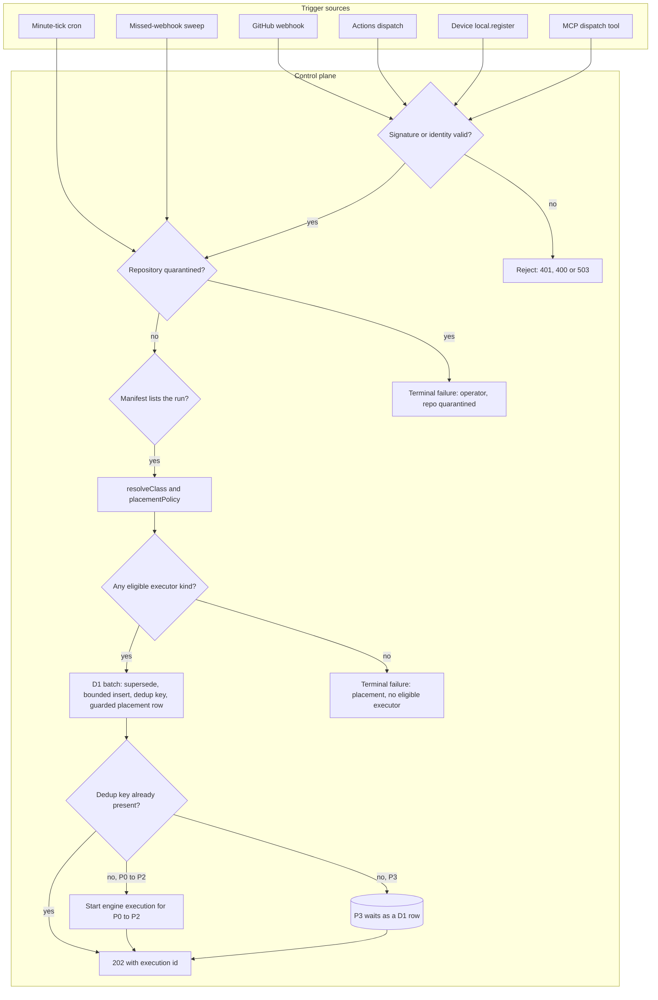
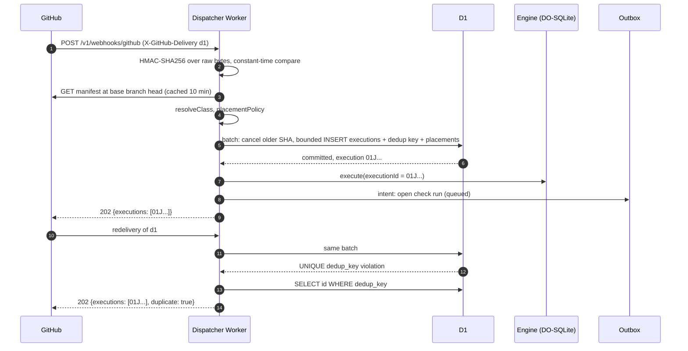
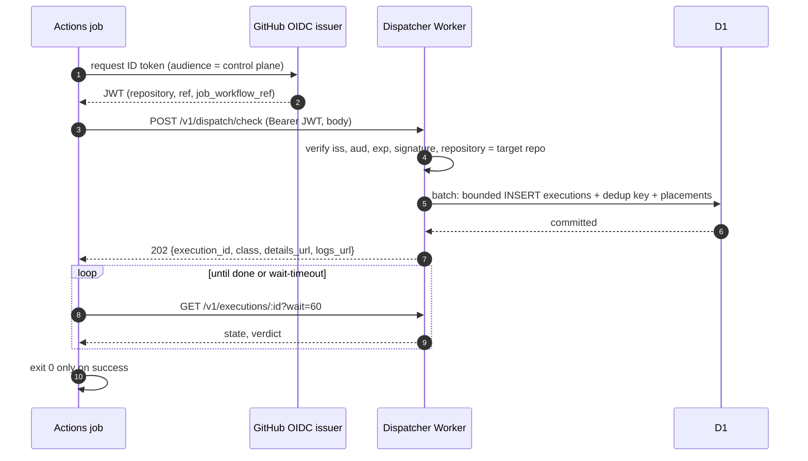

# Intake

Intake turns a trigger into at most one execution per dedup key. It authenticates the caller, reads the repo manifest, classifies the work, checks that some executor may run it, and writes the execution row, its dedup key and its placement row in one D1 batch before any engine execution exists.

## Scope

This file covers the five trigger kinds (webhook, Actions dispatch, cron, local submit, MCP call) and the three control-plane sources that reuse the same path (the missed-webhook sweep, check re-runs and the `dispatch.followOn` drain of [github-output.md](github-output.md) FD-GH-088); the `DispatchEvent` union; webhook signature and dispatch token checks; execution ids and dedup keys; repo manifests; the refusal of unplaceable requests and of requests for a quarantined repository; and the release-approval event that starts a `release-notes` publish execution. It depends on [qos-admission.md](qos-admission.md) for `resolveClass`, `placementPolicy`, intake bounds and supersession, on [spend.md](spend.md) for the operator halt, on [operability.md](operability.md) for repository quarantine, on [engine.md](engine.md) for engine execution start, on [github-output.md](github-output.md) for the outbox that posts check runs, on [interfaces.md](interfaces.md) for the HTTP API surface, the error model, the dispatch response, the dispatch action and MCP tools, on [local-scheduler.md](local-scheduler.md) for local registrations, and on [runs/agentic.md](runs/agentic.md) for the release approval rules.

This file does not specify an external-signals webhook, chat-originated dispatch or inbound-mail triggers; none of them is a trigger kind in this system.

## Model

### Trigger kinds

| Trigger kind | Source | Authenticated by | Default class source | Phase |
| --- | --- | --- | --- | --- |
| `webhook` | GitHub App webhook delivery | HMAC-SHA256 over the raw body | `resolveClass` | 0 |
| `dispatch` | GitHub Actions step or a server caller, `POST /v1/dispatch/:run` | Actions OIDC token, or an Access JWT of a member of the dispatch group ([interfaces.md](interfaces.md) FD-IFC-027) | `resolveClass`, then the `class` input | 0 |
| `cron` | One minute-tick cron trigger on the control plane | The platform | `resolveClass` (scheduled runs default to P3) | 0 |
| `local` | A device's `local.register` under a capacity lease | Capacity-lease credential plus proof of possession | Always advisory, `local-only` | 1 |
| `mcp` | The control plane's MCP `dispatch` tool | The identity gate of the HTTP API | `resolveClass`, lower-only override | 2 |

The missed-webhook sweep, check re-runs and the `dispatch.followOn` drain are not trigger kinds. The sweep and check re-runs submit the trigger kind of the event they replace (`webhook`) through the same intake function, so they share the dedup key and every check below. The drain submits its trigger through the same intake function under the follow-on dedup key.

### Records

- **`DispatchEvent`.** A `Schema.Union` tagged by trigger kind, which every trigger function in [run-model.md](run-model.md) receives decoded. Its members: `webhook` {event, action, delivery id, payload decoded per event}, `dispatch` {run, repo, ref, sha, inputs, class, caller}, `cron` {scheduled minute, repo, schedule}, `local` {`lease_id`, epoch, run, tree hash, inputs digest} and `mcp` {caller identity, run, repo, ref, sha, inputs}.
- **Execution id.** A ULID: 26 characters of Crockford base32. It is the `executions` primary key, the engine `executionId`, the check run's `external_id` and the subject of every per-lease credential.
- **Dedup key.** A canonical string that names what the execution verifies, stored as its lowercase hex SHA-256 in `executions.dedup_key` under a `UNIQUE` constraint, with the canonical string beside it for display.

| Trigger | Canonical dedup key |
| --- | --- |
| Commit-scoped (`webhook`, `dispatch`, `mcp`) | `<run>[:<label>]:<owner>/<repo>:<sha>` |
| Check re-run, attempt *n* ≥ 2 | `<run>[:<label>]:<owner>/<repo>:<sha>:attempt-<n>` |
| `cron` | `<run>:<owner>/<repo>:cron:<scheduled minute, ISO 8601 UTC>` |
| `dispatch` with an `Idempotency-Key` header | `idem:<owner>/<repo>:<Idempotency-Key>` |
| `local` | `local:<lease_id>:<run>:<tree hash>:<inputs digest>` |
| `dispatch.followOn` drain | `<execution_id>/<intent_key>` ([github-output.md](github-output.md) FD-GH-088) |
| Child execution | `<parent dedup key>/<child run>:<sha256 of the canonical child input>` ([run-model.md](run-model.md) FD-RUN-047) |

The commit-scoped key omits the trigger kind, so a webhook and an Actions dispatch for one run on one commit resolve to one execution.

- **Repo manifest.** `.github/flare-dispatch.json` in the consumer repository, decoded by the `RepoManifest` schema (`version: 1`). Each entry names a recipe, an optional label, the triggers it answers, its parameters and, for cron, its schedule. A run dispatches for a repository only when the manifest lists it.

### Intake path

Every trigger passes the same checks in the same order; the first refusal ends intake for that (trigger, run) pair.

*Intake path: authentication, repository quarantine, manifest, classification and placeability come before the one D1 batch that creates the execution.*

### Webhook delivery and redelivery

*Webhook delivery: the dedup key, not the delivery id, makes a redelivery a no-op; the engine starts only after the batch commits.*

### Actions dispatch with OIDC and blocking mode

*Actions dispatch: the token's `repository` claim binds the request to one repository; blocking mode turns the verdict into the step's exit code.*

## Requirements

### One door

- **FD-INT-001** · phase 0 · `V-UNIT` `V-CONF` — The control plane must accept every trigger, including the missed-webhook sweep, check re-runs and the `dispatch.followOn` drain, only through the one intake function `intake.accept`, which is the only writer of `executions` rows, dedup keys and initial `placements` rows.
- **FD-INT-002** · phase 0 · `V-UNIT` `V-CONF` `V-SIM` — When intake accepts a placeable execution, the control plane must write its `executions` row, its dedup key and its `placements` row in one D1 batch, so that after the batch either all three exist or none does.
- **FD-INT-069** · phase 0 · `V-CONF` `V-SIM` — The control plane must guard every statement that follows the bounded `executions` insert ([qos-admission.md](qos-admission.md) FD-QOS-031) in the intake batch with `WHERE EXISTS (SELECT 1 FROM executions WHERE id = ?)`, so that no placement row or check-run intent commits when that insert changes 0 rows.
- **FD-INT-068** · phase 0 · `V-UNIT` `V-CONF` — If the bounded `executions` insert changes 0 rows (`meta.changes = 0`), then the control plane must apply [qos-admission.md](qos-admission.md) FD-QOS-033 to FD-QOS-035 to the trigger and must not answer it under FD-INT-004.
- **FD-INT-003** · phase 0 · `V-UNIT` `V-CONF` `V-SIM` — If the batch fails on the `UNIQUE` dedup key, the control plane must answer `202` with the existing execution's id and `duplicate: true`, write no row and start no engine execution.
- **FD-INT-004** · phase 0 · `V-UNIT` `V-SIM` — If the batch fails for any cause other than the dedup key, the control plane must answer `503` with error `intake_unavailable` from the error-model table in [interfaces.md](interfaces.md) and leave no row, dedup key or engine execution behind.
- **FD-INT-005** · phase 0 · `V-UNIT` `V-REPLAY` — When the batch commits an execution of class P0, P1 or P2, the control plane must start its engine execution with `executionId` equal to the execution id, and must not start it before the commit.
- **FD-INT-006** · phase 0 · `V-SIM` `V-REPLAY` — If an execution of class P0, P1 or P2 has no engine execution 60 s after its batch committed, the intake sweep must start it, and a second start for the same execution id must leave the first engine execution unchanged.
- **FD-INT-007** · phase 0 · `V-UNIT` — When the batch commits an execution of class P3, the control plane must keep it as a D1 row with no engine execution until a device claims it or its `stale_at` passes ([qos-admission.md](qos-admission.md)).
- **FD-INT-008** · phase 0 · `V-UNIT` — The control plane must give every execution a ULID execution id of 26 Crockford base32 characters, generated once at intake and used unchanged as the engine `executionId`, the check run's `external_id` and the per-lease credential subject.

### Dedup keys

- **FD-INT-009** · phase 0 · `V-UNIT` — The control plane must derive the dedup key of a commit-scoped trigger as `<run>[:<label>]:<owner>/<repo>:<sha>`, without the trigger kind, so that one run on one commit yields at most one execution across webhook, dispatch and MCP triggers.
- **FD-INT-010** · phase 0 · `V-UNIT` — Where a dispatch carries an `Idempotency-Key` header of 1 to 128 characters from `[A-Za-z0-9._:-]`, the control plane must use `idem:<owner>/<repo>:<Idempotency-Key>` as the dedup key.
- **FD-INT-011** · phase 0 · `V-UNIT` — If an `Idempotency-Key` header is empty, longer than 128 characters or contains a character outside `[A-Za-z0-9._:-]`, the control plane must reject the dispatch with `400` and error `invalid_idempotency_key`.
- **FD-INT-012** · phase 0 · `V-UNIT` `V-CONF` — The control plane must store each dedup key as the lowercase hex SHA-256 of its canonical string in a column with a `UNIQUE` constraint, on every store backend.

### Placeability and refusal

- **FD-INT-013** · phase 0 · `V-UNIT` `V-PROOF` `V-DIFF` — If `placementPolicy` leaves a request with an empty set of eligible executor kinds, or with no eligible kind that advertises every capability label the run declares ([executors.md](executors.md) § Capability labels, the filter of [placement-leases.md](placement-leases.md) FD-LEASE-007), the control plane must write it as a terminal execution with verdict `failure` and reason `placement: no eligible executor`, enqueue its check conclusion through the outbox, and create no placement row, hold or engine execution.
- **FD-INT-014** · phase 0 · `V-UNIT` `V-PROOF` — The control plane must not queue, hold or wait on an unplaceable request for any duration.
- **FD-INT-070** · phase 0 · `V-UNIT` — If a request names a repository that an operator has quarantined, then the control plane must refuse it under [operability.md](operability.md) FD-OPS-085 after the signature or identity check and before it reads the manifest, writing it as a terminal execution and enqueuing its check conclusion as FD-INT-013 does, with no placement row, hold or engine execution.

### Repo manifests

- **FD-INT-015** · phase 0 · `V-UNIT` `V-E2E-LOCAL` — When a trigger names a repository, the control plane must dispatch only the runs that the repository's manifest lists for that trigger and the operator policy allows.
- **FD-INT-016** · phase 0 · `V-UNIT` — The control plane must read the manifest at the base branch head for `pull_request` and `merge_group` triggers, at the pushed commit for a push to the default branch, and at the default branch head for every other trigger.
- **FD-INT-017** · phase 0 · `V-UNIT` — The control plane must decode the manifest with the `RepoManifest` schema and must reject a manifest larger than 64 KiB or with more than 50 run entries as invalid.
- **FD-INT-018** · phase 0 · `V-UNIT` `V-E2E-LOCAL` — If the manifest fails to decode, or a run entry's parameters fail the recipe's input schema, the control plane must dispatch none of the manifest's runs, write a `shed` row with reason `manifest: invalid`, and post one `failure` check run named `flare-dispatch/manifest` that lists the first 20 decode errors.
- **FD-INT-019** · phase 0 · `V-UNIT` `V-SIM` — If the manifest read fails with a GitHub `5xx`, a 10 s timeout or a quota-reserve refusal, the control plane must dispatch nothing for that trigger and write a `shed` row with reason `manifest: unreadable`.
- **FD-INT-020** · phase 0 · `V-UNIT` — If a repository has no manifest, the control plane must write no `executions`, `placements` or `shed` row, open no check run and start no engine execution for it.
- **FD-INT-021** · phase 0 · `V-UNIT` — The control plane must cache a decoded manifest per (repository, commit SHA) for at most 10 min.

### Webhook

- **FD-INT-022** · phase 0 · `V-UNIT` `V-DEPLOY` — If the webhook secret is absent from the dispatcher Worker's secrets, the control plane must answer every webhook with `503` and error `webhook_unconfigured` and dispatch nothing.
- **FD-INT-023** · phase 0 · `V-UNIT` — If a webhook body exceeds 25 MiB, the control plane must answer `413` without verifying or parsing it.
- **FD-INT-024** · phase 0 · `V-UNIT` — When a webhook arrives, the control plane must verify `X-Hub-Signature-256` as HMAC-SHA256 over the raw request bytes with a constant-time comparison before it parses any JSON.
- **FD-INT-025** · phase 0 · `V-UNIT` — If the webhook signature is missing or does not match, the control plane must answer `401` and dispatch nothing.
- **FD-INT-026** · phase 0 · `V-UNIT` — If a signed webhook lacks `X-GitHub-Delivery` or `X-GitHub-Event`, the control plane must answer `400` and dispatch nothing.
- **FD-INT-027** · phase 0 · `V-UNIT` `V-DEPLOY` — Where `intake.webhookEvents` is set, the control plane must answer an event outside the list with `202` and `{ignored: true, reason: "event_not_allowed"}` after the signature check and write no row; an absent field must admit every supported event and an empty list none.
- **FD-INT-028** · phase 0 · `V-UNIT` — The control plane must take a webhook's commit SHA from the first present field of `deployment.sha`, `pull_request.head.sha`, `merge_group.head_sha`, `head_commit.id` on a tag push or `after` on a branch push, `check_run.head_sha` and `check_suite.head_sha`.
- **FD-INT-029** · phase 0 · `V-UNIT` — If a webhook event carries none of those SHA fields, the control plane must dispatch nothing for it and write a `shed` row with reason `intake: no commit`.
- **FD-INT-030** · phase 0 · `V-UNIT` `V-PROOF` — When a `pull_request` event's `head.repo.full_name` differs from its `base.repo.full_name`, the control plane must record the trigger as `fork-pr`, which applies the `stranger-code` placement constraint.
- **FD-INT-031** · phase 0 · `V-LIVE` — When the control plane verifies a webhook signature, it must record the delivery time per installation, which the liveness alarm in [operability.md](operability.md) reads.

### Missed-webhook sweep

- **FD-INT-032** · phase 0 · `V-UNIT` `V-SIM` — Every 10 min, the control plane must list each installation's open pull requests updated in the last 72 h, up to 100 per installation, and submit a `webhook` trigger through intake for every head that lacks a FlareDispatch check run for a run in its target branch's required set.
- **FD-INT-033** · phase 0 · `V-UNIT` — While an installation's remaining GitHub API quota is below 30%, the missed-webhook sweep must skip that installation.

### Actions dispatch

- **FD-INT-034** · phase 0 · `V-UNIT` — When `POST /v1/dispatch/:run` arrives, the control plane must authenticate it before it looks up the run, so an unauthenticated request receives `401` whatever the run name.
- **FD-INT-035** · phase 0 · `V-UNIT` `V-E2E-LOCAL` — Where a dispatch carries a bearer token, the control plane must accept it only when it is a JWT from issuer `https://token.actions.githubusercontent.com` with the configured audience, an unexpired `exp`, and a valid RS256 signature against the issuer's JWKS cached for at most 1 h.
- **FD-INT-036** · phase 0 · `V-UNIT` — If a valid Actions token's `repository` claim differs from the dispatch's target repository, the control plane must reject the dispatch with `403` and error `repository_mismatch`.
- **FD-INT-037** — Removed.
- **FD-INT-038** — Removed.
- **FD-INT-039** · phase 0 · `V-UNIT` — If an authenticated dispatch names an unknown run, the control plane must answer `404` with error `run_not_found`.
- **FD-INT-040** · phase 0 · `V-UNIT` — If a dispatch body exceeds 1 MiB, the control plane must answer `413`; if it fails the dispatch schema, `400` with error `invalid_body`; if its inputs fail the run's input schema, `400` with error `invalid_inputs`.
- **FD-INT-041** · phase 0 · `V-UNIT` — If a dispatch carries no `ref`, the control plane must resolve the repository's default branch head to a commit SHA at intake and dispatch against that SHA.
- **FD-INT-042** · phase 0 · `V-UNIT` `V-E2E-LOCAL` — If a dispatch carries no installation id, the control plane must resolve the installation from the target repository through the GitHub App.
- **FD-INT-043** · phase 0 · `V-UNIT` — If no installation of the GitHub App covers the target repository, the control plane must reject the dispatch with `422` and error `installation_not_found` and create no execution.
- **FD-INT-044** — Removed; see [interfaces.md](interfaces.md) FD-IFC-035 and FD-IFC-036.

### Dispatch action

The dispatch action (`actions/flare-dispatch-action`) is specified in [interfaces.md](interfaces.md) § Dispatch action (FD-IFC-055 to FD-IFC-061).

- **FD-INT-045** — Removed; see [interfaces.md](interfaces.md) FD-IFC-055.
- **FD-INT-046** — Removed; see [interfaces.md](interfaces.md) FD-IFC-058.
- **FD-INT-047** — Removed; see [interfaces.md](interfaces.md) FD-IFC-057.
- **FD-INT-048** — Removed; see [interfaces.md](interfaces.md) FD-IFC-059.
- **FD-INT-049** · phase 0 · `V-UNIT` — If a dispatch's signals, after merging the collected and the input signals, exceed 50 entries or a field exceeds its cap (source 120, title 200, detail 2000, url 1000 characters), the control plane must reject the dispatch with `400` and error `invalid_signals`, and the dispatch action must refuse to send it.

### Cron

- **FD-INT-050** · phase 0 · `V-UNIT` `V-DEPLOY` — The committed template must declare exactly one cron trigger, `* * * * *`, and the drift check must fail a rendered configuration or a deployed Worker whose cron set differs from it.
- **FD-INT-067** · phase 0 · `V-UNIT` `V-SIM` — When the minute tick fires, the control plane must only enqueue work: each sweep and each installation's missed-webhook scan must run in its own Durable Object alarm or Queue message, and each such unit must stay within 500 D1 queries and 1,000 subrequests, carrying a cursor to the next unit when it stops.
- **FD-INT-051** · phase 0 · `V-UNIT` — When the minute tick fires, the control plane must dispatch every run whose `schedules[].cron` expression matches the tick's scheduled minute in UTC, once for each repository whose manifest lists that schedule.
- **FD-INT-052** · phase 0 · `V-UNIT` — When the control plane dispatches a scheduled run, it must pin the head SHA of the branch the schedule names, or of the default branch when it names none, at intake.
- **FD-INT-053** · phase 0 · `V-UNIT` `V-SIM` — If the platform fires the tick for one scheduled minute more than once, the control plane must create at most one execution per (run, repository) for that minute.

### Check re-runs

- **FD-INT-054** · phase 0 · `V-UNIT` — When a `check_run` or `check_suite` `rerequested` event names a FlareDispatch check run, the control plane must dispatch attempt *n* + 1 with a new execution id and placement row, the dedup key suffix `:attempt-<n+1>`, the same check name and the same class, and without applying a cooldown.
- **FD-INT-055** · phase 0 · `V-UNIT` — If a re-run names another App's check run, an unknown check run, a family with a non-terminal attempt, a family with 5 attempts, an unregistered run or inputs that no longer decode, the control plane must create no execution and write a `shed` row with reason `foreign_app`, `unknown_check_run`, `in_progress`, `attempts_exhausted`, `run_not_registered` or `inputs_unreplayable`.
- **FD-INT-056** · phase 0 · `V-UNIT` — When a `check_suite` `rerequested` event arrives, the control plane must re-run every family in the suite whose latest attempt's verdict is not `success`.

### Release approval

A release-approval event is a merge, a close or a label on the release pull request that a `release-notes` execution opened. Intake decides from it whether to start one publish execution under [runs/agentic.md](runs/agentic.md) FD-AGT-085 to FD-AGT-087.

- **FD-INT-066** · phase 3 · `V-UNIT` — When a `pull_request` `closed` or `labeled` event names a pull request authored by the GitHub App that carries the release-notes execution marker, the control plane must apply [runs/agentic.md](runs/agentic.md) FD-AGT-085 to FD-AGT-087 to it, starting at most one publish execution per release pull request across redeliveries, a label and a merge, and must ignore the event otherwise.

### Cooldown

- **FD-INT-057** · phase 0 · `V-UNIT` `V-SIM` — Where a run declares `cooldown { seconds, scope }`, the control plane must set `not_before` to the end of the current window for an execution that arrives within `seconds` of a prior execution of the same (run, repository, scope), and must keep its check run `queued` until then.
- **FD-INT-058** · phase 0 · `V-UNIT` — The control plane must clamp a cooldown window to the range 60 s to 86400 s and must not apply a cooldown to `cron` triggers or check re-runs.

### Local submit

- **FD-INT-059** · phase 1 · `V-UNIT` `V-CONF` — When a device sends `local.register`, the control plane must accept it only under the current epoch of a live capacity lease and with proof of possession of the key whose thumbprint the capacity lease's `cnf` holds.
- **FD-INT-060** · phase 1 · `V-UNIT` — If a `local.register` carries a stale capacity-lease epoch or fails proof of possession, the control plane must reject it with error `lease_stale` or `proof_invalid` and write no row.
- **FD-INT-061** · phase 1 · `V-UNIT` `V-PROOF` — When the control plane accepts a `local.register`, it must record trigger kind `local` and the `local-only` placement constraint, whose check-run and spend rule [qos-admission.md](qos-admission.md) FD-QOS-023 specifies.

### MCP

- **FD-INT-062** · phase 2 · `V-UNIT` `V-E2E-LOCAL` — When the MCP `dispatch` tool is called, the control plane must authenticate the caller through the identity gate of the HTTP API and accept the trigger as kind `mcp` through `intake.accept`, recording the caller's identity on the execution row.
- **FD-INT-063** · phase 2 · `V-UNIT` — If an MCP `dispatch` call requests a class above the one `resolveClass` assigns, the control plane must keep the assigned class and log the clamp.

### Ingress errors

- **FD-INT-064** · phase 0 · `V-UNIT` — If a request names a path the control plane does not serve, the control plane must answer `404` with `{error: "not_found"}`, and if it names a served path with an unsupported method, `405` with `{error: "method_not_allowed"}`, both after the identity gate.
- **FD-INT-065** · phase 0 · `V-UNIT` — If an intake handler ends in a defect rather than a tagged error, the control plane must answer `500` with `{error: "internal", message, request_id}` and record the defect under that `request_id`.

## Open items

- TODO(maintainer): decide whether the missed-webhook sweep also covers `merge_group` heads, which have no open pull request to list.
- TODO(operator): confirm `.github/flare-dispatch.json` as the manifest path before the first consumer repository adopts it.
