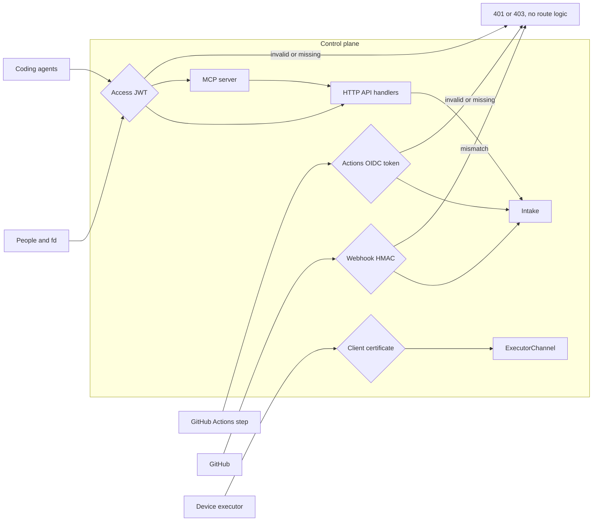
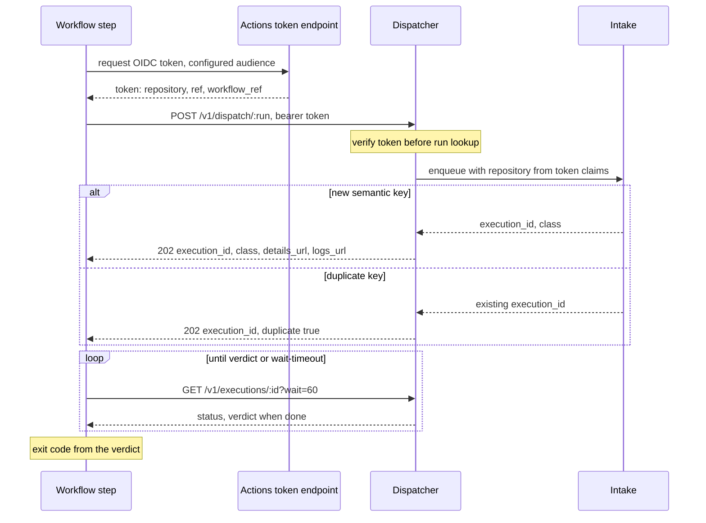
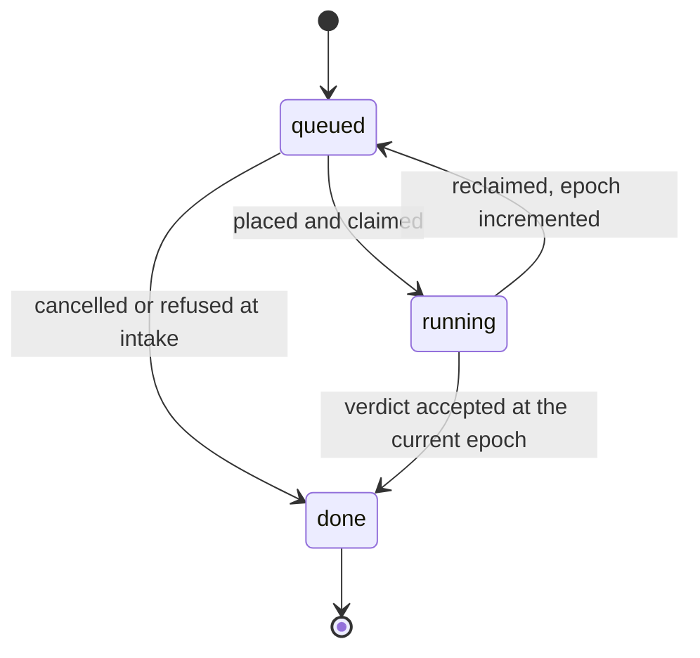
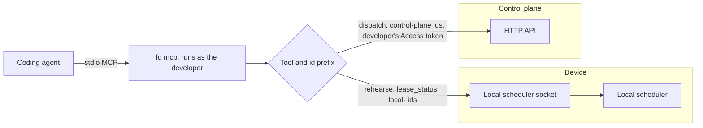

# Interfaces

This file specifies the surfaces people, workflows and coding agents use to reach FlareDispatch: the dispatcher's HTTP API, the identity gate in front of it, the GitHub Actions dispatch client, the `fd` command-line tool and the MCP tools `rehearse`, `dispatch`, `get_verdict` and `get_failure_summary`.

## Scope

The HTTP API is declared once with `effect/http-api`: every route, request schema, response schema and error union is a `Schema`, and every error is a `Schema.TaggedError` class. The dispatcher implements the declaration; the `fd-<subcommand>` executables, built with `effect/cli`, and the MCP tools derive their clients and tool schemas from it. `fd` itself is mameko's `<cli>` built with the command name `fd` ([mameko releases.md § Device command](https://github.com/fractalboxdev/mameko/blob/2c3041335db0cf4a2193e5b11827f20631d54e87/specs/releases.md#device-command)). In Effect 4.0.6, `effect/http-api`, `effect/cli` and the `effect/ai` MCP server are `@stability unstable`, and the upgrade gate of FD-IFC-082 covers them.

This file depends on:

- [intake.md](intake.md) for webhook signature checks, atomic dedup, repo manifests and the installation lookup behind a dispatch;
- [profile.md](profile.md) for `resolveClass`, and mameko's [admission-qos.md § Supersession](https://github.com/fractalboxdev/mameko/blob/2c3041335db0cf4a2193e5b11827f20631d54e87/specs/admission-qos.md#supersession) for cancellation and supersession;
- [operability.md](operability.md) for the operator operations each `/v1/ops/*` route surfaces, the dashboard, `fd deploy` and `fd doctor`;
- mameko's [executor-protocol.md](https://github.com/fractalboxdev/mameko/blob/2c3041335db0cf4a2193e5b11827f20631d54e87/specs/executor-protocol.md) for the executor connect route;
- [local-scheduler.md](local-scheduler.md) for the local MCP endpoint, its tools and the submit port;
- [provenance.md](provenance.md) for the statements and policy the provenance routes serve;
- [run-model.md](run-model.md) for `RunResult` and the verdict union;
- [cache-artifacts.md](cache-artifacts.md) for the log, artifact and compile-cache routes;
- [model-gateway.md](model-gateway.md) for the model request the model-gateway route carries.

Not specified: the Slack-origin client, the signals webhook, the inbound mailbox and the deploy console. The release-approval event is in [intake.md](intake.md) FD-INT-066. Each belongs to a later phase with the feature it serves.

## Model

### Surfaces and their identity gates

Every surface passes exactly one identity check before any route logic runs.

| Surface | Served by | Callers | Identity | Phase |
| --- | --- | --- | --- | --- |
| HTTP API, `/v1/*` | Dispatcher | People, `fd`, automation | Cloudflare Access JWT (people and service tokens) | 0 |
| `POST /v1/dispatch/:run` | Dispatcher | A GitHub Actions workflow step, or a member or service token through `fd` | GitHub Actions OIDC token, or Access JWT of an identity in `dispatchers` | 0 |
| `POST /v1/webhooks/github` | Dispatcher | GitHub | HMAC-SHA256 over the raw body ([intake.md](intake.md)) | 0 |
| `/v1/executors/connect` | `ExecutorChannel` Durable Object | Device executors and `gha` runners | Client certificate over mTLS whose SHA-256 fingerprint equals the executor row's `key_fingerprint` ([MAMEKO-PROTO-002](https://github.com/fractalboxdev/mameko/blob/2c3041335db0cf4a2193e5b11827f20631d54e87/specs/executor-protocol.md)); for a `gha` runner, the launcher port's `verify` of its OIDC token ([executors.md](executors.md)) | 1 |
| `/v1/executions/:id/logs/:file`, `/v1/artifacts/:artifact_id` | Dispatcher | Anyone holding a link | Link token, or Access JWT | 0 |
| `/v1/compile-cache/*` | Dispatcher | `sccache` in a job | Compile-cache token ([cache-artifacts.md](cache-artifacts.md) FD-CACHE-057) | 0 |
| `POST /v1/model/completions` | Dispatcher | An executor's egress proxy, a local scheduler's host proxy | The execution's per-lease token with its epoch, or a capacity-lease proof of possession ([MAMEKO-MDL-040](https://github.com/fractalboxdev/mameko/blob/2c3041335db0cf4a2193e5b11827f20631d54e87/specs/model-gateway.md), [MAMEKO-MDL-041](https://github.com/fractalboxdev/mameko/blob/2c3041335db0cf4a2193e5b11827f20631d54e87/specs/model-gateway.md), [MAMEKO-MDL-043](https://github.com/fractalboxdev/mameko/blob/2c3041335db0cf4a2193e5b11827f20631d54e87/specs/model-gateway.md)) | 0 |
| `/.well-known/*`, `/health` | Dispatcher | Anyone | None | 0 |
| `/v1/provenance/*` | Dispatcher | Verifiers | None for public repositories, Access JWT otherwise | 4 |
| `/mcp` | Dispatcher | Coding agents | Access JWT | 2 |
| Local MCP endpoint and submit port | Local scheduler | Developers and agents on a device or the tailnet | Socket peer uid, or Tailscale WhoIs ([local-scheduler.md](local-scheduler.md)) | 1–2 |

*Identity gates · one gate per surface, and every gate runs before the route looks up a run or an execution.*

### Error model

Every error response is a JSON object `{ "error": <code>, "message": <text>, "request_id": <id> }`. The codes form a closed set. Four codes carry an error mameko's coordinator raises: `conflict` (an `Idempotency-Key` reused with a different body, [MAMEKO-ADM-028](https://github.com/fractalboxdev/mameko/blob/2c3041335db0cf4a2193e5b11827f20631d54e87/specs/admission-qos.md)), `intake_unavailable` ([MAMEKO-ADM-029](https://github.com/fractalboxdev/mameko/blob/2c3041335db0cf4a2193e5b11827f20631d54e87/specs/admission-qos.md)), `spend_unreadable` ([MAMEKO-SPD-059](https://github.com/fractalboxdev/mameko/blob/2c3041335db0cf4a2193e5b11827f20631d54e87/specs/spend.md)) and `misconfigured` ([MAMEKO-OPS-002](https://github.com/fractalboxdev/mameko/blob/2c3041335db0cf4a2193e5b11827f20631d54e87/specs/operability.md)).

| Status | Codes |
| --- | --- |
| 400 | `invalid_body`, `invalid_inputs`, `invalid_signals`, `invalid_idempotency_key`, `invalid_wait`, `reason_required`, `model_request_invalid` |
| 401 | `unauthenticated`, `lease_stale`, `proof_invalid` |
| 402 | `allowance_exhausted` |
| 403 | `forbidden`, `repository_mismatch`, `link_expired`, `link_revoked`, `model_route_refused` |
| 404 | `not_found`, `run_not_found`, `execution_not_found` |
| 405 | `method_not_allowed` |
| 409 | `conflict`, `not_failed`, `not_finished` |
| 413 | `payload_too_large` |
| 422 | `installation_not_found` |
| 429 | `rate_limited`, with `Retry-After` |
| 500 | `internal` |
| 503 | `not_configured`, `unavailable`, `misconfigured`, `intake_unavailable`, `webhook_unconfigured`, `spend_unreadable` |
| 507 | `storage_bound` |

### Routes

| Route | Purpose | Phase |
| --- | --- | --- |
| `POST /v1/dispatch/:run` | Request an execution of a run on a repository and commit | 0 |
| `GET /v1/executions` | List executions, newest first, with a keyset cursor | 0 |
| `GET /v1/executions/:id` | One execution; `?wait=<s>` holds the response until a verdict or the wait ends | 0 |
| `GET /v1/executions/:id/failure-summary` | The bounded `incident/v1` pack of a failed execution | 0 |
| `POST /v1/executions/:id/cancel` | Request cancellation | 0 |
| `GET /v1/executions/:id/logs/:file` | The redacted step log ([cache-artifacts.md](cache-artifacts.md) FD-CACHE-083) | 0 |
| `GET /v1/artifacts/:artifact_id` | One stored artifact and its browse paths ([cache-artifacts.md](cache-artifacts.md) FD-CACHE-075) | 0 |
| `GET`, `HEAD`, `PUT`, `PROPFIND`, `MKCOL` `/v1/compile-cache/:owner/:name/*` | The compile cache ([cache-artifacts.md](cache-artifacts.md) FD-CACHE-056) | 0 |
| `POST /v1/model/completions` | One `ModelCompletionRequest` through the model gateway | 0 |
| `POST /v1/ops/halt` | Set the control state: `run`, `halt-cloud`, `halt-all` | 0 |
| `POST /v1/ops/quarantine` | Quarantine one executor or one repository | 0 |
| `POST /v1/ops/release` | Release a quarantined or drained executor, or a quarantined repository | 0 |
| `POST /v1/ops/force-admit` | Admit one stuck `required` execution above its line until an expiry | 0 |
| `POST /v1/ops/top-up` | Top up the `required` reserve until an expiry | 0 |
| `POST /v1/ops/drain` | Drain one executor | 1 |
| `POST /v1/ops/revoke` | Revoke one device key | 1 |
| `POST /v1/ops/pause-key`, `POST /v1/ops/resume-key` | Pause or resume one delivery key: an installation's `limit_key` | 1 |
| `GET /v1/ops/health` | Installation, delivery, cron, executor, outbox and control-state health ([operability.md](operability.md) FD-OPS-036) | 0 |
| `GET /v1/spend` | Month-to-date spend per class line ([spend.md](spend.md)) | 0 |
| `GET /.well-known/openid-configuration`, `GET /.well-known/jwks.json` | OIDC discovery and keys | 0 |
| `GET /.well-known/flare-dispatch/provenance-policy.json` | The verification policy | 4 |
| `GET /v1/provenance/executions/:id`, `GET /v1/provenance/subjects/sha256:<hex>` | Statements with inclusion proofs | 4 |
| `GET /v1/provenance/log/checkpoint`, `/proof/inclusion`, `/proof/consistency` | Private-log checkpoint and proofs | 4 |

### Dispatch with wait

An Actions step and `fd dispatch --wait` follow the same exchange.

*Dispatch with wait · a 4xx ends the step at once; only a 5xx or a network error is retried.*

### Execution status as the API reports it

*Reported status · `queued` covers an execution before its first lease and after a reclaim; `done` carries the verdict `success`, `failure(reason)`, `cancelled` or `skipped`, or no verdict for an execution that ended `deferred` or `expired` ([MAMEKO-ARCH-061](https://github.com/fractalboxdev/mameko/blob/2c3041335db0cf4a2193e5b11827f20631d54e87/specs/architecture.md) to [MAMEKO-ARCH-063](https://github.com/fractalboxdev/mameko/blob/2c3041335db0cf4a2193e5b11827f20631d54e87/specs/architecture.md)).*

### `fd` commands

| Command | Talks to | Phase |
| --- | --- | --- |
| `fd login` | Access, through the browser | 0 |
| `fd dispatch <run>` | `POST /v1/dispatch/:run` | 0 |
| `fd status <id>`, `fd verdict <id> [--wait]` | `GET /v1/executions/:id` | 0 |
| `fd failure <id>` | `GET /v1/executions/:id/failure-summary` | 0 |
| `fd logs <id>` | `GET /v1/executions/:id/logs/:file` | 0 |
| `fd cancel <id>` | `POST /v1/executions/:id/cancel`, or the local scheduler for a local id | 0 |
| `fd ls` | `GET /v1/executions` | 0 |
| `fd ops halt`, `drain`, `quarantine`, `release`, `force-admit`, `top-up`, `revoke`, `pause-key`, `resume-key` | `/v1/ops/*` | 0 |
| `fd deploy`, `fd doctor` | As [operability.md](operability.md) specifies | 0 |
| `fd rehearse <run>`, `fd queue`, `fd lease` | The local scheduler socket; commands mameko's `<cli>` defines | 1 |
| `fd mcp` | Stdio MCP shim over both | 1 |
| `fd verify <artifact>` | Offline, with a policy and a statement bundle | 4 |

| Exit code | Meaning |
| --- | --- |
| 0 | Command succeeded; with a wait, the verdict is `success` |
| 1 | The verdict is `failure` |
| 2 | Usage error |
| 3 | The verdict is `cancelled` |
| 4 | The verdict is `skipped` |
| 5 | No verdict: authentication, transport or scheduler unreachable |
| 6 | The wait ended before a verdict |

### MCP tools

Each tool is served where it is backed. The dispatcher has no device to rehearse on, so `rehearse` exists only on the local scheduler; `fd mcp` serves the union and routes each call.

| Tool | Dispatcher `/mcp` | Local scheduler socket | Input | Output |
| --- | --- | --- | --- | --- |
| `rehearse` | — | Yes | `run`, `inputs`, `class` (default `rehearsal`), `wait_seconds` | `execution_id`, `queue_position`, verdict when done |
| `dispatch` | Yes | — | `run`, `repo`, `ref`, `sha`, `inputs`, `class`, `wait_seconds` | `execution_id`, `class`, `details_url`, verdict when done |
| `get_verdict` | Yes | Yes | `execution_id`, `wait_seconds` | Status, verdict, reason, conclusion, `advisory`, executor kind, class |
| `get_failure_summary` | Yes | Yes | `execution_id` | `incident/v1` pack |
| `cancel` | Yes | Yes | `execution_id` | Status |
| `lease_status` | — | Yes | None | Capacity-lease state, slots, remaining token allowance, offline flag |

*MCP routing · the shim uses the developer's own identity for the control plane; the local scheduler never calls the control plane for a member.*

## Requirements

### API declaration and errors

- **FD-IFC-001** · phase 0 · `V-UNIT` — The dispatcher must serve exactly the routes, request schemas, response schemas and error unions of the one `effect/http-api` declaration.
- **FD-IFC-002** · phase 0 · `V-UNIT` — `fd`, the dispatch action and the MCP tools must call the HTTP API only through clients and schemas derived from that declaration.
- **FD-IFC-003** · phase 0 · `V-UNIT` — The dispatcher must run the identity gate before the method check and before any lookup of a run or an execution.
- **FD-IFC-004** · phase 0 · `V-UNIT` — If a request matches no route, then the dispatcher must answer 404 `not_found`.
- **FD-IFC-005** · phase 0 · `V-UNIT` — If a request matches a route's path with another method, then the dispatcher must answer 405 `method_not_allowed`.
- **FD-IFC-006** · phase 0 · `V-UNIT` — If a request body exceeds its route's limit (1 MiB by default, 25 MiB on `POST /v1/webhooks/github` as [intake.md](intake.md) FD-INT-023 specifies), then the dispatcher must answer 413 `payload_too_large` without parsing it.
- **FD-IFC-007** · phase 0 · `V-UNIT` — If a request body fails its schema, then the dispatcher must answer 400 `invalid_body` naming the first failing path.
- **FD-IFC-008** · phase 0 · `V-UNIT` — If a handler fails with a defect, then the dispatcher must record the defect under a request id and answer 500 `internal` with that id and no stack trace or exception text.
- **FD-IFC-009** · phase 0 · `V-UNIT` — The dispatcher must answer every error with the JSON shape and a code from the error-model table.

### Identity gate

- **FD-IFC-010** · phase 0 · `V-UNIT` `V-E2E-LOCAL` — The dispatcher must require a valid Access JWT on every route outside the surfaces whose identity column names another check.
- **FD-IFC-011** · phase 0 · `V-UNIT` — The dispatcher must accept an Access JWT only with algorithm RS256, a `kid` in the team's JWKS, `iss` equal to the operator overlay's `access.teamDomain`, `aud` equal to the overlay's `access.aud` and a clock skew of at most 60 s.
- **FD-IFC-012** · phase 0 · `V-UNIT` — If an Access JWT is malformed or its signature does not verify, then the dispatcher must answer 403 `forbidden`, never 500.
- **FD-IFC-013** · phase 0 · `V-UNIT` — If a gated route receives no Access JWT, then the dispatcher must answer 401 `unauthenticated`, or redirect a browser request to the Access login.
- **FD-IFC-014** · phase 0 · `V-UNIT` `V-DEPLOY` — If the operator overlay sets no Access team domain or audience, then the dispatcher must answer 503 `not_configured` on every gated route.
- **FD-IFC-015** · phase 0 · `V-UNIT` `V-DEPLOY` — The dispatcher must not offer any mode that serves a gated route without identity.
- **FD-IFC-016** · phase 0 · `V-UNIT` — If the identity on a `/v1/ops/*` request is not in the operator overlay's `operators`, then the dispatcher must answer 403 `forbidden`.
- **FD-IFC-017** · phase 0 · `V-UNIT` — The dispatcher must serve a log or an artifact only to an Access identity or to a request with an unexpired, unrevoked link token bound to that execution or artifact.

### Link tokens

- **FD-IFC-018** · phase 0 · `V-UNIT` — The dispatcher must mint each link token as an HMAC-SHA256 over the purpose, `execution_id`, expiry and revocation epoch, with a key derived by HKDF from the link key under one label per purpose, truncated to no fewer than 128 bits.
- **FD-IFC-019** · phase 0 · `V-UNIT` — The dispatcher must set a check-run details link token's expiry to the configured link lifetime, default 24 h and at most 7 days, and a dashboard link token's expiry as [operability.md](operability.md) FD-OPS-067 specifies.
- **FD-IFC-020** · phase 0 · `V-UNIT` — If a link token's expiry has passed, then the dispatcher must answer 403 `link_expired`.
- **FD-IFC-021** · phase 0 · `V-UNIT` — If a link token's revocation epoch is below the current link epoch, then the dispatcher must answer 403 `link_revoked`.
- **FD-IFC-022** · phase 0 · `V-UNIT` — The dispatcher must compare every token and HMAC in constant time.
- **FD-IFC-023** · phase 0 · `V-UNIT` `V-DEPLOY` — The dispatcher must keep the link key distinct from the webhook secret, the OIDC key and the provenance key.

### Dispatch API

- **FD-IFC-024** · phase 0 · `V-UNIT` `V-LIVE` — When `POST /v1/dispatch/:run` carries a GitHub Actions OIDC token, the dispatcher must verify it against GitHub's OIDC keys with `iss` equal to `https://token.actions.githubusercontent.com` and `aud` equal to the operator overlay's `dispatch.oidcAudience`.
- **FD-IFC-025** · phase 0 · `V-UNIT` — When a dispatch carries an Actions OIDC token, the dispatcher must take the repository, ref and workflow ref from the token's claims.
- **FD-IFC-026** · phase 0 · `V-UNIT` — If a dispatch body names a repository other than the token's `repository` claim, then the dispatcher must answer 403 `repository_mismatch`.
- **FD-IFC-027** · phase 0 · `V-UNIT` — If a dispatch carries neither a valid Actions OIDC token nor an Access JWT of an identity in the operator overlay's `dispatchers`, then the dispatcher must answer 401 `unauthenticated` before it looks up the run.
- **FD-IFC-028** · phase 0 · `V-UNIT` — If the dispatched run is not in the catalog or the repository's manifest, then the dispatcher must answer 404 `run_not_found`.
- **FD-IFC-029** · phase 0 · `V-UNIT` — If a dispatch's inputs fail the run's input schema, then the dispatcher must answer 400 `invalid_inputs`.
- **FD-IFC-030** · phase 0 · `V-UNIT` — If a dispatch's `signals` exceed the `signals/v1` caps (source 120, title 200, detail 2000 and url 1000 characters; at most 50 entries), then the dispatcher must answer 400 `invalid_signals`.
- **FD-IFC-032** · phase 0 · `V-UNIT` — If the dispatched repository has no installation of the GitHub App, then the dispatcher must answer 422 `installation_not_found` and create no execution.
- **FD-IFC-033** · phase 0 · `V-UNIT` — When a dispatch names a `class`, the dispatcher must pass it to `resolveClass` as the `class` input and return the resolved class in the response.
- **FD-IFC-035** · phase 0 · `V-UNIT` — When admission admits a dispatch, the dispatcher must answer 202 with `execution_id`, `class`, `details_url` and `logs_url`.
- **FD-IFC-036** · phase 0 · `V-UNIT` — When admission answers a dispatch `duplicate` or `conflict`, the dispatcher must answer as [intake.md](intake.md) FD-INT-003 specifies: 202 with the existing `execution_id` and `duplicate: true`, or 409 `conflict` with the existing `execution_id`.

### Executions API

- **FD-IFC-037** · phase 0 · `V-UNIT` — When the dispatcher answers `GET /v1/executions`, the dispatcher must filter by run, repository, status, class, executor kind and `before`, return at most `limit` rows (default 50, maximum 200), and return a `next_before` cursor when more rows exist.
- **FD-IFC-038** · phase 0 · `V-UNIT` — The dispatcher must include in each execution it returns the placement, executor id and kind, class, lease epoch, verdict, conclusion, reserved cost and settled cost.
- **FD-IFC-039** · phase 0 · `V-UNIT` — The dispatcher must not return an execution's `input_json` or any secret value from any route.
- **FD-IFC-040** · phase 0 · `V-UNIT` `V-E2E-LOCAL` — When `GET /v1/executions/:id` carries `wait` of 1 to 60 s, the dispatcher must hold the response until the execution is `done` or the wait ends.
- **FD-IFC-041** · phase 0 · `V-UNIT` — If `wait` is not a whole number from 1 to 60, then the dispatcher must answer 400 `invalid_wait`.
- **FD-IFC-042** · phase 0 · `V-UNIT` — The dispatcher must bound a failure summary to the `incident/v1` caps (log tail 4000, text fields 2000 and paths 400 characters) and to 16 KiB serialized.
- **FD-IFC-043** · phase 0 · `V-UNIT` — If a failure summary is requested for an execution whose verdict is not `failure`, then the dispatcher must answer 409 `not_failed`.
- **FD-IFC-044** · phase 0 · `V-UNIT` — If a failure summary is requested for an execution that is not `done`, then the dispatcher must answer 409 `not_finished`.
- **FD-IFC-045** · phase 0 · `V-UNIT` — Where a repository's confidentiality mode is `confidential-compute`, the dispatcher must return in its failure summaries only the reason and the failing step names, with no log tail, path or file content.
- **FD-IFC-046** · phase 0 · `V-UNIT` — If a cancel request comes from an identity that neither dispatched the execution nor is in the operator overlay's `operators`, then the dispatcher must answer 403 `forbidden`.

### Operator API

- **FD-IFC-047** · phase 0 · `V-UNIT` — If the coordinator rejects a `/v1/ops/*` request for its `reason` ([MAMEKO-OPS-031](https://github.com/fractalboxdev/mameko/blob/2c3041335db0cf4a2193e5b11827f20631d54e87/specs/operability.md)), then the dispatcher must answer 400 `reason_required`.
- **FD-IFC-049** · phase 0 · `V-UNIT` — If the store transaction of an operator operation fails, then the dispatcher must answer 503 `unavailable`, and the control state stays unchanged.
- **FD-IFC-050** · phase 0 · `V-UNIT` — If the coordinator rejects a force-admit or top-up request for its `expires_at` ([MAMEKO-OPS-033](https://github.com/fractalboxdev/mameko/blob/2c3041335db0cf4a2193e5b11827f20631d54e87/specs/operability.md)), then the dispatcher must answer 400 `invalid_body`.
- **FD-IFC-083** · phase 0 · `V-UNIT` — The dispatcher must pass the request id it assigns to every `/v1/ops/*` call, the operator's Access identity and the `reason` to the coordinator's operation, which writes them on the audit row ([MAMEKO-OPS-032](https://github.com/fractalboxdev/mameko/blob/2c3041335db0cf4a2193e5b11827f20631d54e87/specs/operability.md)).

### Well-known and provenance routes

- **FD-IFC-051** · phase 0 · `V-UNIT` — The dispatcher must serve `/.well-known/openid-configuration` and `/.well-known/jwks.json` with `Cache-Control: max-age=3600`, and must answer 503 `not_configured` while no OIDC key is set.
- **FD-IFC-052** · phase 0 · `V-UNIT` — The dispatcher must not include a private key member (`d`) in any JWKS it serves.
- **FD-IFC-053** · phase 4 · `V-UNIT` — Where a repository's GitHub visibility is `public`, the dispatcher must serve its `/v1/provenance/*` routes without identity.
- **FD-IFC-054** · phase 4 · `V-UNIT` — Where a repository's GitHub visibility is other than `public`, the dispatcher must require an Access JWT on its `/v1/provenance/*` routes.

### Dispatch action

- **FD-IFC-055** · phase 0 · `V-UNIT` `V-LIVE` — The dispatch action must obtain its bearer token from the Actions OIDC token endpoint with the overlay's `dispatch.oidcAudience` and must take no shared-secret input.
- **FD-IFC-056** · phase 0 · `V-UNIT` — The dispatch action must send no `Idempotency-Key`; the commit-scoped dedup key of [intake.md](intake.md) FD-INT-009 dedups its retries (FD-IFC-057).
- **FD-IFC-057** · phase 0 · `V-UNIT` — When a dispatch answers 5xx or fails at the network, the dispatch action must retry it up to 3 attempts in total with a backoff of attempt × 5 s.
- **FD-IFC-058** · phase 0 · `V-UNIT` — If a dispatch answers any 4xx, then the dispatch action must fail the step at once with the error code.
- **FD-IFC-059** · phase 0 · `V-UNIT` `V-E2E-LOCAL` — Where the `wait` input is `true`, the dispatch action must poll the execution with `wait=60` until it is `done` or `wait-timeout` (default 3600 s) passes, and fail the step unless the verdict is `success`.
- **FD-IFC-060** · phase 0 · `V-UNIT` — The dispatch action must output `execution-id`, `details-url` and `logs-url`, and `verdict` when it waits.
- **FD-IFC-061** · phase 0 · `V-UNIT` — If the signals the action collects fail the `signals/v1` caps, then the dispatch action must fail the step naming the failing field before it sends the dispatch.
- **FD-IFC-062** · phase 0 · `V-UNIT` — CI must run the dispatch action's test suite on every pull request that changes the action.

### `fd`

- **FD-IFC-063** · phase 1 · `V-UNIT` `V-DEPLOY` — `fd` must be mameko's `<cli>` built with the command name `fd` from the source archive of `crates/` of the mameko release FlareDispatch pins, with that release's embedded version, and installed in the same device bundle as that release's device executor, local scheduler and key helper ([MAMEKO-REL-036](https://github.com/fractalboxdev/mameko/blob/2c3041335db0cf4a2193e5b11827f20631d54e87/specs/releases.md), [MAMEKO-REL-037](https://github.com/fractalboxdev/mameko/blob/2c3041335db0cf4a2193e5b11827f20631d54e87/specs/releases.md), [MAMEKO-REL-038](https://github.com/fractalboxdev/mameko/blob/2c3041335db0cf4a2193e5b11827f20631d54e87/specs/releases.md), [MAMEKO-REL-049](https://github.com/fractalboxdev/mameko/blob/2c3041335db0cf4a2193e5b11827f20631d54e87/specs/releases.md)).
- **FD-IFC-084** · phase 0 · `V-UNIT` — Every `fd` command that mameko's `<cli>` does not define must be an `fd-<subcommand>` executable on `PATH` that `fd` runs with the remaining arguments ([MAMEKO-REL-039](https://github.com/fractalboxdev/mameko/blob/2c3041335db0cf4a2193e5b11827f20631d54e87/specs/releases.md)), each mapped to the one route the `fd` commands table names.
- **FD-IFC-064** · phase 0 · `V-UNIT` — When a command runs with `--json`, `fd` must write exactly one JSON document matching the route's response schema to stdout and every diagnostic to stderr.
- **FD-IFC-065** · phase 0 · `V-UNIT` — `fd` must exit with the code the exit-code table assigns to the outcome.
- **FD-IFC-066** · phase 0 · `V-UNIT` — `fd dispatch` must retry a 5xx or network failure up to 3 attempts in total with a backoff of attempt × 5 s, and must treat every 4xx as final.
- **FD-IFC-067** · phase 0 · `V-UNIT` `V-E2E-LOCAL` — `fd login` must store the Access token only in the operating system's credential store, and `fd` must not write a credential to a file or print one.
- **FD-IFC-068** · phase 0 · `V-UNIT` — If `fd` holds no unexpired Access token for a command that needs one, then `fd` must exit 5 with a message that names `fd login`.
- **FD-IFC-069** · phase 1 · `V-UNIT` — If the local scheduler socket is absent or refuses the connection, then `fd rehearse`, `fd queue` and `fd lease` must exit 5 with `scheduler_unreachable`.
- **FD-IFC-070** · phase 0 · `V-DEPLOY` — `fd deploy` and `fd doctor` must be the only deploy and drift-check paths, with the behavior [operability.md](operability.md) specifies.
- **FD-IFC-071** · phase 4 · `V-UNIT` `V-CONF` — `fd verify` must run the verifier procedure of [provenance.md](provenance.md) with no network access and exit 0 only when the artifact passes.

### MCP tools

- **FD-IFC-072** · phase 2 · `V-UNIT` `V-E2E-LOCAL` — The dispatcher must serve an MCP server at `/mcp` over the Streamable HTTP transport with the tools `dispatch`, `get_verdict`, `get_failure_summary` and `cancel`.
- **FD-IFC-073** · phase 2 · `V-UNIT` — If an `/mcp` request carries no valid Access JWT, then the dispatcher must answer 401 `unauthenticated`.
- **FD-IFC-074** · phase 2 · `V-UNIT` — The dispatcher must apply to the MCP `dispatch` tool the same identity, dedup, class and catalog rules as `POST /v1/dispatch/:run`.
- **FD-IFC-075** · phase 1 · `V-UNIT` `V-E2E-LOCAL` — `fd mcp` must serve the union of the dispatcher's and the local scheduler's tools over stdio, routing `rehearse`, `lease_status` and `local-` ids to the local scheduler socket and every other call to the HTTP API with the developer's own Access token.
- **FD-IFC-076** · phase 0 · `V-UNIT` — The local scheduler must issue local execution ids as `local-` followed by a ULID; control-plane execution ids follow [MAMEKO-ADM-033](https://github.com/fractalboxdev/mameko/blob/2c3041335db0cf4a2193e5b11827f20631d54e87/specs/admission-qos.md).
- **FD-IFC-077** · phase 1 · `V-UNIT` — Every MCP tool must take its input and output schemas from the `Schema` of the route or local scheduler operation it wraps.
- **FD-IFC-078** · phase 1 · `V-UNIT` — If `wait_seconds` exceeds 60 on `get_verdict` or `dispatch`, or 600 on `rehearse`, then the MCP tool must return the `invalid_wait` tool error.
- **FD-IFC-079** · phase 1 · `V-UNIT` — Every MCP tool must keep its serialized result at or below 16 KiB.
- **FD-IFC-080** · phase 1 · `V-UNIT` — When a wrapped route or operation answers an error, the MCP tool must return a tool error carrying the error-model code, never an MCP protocol error.
- **FD-IFC-081** · phase 1 · `V-UNIT` — When a tool reports a verdict of a rehearsal or any other capacity-lease work, the tool must set `advisory: true`.

### Upgrade gate

- **FD-IFC-082** · phase 0 · `V-UNIT` `V-E2E-LOCAL` — A change to the `effect` version must merge only when the HTTP API, `fd-<subcommand>` and MCP test suites pass over the `@stability unstable` modules they use ([MAMEKO-ENG-086](https://github.com/fractalboxdev/mameko/blob/2c3041335db0cf4a2193e5b11827f20631d54e87/specs/engine.md)).

## Open items

- TODO(maintainer): confirm that the MCP server implementation in Effect 4.0.6 serves the Streamable HTTP transport inside a Worker; FD-IFC-072 assumes it.
