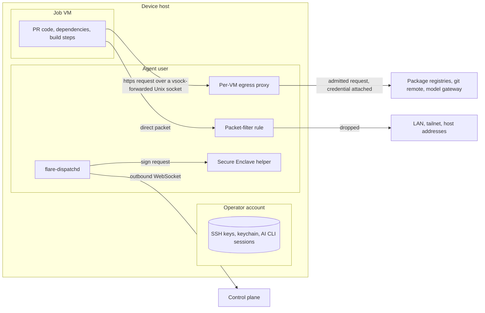
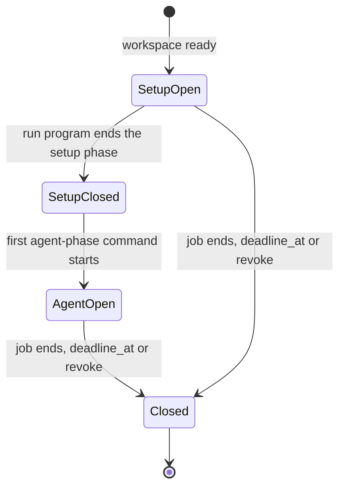
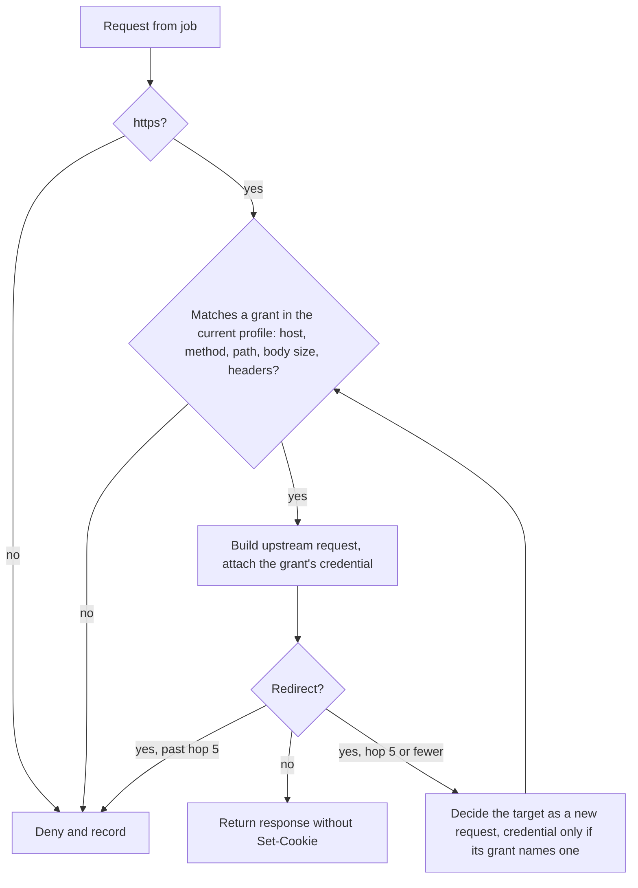
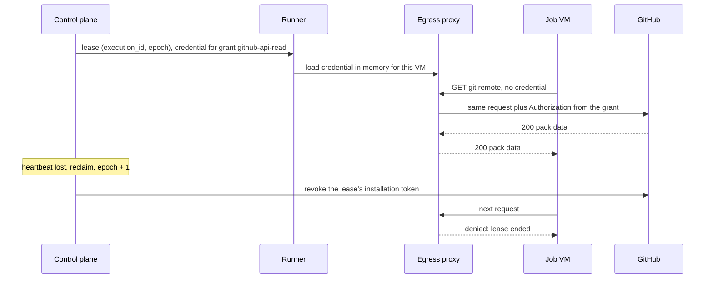

# Isolation and egress

This file specifies how an executor keeps job code away from keys, networks and credentials: one VM per job on a device, a dedicated agent user, no route from a job VM to the LAN or the tailnet, deny-all egress with `setup` and `agent` egress profiles on every executor kind, the approval floor, and credentials minted per execution lease and revoked on reclaim.

## Scope

This file covers the isolation boundary between job code and everything else an executor can reach: the host, the agent's keys and sockets, the local network, the tailnet, the internet and the control plane's credentials. It covers the egress proxy that every executor kind runs, the grants a run definition declares, and the credentials a job uses without holding them.

It depends on:

- [executors.md](executors.md) for the executor kinds, the job lifecycle, the agent and the Secure Enclave helper;
- [placement-leases.md](placement-leases.md) for the execution lease, epochs and reclaim, and for the placement rules that keep fork-PR code, tags and P0 off owned devices;
- [executor-protocol.md](executor-protocol.md) for lease messages and the device's connection authentication;
- [cache-artifacts.md](cache-artifacts.md) for the cache trust namespaces a lease names;
- [model-gateway.md](model-gateway.md) for the model gateway the `agent` profile admits;
- [runs/agentic.md](runs/agentic.md) for staged writeback and the trifecta rule;
- [local-scheduler.md](local-scheduler.md) for the local tokens a capacity lease's VMs use.

The decision behind this file is [ADR-0009](adr/0009-device-isolation.md).

Not specified: secret injection through environment variables, including run inputs that name secrets and per-repository secret keys; a run uses a secret only as a grant credential the egress proxy attaches.

## Model

### Zones on a device

A device holds the operator's own account beside the agent. The job VM is untrusted and sees nothing of the host except its workspace clone and the cache directories its lease names.

**Job code reaches the outside only through the egress proxy; nothing of the host is visible to it**

*device zones · the proxy, reached over a forwarded Unix socket, is the only path out; the packet-filter rule drops every direct packet, host addresses included.*

### Egress profiles

Each execution has two egress profiles. The `setup` profile admits what installing dependencies needs (package registries, the git remote); the `agent` profile admits the model gateway and the git remote, and other granted hosts for read methods only. Each profile is the union of the grants the run definition declares for that phase. A grant is one entry of the grant catalog: hosts, methods, paths, a body-size limit, a header allowlist and, optionally, the credential the proxy attaches.

**The setup profile closes before the agent phase starts and never reopens**

*egress phases · `setup` then `agent`; no transition returns to `setup`.*

### The egress decision

The same decision code runs in the Cloudflare outbound proxy, the per-VM proxy on a device, and the proxy an AWS task reaches. It comes from one shared package.

On executor kind `cloudflare`, the outbound proxy is the Container class's outbound handler, which receives every HTTPS request the Container makes. A presigned R2 request for cache, artifact or log bytes therefore streams through that handler on its way to R2, unbuffered; it never passes through the dispatcher Worker ([architecture.md](architecture.md) FD-ARCH-007).

**Every request is decided against the current profile; every redirect is decided again**

*egress decision · https only, grant match, redirect re-decided up to 5 hops.*

### Per-lease credentials

A job uses credentials it never holds. The control plane mints each credential for one execution lease, the egress proxy attaches it to requests that match the grant naming it, and a reclaim revokes it.

**A credential lives for one lease, stays outside the VM, and dies on reclaim**

*credential flow · minted per lease, attached by the proxy, revoked on reclaim.*

## Requirements

### Job VM and host

- **FD-ISO-001** · phase 1 · `V-E2E-LOCAL` `V-CONF` — While a device runs a job, the agent must run that job in a Linux VM started by Apple `container` for that job alone, and must not run job code on the host.
- **FD-ISO-002** · phase 4 · `V-E2E-LOCAL` — Where a job needs `macos-arm64`, the agent must run it in a macOS VM started from the run's macOS image, and must not run it on the host.
- **FD-ISO-003** · phase 1 · `V-E2E-LOCAL` — When a job ends, the agent must destroy the job's VM and must not start a second job in it.
- **FD-ISO-004** · phase 1 · `V-E2E-LOCAL` — The agent must attach to a job VM only the job's workspace clone and the cache directories the lease names, and must attach read-only each cache directory the lease names for reading.
- **FD-ISO-005** · phase 1 · `V-E2E-LOCAL` — The agent must not expose to a job VM the agent's sockets, the helper's socket, the device key, an execution-lease token, a capacity-lease credential or any file under the agent user's home directory.
- **FD-ISO-006** · phase 1 · `V-UNIT` — The agent must execute on the host only run programs from the run catalog in its own signed build.
- **FD-ISO-007** · phase 1 · `V-UNIT` — If a lease names a run definition digest that is not in the agent's run catalog, then the agent must reject the lease with `RunNotInCatalog`.

### Agent user

- **FD-ISO-008** · phase 1 · `V-E2E-LOCAL` — The agent must run as a dedicated macOS user under `launchd` with no read access to any other user's home directory, keychain or SSH agent socket.
- **FD-ISO-009** · phase 1 · `V-E2E-LOCAL` — If at start the agent user has read access to another user's home directory or keychain, then the agent must exit with `HostNotIsolated` without registering.
- **FD-ISO-010** — Removed; see [executor-protocol.md](executor-protocol.md) FD-PROTO-001.

### Network isolation on a device

- **FD-ISO-011** · phase 1 · `V-E2E-LOCAL` `V-LIVE` — Before a job VM starts, the agent must load a packet-filter rule that drops every packet from that VM to 10.0.0.0/8, 172.16.0.0/12, 192.168.0.0/16, 169.254.0.0/16, 100.64.0.0/10, 127.0.0.0/8, ::1/128, fc00::/7, fe80::/10, fd7a:115c:a1e0::/48 and every address of the host.
- **FD-ISO-012** · phase 1 · `V-E2E-LOCAL` — The agent must drop every direct packet from a job VM to the internet, so the VM's egress proxy is its only outbound path.
- **FD-ISO-013** · phase 1 · `V-E2E-LOCAL` — The agent must not route any packet from a job VM to the host's tailnet interface.
- **FD-ISO-014** · phase 1 · `V-E2E-LOCAL` `V-LIVE` — Before the agent advertises slots, and after every macOS update, the agent must run an isolation probe VM that attempts each range in FD-ISO-011, the host's tailnet address and a direct internet connection, and must advertise slots only when every attempt fails.
- **FD-ISO-015** · phase 1 · `V-E2E-LOCAL` — If the isolation probe reaches any blocked destination, then the agent must drain the device and report `isolation-probe-failed`.
- **FD-ISO-016** · phase 1 · `V-E2E-LOCAL` — If the packet-filter rule is missing when a job VM is about to start, then the agent must not start the VM and must drain the device.
- **FD-ISO-062** · phase 1 · `V-E2E-LOCAL` — The agent must expose each VM's egress proxy and compile-cache proxy to that VM only as a host Unix socket forwarded into the VM over virtio-vsock, and must open no TCP listener for either, so that FD-ISO-011 drops every IP packet from the VM to the host.

### Egress on every executor kind

- **FD-ISO-017** · phase 1 · `V-CONF` `V-LIVE` — Every executor kind must drop every outbound request from a job except the requests its egress proxy admits under the execution's current egress profile.
- **FD-ISO-018** · phase 1 · `V-DEPLOY` `V-LIVE` — Each Cloudflare Container class must set `enableInternet` to false, `allowedHosts` to empty and `interceptHttps` to true.
- **FD-ISO-019** · phase 1 · `V-LIVE` — The deny-all canary for a Cloudflare Container class must pass only when an HTTPS request to a host outside every grant receives the egress proxy's denial response (status 403, body `{"error": "egress_denied"}`) with a denial record for the canary's execution id, and a TCP connection to port 22 of a public address fails, and must record failure on any 2xx or 3xx status or a completed TCP connection.
- **FD-ISO-020** · phase 3 · `V-DEPLOY` `V-LIVE` — Each AWS task's security group must allow egress only to the egress proxy endpoint and the image registry endpoint the operator overlay names.
- **FD-ISO-021** · phase 4 · `V-CONF` — Before the run program starts, the GitHub Actions runner job must apply an egress firewall that drops every host outside the execution's current egress profile, and must fail without starting the run program when a probe to a host outside that profile succeeds.
- **FD-ISO-022** · phase 4 · `V-UNIT` — The control plane must not place on a `gha` executor an execution whose egress profiles contain a grant that carries a credential.
- **FD-ISO-060** · phase 0 · `V-DEPLOY` `V-LIVE` — Each Cloudflare Container class must deny all egress except requests that match a grant the execution's run definition declares, and the control plane must mint every credential a Cloudflare job uses for its execution lease.
- **FD-ISO-061** · phase 1 · `V-LIVE` `V-DEPLOY` — Each Cloudflare Container image's entrypoint must add `/etc/cloudflare/certs/cloudflare-containers-ca.crt` to the system trust store and set `NODE_EXTRA_CA_CERTS`, `SSL_CERT_FILE` and `REQUESTS_CA_BUNDLE` to the resulting bundle before the runtime starts any command.
- **FD-ISO-064** · phase 0 · `V-CONF` `V-E2E-LOCAL` — On executor kind `cloudflare`, the Container class's outbound handler must pass a presigned `GET` or `PUT` to the R2 S3 endpoint of [cache-artifacts.md](cache-artifacts.md) FD-CACHE-091 to R2 with no credential attached, streaming the request and response bodies without buffering them, so that no cache, artifact or log byte passes through the dispatcher Worker.

### Egress profiles and the decision

- **FD-ISO-023** · phase 2 · `V-UNIT` — The control plane must give each execution two egress profiles, `setup` and `agent`, each the union of the grants its run definition declares for that phase.
- **FD-ISO-024** · phase 2 · `V-PROOF` `V-CONF` — When the run program ends the setup phase, the egress proxy must close the `setup` profile before the first agent-phase command starts.
- **FD-ISO-025** · phase 2 · `V-PROOF` `V-SIM` — After the `setup` profile closes, the egress proxy must not admit any request under it again in that execution.
- **FD-ISO-026** · phase 2 · `V-UNIT` `V-CONF` — The `agent` profile must admit the model gateway and the repository's git remote for the methods their grants declare, and every other granted host for `GET`, `HEAD` and `OPTIONS` only.
- **FD-ISO-027** · phase 1 · `V-UNIT` — The egress proxy must admit only `https` requests.
- **FD-ISO-028** · phase 1 · `V-UNIT` — The egress proxy must admit a request only when its host, method, path, body size and headers match a grant in the current egress profile.
- **FD-ISO-029** · phase 1 · `V-UNIT` — When an upstream answers with a redirect, the egress proxy must decide the redirect target again as a new request, for at most 5 hops.
- **FD-ISO-030** · phase 1 · `V-UNIT` — If a redirect target does not match the grant that carried a credential, then the egress proxy must send the redirected request without that credential.
- **FD-ISO-031** · phase 1 · `V-UNIT` — The egress proxy must strip `Set-Cookie` from every response and must build each upstream request itself instead of forwarding the job's request object.
- **FD-ISO-032** · phase 1 · `V-UNIT` — Every executor must run its egress proxy in the `enforce` position, except during a local rehearsal, which may run in the `report` position.
- **FD-ISO-033** · phase 1 · `V-UNIT` — While a rehearsal runs in the `report` position, the egress proxy must record each request it would deny and must attach no credential.
- **FD-ISO-034** · phase 1 · `V-UNIT` — If a run definition declares no grants, then the egress proxy must drop every outbound request of its executions.
- **FD-ISO-035** · phase 1 · `V-UNIT` — The egress proxy must record each denial with the execution id, epoch, host, method and the rule that denied it.
- **FD-ISO-036** · phase 1 · `V-UNIT` — If a read of denial records fails, then the reader must fail with an error and must not return an empty list.
- **FD-ISO-037** · phase 1 · `V-UNIT` — The egress decision, host-pattern match and shell quoting must come from one shared package that the control plane and every executor's egress proxy import.
- **FD-ISO-063** · phase 1 · `V-UNIT` — The egress proxy must record each admitted request with the execution id, epoch, egress phase, grant name, host, method, path and response status, and, where the proxy terminates the job's TLS, the byte length and SHA-256 digest of the response body, so that a statement's egress proxy log digest and its `proxy` dependency digests ([provenance.md](provenance.md) FD-PROV-005, FD-PROV-006) cover every admitted fetch.

### Grants

- **FD-ISO-038** · phase 1 · `V-UNIT` — A run definition must declare its grants per phase and the capability labels it needs.
- **FD-ISO-039** · phase 1 · `V-DEPLOY` — If a run definition names a grant that the grant catalog lacks, then the deploy check must fail.
- **FD-ISO-040** · phase 1 · `V-UNIT` — If a dynamic egress target is not an `https` URL, then the control plane must fail the execution before any workspace starts.
- **FD-ISO-041** · phase 1 · `V-UNIT` — If a dynamic egress target's host matches no target pattern in the operator overlay, where `*` matches exactly one DNS label, then the control plane must fail the execution before any workspace starts.
- **FD-ISO-042** · phase 1 · `V-CONF` — The executor must apply a grant only after the workspace is ready, and must revoke it when the command ends, on failure included, after it kills the command.

### Approval floor

- **FD-ISO-043** · phase 1 · `V-UNIT` — If a command matches the approval floor — `git push`; `wrangler deploy`, `wrangler secret` or `wrangler d1`; `terraform apply`; `kubectl apply` or `kubectl delete`; `npm publish`, `pnpm publish`, `yarn publish` or `cargo publish`; `gh release` — and the run definition does not pre-assert that pattern, then the executor must reject it with `ApprovalRequired` before it touches a workspace.
- **FD-ISO-044** · phase 1 · `V-UNIT` — If a command matches the approval floor and the execution is not cloud-pinned, then the executor must reject it with `ApprovalRequired` whatever the run definition pre-asserts.
- **FD-ISO-045** · phase 1 · `V-UNIT` `V-REPLAY` — The executor must spend a pre-assertion at most once per (execution, epoch, ordinal), reading the ordinal from the execution's journal.

### Per-lease credentials

- **FD-ISO-046** · phase 1 · `V-UNIT` — The control plane must mint each credential a job uses for one execution lease, scoped to the lease's repository and to the permissions the run's grants declare.
- **FD-ISO-047** · phase 1 · `V-SIM` `V-CONF` — When the control plane reclaims an execution or its lease ends, the control plane must revoke every credential minted for that lease within 30 s.
- **FD-ISO-048** · phase 1 · `V-PROOF` `V-SIM` — The control plane and the model gateway must accept a per-lease credential only while its epoch is the execution's current epoch.
- **FD-ISO-049** · phase 1 · `V-UNIT` `V-CONF` — The egress proxy must attach a credential only to a request that matches the grant naming that credential.
- **FD-ISO-050** · phase 1 · `V-UNIT` `V-CONF` — The executor must not place any credential in a job's environment variables, files or command line.
- **FD-ISO-051** · phase 1 · `V-UNIT` — The control plane must resolve for an execution only the secrets its run's grants name, and must not return any other control-plane secret.
- **FD-ISO-052** · phase 1 · `V-UNIT` `V-E2E-LOCAL` — The agent must hold per-lease credentials only in process memory and must not write them to disk, logs or crash reports.
- **FD-ISO-053** · phase 1 · `V-E2E-LOCAL` — The agent must store no long-lived bearer secret on disk; its long-lived credentials are the device key in the Secure Enclave and the TLS client-certificate key of [executors.md](executors.md) FD-EXEC-101, which authenticates no session without a `connect` signature by the device key.
- **FD-ISO-054** · phase 1 · `V-UNIT` — When a device makes a lease-scoped call, the agent must sign the request through the helper under the purpose `lease-call`.
- **FD-ISO-055** · phase 1 · `V-UNIT` `V-CONF` — If a lease-scoped call from a device carries no valid `lease-call` signature by that device's registered key, then the control plane must reject it with `401`.
- **FD-ISO-056** · phase 1 · `V-UNIT` — Before a Cloudflare executor runs any command, it must verify the lease token's execution id, epoch and expiry.
- **FD-ISO-057** · phase 1 · `V-UNIT` `V-CONF` — The executor must fetch a private repository through the egress proxy, which attaches the per-lease token, so the token never appears in the command, the URL, persisted stderr or `.git/config`.
- **FD-ISO-058** · phase 1 · `V-UNIT` — After a checkout, the executor must verify that `.git/config` holds no credential, credential helper or `extraheader` entry.
- **FD-ISO-059** · phase 1 · `V-UNIT` — If the `.git/config` check finds a credential entry or fails to run, then the executor must fail the checkout with `CheckoutFailed`.

## Open items

- TODO(maintainer): confirm the Apple `container` option that forwards a host Unix socket into a VM over virtio-vsock for FD-ISO-062, and the guest path the job's proxy settings name.
- TODO(maintainer): decide where the egress proxy for AWS tasks runs — a proxy service in the deploying organization's VPC, or the Cloudflare outbound proxy reached over HTTPS — before phase 3; FD-ISO-020 holds under either.
- TODO(maintainer): decide whether the per-VM egress proxy terminates the job's TLS through a CA installed in the VM; without one, FD-ISO-063 records no response digest on a device, and resolved dependencies in a provenance statement come from lockfile digests only ([provenance.md](provenance.md) FD-PROV-006).
