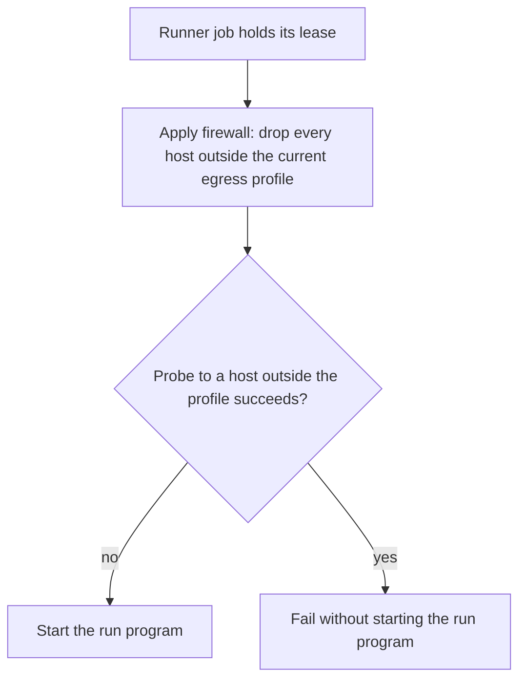

# Isolation and egress

FlareDispatch uses mameko's isolation and egress mechanism on every executor kind mameko defines. This file specifies the egress rules for FlareDispatch's own launcher kind `gha`, whose job sandbox is a GitHub-hosted runner VM: the runner job's egress firewall and the bar on credentialed grants.

## Scope

mameko's [isolation-egress.md](https://github.com/fractalboxdev/mameko/blob/da1249e8318d7ac67eae38c4d1419613590ad18e/specs/isolation-egress.md) specifies the job sandbox per job on a device, the executor user, network isolation on a device, egress on the `cloudflare`, `device` and `aws` kinds, egress profiles, grants and the egress decision, the approval floor and per-lease credentials. Two of its rules carry what FlareDispatch requires of every kind: each outbound HTTPS request outside the current egress profile is denied ([MAMEKO-ISO-015](https://github.com/fractalboxdev/mameko/blob/da1249e8318d7ac67eae38c4d1419613590ad18e/specs/isolation-egress.md)), and each outbound connection that is not an HTTPS request through the egress proxy is dropped ([MAMEKO-ISO-016](https://github.com/fractalboxdev/mameko/blob/da1249e8318d7ac67eae38c4d1419613590ad18e/specs/isolation-egress.md)). A device starts run programs only from the run-catalogue bundle its device configuration pins ([MAMEKO-EXEC-121](https://github.com/fractalboxdev/mameko/blob/da1249e8318d7ac67eae38c4d1419613590ad18e/specs/executors.md)) and refuses a lease whose run definition is not in it with `RunNotInCatalog` ([MAMEKO-EXEC-122](https://github.com/fractalboxdev/mameko/blob/da1249e8318d7ac67eae38c4d1419613590ad18e/specs/executors.md)).

FlareDispatch's approval floor, base egress profiles and signing purposes are profile values ([profile.md](profile.md) § Approval floor, egress profiles and signing purposes).

This file depends on:

- [executors.md](executors.md) § GitHub Actions launcher for the runner job and its launch;
- [profile.md](profile.md) for the egress profiles and the launcher kind `gha`.

The decision behind the mechanism is mameko's [ADR-0011](https://github.com/fractalboxdev/mameko/blob/da1249e8318d7ac67eae38c4d1419613590ad18e/specs/adr/0011-device-isolation.md).

## Model

### Egress on `gha`

A `gha` job runs on a GitHub-hosted runner VM, which the deploying organization does not operate, and the runner shares that VM with the repository's commands. The runner job applies an egress firewall for the execution's current egress profile before the run program starts, and checks it with a probe to a host outside that profile. An execution whose egress profiles hold a grant that carries a credential is never placed on `gha`.

**The runner job closes egress before the run program starts, or does not start it**

*`gha` egress · the firewall must hold before any run code executes.*

## Requirements

### `gha` egress

- **FD-ISO-021** · phase 4 · `V-CONF` — Before the run program starts, the GitHub Actions runner job must apply an egress firewall that drops every host outside the execution's current egress profile, and must fail without starting the run program when a probe to a host outside that profile succeeds.
- **FD-ISO-022** · phase 4 · `V-UNIT` — The control plane must not place on a `gha` executor an execution whose egress profiles contain a grant that carries a credential.

## Open items

None.
