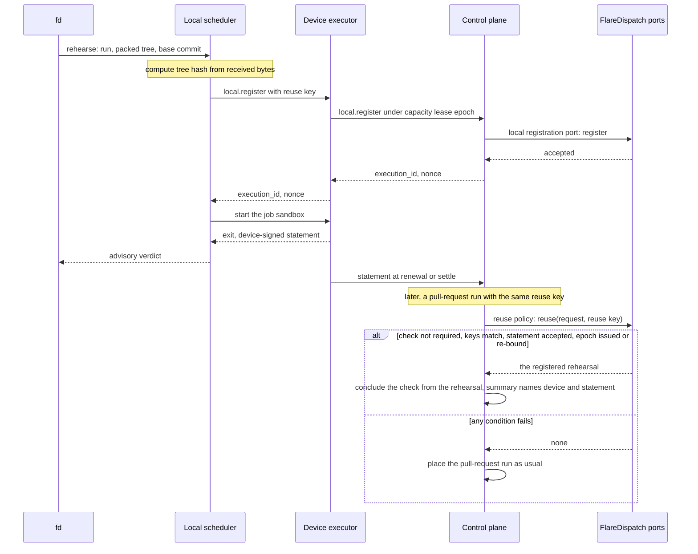

# Local scheduler

Each device runs mameko's local scheduler unchanged. This file specifies FlareDispatch's side of local work: which intents of a local execution become writeback requests, what a rehearsal registers through FlareDispatch's local registration port, the reuse policy under which a registered rehearsal concludes a pull-request check, the writeback gate that decides what local work may write to GitHub, and the MCP tools that reach the local scheduler.

## Scope

mameko's [local-scheduler.md](https://github.com/fractalboxdev/mameko/blob/88770c64b14818ad32aed9615f1cfaf4bbc1f591/specs/local-scheduler.md) specifies the local scheduler's process and keys, the local classes, eligibility and admission, submitters and merging, the Unix socket and workspaces, the tailnet submit port, preemption, expiry, drain and offline mode, advisory results and the registration exchange, and its credentials. No device schedules guaranteed work: the control plane schedules every P0 to P3 execution and owns every check, and local work stays advisory unless a registered rehearsal stands in under the reuse policy.

On the device, `fd` is mameko's `<cli>` built with the command name `fd` from the source archive of the mameko release the device bundle comes from ([MAMEKO-REL-036](https://github.com/fractalboxdev/mameko/blob/88770c64b14818ad32aed9615f1cfaf4bbc1f591/specs/releases.md), [MAMEKO-REL-037](https://github.com/fractalboxdev/mameko/blob/88770c64b14818ad32aed9615f1cfaf4bbc1f591/specs/releases.md)); the device executor accepts it only when its embedded release version equals its own ([MAMEKO-REL-038](https://github.com/fractalboxdev/mameko/blob/88770c64b14818ad32aed9615f1cfaf4bbc1f591/specs/releases.md)), and the local scheduler's submit group is `fd-submit` ([MAMEKO-REL-040](https://github.com/fractalboxdev/mameko/blob/88770c64b14818ad32aed9615f1cfaf4bbc1f591/specs/releases.md)).

FlareDispatch implements three of mameko's application ports for local work ([hosts.md](https://github.com/fractalboxdev/mameko/blob/88770c64b14818ad32aed9615f1cfaf4bbc1f591/specs/hosts.md) § Application ports):

| Port | mameko requirement | FlareDispatch's implementation |
| --- | --- | --- |
| Local registration port | [MAMEKO-PROTO-081](https://github.com/fractalboxdev/mameko/blob/88770c64b14818ad32aed9615f1cfaf4bbc1f591/specs/executor-protocol.md), [MAMEKO-LOCAL-069](https://github.com/fractalboxdev/mameko/blob/88770c64b14818ad32aed9615f1cfaf4bbc1f591/specs/local-scheduler.md) | § Rehearsal and registration |
| Reuse policy | [MAMEKO-LOCAL-075](https://github.com/fractalboxdev/mameko/blob/88770c64b14818ad32aed9615f1cfaf4bbc1f591/specs/local-scheduler.md) | § Rehearsal reuse |
| Writeback gate | [MAMEKO-PROTO-082](https://github.com/fractalboxdev/mameko/blob/88770c64b14818ad32aed9615f1cfaf4bbc1f591/specs/executor-protocol.md) | § Writeback from local work |

This file depends on:

- [profile.md](profile.md) for the classes and the intent kinds;
- [runs/agentic.md](runs/agentic.md) for `stagedWriteGate` and the `writeback` block;
- [provenance.md](provenance.md) for the `device-signed` statement and the registration nonce;
- [github-output.md](github-output.md) for the draft pull request and the pull-request review a writeback produces;
- [interfaces.md](interfaces.md) for `fd`, the MCP tool schemas and the execution id grammar.

[ADR-0001](adr/0001-local-first-control-plane.md) and mameko's [ADR-0003](https://github.com/fractalboxdev/mameko/blob/88770c64b14818ad32aed9615f1cfaf4bbc1f591/specs/adr/0003-two-level-scheduling-owned-devices-first.md) record why devices run only unguaranteed work.

## Model

### Intents of a local execution

A local execution's run program appends intents through the `Intents` capability as any run does. The local run context sorts each append by kind:

| Kind | Unregistered execution | Registered execution |
| --- | --- | --- |
| `check.summary`, `check.annotations` | Logged no-op in the journal; nothing reaches GitHub | Logged no-op in the journal; nothing reaches GitHub |
| Every other kind | The step fails with `RegistrationRequired` | One `local.writeback` request, keyed by the execution id and the intent's `run:<step name>:<index>` key |

### Rehearsal and registration

A rehearsal is a local execution of class `rehearsal` that predicts a recipe's verdict. A rehearsal registers before it starts when it wants reuse or writeback; the registration records what it tested, so a later pull-request run can check that the rehearsal tested the same thing.

**A rehearsal registers before it starts; a later pull-request run may reuse it only when every check holds**

*Rehearsal reuse · off by default, never for a required check, a cloud-only rule or a run with effects.*

### Rehearsal reuse

The reuse policy names a registered rehearsal only for a check outside the base branch's required set, and only where the repository's policy turns reuse on. It reads the required set through the 10 min cache of [profile.md](profile.md) FD-PROF-014 and names no rehearsal when that read fails.

### Writeback from local work

The writeback gate decides each `local.writeback` request of a registered execution. It accepts a request only for a `success` verdict, only as a draft pull request from a bot branch marked `device-signed` or as a pull-request review, at most `local_writeback_rate` requests per capacity lease per hour, and only after `stagedWriteGate` accepts the proposed file changes.

## Requirements

### Local run context

- **FD-LOCAL-018** · phase 1 · `V-UNIT` — The kinds that only decorate a local execution's own outcome, which the local run context records as logged no-ops under [MAMEKO-LOCAL-017](https://github.com/fractalboxdev/mameko/blob/88770c64b14818ad32aed9615f1cfaf4bbc1f591/specs/local-scheduler.md), must be exactly `check.summary` and `check.annotations`.
- **FD-LOCAL-019** · phase 1 · `V-UNIT` — The local run context must turn each `Intents` append of a registered execution of any other kind into a `local.writeback` request.
- **FD-LOCAL-020** · phase 1 · `V-UNIT` — If an unregistered execution appends an intent of a kind other than `check.summary` or `check.annotations`, then the local run context must fail the step with `RegistrationRequired` ([MAMEKO-LOCAL-018](https://github.com/fractalboxdev/mameko/blob/88770c64b14818ad32aed9615f1cfaf4bbc1f591/specs/local-scheduler.md)).
- **FD-LOCAL-055** · phase 1 · `V-UNIT` `V-REPLAY` — The local run context must key each intent of a `local.writeback` request by the execution id and the run-authored key `run:<step name>:<index>` of [MAMEKO-RUN-068](https://github.com/fractalboxdev/mameko/blob/88770c64b14818ad32aed9615f1cfaf4bbc1f591/specs/run-model.md), so a rerun step never writes twice.
- **FD-LOCAL-067** · phase 1 · `V-UNIT` — While in offline mode, the local scheduler must send no writeback request.
- **FD-LOCAL-071** · phase 1 · `V-SIM` — If a new grant rejects a registered in-flight execution, then the local scheduler must send no writeback request for it.

### Rehearsal and registration

- **FD-LOCAL-072** · phase 1 · `V-UNIT` — When the local registration port accepts a rehearsal, it must record the rehearsal's environment names beside the tree hash, base commit SHA, run-definition digest, image digest, platform and inputs digest that [MAMEKO-LOCAL-069](https://github.com/fractalboxdev/mameko/blob/88770c64b14818ad32aed9615f1cfaf4bbc1f591/specs/local-scheduler.md) passes it.
- **FD-LOCAL-075** · phase 1 · `V-UNIT` `V-SIM` — A local execution must register under [MAMEKO-LOCAL-068](https://github.com/fractalboxdev/mameko/blob/88770c64b14818ad32aed9615f1cfaf4bbc1f591/specs/local-scheduler.md) exactly when it requests rehearsal reuse or writeback.

### Rehearsal reuse

- **FD-LOCAL-077** · phase 2 · `V-UNIT` — The reuse policy must name no rehearsal for a check unless the repository's policy turns rehearsal reuse on.
- **FD-LOCAL-078** · phase 2 · `V-UNIT` `V-SIM` — When a pull-request run is admitted for a check with reuse on, the reuse policy may name a rehearsal only when the rehearsal registered and received its nonce before it started, ran under a capacity-lease epoch the control plane issued or re-bound, matches the run on tree hash, base commit, run-definition digest, image digest, platform and environment names, and carries an accepted `device-signed` statement.
- **FD-LOCAL-079** · phase 2 · `V-UNIT` — If the check's name is in the base branch's required set, then the reuse policy must name no rehearsal for it.
- **FD-LOCAL-080** · phase 2 · `V-UNIT` — If the read of the base branch's required set fails, then the reuse policy must name no rehearsal for the check.
- **FD-LOCAL-081** · phase 2 · `V-UNIT` — If the cached required set is older than its 10 min TTL, then the reuse policy must read it again before it names a rehearsal, and must name none when the read fails.
- **FD-LOCAL-082** · phase 2 · `V-UNIT` — The reuse policy must name no rehearsal for a check whose placement rule is cloud-only.
- **FD-LOCAL-083** · phase 2 · `V-UNIT` — The reuse policy must name no rehearsal for a run that requests an intent other than its own check, including every deploy and release recipe.
- **FD-LOCAL-084** · phase 2 · `V-UNIT` — If the rehearsal's platform differs from the pull-request run's, then the reuse policy must not name it unless the repository's policy names both platforms as equivalent.
- **FD-LOCAL-085** · phase 2 · `V-UNIT` — The reuse policy must not name a rehearsal signed by a device whose posture tier is `unmanaged`.
- **FD-LOCAL-086** · phase 2 · `V-UNIT` — When the control plane concludes a check from a rehearsal, the control plane must state in the check summary that a rehearsal produced it and name the device and the statement.

### Writeback from local work

- **FD-LOCAL-087** · phase 2 · `V-UNIT` — The writeback gate must accept a `local.writeback` only for a registered execution with a `success` verdict, and only as a draft pull request from a bot branch marked `device-signed` or as a pull-request review.
- **FD-LOCAL-088** · phase 2 · `V-UNIT` — The writeback gate must reject every `local.writeback` intent that opens an issue or pushes to a protected branch.
- **FD-LOCAL-089** · phase 2 · `V-UNIT` — If a capacity lease's writeback requests exceed `local_writeback_rate` (default 10 per hour), then the control plane must answer the excess `rate_limited` with a `retry_after`.
- **FD-LOCAL-094** · phase 2 · `V-UNIT` `V-PROOF` `V-DIFF` — When a `local.writeback` proposes file changes, the writeback gate must run `stagedWriteGate` ([runs/agentic.md](runs/agentic.md) FD-AGT-016) on its manifest with the run's `writeback` block before it accepts any intent, treating the write as model-authored when the capacity lease's usage report records any model call for that execution, and must reject the request when the gate rejects it.

### MCP tools

- **FD-LOCAL-038** · phase 1 · `V-UNIT` `V-E2E-LOCAL` — FlareDispatch's MCP server on the device must serve the tools `rehearse`, `get_verdict`, `get_failure_summary`, `cancel` and `lease_status`, and must reach the local scheduler only through its Unix socket.

## Open items

None.
