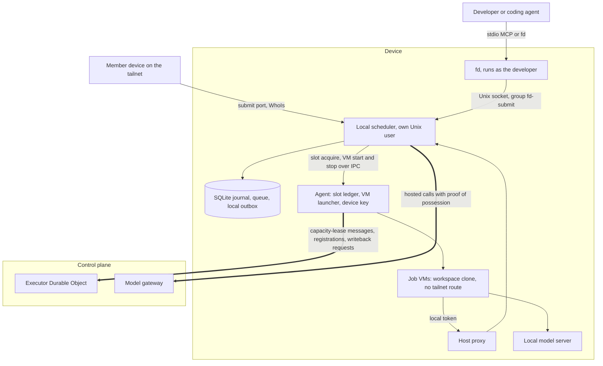
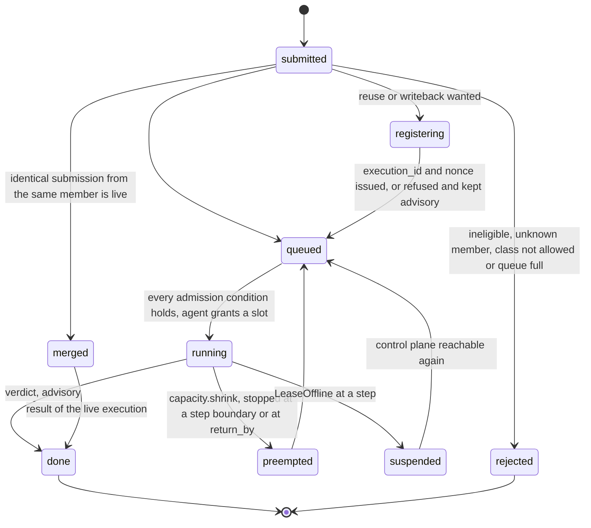
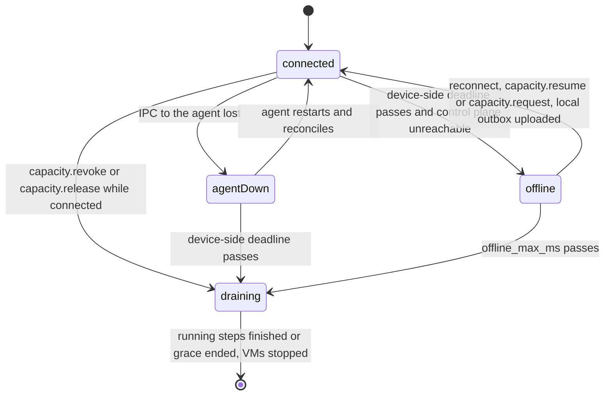
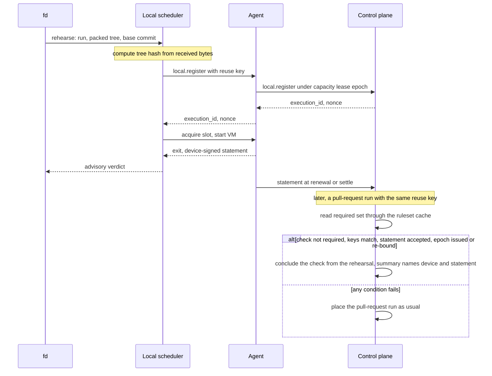

# Local scheduler

This file specifies the scheduler that runs on each device: the unguaranteed work it accepts inside a capacity lease, its local classes, admission and preemption, its behavior when the control plane or the agent is unreachable, rehearsals and the rules under which a registered rehearsal may stand in for a pull-request run, and the `fd` commands that reach it on the device.

## Scope

No device schedules guaranteed work ([ADR-0001](adr/0001-local-first-control-plane.md)). The control plane schedules every P0–P3 execution and owns every check; the local scheduler runs only work submitted to it, inside the capacity lease the control plane grants. A dead local scheduler stops that device's local work and nothing else.

This file depends on:

- [placement-leases.md](placement-leases.md) for the capacity lease record, its epoch, the slot ledger and the reclaim of slots for control-plane work;
- [executor-protocol.md](executor-protocol.md) for the `capacity.*`, `local.register` and `local.writeback` messages and the heartbeat's activity signal;
- [engine.md](engine.md) for the SQLite backend of `WorkflowEngine` that journals local work;
- [isolation-egress.md](isolation-egress.md) for the job VM, the host proxy and the packet filter;
- [model-gateway.md](model-gateway.md) for the capacity-lease scope of the gateway;
- [spend.md](spend.md) for the capacity-lease allowance reserved against the P3 line;
- [provenance.md](provenance.md) for the `device-signed` statement and the registration nonce;
- [interfaces.md](interfaces.md) for `fd`, the MCP tool schemas and the execution id grammar.

Not specified: the claim port, claim credentials and pooling of unguaranteed work between devices. They wait on the decision of which capacity lease pays for work that crosses devices (open items).

## Model

### Components on a device

*Device components · the agent launches every VM and owns the slot ledger; the scheduler decides what runs and when.*

The local scheduler holds its own device-bound key, the capacity-lease credential, the control plane's public verification key, the policy snapshot, cache credentials for the namespaces the capacity lease names, its journal, and one local token per running VM. The agent alone holds the device key, its client-certificate key, execution-lease tokens, the VM launcher and the slot ledger.

The **local outbox** is the local scheduler's queue of artifacts, logs and usage reports written in offline mode and uploaded through `capacity.settle` after reconnect. It is distinct from the agent outbox and from the outbox in D1.

### Local classes

All four rank below P3 in queue order, and precedence is strict.

| Class | Work | Precedence | Queue bound (start value) |
| --- | --- | --- | --- |
| `dev-loop` | A developer or an agent waits on a result against its working tree | 1, preempted last | 4 per submitter |
| `swarm` | A task fanned out by a coding-agent swarm | 2, round-robin across submitters | 64 per submitter |
| `rehearsal` | A pre-push run that predicts a recipe's verdict | 3 | 16 per repository |
| `background` | Sweeps, re-indexing, long evaluations | 4, preempted first | 256 per device |

### Eligibility and admission

A run is eligible for local scheduling when it declares no facade gap (`detached-process`, `expose-port`, `container-artifact`), makes no decision-bearing `GithubRead` call and appends no check intent of its own. The run context holds no secrets service ([run-model.md](run-model.md) FD-RUN-019). An eligible submission starts only when every admission condition holds:

| Condition | Rejection reason when the queue is full and this condition holds the head |
| --- | --- |
| The pool has a free slot under the capacity lease | `lease-slots` |
| The VMs under the capacity lease stay within `memory_mib` | `lease-slots` |
| A run that declares local-model use has a free local-model stream | `local-model-busy` |
| The foreground cap and the class share have room | `queue-full` |
| The submitter's slot share and token quota have room | `queue-full` |
| A run that declares hosted-model use has its reservation covered by the remaining token allowance | `lease-tokens` |

### Submission lifecycle

*Local execution lifecycle · every verdict here is advisory; only a registered rehearsal can later stand in for a check.*

### Connection modes

The device measures its capacity lease from `sent_mono`, the `mach_continuous_time` reading taken when it sent the request that produced the current grant or renewal. The send precedes the grant, so the device's deadline falls at or before the control plane's.

*Connection modes · offline mode exists only for capacity-lease work; a control-plane claim runs on to `deadline_at` and keeps its result in the agent outbox.*

### Rehearsal registration and reuse

A rehearsal records what it tested: the git tree hash of the bytes it received, the base commit SHA, the run-definition digest, the image digest, the platform and the environment names. A registered rehearsal may stand in for a pull-request run only for a check outside the base branch's required set, and only where the repository's policy turns reuse on.

*Rehearsal reuse · off by default, never for a required check, a cloud-only rule or a run with effects.*

## Requirements

### Process and keys

- **FD-LOCAL-001** · phase 1 · `V-E2E-LOCAL` — The local scheduler must run as its own process under a dedicated Unix user distinct from the agent's user and from every developer account.
- **FD-LOCAL-002** · phase 1 · `V-UNIT` `V-E2E-LOCAL` — The local scheduler must hold its own non-exportable key generated in the Secure Enclave under its own user, and must request every capacity lease with that key's thumbprint as `cnf`.
- **FD-LOCAL-003** · phase 1 · `V-E2E-LOCAL` — The local scheduler must not hold the device key, the agent's client-certificate key or any execution-lease token.
- **FD-LOCAL-004** · phase 1 · `V-UNIT` `V-E2E-LOCAL` — The local scheduler must not hold a GitHub App key, a GitHub installation token, a Cloudflare or AWS credential, a model-provider key, the provenance key or any repository secret.
- **FD-LOCAL-005** · phase 1 · `V-UNIT` `V-E2E-LOCAL` — The local scheduler must acquire every slot from the agent's slot ledger over IPC and must ask the agent to start and stop every job VM.
- **FD-LOCAL-006** · phase 1 · `V-UNIT` — The local scheduler must not accept or run a control-plane execution.
- **FD-LOCAL-007** · phase 1 · `V-UNIT` — The local scheduler must not call the control plane's dispatch or read routes on a member's behalf.
- **FD-LOCAL-008** · phase 1 · `V-E2E-LOCAL` — The agent must run the local scheduler under `launchd` and restart it when it exits.
- **FD-LOCAL-009** · phase 1 · `V-SIM` `V-E2E-LOCAL` — If the local scheduler has not reconnected to the agent within `scheduler_restart_grace` (default 30 s) of exiting, then the agent must stop the scheduler's VMs and send `capacity.release` with gateway-metered usage and the last reported slot-seconds, marked partial.
- **FD-LOCAL-010** · phase 1 · `V-CONF` `V-SIM` — The local scheduler must journal each local execution with the SQLite backend of `WorkflowEngine` and, after a restart, resume each execution from its last finished step.

### Classes and queue

- **FD-LOCAL-011** · phase 1 · `V-UNIT` `V-SIM` — The local scheduler must order its queue by the strict precedence `dev-loop`, `swarm`, `rehearsal`, `background`, and first-in first-out within one class and submitter.
- **FD-LOCAL-012** · phase 1 · `V-UNIT` — The local scheduler must serve the `swarm` class round-robin across submitters.
- **FD-LOCAL-013** · phase 1 · `V-UNIT` — The local scheduler must take each class's queue bound from the policy snapshot, with the start values of the local-classes table.
- **FD-LOCAL-014** · phase 1 · `V-UNIT` — If a submission's class is not in the capacity lease's `classes`, then the local scheduler must reject it with `class-not-allowed`.

### Eligibility and the local run context

- **FD-LOCAL-015** · phase 1 · `V-UNIT` — If a submitted run declares a facade gap, makes a decision-bearing `GithubRead` call or appends a check intent of its own, then the local scheduler must reject it with `ineligible` naming the rule it breaks.
- **FD-LOCAL-016** · phase 1 · `V-UNIT` — The local run context must fail every `GithubRead` call with a tagged error and must never answer one with an empty result.
- **FD-LOCAL-017** — Removed; see [run-model.md](run-model.md) FD-RUN-019.
- **FD-LOCAL-018** · phase 1 · `V-UNIT` — The local run context must record each `Intents` append of kind `check.summary` or `check.annotations` in the journal as a logged no-op and send nothing to GitHub.
- **FD-LOCAL-019** · phase 1 · `V-UNIT` — The local run context must turn each other `Intents` append of a registered execution into a `local.writeback` request.
- **FD-LOCAL-020** · phase 1 · `V-UNIT` — If an unregistered execution appends an intent of a kind other than `check.summary` or `check.annotations`, then the local run context must fail the step with `WritebackRequiresRegistration`.

### Admission

- **FD-LOCAL-021** · phase 1 · `V-UNIT` `V-SIM` — The local scheduler must start an execution only when every condition of the admission table holds.
- **FD-LOCAL-022** · phase 1 · `V-UNIT` — While any admission condition fails, the local scheduler must keep an accepted submission queued.
- **FD-LOCAL-023** · phase 1 · `V-UNIT` — If a submission arrives while its class queue is at its bound, then the local scheduler must reject it with the reason the admission table assigns to the condition holding the head of that queue, and a `retry_after`.
- **FD-LOCAL-024** · phase 1 · `V-UNIT` — If a run that declares hosted-model use is submitted in offline mode, then the local scheduler must reject it with `offline-hosted`.
- **FD-LOCAL-025** · phase 1 · `V-UNIT` — When the local scheduler accepts a submission, the local scheduler must return its queue position and report every change of position to the submitter.
- **FD-LOCAL-026** · phase 1 · `V-UNIT` `V-SIM` — The local scheduler must keep the summed memory of its running VMs at or below the capacity lease's `memory_mib`.
- **FD-LOCAL-027** · phase 1 · `V-UNIT` — While the device runs on battery power, the local scheduler must start no execution.
- **FD-LOCAL-028** — Removed; see [executors.md](executors.md) FD-EXEC-059.
- **FD-LOCAL-029** · phase 1 · `V-UNIT` — The local scheduler must not request admission of a cloud execution while the capacity lease's `cloud_spend_allowance_micro_usd` is 0.

### Submitters and merging

- **FD-LOCAL-030** · phase 1 · `V-UNIT` `V-E2E-LOCAL` — The local scheduler must identify a Unix-socket submitter by the peer uid from `getpeereid`, mapped to a member through the capacity lease's `members`, plus a per-session id.
- **FD-LOCAL-031** · phase 1 · `V-UNIT` — If a socket peer uid maps to no member, then the local scheduler must reject the submission with `unknown-member`.
- **FD-LOCAL-032** · phase 1 · `V-UNIT` — The local scheduler must compute the git tree hash over the bytes it receives and must ignore any tree hash a client supplies.
- **FD-LOCAL-033** · phase 1 · `V-UNIT` — When a submission matches a live execution of the same member on repository, tree hash, run and inputs digest, the local scheduler must attach the submitter to that execution instead of starting another.
- **FD-LOCAL-034** · phase 1 · `V-UNIT` — The local scheduler must not merge submissions from different members.
- **FD-LOCAL-035** · phase 1 · `V-UNIT` — If a caller who is not a submitter of a local execution asks for its verdict or failure summary, then the local scheduler must answer `execution_not_found`.
- **FD-LOCAL-036** · phase 1 · `V-UNIT` — When a submitter cancels, the local scheduler must detach that submitter, and must stop the execution only when no submitter remains.

### Socket and workspace

- **FD-LOCAL-037** · phase 1 · `V-E2E-LOCAL` — The local scheduler must create its Unix socket with mode 0660, owned by its own user and the group `fd-submit`, which holds only developer accounts.
- **FD-LOCAL-038** · phase 1 · `V-UNIT` `V-E2E-LOCAL` — The local scheduler must serve the MCP tools `rehearse`, `get_verdict`, `get_failure_summary`, `cancel` and `lease_status` on its Unix socket.
- **FD-LOCAL-039** · phase 1 · `V-UNIT` — When `fd` submits a rehearsal, `fd` must pack the tracked files and the uncommitted diff of the repository that contains the current directory, with its base commit SHA, and must exclude untracked and ignored files.
- **FD-LOCAL-040** · phase 1 · `V-E2E-LOCAL` — The local scheduler must store each received tree as an APFS image keyed by its tree hash and give each execution a writable copy-on-write clone of that image.
- **FD-LOCAL-041** · phase 1 · `V-UNIT` — The local run context must answer the workspace checkout from the execution's clone, with no clone token.
- **FD-LOCAL-042** · phase 1 · `V-E2E-LOCAL` — The local scheduler must not read any path under a developer's home directory.
- **FD-LOCAL-043** · phase 1 · `V-UNIT` — `fd queue` must list only the caller's own submissions, and `fd lease` must show the capacity lease's state, slots per pool, remaining token allowance and the offline flag.

### Tailnet submit port

- **FD-LOCAL-044** · phase 2 · `V-E2E-LOCAL` — The local scheduler must bind the tailnet submit port only on the device's Tailscale address.
- **FD-LOCAL-045** · phase 2 · `V-UNIT` — If LocalAPI `WhoIs` fails for a connection's remote address, then the local scheduler must close the connection.
- **FD-LOCAL-046** · phase 2 · `V-UNIT` — If the peer's `CapMap` holds neither `fd-submit` nor `fd-submit-advisory` for the submit port, then the local scheduler must close the connection.
- **FD-LOCAL-047** · phase 2 · `V-UNIT` — If a submit-port peer is a tagged node, or a user-owned node whose login is not in the capacity lease's `members`, then the local scheduler must reject its submissions with `unknown-member`.
- **FD-LOCAL-048** · phase 2 · `V-UNIT` — Where a submitter holds only `fd-submit-advisory`, the local scheduler must accept only the `rehearsal` class, with no hosted-model use and no registration.

### Preemption

- **FD-LOCAL-049** · phase 1 · `V-UNIT` `V-SIM` — The local scheduler must preempt a running execution only on `capacity.shrink`, `capacity.revoke` or a drain.
- **FD-LOCAL-050** · phase 1 · `V-UNIT` `V-SIM` — When `capacity.shrink` arrives, the local scheduler must choose victims among its own executions only, lowest class first, single-submitter executions before merged ones within a class, then newest first.
- **FD-LOCAL-051** · phase 1 · `V-SIM` `V-E2E-LOCAL` — When the local scheduler preempts an execution, the local scheduler must stop it at its next step boundary, keep its finished steps in the journal, and have the agent stop the VM and keep its workspace image.
- **FD-LOCAL-052** · phase 1 · `V-SIM` — If no step boundary arrives before `return_by`, then the local scheduler must have the agent stop the VM and must rerun the interrupted step from its start on resume.
- **FD-LOCAL-053** · phase 1 · `V-SIM` — When the shrink target is met, the local scheduler must send `capacity.shrunk` through the agent without waiting for the next renewal.
- **FD-LOCAL-054** · phase 1 · `V-UNIT` — When the local scheduler preempts an execution, the local scheduler must report `preempted` with the new queue position and a `retry_after` to every submitter of that execution.
- **FD-LOCAL-055** · phase 1 · `V-UNIT` `V-REPLAY` — The local run context must key each intent of a `local.writeback` request by the execution id and the run-authored key `run:<step name>:<index>` of [run-model.md](run-model.md) FD-RUN-042, so a rerun step never writes twice.
- **FD-LOCAL-056** · phase 1 · `V-MEASURE` — The local scheduler must report each preemption with its class, the wait for a step boundary and whether it ended in a forced stop at `return_by`.

### Expiry, drain and offline mode

- **FD-LOCAL-057** · phase 1 · `V-SIM` — The local scheduler must measure its capacity lease's validity from `sent_mono` on `mach_continuous_time`, the clock the agent uses under [executor-protocol.md](executor-protocol.md) FD-PROTO-033, and must compare no wall clock for it.
- **FD-LOCAL-058** · phase 1 · `V-SIM` — When the capacity lease is revoked or released while the control plane is reachable, the local scheduler must start no new step, give each running step `drain_grace` (default 30 s), then have the agent stop every VM.
- **FD-LOCAL-059** · phase 1 · `V-SIM` — While the agent is unreachable, the local scheduler must keep running executions, start no new step and queue new submissions.
- **FD-LOCAL-060** · phase 1 · `V-SIM` — If the device-side deadline passes while the agent is unreachable, then the local scheduler must drain.
- **FD-LOCAL-061** · phase 1 · `V-SIM` — When the device-side deadline passes and the control plane is unreachable, the local scheduler must enter offline mode.
- **FD-LOCAL-062** · phase 1 · `V-SIM` — The local scheduler must not enter offline mode because the device-side deadline passed during sleep while the control plane is reachable.
- **FD-LOCAL-063** · phase 1 · `V-SIM` — While in offline mode, the local scheduler must run at most `offline_slots` executions on local models only.
- **FD-LOCAL-064** · phase 1 · `V-UNIT` `V-SIM` — While in offline mode, the local scheduler's host proxy must answer every hosted-model, R2 and control-plane call with the tagged error `LeaseOffline`.
- **FD-LOCAL-065** · phase 1 · `V-UNIT` `V-SIM` — When a step receives `LeaseOffline`, the local engine must suspend the execution at that step, consume no step retry, stop the VM, keep its image and free its slot.
- **FD-LOCAL-066** · phase 1 · `V-UNIT` — While in offline mode, the local run context must answer every cache read as a miss and write every artifact to the local outbox.
- **FD-LOCAL-067** · phase 1 · `V-UNIT` — While in offline mode, the local scheduler must send no registration and no writeback request.
- **FD-LOCAL-068** · phase 2 · `V-E2E-LOCAL` — While in offline mode, the local scheduler must close the tailnet submit port and accept submissions only on its Unix socket.
- **FD-LOCAL-069** · phase 1 · `V-SIM` — If offline mode lasts longer than `offline_max_ms` (default 24 h), then the local scheduler must drain.
- **FD-LOCAL-070** · phase 1 · `V-SIM` — When the control plane grants a capacity lease after reconnect, the local scheduler must drain to fit the grant, upload its local outbox through `capacity.settle` for the previous epoch, and resume its suspended executions.
- **FD-LOCAL-071** · phase 1 · `V-SIM` — If a new grant rejects a registered in-flight execution, then the local scheduler must discard that execution's registration, keep its result advisory and send no writeback request for it.

### Rehearsal and registration

- **FD-LOCAL-072** · phase 1 · `V-UNIT` — When the local scheduler accepts a rehearsal, the local scheduler must record its tree hash, base commit SHA, run-definition digest, image digest, platform, environment names and inputs digest.
- **FD-LOCAL-073** · phase 1 · `V-UNIT` — The local scheduler must keep every rehearsal result advisory: it posts no check, requests no cloud execution and draws hosted-model tokens only from the capacity lease's allowance.
- **FD-LOCAL-074** · phase 1 · `V-UNIT` — Where the run's policy allows it, the local scheduler must report an advisory result at the next renewal or settle as its verdict, a summary of at most 2000 characters and a log pointer.
- **FD-LOCAL-075** · phase 1 · `V-UNIT` `V-SIM` — When a local execution needs reuse or writeback, the local scheduler must send `local.register` with its reuse key before the execution starts and must not start it until the control plane answers.
- **FD-LOCAL-076** · phase 1 · `V-UNIT` — If the control plane refuses a registration, then the local scheduler must run the execution unregistered with an advisory result.

### Rehearsal reuse

- **FD-LOCAL-077** · phase 2 · `V-UNIT` — The control plane must not conclude a check from a rehearsal unless the repository's policy turns rehearsal reuse on.
- **FD-LOCAL-078** · phase 2 · `V-UNIT` `V-SIM` — When a pull-request run is admitted for a check with reuse on, the control plane may conclude the check from a rehearsal only when the rehearsal registered and received its nonce before it started, ran under a capacity-lease epoch the control plane issued or re-bound, matches the run on tree hash, base commit, run-definition digest, image digest, platform and environment names, and carries an accepted `device-signed` statement.
- **FD-LOCAL-079** · phase 2 · `V-UNIT` — If the check's name is in the base branch's required set, then the control plane must not conclude it from a rehearsal.
- **FD-LOCAL-080** · phase 2 · `V-UNIT` — If the read of the base branch's required set fails, then the control plane must not conclude the check from a rehearsal.
- **FD-LOCAL-081** · phase 2 · `V-UNIT` — If the cached required set is older than its 10 min TTL, then the control plane must read it again before it concludes a check from a rehearsal, and must refuse the stand-in when the read fails.
- **FD-LOCAL-082** · phase 2 · `V-UNIT` — The control plane must not conclude from a rehearsal any check whose placement rule is cloud-only.
- **FD-LOCAL-083** · phase 2 · `V-UNIT` — The control plane must not conclude from a rehearsal any run that requests an intent other than its own check, including every deploy and release recipe.
- **FD-LOCAL-084** · phase 2 · `V-UNIT` — If the rehearsal's platform differs from the pull-request run's, then the control plane must not conclude the check from it unless the repository's policy names both platforms as equivalent.
- **FD-LOCAL-085** · phase 2 · `V-UNIT` — The control plane must not conclude a check from a rehearsal signed by a device whose posture tier is `unmanaged`.
- **FD-LOCAL-086** · phase 2 · `V-UNIT` — When the control plane concludes a check from a rehearsal, the control plane must state in the check summary that a rehearsal produced it and name the device and the statement.

### Writeback from local work

- **FD-LOCAL-087** · phase 2 · `V-UNIT` — When the control plane accepts a `local.writeback` for a registered execution with a `success` verdict, the control plane must perform it only as a draft pull request from a bot branch marked `device-signed` or as a pull-request review.
- **FD-LOCAL-088** · phase 2 · `V-UNIT` — The control plane must not open an issue or push to a protected branch from a `local.writeback`.
- **FD-LOCAL-089** · phase 2 · `V-UNIT` — If a capacity lease's writeback requests exceed `local_writeback_rate` (default 10 per hour), then the control plane must reject the excess with `rate_limited` and a `retry_after`.
- **FD-LOCAL-094** · phase 2 · `V-UNIT` `V-PROOF` `V-DIFF` — When the control plane accepts a `local.writeback` that proposes file changes, it must run `stagedWriteGate` ([runs/agentic.md](runs/agentic.md) FD-AGT-016) on its manifest with the run's `writeback` block before it inserts any intent, treating the write as model-authored when the capacity lease's usage report records any model call for that execution, and must apply nothing from a writeback the gate rejects.

### Credentials and confidential repositories

- **FD-LOCAL-090** · phase 1 · `V-UNIT` `V-E2E-LOCAL` — The local scheduler must mint one local token per running VM, valid only for that execution and revoked when it ends, and must exchange it at the host proxy for a proof-of-possession request under the capacity-lease credential, so no VM sees the credential.
- **FD-LOCAL-091** · phase 1 · `V-UNIT` — Where a repository's confidentiality mode is other than `non-confidential`, the local scheduler must route its local work's model calls to local models only, with no hosted fallback.
- **FD-LOCAL-092** · phase 1 · `V-UNIT` `V-E2E-LOCAL` — Where a repository's confidentiality mode is other than `non-confidential`, the local scheduler must send to the control plane only capacity-lease aggregates and the verdict of a registered execution, never source, file contents, diffs, logs, prompts, completions, inputs or artifacts.
- **FD-LOCAL-093** · phase 1 · `V-UNIT` — The local scheduler must report at every renewal and at settle its `in_use` per pool and its usage deltas: slot-seconds, executions per class and tokens per model, split into local and hosted.

## Open items

- TODO(operator): decide which capacity lease pays for work one device accepts and another runs; executing-device-pays is the recommended answer, and the claim port and pooling wait on it.
- TODO(maintainer): confirm that a CryptoKit Secure Enclave key works for a `launchd` daemon user with no login keychain (FD-LOCAL-002).
- TODO(maintainer): confirm that input over a remote screen-sharing session resets HID idle time, which the agent's activity signal reads.
- TODO(maintainer): confirm that stopping and restarting a job VM under Apple `container` preserves its APFS-cloned block image (FD-LOCAL-051).
