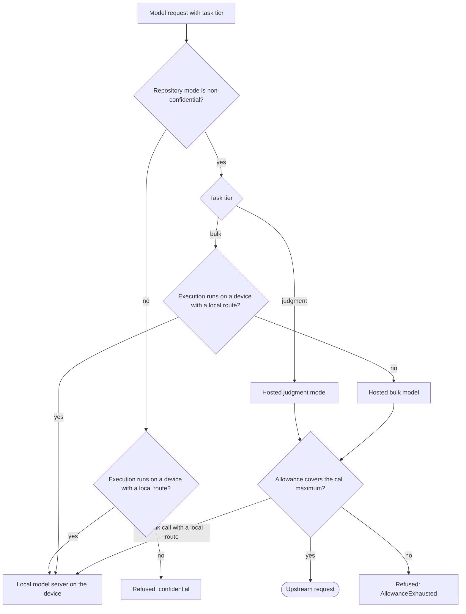
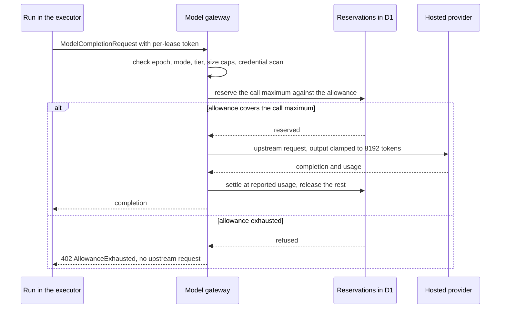
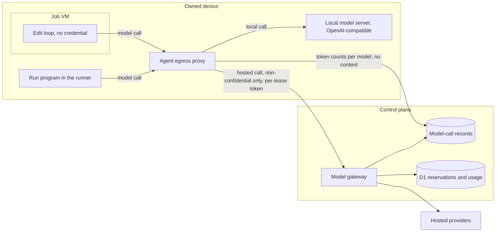

# Model gateway

The model gateway is the one path between a run and a model. It routes each call by the repository's confidentiality mode, the call's task tier and where the call's input lives; it meters every hosted call against the execution's allowance and refuses a call the allowance does not cover; and it holds every provider credential. On an owned device, a local OpenAI-compatible model server is one more route under the same request schema. This file specifies the routing rule, the provider registry, allowance enforcement, rate control, the local route and the records the gateway keeps.

## Scope

This file covers model-call routing, the provider registry, per-call allowance enforcement, token buckets and breakers, the local model route on devices, structured output and the model-call records. It depends on:

- [spend.md](spend.md) for the hold, the allowance's place inside the hold, class lines and `BudgetExhausted`;
- [qos-admission.md](qos-admission.md) for classes, `deadline_at`, queue age and placement constraints;
- [placement-leases.md](placement-leases.md) for the execution lease, epochs and the capacity lease;
- [isolation-egress.md](isolation-egress.md) for the job VM, the `setup` and `agent` egress profiles and per-lease credentials;
- [executors.md](executors.md) and [local-scheduler.md](local-scheduler.md) for the device and its local scheduler;
- [interfaces.md](interfaces.md) for the HTTP route that carries a model request;
- [runs/agentic.md](runs/agentic.md) for the recipes that call models.

[ADR-0014](adr/0014-model-routing.md) records why routing follows confidentiality mode, task tier and data location.

Not specified: a model-id prefix that selects a provider route; a model chosen by a run's own configuration outside the provider registry.

## Model

A **model request** is a `ModelCompletionRequest`: the model entry id, the task tier, the messages, an optional tool list, an optional JSON schema for structured output, `maxTokens` and `temperature`. Every request names its task tier: `bulk` (classify, extract, summarize, embed, filter) or `judgment` (review, plan, write code).

A **model entry** in the provider registry names one model: its id, its provider, its route kind, its tier, its input and output price in micro-USD per million tokens and its context window in tokens. Route kinds form a closed set:

| Route kind | Reached from | Credential |
| --- | --- | --- |
| `workers-ai` | The control plane, through the Workers AI binding | The binding |
| `openai-compatible` | The control plane, `chat/completions` and `embeddings` | Provider key in the control plane |
| `anthropic-messages` | The control plane, `messages` | Provider key in the control plane |
| `bedrock` | The control plane, SigV4-signed through the gateway | Role assumed by the control plane |
| `local` | The runner and the job VM on a device, through the agent's egress proxy | The execution's per-lease token, attached by the egress proxy |

A **hosted model** is a model entry with any route kind except `local`. A **local model** is a model entry with route kind `local`, served by a model server on a device.

The routing decision is a pure function `routeModelCall(mode, tier, location, allowance) → local | hosted(entry) | refused(reason)`, part of the `placementPolicy` kernel. The function is checked in Lean as `Placement.unclassified_not_hosted` and differentially tested against the compiled oracle ([verification.md](verification.md)).

*Routing · the confidentiality mode is checked first and no later branch returns to a hosted model for a repository that is not `non-confidential`.*

A hosted call travels from the run in the executor to the gateway in the control plane, which checks the token, the mode, the caps and the allowance before it opens an upstream request.

*Hosted call · the reservation precedes the upstream request, so no call settles above what the allowance had left.*

On a device, the runner runs the run program outside the job VM ([architecture.md](architecture.md) FD-ARCH-012), and the edit loop inside the job VM holds no credential. Both reach a model only through the agent's egress proxy, which attaches the execution's per-lease token. Prompts and completions on the local route stay on the device; only token counts per model reach the control plane.

*Routes · the egress proxy attaches the per-lease token to every call; a hosted call carries content to a provider through the gateway, a local call only inside the device.*

## Requirements

### Task tier and request shape

- **FD-MDL-001** · phase 0 · `V-UNIT` — If a model request carries no task tier, the model gateway must reject it with `ModelRequestInvalid` and make no upstream request.
- **FD-MDL-002** · phase 0 · `V-UNIT` — If a model request names a model entry id that is not in the provider registry, the model gateway must reject it with `ModelRequestInvalid` and make no upstream request.
- **FD-MDL-003** · phase 0 · `V-UNIT` — If a model request's system text exceeds 100,000 characters or its user text exceeds 400,000 characters, the model gateway must reject it with `ModelRequestInvalid` and HTTP `413`.
- **FD-MDL-004** · phase 0 · `V-UNIT` — If a request names a `judgment` task tier and a model entry whose tier is `bulk`, the model gateway must reject it with `ModelRequestInvalid`.
- **FD-MDL-005** · phase 0 · `V-UNIT` `V-REPLAY` — The run must make every model call inside an `Activity`, so that a replay over a cached journal makes zero model calls.

### Confidentiality routing

- **FD-MDL-006** · phase 0 · `V-UNIT` `V-PROOF` `V-DIFF` — The model gateway must decide every route with `routeModelCall`, a pure function of the confidentiality mode, the task tier, the execution's location and the allowance state.
- **FD-MDL-007** · phase 0 · `V-UNIT` — The model gateway must read the confidentiality mode from the policy snapshot recorded on the execution's placement row, and must ignore any mode the request carries.
- **FD-MDL-008** · phase 0 · `V-PROOF` `V-DIFF` — While a repository's confidentiality mode is `unclassified`, `confidential-model` or `confidential-compute`, the model gateway must route no call of its executions to a hosted model.
- **FD-MDL-009** · phase 0 · `V-UNIT` `V-CONF` — If a hosted call arrives for an execution whose confidentiality mode is not `non-confidential`, the model gateway must refuse it with `ModelRouteRefused` reason `confidential` and HTTP `403`, and make no upstream request.
- **FD-MDL-010** · phase 0 · `V-UNIT` `V-PROOF` `V-DIFF` — If a local model call fails, times out or finds the local model server busy, then `routeModelCall` must not return a hosted model for that call while the repository is not `non-confidential`.
- **FD-MDL-011** · phase 0 · `V-UNIT` `V-PROOF` `V-DIFF` — When a repository is `non-confidential` and a call's task tier is `judgment`, `routeModelCall` must return the hosted judgment model that the recipe's model entry names.
- **FD-MDL-012** · phase 2 · `V-UNIT` `V-DIFF` — When a repository is `non-confidential`, a call's task tier is `bulk` and the execution runs on a device that advertises a local route, `routeModelCall` must return the local model.
- **FD-MDL-013** · phase 0 · `V-UNIT` `V-DIFF` — When a repository is `non-confidential`, a call's task tier is `bulk` and the execution runs on a cloud executor, `routeModelCall` must return a hosted bulk model, and the executor must not move the call's input to a device.
- **FD-MDL-014** · phase 4 · `V-UNIT` `V-E2E-LOCAL` — While a repository's confidentiality mode is `unclassified`, `confidential-model` or `confidential-compute` and its execution runs on a device, the run must make every model call of that execution on the local route, and the control plane must receive no prompt or completion text of that call.
- **FD-MDL-015** · phase 4 · `V-UNIT` `V-SIM` — While a repository's confidentiality mode is not `non-confidential` and its execution runs on a cloud executor, the run must make no model call.
- **FD-MDL-016** · phase 4 · `V-UNIT` `V-SIM` — Where a recipe declares `needsModel` and the repository's confidentiality mode is not `non-confidential`, the control plane must add a placement constraint that keeps only device executors advertising a local route, applied by `placementPolicy` ([qos-admission.md](qos-admission.md)).
- **FD-MDL-017** · phase 4 · `V-SIM` — If `placementPolicy` leaves a `needsModel` request of a repository that is not `non-confidential` with no eligible executor kind that advertises `local-model`, then intake must conclude it as [intake.md](intake.md) FD-INT-013 specifies.
- **FD-MDL-069** · phase 4 · `V-SIM` — If no device executor with a local route claims a `needsModel` execution of a repository that is not `non-confidential` by `deadline_at`, then the control plane must conclude it `failure` with the reason `capacity: confidential executor unavailable`.
- **FD-MDL-018** · phase 1 · `V-UNIT` — While locally submitted work on a repository that is not `non-confidential` waits for a busy local model server, the step must wait in the server's queue without consuming a step retry.

### Provider registry

- **FD-MDL-019** · phase 0 · `V-UNIT` `V-DEPLOY` — The model gateway must read the provider registry (model entry id, provider id, route kind, tier, input price, output price, context window) from configuration values in the committed configuration and the operator overlay, with no provider-specific code path chosen by a model-id prefix.
- **FD-MDL-020** · phase 0 · `V-DEPLOY` — If the provider registry holds two model entries with one id, a model entry whose provider is not registered, or a route kind outside `workers-ai`, `openai-compatible`, `anthropic-messages`, `bedrock` and `local`, then the deploy check must fail.
- **FD-MDL-021** · phase 0 · `V-UNIT` — If a hosted model entry other than `workers-ai` omits a price, the model gateway must price it at the fallback rate, default 75 USD per million tokens for input and output, set in the operator overlay.
- **FD-MDL-022** · phase 0 · `V-DEPLOY` — If a `workers-ai` model entry states no per-token rate derived from its Neurons price, then the deploy check must fail.
- **FD-MDL-023** · phase 0 · `V-UNIT` `V-CONF` — The model gateway must hold every hosted provider credential, and the control plane must not send one to an executor, a job VM or the agent.
- **FD-MDL-024** · phase 0 · `V-UNIT` — The model gateway must sign `bedrock` requests in the control plane, and must reach `bedrock` from no other component.
- **FD-MDL-025** · phase 0 · `V-UNIT` `V-REPLAY` — The model gateway must not write a provider credential or an assumed-role session credential into a journal, a step result, a log or a model-call record.

### Allowance enforcement

- **FD-MDL-026** · phase 0 · `V-UNIT` `V-CONF` `V-SIM` — Before each hosted upstream request, the model gateway must reserve the call maximum against the execution's allowance in one atomic statement, where the call maximum in micro-USD is the UTF-8 byte count of the request's message content × the input price plus the clamped `maxTokens` × the output price, divided by 1,000,000 and rounded up.
- **FD-MDL-027** · phase 0 · `V-UNIT` `V-CONF` `V-SIM` — If the execution's settled model cost plus its open call reservations plus the new call maximum exceeds its allowance, then the model gateway must refuse the call with `AllowanceExhausted` and HTTP `402`, and make no upstream request.
- **FD-MDL-028** · phase 0 · `V-UNIT` `V-CONF` — When a hosted upstream request ends, the model gateway must settle the call at the cost of the provider-reported input and output tokens and release the rest of its reservation.
- **FD-MDL-029** · phase 0 · `V-UNIT` — If a provider response reports no token usage, then the model gateway must settle the call at its reserved call maximum.
- **FD-MDL-030** · phase 0 · `V-UNIT` — The model gateway must clamp `maxTokens` to 8192 on every route, and must use 2048 when the request omits it.
- **FD-MDL-031** · phase 0 · `V-UNIT` — If the execution's summed input tokens plus the UTF-8 byte count of a new call's message content exceed its input-token allowance, then the model gateway must refuse the call with `AllowanceExhausted` reason `input-tokens`.
- **FD-MDL-032** · phase 0 · `V-SIM` — The model gateway must count an execution's model cost across every epoch of that execution, and a reclaim must not reset the used amount.
- **FD-MDL-033** · phase 0 · `V-CONF` `V-SIM` — If two calls of one execution reserve concurrently, then the model gateway must admit them only while their summed call maxima fit the remaining allowance.
- **FD-MDL-034** · phase 0 · `V-UNIT` `V-SIM` — When an execution is cancelled, its epoch is fenced or its lease is reclaimed, the model gateway must abort that execution's in-flight upstream requests through an `AbortSignal` within 1 s.
- **FD-MDL-035** · phase 0 · `V-UNIT` — If an aborted upstream request reports no usage, then the model gateway must settle it at its reserved call maximum.
- **FD-MDL-036** · phase 0 · `V-UNIT` — The model gateway must compute every price, reservation and settlement in integer micro-USD.
- **FD-MDL-037** · phase 2 · `V-UNIT` — When a `bulk` call is refused with `AllowanceExhausted` and the execution runs on a device with a local route, the run must retry the call once on the local model.
- **FD-MDL-038** · phase 0 · `V-UNIT` — When a `judgment` call is refused with `AllowanceExhausted`, the run must fail with `BudgetExhausted`, which concludes `failure` with the reason `budget`.
- **FD-MDL-039** · phase 2 · `V-UNIT` — The model gateway must charge a local model call 0 micro-USD against the allowance and must count its input tokens against the input-token allowance.
- **FD-MDL-040** · phase 1 · `V-UNIT` `V-SIM` — When a call arrives under a capacity lease, the model gateway must meter it in micro-USD against that capacity lease's allowance and refuse it with `AllowanceExhausted` past that allowance.
- **FD-MDL-041** · phase 1 · `V-SIM` — When the operator sets `halt-cloud`, the model gateway must refuse every later hosted call under each capacity lease with `AllowanceExhausted`.

### Tokens and context

- **FD-MDL-042** · phase 1 · `V-UNIT` `V-SIM` `V-PROOF` — If a model request carries a per-lease token whose epoch is not the execution's current epoch ([isolation-egress.md](isolation-egress.md) FD-ISO-048), then the model gateway must reject it with HTTP `401` and make no upstream request.
- **FD-MDL-043** · phase 0 · `V-UNIT` — If a model request carries no per-lease token or a token whose signature does not verify, then the model gateway must reject it with HTTP `401` before it reads the request body.
- **FD-MDL-044** · phase 0 · `V-UNIT` — If a model request's input contains a credential that the control plane issued to that execution, then the model gateway must refuse the call with `ModelRouteRefused` reason `credential-in-context` and make no upstream request.
- **FD-MDL-068** · phase 1 · `V-UNIT` `V-CONF` — If a call under a capacity lease carries no proof of possession of the key whose thumbprint is the capacity lease's `cnf`, or its proof does not verify, then the model gateway must reject it with HTTP `401` and make no upstream request.

### Rate control

- **FD-MDL-045** · phase 0 · `V-UNIT` `V-SIM` — Before each hosted upstream request, the model gateway must take from a tokens-per-minute bucket and a requests-per-minute bucket held per (provider, class), with each class's share set in the operator overlay.
- **FD-MDL-046** · phase 0 · `V-UNIT` `V-SIM` — If a (provider, class) bucket is empty, then the model gateway must answer HTTP `429` with reason `rate-limited` and a `Retry-After` in seconds, and make no upstream request.
- **FD-MDL-047** · phase 0 · `V-SIM` — When a call is answered `rate-limited`, the run must wait and retry without consuming a step retry, for at most until `deadline_at` in class P1, at most its queue age in class P2 and at most its staleness point in class P3.
- **FD-MDL-048** · phase 0 · `V-SIM` — If a `rate-limited` call's wait bound passes, then the run must fail the call with `ModelCallFailed` reason `rate-limited`, which concludes the execution `failure` with the reason `capacity: model unavailable` ([qos-admission.md](qos-admission.md) § Verdicts for capacity outcomes).
- **FD-MDL-049** · phase 0 · `V-UNIT` `V-SIM` — The model gateway must open the breaker of a (provider, model) pair when that pair returns HTTP `429` on at least the breaker threshold, default 5 responses in 60 s, set in the operator overlay.
- **FD-MDL-050** · phase 0 · `V-UNIT` — While a (provider, model) breaker is open, the model gateway must answer each call to that pair with `rate-limited` and the breaker's remaining open time as `Retry-After`.
- **FD-MDL-051** · phase 1 · `V-SIM` — The model gateway must serve capacity-lease calls from a `local` bucket ranked below class P3, and must throttle that bucket before any class bucket.

### Errors and structured output

- **FD-MDL-052** · phase 0 · `V-UNIT` — The model gateway must fail a call with `ModelCallFailed`, a `Schema.TaggedError` class whose `reason` field is one of `context-overflow`, `rate-limited`, `auth-failed`, `timeout`, `bad-response` and `refused`.
- **FD-MDL-053** · phase 0 · `V-UNIT` — When a structured call runs in tools mode and the tool arguments do not decode, the model client must fall back to JSON mode at most once.
- **FD-MDL-054** · phase 0 · `V-UNIT` — When a structured call's JSON output does not parse, the model client must strip reasoning blocks and code fences, take the last balanced JSON value and repair it at most once.
- **FD-MDL-055** · phase 0 · `V-UNIT` — If a structured call's decoded output does not match its schema, then the model client must fail with `StructuredOutputInvalid` and make no repair call.
- **FD-MDL-056** · phase 0 · `V-UNIT` — When a call fails with `context-overflow`, the model client must halve the variable input and retry, at most twice, and must stop when the input is at most 2000 characters; a call still overflowing after those retries concludes the execution `failure` with the reason `capacity: context overflow` ([qos-admission.md](qos-admission.md) § Verdicts for capacity outcomes).

### Local model route

- **FD-MDL-057** · phase 2 · `V-CONF` `V-E2E-LOCAL` — Where a device advertises a local route, the agent must serve an OpenAI-compatible `chat/completions` and `embeddings` API from the device's local model server, and the run's model client must send the same `ModelCompletionRequest` on the local route as on a hosted route.
- **FD-MDL-058** · phase 2 · `V-UNIT` — The agent must subtract the local model server's memory reservation from the device's memory before it advertises job slots.
- **FD-MDL-059** · phase 2 · `V-UNIT` `V-SIM` — The agent must admit local model calls into a queue bounded at the local queue size, default 8, run at most the local concurrency, default 2, and order waiting calls P1 before P2 before P3.
- **FD-MDL-060** · phase 2 · `V-UNIT` — If the local queue is full, then the agent must answer the call `rate-limited` with a `Retry-After` in seconds.
- **FD-MDL-061** · phase 4 · `V-SIM` — While a class P2 call of a repository that is not `non-confidential` waits on a device, the agent must refuse class P3 calls to that device's local model server.
- **FD-MDL-062** · phase 4 · `V-SIM` — The agent must reserve the confidential stream count, default 1, of the local model server's concurrency for executions of repositories that are not `non-confidential`.
- **FD-MDL-063** · phase 2 · `V-E2E-LOCAL` — The job VM must reach the local model server only through the agent's egress proxy, which attaches the execution's per-lease token, and must hold no per-lease token itself.

### Records

- **FD-MDL-064** · phase 0 · `V-UNIT` `V-REPLAY` — The model gateway must write one model-call record per hosted upstream request with the execution id, epoch, provider id, model entry id, task tier, route kind, input tokens, output tokens, cost in micro-USD and outcome.
- **FD-MDL-065** · phase 0 · `V-UNIT` — The model gateway must not persist prompt text, completion text or tool arguments in a model-call record, a log or a metric.
- **FD-MDL-066** · phase 2 · `V-UNIT` — When an execution on a device ends, the agent must report, with the result, the input and output token counts per local model entry, and no prompt or completion text.
- **FD-MDL-067** · phase 0 · `V-DEPLOY` — Where a hosted provider offers an account spend limit, `fd doctor` may report whether it is set; the gateway's allowance enforcement does not depend on it.

## Open items

- TODO(maintainer): measure prompt-processing speed for a typical diff plus log on a reference device before any `judgment` call routes to a local model; until then `judgment` stays hosted.
- TODO(operator): set the per-class bucket shares (P2 reserved share, P1 share once a P1 run makes hosted calls, P3 remainder) in the operator overlay.
- TODO(maintainer): confirm whether a hosted gateway's own rate limit applies per gateway or per account; the per-(provider, class) buckets assume per account.
