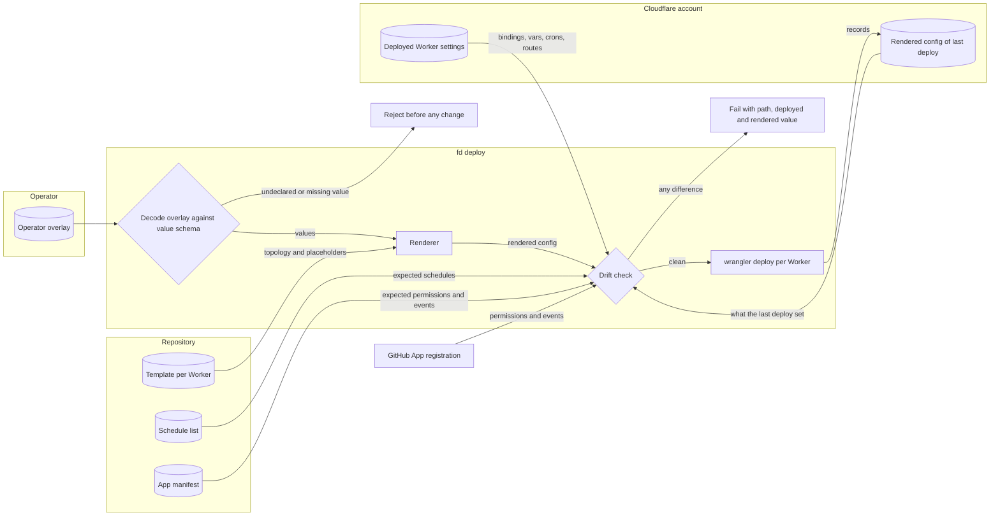
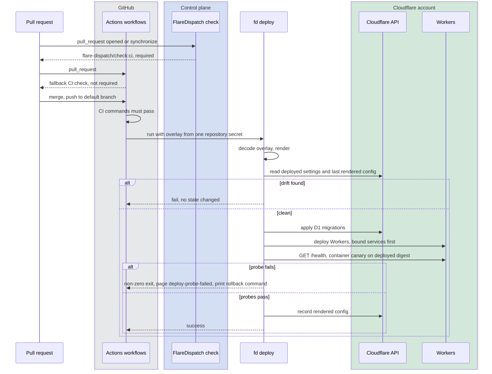
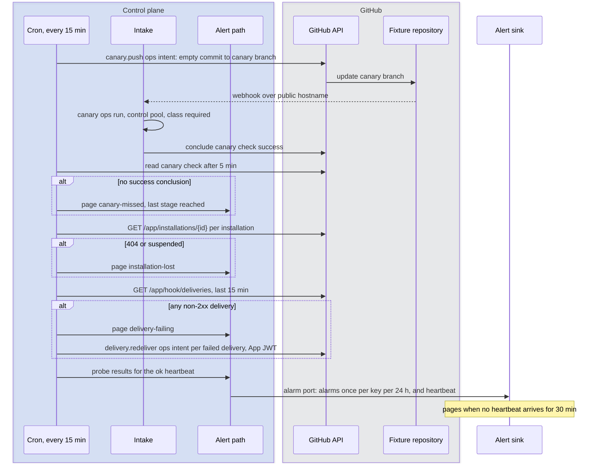

# Operability

This file specifies how an organization deploys FlareDispatch into its own Cloudflare account and keeps it running: the values-only operator overlay, the deploy-time drift check, CI on every pull request, the GitHub liveness probes, FlareDispatch's alarm port, the dashboard behind Cloudflare Access, the routes that surface mameko's operator operations, and the runbook.

## Scope

This file covers the deploy path from a commit to running Workers, the checks that keep the deployed configuration equal to the committed one, the GitHub signals that show the control plane is alive, and the routes and procedures an operator uses. mameko's [operability.md](https://github.com/fractalboxdev/mameko/blob/8530203ba76ba00961e236b1fcea4f34b401bba1/specs/operability.md) specifies the health probe, the liveness monitor, the floor canaries, the alarm rules, the settle-sweep alarm, the operator operations and their audit rows, and configuration at runtime; FlareDispatch inherits them. It depends on:

- [architecture.md](architecture.md) for the Workers, Durable Objects, D1 database and R2 buckets that make up the control plane;
- [spend.md](spend.md) for the meaning of `run`, `halt-cloud` and `halt-all`, the ops reserve, budget top-ups and `unresolved` charges;
- [profile.md](profile.md) for the profile the drift check validates;
- [github-output.md](github-output.md) for the GitHub appliers, the `canary.push` and `delivery.redeliver` ops kinds and the App's permission set;
- [executors.md](executors.md) for the image digest each executor kind runs and the device health probe;
- [interfaces.md](interfaces.md) for the HTTP API, the identity gate of each surface and the `fd` CLI that hosts `fd deploy`, `fd doctor` and `fd ops`;
- [runs/gate.md](runs/gate.md) for the `check` recipe that runs this repository's CI.

[ADR-0012](adr/0012-values-only-overlay.md) records why the overlay holds values only.

Not specified: a per-environment deploy console with approval.

## Model

### Template, overlay and rendered configuration

Each Worker has one committed template (`wrangler.jsonc`). The template holds the whole topology: bindings, Durable Object classes and migrations, cron schedules, container classes and images, compatibility settings, limits and rollout settings. Every account-specific value in a template is a placeholder.

The operator overlay is a JSON document of values only. The value schema, a `Schema.Struct` in the deploy CLI, declares every value path. Decoding uses `Schema.decodeUnknownEffect` with `onExcessProperty: "error"`, so an undeclared key fails the decode.

| Value path | Holds |
| --- | --- |
| `accountId` | Cloudflare account id |
| `d1.<binding>` | D1 database id per binding |
| `kv.<binding>` | KV namespace id per binding |
| `r2.<binding>` | R2 bucket name per binding |
| `hostnames.<worker>` | Custom-domain hostname per Worker |
| `access.teamDomain`, `access.aud` | Cloudflare Access team domain and application AUD |
| `operators` | Access identities allowed on operator routes |
| `dispatchers` | Access identities allowed to dispatch through `fd` and `/mcp` ([interfaces.md](interfaces.md) FD-IFC-027) |
| `github.appId`, `github.fixtureRepo` | GitHub App id; the repository the synthetic webhook canary pushes to |
| `intake.webhookEvents` | The webhook events intake admits ([intake.md](intake.md) FD-INT-027) |
| `dispatch.oidcAudience` | The Actions OIDC audience of a dispatch ([interfaces.md](interfaces.md) FD-IFC-024) |
| `executors.planeId` | This control plane's `plane_id`, which every device's `connect` signature binds ([interfaces.md](interfaces.md) FD-IFC-085); required from phase 1 |
| `alerts.sink` | An HTTPS webhook URL or an email address |
| `alerts.webhookSilentHours` | The delivery gap that raises `webhook-silent`, default 24 |
| `spend.*` | The budget and reserve settings [spend.md](spend.md) defines |
| `pools.<pool>.maxInstances` | Container `max_instances` per pool, bounded by the account's limits |
| `aws.budgetUsd`, `aws.launchCap`, `aws.egressProxy`, `aws.imageRegistry` | The AWS limit, launch cap, egress proxy endpoint and image registry endpoint ([executors.md](executors.md) FD-EXEC-083, [MAMEKO-ISO-019](https://github.com/fractalboxdev/mameko/blob/8530203ba76ba00961e236b1fcea4f34b401bba1/specs/isolation-egress.md)) |
| `gha.concurrencyCap`, `gha.runnerRepo`, `gha.workflow` | The GitHub Actions launcher's concurrency cap, runner repository and runner workflow ([executors.md](executors.md) FD-EXEC-085, FD-EXEC-089) |
| `egress.targetPatterns` | Dynamic egress target patterns ([MAMEKO-ISO-042](https://github.com/fractalboxdev/mameko/blob/8530203ba76ba00961e236b1fcea4f34b401bba1/specs/isolation-egress.md)) |
| `models.registry`, `models.fallbackPriceUsdPerMTok`, `models.bucketShares`, `models.breaker` | The provider registry, fallback price, per-class bucket shares and breaker threshold ([model-gateway.md](model-gateway.md) FD-MDL-021; [MAMEKO-MDL-020](https://github.com/fractalboxdev/mameko/blob/8530203ba76ba00961e236b1fcea4f34b401bba1/specs/model-gateway.md), [MAMEKO-MDL-044](https://github.com/fractalboxdev/mameko/blob/8530203ba76ba00961e236b1fcea4f34b401bba1/specs/model-gateway.md), [MAMEKO-MDL-048](https://github.com/fractalboxdev/mameko/blob/8530203ba76ba00961e236b1fcea4f34b401bba1/specs/model-gateway.md)) |
| `provenance.attestationMaxAgeDays`, `provenance.reattestIntervalDays`, `provenance.auditRate`, `provenance.statementRetentionDays`, `provenance.witnesses` | `attestation_max_age`, `reattest_interval`, `audit_rate`, the statement retention and the private log's witnesses ([provenance.md](provenance.md) FD-PROV-016, FD-PROV-030, FD-PROV-069, FD-PROV-075, FD-PROV-039) |

```json
{
  "accountId": "<account id>",
  "d1": { "CONTROL_DB": "<database id>" },
  "r2": { "CACHE": "<bucket name>", "ARTIFACTS": "<bucket name>" },
  "hostnames": { "dispatcher": "<hostname>", "docs": "<hostname>" },
  "access": { "teamDomain": "<team domain>", "aud": "<aud tag>" },
  "operators": ["<access identity>"],
  "github": { "appId": "<app id>", "fixtureRepo": "<owner>/<repo>" },
  "alerts": { "sink": "<https url or email>" },
  "spend": { "budgetUsd": "<budget USD>" },
  "pools": { "lean": { "maxInstances": "<count>" } }
}
```

No overlay value is a secret. Secrets, the webhook secret included ([intake.md](intake.md) FD-INT-022), are Worker secrets set with `wrangler secret put` (runbook R14), and the drift check shows each by name only. The renderer replaces each placeholder with its value and changes nothing else. The drift check then compares the rendered configuration with three references: the template's own invariants, the live deployed Worker, and the GitHub App registration.



*overlay render · values fill placeholders; any drift stops the deploy before a change.*

### Deploy pipeline



*deploy pipeline · CI on every pull request, drift check before migrations, probes after deploy.*

### Liveness and alerts

mameko's coordinator runs the health probe, the liveness monitor, the `ok` heartbeat and the floor canaries ([mameko operability.md § Liveness and alarms](https://github.com/fractalboxdev/mameko/blob/8530203ba76ba00961e236b1fcea4f34b401bba1/specs/operability.md#liveness-and-alarms)). FlareDispatch adds three GitHub probes, registered with the coordinator so the heartbeat carries their results, that run every 15 min: the synthetic webhook canary, the installation probe and the delivery probe. The canary pushes a real commit, so the webhook crosses public DNS, the GitHub App installation, the webhook signature, intake, admission and the outbox. The delivery probe reads GitHub's own record of failed deliveries, which reports a broken hostname even when no webhook reaches the control plane.



*liveness · real webhook path, GitHub's delivery record, and a heartbeat the sink watches.*

FlareDispatch's alarm port records each alarm for the dashboard and sends it to the alert sink the operator overlay names; mameko's coordinator decides when an alarm is raised, repeated, resolved and retried ([MAMEKO-OPS-022](https://github.com/fractalboxdev/mameko/blob/8530203ba76ba00961e236b1fcea4f34b401bba1/specs/operability.md) to [MAMEKO-OPS-028](https://github.com/fractalboxdev/mameko/blob/8530203ba76ba00961e236b1fcea4f34b401bba1/specs/operability.md)).

| Alarm | Severity | Fires when | Runbook |
| --- | --- | --- | --- |
| `canary-missed` | page | The canary check has no `success` conclusion 5 min after the push | R1 |
| `delivery-failing` | page | A webhook delivery in the last 15 min has a non-2xx status | R1 |
| `installation-lost` | page | An installation read returns 404 or suspended, or an `installation` event deletes or suspends one | R2 |
| `deploy-probe-failed` | page | A post-deploy probe fails | R4 |
| `floor-canary-failed` | page | A container or AWS canary stage fails ([MAMEKO-OPS-016](https://github.com/fractalboxdev/mameko/blob/8530203ba76ba00961e236b1fcea4f34b401bba1/specs/operability.md), [MAMEKO-OPS-020](https://github.com/fractalboxdev/mameko/blob/8530203ba76ba00961e236b1fcea4f34b401bba1/specs/operability.md)) | R5 |
| `placement-stalled` | page | No placement row for 30 min while executions are queued and executor heartbeats arrive ([MAMEKO-OPS-021](https://github.com/fractalboxdev/mameko/blob/8530203ba76ba00961e236b1fcea4f34b401bba1/specs/operability.md)) | R6 |
| `drift` | notify | The daily drift check finds a difference | R3 |
| `cron-silent` | notify | The minute tick's last recorded time is older than 2 min ([MAMEKO-OPS-010](https://github.com/fractalboxdev/mameko/blob/8530203ba76ba00961e236b1fcea4f34b401bba1/specs/operability.md)) | R7 |
| `webhook-silent` | notify | An installation with an enrolled repository has had no verified delivery for `alerts.webhookSilentHours` | R1 |
| `executions-lost` | notify | The settle sweep ends one or more executions ([MAMEKO-OPS-029](https://github.com/fractalboxdev/mameko/blob/8530203ba76ba00961e236b1fcea4f34b401bba1/specs/operability.md)) | R8 |
| `operator-control` | notify | The control state is not `run`, or a quarantine, force-admit or top-up is active ([MAMEKO-OPS-037](https://github.com/fractalboxdev/mameko/blob/8530203ba76ba00961e236b1fcea4f34b401bba1/specs/operability.md)) | R9 |
| `delivery-key-paused` | notify | A delivery key stays paused for more than 10 min ([MAMEKO-OPS-049](https://github.com/fractalboxdev/mameko/blob/8530203ba76ba00961e236b1fcea4f34b401bba1/specs/operability.md)) | R15 |

Other files and mameko define their own alarms (spend, admission, delivery); every alarm travels the same alarm port.

### Operator routes

Each `/v1/ops/*` route and `fd ops` command surfaces one of mameko's operator operations ([mameko operability.md § Operator operations](https://github.com/fractalboxdev/mameko/blob/8530203ba76ba00961e236b1fcea4f34b401bba1/specs/operability.md#operator-operations)); the dispatcher authenticates the operator and passes the identity, the `reason` and its request id through. A tenant scope is a repository and a delivery key is an installation's `limit_key`.

| Route | `fd ops` command | mameko operation |
| --- | --- | --- |
| `POST /v1/ops/halt` | `halt run`, `halt halt-cloud`, `halt halt-all` | `halt` |
| `POST /v1/ops/drain` | `drain <executor>` | `drain` |
| `POST /v1/ops/quarantine` | `quarantine <executor or repository>` | `quarantine` |
| `POST /v1/ops/release` | `release <executor or repository>` | `release` |
| `POST /v1/executions/:id/cancel` | `fd cancel <id>` | `cancel` |
| `POST /v1/ops/force-admit` | `force-admit <execution>` | `force-admit` |
| `POST /v1/ops/top-up` | `top-up` | `top-up` |
| `POST /v1/ops/revoke` | `revoke <executor>` | `revoke` |
| `POST /v1/ops/pause-key`, `POST /v1/ops/resume-key` | `pause-key <installation>`, `resume-key <installation>` | `pause`, `resume` |

FlareDispatch surfaces no `resolve`, because no FlareDispatch intent kind is `reconcile-only`.

### Runbook

| Entry | Trigger | First action | Relies on |
| --- | --- | --- | --- |
| R1 Webhooks not arriving | `canary-missed`, `delivery-failing`, `webhook-silent` | `fd doctor --live`; confirm the dispatcher hostname resolves and GitHub's delivery status; the delivery probe redelivers each failed delivery once the path works | FD-OPS-038, FD-OPS-040, FD-OPS-044, FD-OPS-045 |
| R2 Installation lost | `installation-lost` | Reinstall the GitHub App on the account, then `fd doctor` | FD-OPS-042, FD-OPS-043 |
| R3 Configuration drift | `drift`, a failed deploy | Read the paths `fd doctor` lists; move the change into the overlay or the template; deploy again | FD-OPS-016 to FD-OPS-023, [intake.md](intake.md) FD-INT-050 |
| R4 Post-deploy probe failed | `deploy-probe-failed` | Run the `wrangler rollback` command `fd deploy` printed; where it printed `fix forward: rollback blocked by migration <tag>`, fix forward on a new commit | FD-OPS-013 |
| R5 Floor canary failed | `floor-canary-failed` | Compare the failing digest with the last `sandbox-image` publish; rebuild the image | FD-OPS-050, [MAMEKO-OPS-012](https://github.com/fractalboxdev/mameko/blob/8530203ba76ba00961e236b1fcea4f34b401bba1/specs/operability.md) to [MAMEKO-OPS-016](https://github.com/fractalboxdev/mameko/blob/8530203ba76ba00961e236b1fcea4f34b401bba1/specs/operability.md) |
| R6 Placement stalled | `placement-stalled` | Open the fleet view; `fd ops drain <executor>` for an executor that heartbeats and claims nothing | [MAMEKO-OPS-021](https://github.com/fractalboxdev/mameko/blob/8530203ba76ba00961e236b1fcea4f34b401bba1/specs/operability.md) |
| R7 Cron silent | `cron-silent` | Compare the live cron trigger with the rendered configuration's single minute tick; deploy again | [MAMEKO-OPS-010](https://github.com/fractalboxdev/mameko/blob/8530203ba76ba00961e236b1fcea4f34b401bba1/specs/operability.md), [intake.md](intake.md) FD-INT-050 |
| R8 Lost executions | `executions-lost` | Read the swept executions in the executions view; the settle sweep has already concluded them | [MAMEKO-OPS-029](https://github.com/fractalboxdev/mameko/blob/8530203ba76ba00961e236b1fcea4f34b401bba1/specs/operability.md) |
| R9 Operator control active | `operator-control` | Confirm the control is intended, or `fd ops halt run` | [MAMEKO-OPS-037](https://github.com/fractalboxdev/mameko/blob/8530203ba76ba00961e236b1fcea4f34b401bba1/specs/operability.md) |
| R10 Device maintenance | Planned OS update or move | `fd ops drain <executor>`; wait for in-flight executions; release after the work | FD-OPS-077 |
| R11 Device key compromise | Lost or compromised device | `fd ops revoke <executor>`, then `fd ops quarantine <executor>` | [MAMEKO-OPS-040](https://github.com/fractalboxdev/mameko/blob/8530203ba76ba00961e236b1fcea4f34b401bba1/specs/operability.md) to [MAMEKO-OPS-045](https://github.com/fractalboxdev/mameko/blob/8530203ba76ba00961e236b1fcea4f34b401bba1/specs/operability.md) |
| R12 Runaway cloud spend | Spend alarms | `fd ops halt halt-cloud` | FD-OPS-077 |
| R13 Control-plane outage | Every check pending | Run the GitHub Actions CI workflow on the pull request; apply a temporary ruleset change that accepts its check; revert the ruleset when the control plane serves again | FD-OPS-027, FD-OPS-029 |
| R14 Secret rotation | Scheduled or after exposure | `wrangler secret put` for each Worker that holds the secret, then `fd doctor` | FD-OPS-024 |
| R15 Delivery key paused | `delivery-key-paused` | Confirm the pause is intended, or `fd ops resume-key <installation>` | FD-OPS-077, [MAMEKO-OPS-046](https://github.com/fractalboxdev/mameko/blob/8530203ba76ba00961e236b1fcea4f34b401bba1/specs/operability.md) |

## Requirements

### Template and overlay

- **FD-OPS-001** · phase 0 · `V-DEPLOY` `V-UNIT` — The repository must commit one template configuration per Worker, and every account-specific value in a template must be a placeholder.
- **FD-OPS-002** · phase 0 · `V-UNIT` — The operator overlay must hold only values at the paths the value schema declares, and must not hold bindings, Durable Object classes, migrations, cron schedules, container class definitions, compatibility settings, limits or rollout settings.
- **FD-OPS-003** · phase 0 · `V-UNIT` `V-DEPLOY` — If the operator overlay contains a key the value schema does not declare, then `fd deploy` must reject the overlay, naming the key's path, before it changes any Cloudflare state.
- **FD-OPS-004** · phase 0 · `V-UNIT` `V-DEPLOY` — If the operator overlay lacks a value the value schema marks required, then `fd deploy` must reject the overlay, naming the path, before it changes any Cloudflare state.
- **FD-OPS-005** · phase 0 · `V-UNIT` — The renderer must produce each Worker's configuration by replacing each template placeholder with its overlay value, and must not replace, delete or merge any other part of the template.
- **FD-OPS-006** · phase 0 · `V-UNIT` — The renderer must be a pure function of the template and the overlay, so the same inputs render byte-identical configuration.
- **FD-OPS-007** · phase 0 · `V-DEPLOY` — Every deploy path (the deploy workflow, `fd deploy` on a workstation and the published deploy action) must render configuration through the one renderer.
- **FD-OPS-008** · phase 0 · `V-DEPLOY` — The deploy workflow must read the operator overlay from one repository secret, and if the secret is absent, then the workflow must fail before its first deploy step.
- **FD-OPS-009** · phase 0 · `V-DEPLOY` `V-UNIT` — When `fd deploy` runs, it must run overlay decode, render, drift check, D1 migrations, Worker deploys and post-deploy probes in that order, and stop at the first stage that fails.
- **FD-OPS-010** · phase 0 · `V-DEPLOY` — `fd deploy` must deploy a Worker only after it has deployed every Worker that the first Worker binds as a service.
- **FD-OPS-011** · phase 0 · `V-DEPLOY` — The deploy workflow must run at most one deploy per account at a time, and must not cancel a deploy that has started.
- **FD-OPS-012** · phase 0 · `V-DEPLOY` `V-UNIT` — Every template must set `keep_vars` to `false`.
- **FD-OPS-013** · phase 0 · `V-DEPLOY` `V-LIVE` — If a post-deploy probe fails, then `fd deploy` must exit with a non-zero status, raise the page alarm `deploy-probe-failed` and, for each Worker, print the `wrangler rollback` command for its previous version only when the deploy carried no Durable Object migration and no D1 migration, and otherwise print `fix forward: rollback blocked by migration <tag>`.
- **FD-OPS-014** · phase 0 · `V-DEPLOY` — `fd deploy` must not roll a Worker back without an operator running the rollback command.

### Drift check

- **FD-OPS-015** · phase 0 · `V-DEPLOY` — When `fd deploy` finishes deploying every Worker and passing every probe, it must store each Worker's rendered configuration in the artifacts bucket as the record of the last deploy.
- **FD-OPS-016** · phase 0 · `V-DEPLOY` — Before a deploy step changes Cloudflare state, the drift check must read each deployed Worker's bindings, vars, cron triggers, routes, compatibility settings and container classes through the Cloudflare API and compare them with the record of the last deploy.
- **FD-OPS-017** · phase 0 · `V-DEPLOY` — If a deployed setting differs from the record of the last deploy, then the drift check must fail, listing each path with its deployed and recorded values, and with each secret shown by name only.
- **FD-OPS-019** · phase 0 · `V-DEPLOY` `V-UNIT` — If a binding that the control plane's environment schema declares is absent from a rendered configuration, then the drift check must fail, naming the binding.
- **FD-OPS-020** · phase 0 · `V-DEPLOY` `V-UNIT` — If an admission cap in a rendered configuration is not below the `max_instances` of its pool's container class, then the drift check must fail, naming the pool ([MAMEKO-ADM-047](https://github.com/fractalboxdev/mameko/blob/8530203ba76ba00961e236b1fcea4f34b401bba1/specs/admission-qos.md)).
- **FD-OPS-021** · phase 0 · `V-DEPLOY` `V-PROOF` `V-DIFF` — If mameko's profile validator rejects the profile document a deploy carries ([MAMEKO-PROF-003](https://github.com/fractalboxdev/mameko/blob/8530203ba76ba00961e236b1fcea4f34b401bba1/specs/profiles.md), [MAMEKO-PROF-011](https://github.com/fractalboxdev/mameko/blob/8530203ba76ba00961e236b1fcea4f34b401bba1/specs/profiles.md)), then the drift check must fail with every rejection the validator returns.
- **FD-OPS-022** · phase 0 · `V-DEPLOY` `V-LIVE` — The drift check must read the GitHub App's registration from the GitHub API and fail if it lacks a permission, grants a lower access level or lacks an event that the committed App manifest lists.
- **FD-OPS-023** · phase 0 · `V-DEPLOY` — If the GitHub App's registration subscribes to an event the committed App manifest does not list, then the drift check must report a warning and continue.
- **FD-OPS-024** · phase 0 · `V-DEPLOY` — `fd doctor` must run every drift check without changing any Cloudflare or GitHub state.
- **FD-OPS-025** · phase 0 · `V-DEPLOY` `V-LIVE` — The deploy workflow must run `fd doctor` every 24 h, and if a check fails, then raise the notify alarm `drift`.

### CI

- **FD-OPS-026** · phase 0 · `V-DEPLOY` — When a pull request opens or updates, CI must run lint, typecheck, unit tests, the formal build gate, `wrangler deploy --dry-run` for every Worker on configuration rendered from a placeholder overlay, the cron check of [intake.md](intake.md) FD-INT-050, the checks of FD-OPS-019 and FD-OPS-020, and the documentation site build.
- **FD-OPS-027** · phase 0 · `V-DEPLOY` — The repository must carry a GitHub Actions workflow that runs the CI commands of FD-OPS-026 on every `pull_request`, under a check name the ruleset does not require.
- **FD-OPS-028** · phase 0 · `V-LIVE` — This repository's ruleset must require the check `flare-dispatch/check:ci`, which the `check` recipe produces from this repository's repo manifest, on the default branch.
- **FD-OPS-029** · phase 0 · `V-UNIT` — The control plane must not change a repository ruleset.
- **FD-OPS-030** · phase 0 · `V-DEPLOY` — When a push to the default branch arrives, the deploy workflow must run the CI commands of FD-OPS-026 and start no deploy step until they pass.
- **FD-OPS-031** · phase 0 · `V-DEPLOY` — The documentation site must build its pages from the Markdown under `specs/`, and its build must fail on a broken local link or on a diagram that fails the diagram check.

### Liveness

- **FD-OPS-036** · phase 0 · `V-UNIT` — `GET /v1/ops/health` must return mameko's liveness report ([MAMEKO-OPS-007](https://github.com/fractalboxdev/mameko/blob/8530203ba76ba00961e236b1fcea4f34b401bba1/specs/operability.md)) together with each installation's status and the age of the last webhook delivery per installation.
- **FD-OPS-038** · phase 0 · `V-LIVE` — Every 15 min, the control plane must insert a `canary.push` ops intent through `insertOpsIntent` with the key `canary:<tick time>` ([MAMEKO-OUT-056](https://github.com/fractalboxdev/mameko/blob/8530203ba76ba00961e236b1fcea4f34b401bba1/specs/outbox.md)), which the fixture installation's applier applies, under its `InstallationQuota` permit ([architecture.md](architecture.md) FD-ARCH-003), as an empty commit on the canary branch of the fixture repository the operator overlay names, so GitHub delivers a real webhook to the dispatcher's public hostname.
- **FD-OPS-039** · phase 0 · `V-UNIT` — When the canary webhook arrives, the control plane must admit the canary as an ops run ([MAMEKO-SPD-063](https://github.com/fractalboxdev/mameko/blob/8530203ba76ba00961e236b1fcea4f34b401bba1/specs/spend.md)) of class `required` in the `control` pool with no container, and conclude its check `success`.
- **FD-OPS-040** · phase 0 · `V-LIVE` — If the canary check has no `success` conclusion 5 min after the canary push, then the control plane must raise the page alarm `canary-missed` naming the last stage the canary reached: delivery, intake, placement, verdict or check.
- **FD-OPS-041** · phase 0 · `V-LIVE` — Every 15 min, the control plane must read each registered installation through `GET /app/installations/{installation_id}` with the App JWT.
- **FD-OPS-042** · phase 0 · `V-LIVE` `V-UNIT` — If an installation read returns `404` or a suspended installation, then the control plane must raise the page alarm `installation-lost` naming the account login.
- **FD-OPS-043** · phase 0 · `V-UNIT` — When an `installation` event with action `deleted` or `suspend` arrives, the control plane must raise the page alarm `installation-lost` without waiting for the next installation read.
- **FD-OPS-044** · phase 0 · `V-LIVE` — Every 15 min, the control plane must list the App's webhook deliveries of the last 15 min through `GET /app/hook/deliveries`, and if any delivery has a non-2xx status, then raise the page alarm `delivery-failing` with the statuses and the count.
- **FD-OPS-045** · phase 0 · `V-UNIT` `V-LIVE` — When a webhook delivery from the last 24 h has a non-2xx status and no later successful attempt, the control plane must insert one `delivery.redeliver` ops intent with the key `redeliver:<delivery id>` once the delivery path answers `2xx`, which its applier applies as one redelivery request made with the App JWT, the one App-JWT write [architecture.md](architecture.md) FD-ARCH-003 admits.
- **FD-OPS-046** · phase 0 · `V-LIVE` — The control plane must register the canary, installation and delivery probes with the coordinator, so that every `ok` heartbeat carries their results ([MAMEKO-OPS-011](https://github.com/fractalboxdev/mameko/blob/8530203ba76ba00961e236b1fcea4f34b401bba1/specs/operability.md)).
- **FD-OPS-050** · phase 0 · `V-DEPLOY` `V-LIVE` — When `fd deploy` has deployed the Workers, it must run the container floor canary once on the deployed image digest and must not report success until the canary passes.

### Alerts

- **FD-OPS-053** · phase 0 · `V-UNIT` — FlareDispatch's alarm port must show every alarm the coordinator raises on the dashboard and send it to the alert sink the operator overlay names.
- **FD-OPS-056** · phase 0 · `V-DEPLOY` — If the operator overlay names no alert sink, then `fd deploy` must reject the overlay.
- **FD-OPS-057** · phase 0 · `V-UNIT` — Every page-severity alarm message the alarm port sends must name the runbook entry that handles it.

### Dashboard and Access

- **FD-OPS-064** · phase 0 · `V-UNIT` `V-E2E-LOCAL` — Every dashboard page and route must pass the identity gate [interfaces.md](interfaces.md) assigns to its surface (FD-IFC-010 to FD-IFC-017), with the Access JWT checked against the overlay's `access.aud` and `access.teamDomain`.
- **FD-OPS-067** · phase 0 · `V-UNIT` — When the dashboard links a log or an artifact, the link must carry a link token ([interfaces.md](interfaces.md) FD-IFC-018) for that one object that expires within 3600 s.
- **FD-OPS-068** · phase 0 · `V-UNIT` — The executions view and its JSON route must filter by run, repository, class, status and executor kind, page with a keyset cursor at a default of 50 and a maximum of 200 rows, and show each execution's placement, executor, class, epoch, hold and settled cost.
- **FD-OPS-069** · phase 0 · `V-UNIT` — The executions routes must not return an execution's input payload or any secret value.
- **FD-OPS-070** · phase 0 · `V-UNIT` `V-MEASURE` — The dashboard must show, per class, the queue depth, the queue age p50 and p95, and the cloud placement rate by executor kind over the last 24 h, together with the active alarms and the control state.
- **FD-OPS-071** · phase 1 · `V-UNIT` — The fleet view must show each executor's kind, heartbeat age, drain and quarantine flags, and slots in use and in total per class.

### GitHub App install

- **FD-OPS-072** · phase 0 · `V-UNIT` — The GitHub App install routes must serve only an Access identity listed in the overlay's `operators`.
- **FD-OPS-073** · phase 0 · `V-UNIT` — The install flow must bind its `state` parameter to the operator's Access session and accept each state once within 600 s.
- **FD-OPS-074** · phase 0 · `V-UNIT` — If the install callback carries a `state` that is unknown, used or older than 600 s, then the control plane must answer `403` and exchange no code.
- **FD-OPS-075** · phase 0 · `V-UNIT` — The page that shows a new App's credentials must set `Cache-Control: no-store` and must be served only to the operator who started the flow.
- **FD-OPS-076** · phase 0 · `V-UNIT` — The committed App manifest must subscribe to the `installation` and `installation_repositories` events and request only the permissions [github-output.md](github-output.md) lists.

### Operator controls

- **FD-OPS-077** · phase 0 · `V-UNIT` — The control plane must surface each operator operation of the operator routes table as its route and as an `fd ops` command that calls that route, and must surface no other operator operation ([MAMEKO-OPS-030](https://github.com/fractalboxdev/mameko/blob/8530203ba76ba00961e236b1fcea4f34b401bba1/specs/operability.md), [MAMEKO-OPS-046](https://github.com/fractalboxdev/mameko/blob/8530203ba76ba00961e236b1fcea4f34b401bba1/specs/operability.md)).
- **FD-OPS-078** · phase 0 · `V-UNIT` — The operator routes must accept a request only from an Access identity listed in the overlay's `operators`, and must answer `403` to any other identity.
- **FD-OPS-083** · phase 0 · `V-UNIT` — A lasting budget change must go through the operator overlay and a deploy, because the overlay is FlareDispatch's configuration source and no operator operation changes it ([MAMEKO-OPS-036](https://github.com/fractalboxdev/mameko/blob/8530203ba76ba00961e236b1fcea4f34b401bba1/specs/operability.md)).

### Access configuration and webhook silence

- **FD-OPS-088** · phase 0 · `V-DEPLOY` `V-E2E-LOCAL` — The committed Access configuration must bypass Access on every path whose surface in [interfaces.md](interfaces.md) names an identity other than the Access JWT alone (webhook, dispatch, executor connect, `/health`, `/.well-known/*`, log, artifact, compile-cache, model-gateway and `/v1/provenance/*` paths), and the dispatcher must run each such surface's identity check itself.
- **FD-OPS-089** · phase 0 · `V-UNIT` `V-LIVE` — If an installation with at least one repository whose manifest enrolls a recipe has no verified webhook delivery ([intake.md](intake.md) FD-INT-031) for `alerts.webhookSilentHours`, then the control plane must raise the notify alarm `webhook-silent` naming the account login.

## Open items

- TODO(operator): choose an alert sink that pages when no `ok` heartbeat arrives for 30 min; without one, a control plane that stops serving raises no alarm.
