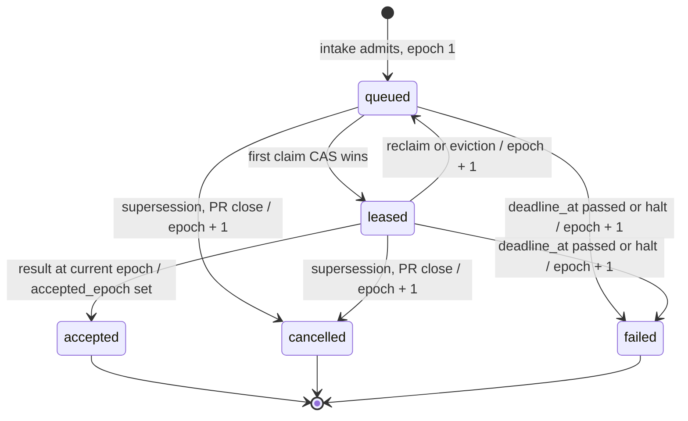
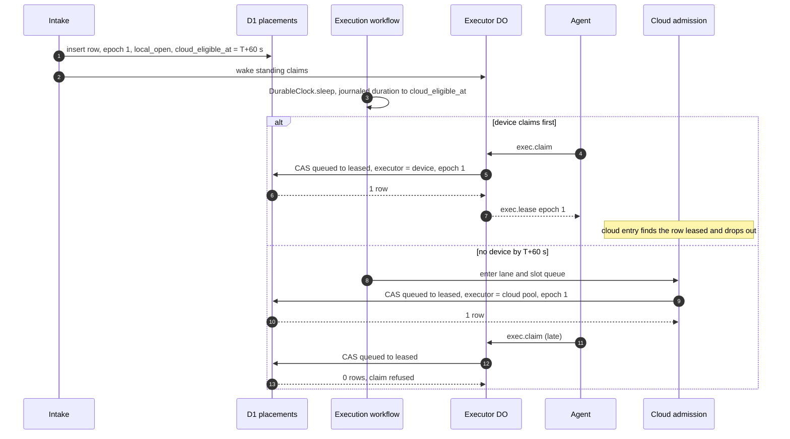
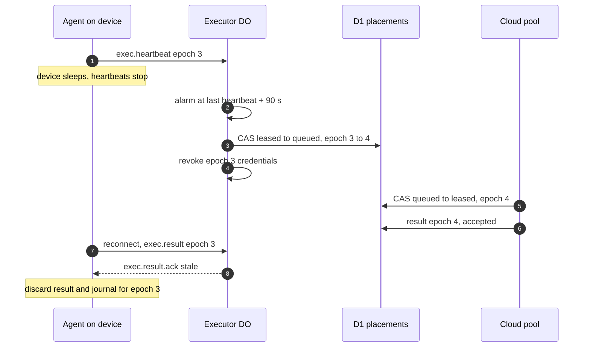
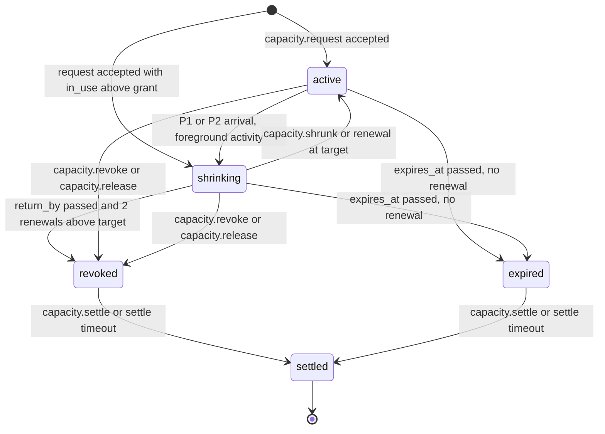
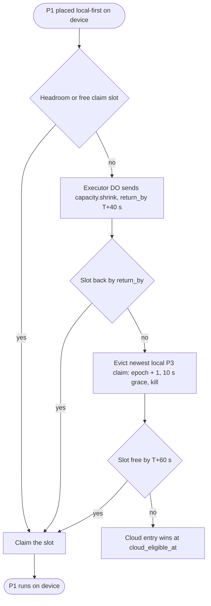

# Placement and leases

This file specifies how the control plane decides where an execution runs and how it keeps exactly one result per execution: the executor registry, the placement row with its delayed cloud claim, the fenced execution lease and its epochs, the capacity lease, the slot ledger on a device, and preemption by class.

## Scope

This file covers the control plane's view of every executor and every lease. It specifies which executor may hold an execution, how a lease is granted, renewed, reclaimed and fenced, which result the control plane accepts, and how a device divides its slots between control-plane claims and a capacity lease. The wire messages that carry these decisions are in [executor-protocol.md](executor-protocol.md).

It depends on:

- [qos-admission.md](qos-admission.md) for classes, `resolveClass`, placement constraints, `deadline_at`, claim deadlines, staleness points and queue-then-fail;
- [spend.md](spend.md) for holds, reservations, the P3 line and the model allowance a lease carries;
- [executors.md](executors.md) for what each executor kind does with a lease, capability labels, workspace naming and the stop at `deadline_at`;
- [isolation-egress.md](isolation-egress.md) for the per-lease credentials a lease carries;
- [engine.md](engine.md) for the `Execution` workflow that awaits a result;
- [github-output.md](github-output.md) for the outbox that applies a run's intents;
- [local-scheduler.md](local-scheduler.md) for the work a device runs inside a capacity lease;
- [operability.md](operability.md) for the operator controls that set drain and quarantine.

The decisions behind this file are [ADR-0001](adr/0001-local-first-control-plane.md) (fleet-first, two-level scheduling), [ADR-0005](adr/0005-qos-classes-queue-then-fail.md) (classes and queue-then-fail), [ADR-0007](adr/0007-fenced-execution-leases.md) (fenced execution leases) and [ADR-0008](adr/0008-executor-transport.md) (executor transport). [ADR-0018](adr/0018-formal-models.md) names the Lean models behind the `V-PROOF` tags here.

## Model

### Executor registry

The `executors` table in D1 holds one row per executor. A Cloudflare Container class is one executor whose capacity is its pool's admission cap, strictly below its `max_instances` ([qos-admission.md](qos-admission.md) FD-QOS-040); a device is one executor whose capacity comes from its slot ledger.

| Field | Meaning |
| --- | --- |
| `executor_id` | Stable id. For a device, assigned at enrollment; for a Container class, the class name |
| `kind` | Executor kind: `cloudflare`, `device`, `aws` or `gha` |
| `posture_tier` | `attested-dedicated`, `managed-workstation` or `unmanaged`, read from MDM through the fabric. Always `attested-dedicated` for a `cloudflare` executor |
| `labels` | Capability labels from [executors.md](executors.md) § Capability labels (`linux-arm64`, `macos-arm64`, `browser`, …) |
| `slots` | Slots per pool (`lean`, `browser`, `agent`, `release`, `control`) and per class (P0–P3), plus the device total |
| `last_heartbeat_at` | Control-plane time of the last heartbeat from the executor |
| `last_progress_at` | Control-plane time of the last step change or log growth on any of its leases |
| `drain` | Set by the operator or by the agent; the executor finishes what it holds and takes nothing new |
| `quarantine` | Set by the operator; the executor holds nothing |
| `key_fingerprint` | SHA-256 fingerprint of the TLS client certificate the agent connects with (`device` only); its key is a file-held P-256 key, not the device key ([executors.md](executors.md) FD-EXEC-101) |
| `protocol_version` | The protocol version negotiated on the executor's current connection |

An executor is **present** while its `last_heartbeat_at` is at most 30 s old (two missed 15 s heartbeats), its `drain` and `quarantine` flags are clear, and its posture tier is not `unmanaged`. Presence gates new claims; the execution-lease TTL governs reclaim.

### Placement row

The `placements` table in D1 holds one row per execution. Every change to a row is one conditional `UPDATE` that names the expected `state` and `epoch`; that compare-and-set is the only way an execution moves between executors.

| Field | Meaning |
| --- | --- |
| `execution_id` | Primary key |
| `class`, `constraints` | From [qos-admission.md](qos-admission.md), fixed at intake |
| `eligible_kinds` | The executor kinds `placementPolicy` allows for this class and these constraints |
| `deadline_at` | The execution's only deadline |
| `local_open` | Whether a device may claim the row |
| `cloud_eligible_at` | When the cloud entry joins the lane and slot queue; null when no cloud executor is eligible |
| `epoch` | Starts at 1. A reclaim, eviction or cancellation increments it |
| `state` | `queued`, `leased`, `accepted`, `cancelled` or `failed` |
| `executor_id` | The lease holder while `leased` |
| `leased_at`, `enqueued_at` | Control-plane times |
| `accepted_epoch` | The epoch of the accepted result; set once |
| `cache_read_namespaces` | The cache namespaces the execution may read, assigned at placement ([cache-artifacts.md](cache-artifacts.md) FD-CACHE-015) |
| `cache_write_namespace` | The one cache namespace the execution may write, assigned at placement |
| `policy_version` | The version of the policy snapshot the placement was computed from |
| `confidentiality_mode` | The repository's confidentiality mode in that snapshot, which the model gateway reads ([model-gateway.md](model-gateway.md) FD-MDL-007) |

An unplaceable request never gets a placement row; intake concludes it ([intake.md](intake.md) FD-INT-013).

An execution lease is identified by `(execution_id, epoch)`, written `lease_id` = `<execution_id>:<epoch>`. A grant happens at most once per epoch, because after a grant only a reclaim, eviction or cancellation changes the row, and each of those increments the epoch.

**A placement row moves only by compare-and-set; every move off an executor increments the epoch**

*placement row · one CAS per move; `accepted` is final and no later event changes it.*

### Delayed cloud claim

Local-first placement is a delayed cloud claim, and at most one copy runs. The row carries a local entry that a device may claim at once and a cloud entry that joins the cloud lane and slot queue at `cloud_eligible_at`. Joining the queue is not admission: until a cloud admission's CAS succeeds, a device that frees up may still claim the row. The first CAS from `queued` to `leased` wins; every later claim at that epoch is refused.

| Class or constraint | `local_open` | `cloud_eligible_at` |
| --- | --- | --- |
| P0, `cloud-pinned`, `stranger-code`, `cloud-only` | false | intake time |
| P1 | true | intake + 60 s; intake time on a predicted miss |
| P2 | true | intake + 300 s; intake time on a predicted miss |
| P3 | true | `stale_at`, the staleness point |
| `confidential-compute` | true | null |
| `local-only` | true | null |

A constraint row overrides the class row. `cloud_eligible_at` is null whenever `eligible_kinds` holds no cloud kind.

A **predicted miss** holds when no present, eligible device has a free claim slot for the class, or when the predicted local wait exceeds the class claim deadline.

**The cloud entry waits for its instant; whichever CAS lands first takes the only lease**

*delayed cloud claim · one row, two entries, one winning CAS.*

### Execution lease

An execution lease is the right to run one execution for one epoch. The executor heartbeats every 15 s. The lease TTL is 90 s, counted from the later of the lease's last heartbeat and the executor DO's restart anchor ([executor-protocol.md](executor-protocol.md) § Restart anchor), so a dispatcher deploy that restarts every executor DO starts a fresh 90 s for every lease instead of expiring it. The same rules apply to every executor kind; for `cloudflare`, the Container's Durable Object holds the lease on the Container's behalf.

A lease ends in exactly one of five ways:

| End | Trigger | Row change | What runs next |
| --- | --- | --- | --- |
| Accepted | A result at the current epoch from the holder | `leased` → `accepted` | Outbox applies intents; spend settles |
| Reclaimed | TTL missed, stall, `exec.release`, `exec.refused`, quarantine | `leased` → `queued`, epoch + 1 | P0–P2 with a cloud kind restart in the cloud under the re-admission of [spend.md](spend.md) FD-SPD-043; P3 and device-only work requeue locally |
| Evicted | A P1 needs the slot and no other slot frees | `leased` → `queued`, epoch + 1 | The P3 requeues locally; the eviction is not a retry |
| Cancelled | Supersession, PR close, parent ended, operator cancel | → `cancelled`, epoch + 1 | Nothing |
| Failed | `deadline_at` passes, or an operator halt ends the execution | → `failed`, epoch + 1 | Nothing; the verdict is `failure(deadline)` or `failure(halt)` |

A reclaimed execution restarts from its first step on the next executor, with an empty journal. Within one lease, an agent that crashes resumes the run from its local journal for that epoch.

**A late executor's result reaches the control plane after its epoch is gone**

*reclaim · epoch 3 is fenced the moment epoch 4 exists; the late result applies nothing.*

### Capacity lease

A capacity lease grants one device slots, memory, local-model streams and a hosted-model allowance for unguaranteed work, for a 10 min TTL renewed every 150 s (TTL/4). It is a D1 record in `capacity_leases` that only the control plane writes; the device holds a credential bound to the lease id, the epoch and the local scheduler's device-bound key, and cannot mint, extend or widen it. Its cloud-spend allowance is 0. Its epoch increments on revoke, release, expiry and reissue, and stays unchanged on renew, shrink, grow and resume after a reconnect.

| `capacity_leases` field | Meaning |
| --- | --- |
| `lease_id` | A ULID assigned at the first grant; unchanged across epochs |
| `executor_id` | The device that holds the capacity lease |
| `epoch` | Integer, starts at 1; changes as stated above |
| `state` | `active`, `shrinking`, `revoked`, `expired` or `settled` |
| `cnf` | SHA-256 thumbprint of the local scheduler's device-bound key; every call proves possession of it |
| `classes` | The local classes the capacity lease admits ([local-scheduler.md](local-scheduler.md) FD-LOCAL-014) |
| `members` | Member identities, each with the Unix uid and tailnet login that map to it (FD-LOCAL-030) |
| `slots` | Granted slots per pool |
| `memory_mib` | Memory, in MiB, that the VMs under the capacity lease may use together |
| `local_model_streams` | Concurrent streams granted on the device's local model server |
| `hosted_model_allowance_micro_usd` | Hosted-model allowance in micro-USD, reserved against the P3 line ([spend.md](spend.md) FD-SPD-049) |
| `cloud_spend_allowance_micro_usd` | Cloud-spend allowance in micro-USD; always 0 (FD-LEASE-046) |
| `offline_slots` | Executions, as a count, the local scheduler may run in offline mode (FD-LOCAL-063) |
| `offline_max_ms` | Longest offline mode in milliseconds, default 86 400 000 (FD-LOCAL-069) |
| `expires_at` | Control-plane time at which the capacity lease expires without a renewal |
| `seq` | The last accepted `seq`, monotonic per `lease_id` across epochs |
| `return_by` | Control-plane time by which the device meets a pushed shrink; null when no shrink is pending |
| `shrink_target` | Target `slots` per pool and `memory_mib` of the pending shrink; null when none |

**A capacity lease shrinks on demand and is revoked when it does not**

*capacity lease · shrink is the fast path, revoke the backstop; settle closes each epoch once.*

### Slot ledger

The agent owns one persisted slot ledger per device. It counts claim slots per class and capacity-lease slots per pool against the device total. The control plane never trusts a slot count it did not see: the claim CAS counts the executor's `leased` placements plus its granted capacity-lease slots against the device total, and the agent reports its true `in_use` on every heartbeat.

Per-device defaults, set in the registry row and replaced per device:

| Setting | Default on an 8-slot device |
| --- | --- |
| P1 headroom slots, never taken by P2, P3 or a capacity lease | 2 |
| P2 claim slots | at most 3 |
| P3 claim slots | at most 5 |
| P2 + P3 claim slots | at most 6 |
| Capacity-lease slots | at most total − headroom − claim slots in use |

The heartbeat's activity signal changes what the control plane offers. Activity means HID idle under 2 min (screen sharing included), camera or microphone in use, or a display-sleep assertion held by another app.

| Device state | P1 | P2 | P3 |
| --- | --- | --- | --- |
| Active | 2 new claims | 1 new claim | 0; running P3 claims are evicted |
| Idle ≥ 10 min | Full partition | Full partition | Full partition |
| Configured idle hours | Full partition | Full partition | At least 1 slot kept for P3 |
| Memory pressure `warning` | No new claims | No new claims | Running P3 claims are evicted |
| Memory pressure `critical`, thermal `serious` or worse, Low Power Mode | Total halved | Total halved | Running P3 claims are evicted |

### Preemption by class

Preemption happens only on owned devices and only to make room for a P1 or P2 claim. No cloud execution that holds a slot is ever stopped to admit another.

**A P1 on a full device climbs four steps; each costs more than the one before**

*P1 preemption · headroom, then shrink, then evict a P3, then spill; P2 stops after the shrink and P3 preempts nothing.*

| Arriving class | May take | May send `capacity.shrink` | May evict | Spills at |
| --- | --- | --- | --- | --- |
| P1 | Headroom or free claim slot | Yes, `return_by` T+40 s | Newest local P3 claim, at `return_by` | T+60 s |
| P2 | Free claim slot only | Yes | Nothing | T+300 s |
| P3 | Free claim slot only | No | Nothing | `stale_at` |

## Requirements

### Executor registry

- **FD-LEASE-001** · phase 0 · `V-UNIT` `V-CONF` — The control plane must keep exactly one `executors` row per executor, carrying `executor_id`, `kind`, `posture_tier`, `labels`, `slots`, `last_heartbeat_at`, `last_progress_at`, `drain`, `quarantine`, `key_fingerprint` and `protocol_version`.
- **FD-LEASE-002** · phase 0 · `V-DEPLOY` `V-UNIT` — When the dispatcher deploys, the control plane must write one `executors` row of kind `cloudflare` per Container class, with per-class slots from that pool's per-class caps in [qos-admission.md](qos-admission.md) and a slot total equal to the pool's admission cap, which [qos-admission.md](qos-admission.md) FD-QOS-040 bounds.
- **FD-LEASE-003** · phase 1 · `V-UNIT` `V-SIM` — The control plane must treat an executor as present only while its `last_heartbeat_at` is at most 30 s old, its `drain` and `quarantine` flags are clear and its `posture_tier` is not `unmanaged`.
- **FD-LEASE-004** · phase 1 · `V-UNIT` — If an executor's `posture_tier` is `unmanaged`, then the control plane must advertise 0 claim slots and must grant it no capacity lease.
- **FD-LEASE-005** · phase 1 · `V-UNIT` `V-SIM` — When a heartbeat reports a change in activity state, memory pressure, thermal state or power source, the control plane must recompute the executor's claim slots per class from the activity table in § Slot ledger before it serves the next claim.
- **FD-LEASE-006** · phase 1 · `V-UNIT` — If a heartbeat reports free disk below the device's free-disk floor, then the control plane must advertise 0 claim slots for that executor until a heartbeat reports free disk at or above the floor.
- **FD-LEASE-007** · phase 1 · `V-UNIT` `V-CONF` — The control plane must grant an execution lease only to an executor whose capability manifest ([executors.md](executors.md)) serves every capability service in the run's `requires` and whose `labels` contain every capability label the run definition declares.

### Placement policy

- **FD-LEASE-008** · phase 0 · `V-UNIT` `V-CONF` — When intake admits an execution, the control plane must write exactly one `placements` row keyed by `execution_id`, with `epoch` = 1 and `state` = `queued`, in the same D1 batch as the execution's admission row.
- **FD-LEASE-009** · phase 0 · `V-PROOF` `V-DIFF` `V-UNIT` — The control plane must compute a placement's `eligible_kinds` with the pure kernel `placementPolicy` from its class and placement constraints, and must not grant an execution lease to an executor whose kind is outside `eligible_kinds`.
- **FD-LEASE-010** · phase 0 · `V-PROOF` `V-DIFF` — The control plane must not grant an execution lease for a P0 execution, or for an execution that carries `stranger-code` or `cloud-pinned`, to an executor of kind `device`.
- **FD-LEASE-011** · phase 1 · `V-PROOF` `V-DIFF` — The control plane must not grant an execution lease for a `confidential-compute` execution to an executor of kind `cloudflare`, `aws` or `gha`.
- **FD-LEASE-012** · phase 0 · `V-CONF` `V-SIM` — The control plane must change a placement row's `state`, `epoch` or `executor_id` only through one conditional `UPDATE` whose `WHERE` clause names the row's expected `state` and `epoch`.
- **FD-LEASE-013** · phase 1 · `V-SIM` `V-CONF` — The claim CAS must re-check, inside the same conditional `UPDATE`, that the claiming executor's kind is in `eligible_kinds` and that its leased claim slots for the class plus its granted capacity-lease slots stay within its slot caps and device total.

### Delayed cloud claim

- **FD-LEASE-014** · phase 0 · `V-UNIT` `V-PROOF` — When intake writes a placement for a P0 execution, or for an execution that carries `cloud-pinned`, `stranger-code` or `cloud-only`, the control plane must set `local_open` to false and `cloud_eligible_at` to the intake time.
- **FD-LEASE-015** · phase 0 · `V-UNIT` — When intake writes a P3 placement, the control plane must set `local_open` to true and `cloud_eligible_at` to the execution's `stale_at`, unless `eligible_kinds` holds no cloud kind, in which case `cloud_eligible_at` is null (FD-LEASE-019).
- **FD-LEASE-016** · phase 2 · `V-UNIT` `V-SIM` — When intake writes a P2 placement and no predicted miss holds, the control plane must set `local_open` to true and `cloud_eligible_at` to the intake time + 300 s.
- **FD-LEASE-017** · phase 3 · `V-UNIT` `V-SIM` — When intake writes a P1 placement and no predicted miss holds, the control plane must set `local_open` to true and `cloud_eligible_at` to the intake time + 60 s.
- **FD-LEASE-018** · phase 2 · `V-UNIT` `V-SIM` — If a predicted miss holds for a P1 or P2 placement at intake, then the control plane must set `cloud_eligible_at` to the intake time.
- **FD-LEASE-019** · phase 0 · `V-UNIT` `V-PROOF` — When intake writes a placement whose `eligible_kinds` holds no cloud kind (`confidential-compute`, `local-only`), the control plane must set `cloud_eligible_at` to null.
- **FD-LEASE-020** · phase 2 · `V-SIM` — When `cloud_eligible_at` passes for a `queued` placement, the `Execution` workflow must wake from `DurableClock.sleep` for the journaled duration until that instant ([engine.md](engine.md) FD-ENG-050) and enter the cloud entry in the lane and slot queue, and may poll the row only to recover a missed wake.
- **FD-LEASE-021** · phase 2 · `V-SIM` — While a placement is `queued` and no cloud admission's CAS has succeeded, the control plane must keep its local entry claimable when `local_open` is true.
- **FD-LEASE-022** · phase 0 · `V-SIM` `V-CONF` `V-PROOF` — When several claims race for one `queued` placement, the control plane must grant the execution lease to the first conditional `UPDATE` from `queued` to `leased` and must refuse every other claim at that epoch.
- **FD-LEASE-023** — Removed; see [spend.md](spend.md) FD-SPD-043.

### Claim order

- **FD-LEASE-024** · phase 1 · `V-UNIT` `V-SIM` — When a claim matches several eligible `queued` placements, the control plane must choose by class rank, then by the repository's count of `leased` placements in that class ascending, then by `enqueued_at`.
- **FD-LEASE-025** · phase 1 · `V-UNIT` — When a P3 placement has waited past 75 % of the span from `enqueued_at` to `stale_at`, the control plane must rank it ahead of newer P3 placements and must not rank it above any P2 placement.
- **FD-LEASE-026** · phase 4 · `V-UNIT` — Where a device has an owner in the registry, the control plane must offer that owner's placements to the device before other members' placements of the same class.

### Execution lease

- **FD-LEASE-027** · phase 0 · `V-CONF` — The control plane must apply the heartbeat, TTL, epoch, reclaim and result-acceptance rules of this section to every executor kind.
- **FD-LEASE-028** · phase 0 · `V-SIM` `V-UNIT` — The control plane must treat an execution lease as expired when 90 s have passed since the later of the lease's last heartbeat and the restart anchor of the executor DO that holds it.
- **FD-LEASE-029** · phase 0 · `V-PROOF` `V-DIFF` `V-SIM` — When an execution lease expires, the control plane must reclaim it by changing the row from `leased` to `queued` and incrementing `epoch` in one conditional `UPDATE`.
- **FD-LEASE-030** · phase 1 · `V-SIM` — If a leased execution shows no step change and no log growth for its progress timeout, default 300 s and set per run, then the control plane must reclaim it.
- **FD-LEASE-031** · phase 1 · `V-SIM` — When an executor sends `exec.release` or `exec.refused` for a lease at the current epoch, the control plane must reclaim that lease at once, without waiting for the TTL.
- **FD-LEASE-032** · phase 2 · `V-SIM` — When the control plane reclaims a P0, P1 or P2 execution whose `eligible_kinds` hold a cloud kind, the control plane must set `local_open` to false and `cloud_eligible_at` to the reclaim time; otherwise FD-LEASE-034 applies.
- **FD-LEASE-033** · phase 1 · `V-SIM` — When the control plane reclaims a P3 execution, the control plane must keep `local_open` true and `cloud_eligible_at` unchanged: its `stale_at`, or null under FD-LEASE-019.
- **FD-LEASE-034** · phase 1 · `V-SIM` `V-PROOF` — When the control plane reclaims an execution whose `eligible_kinds` hold no cloud kind (`confidential-compute`, `local-only`), the control plane must keep `cloud_eligible_at` null and reopen only its local entry.
- **FD-LEASE-035** · phase 0 · `V-CONF` `V-SIM` — When an execution is leased at an epoch above 1, the executor must start the run from its first step with an empty journal and must not read a journal written under an earlier epoch.
- **FD-LEASE-036** · phase 1 · `V-CONF` — While an agent holds a current execution lease, the agent may resume that execution after its own restart from the journal it wrote for that epoch.
- **FD-LEASE-037** · phase 0 · `V-PROOF` `V-DIFF` `V-SIM` — When a result arrives, the control plane must accept it only if its epoch equals the row's `epoch`, the row is `leased` to the sending executor, and `accepted_epoch` is null, and must set `state` to `accepted` and `accepted_epoch` in the same conditional `UPDATE`.
- **FD-LEASE-038** · phase 0 · `V-PROOF` `V-SIM` `V-MEASURE` — If a result or an intent batch carries an epoch below the row's `epoch`, then the control plane must discard it, apply none of its intents or artifacts, and count one epoch discard on the execution.
- **FD-LEASE-039** · phase 0 · `V-PROOF` `V-DIFF` — If a row is `accepted`, then the control plane must not reclaim, evict, cancel or change its `accepted_epoch`, and must leave the accepted result unchanged on every later result for that execution.
- **FD-LEASE-040** · phase 0 · `V-UNIT` `V-CONF` — The control plane must read logs and artifacts for an accepted execution only from object keys that carry its `accepted_epoch`, under the key rules in [cache-artifacts.md](cache-artifacts.md) § Artifacts and logs.
- **FD-LEASE-041** — Removed; see [isolation-egress.md](isolation-egress.md) FD-ISO-048.
- **FD-LEASE-042** · phase 1 · `V-CONF` `V-SIM` — When the control plane reclaims, evicts, cancels or fails an execution lease, the control plane must revoke every credential minted for that epoch before it grants the next epoch.
- **FD-LEASE-043** · phase 0 · `V-UNIT` `V-PROOF` — When an execution is cancelled by supersession, PR close, its parent's end or an operator cancel, the control plane must set `state` to `cancelled` and increment `epoch` in one conditional `UPDATE`.
- **FD-LEASE-067** · phase 0 · `V-UNIT` `V-SIM` — When `deadline_at` passes for an execution whose row is not `accepted`, or an operator halt ends it, the control plane must set `state` to `failed` and increment `epoch` in one conditional `UPDATE`.
- **FD-LEASE-044** · phase 0 · `V-UNIT` `V-REPLAY` — When the control plane accepts a result or reclaims a lease, the control plane must complete the execution's `DurableDeferred` named for that epoch, with the verdict on acceptance and with a `LeaseReclaimed` failure on reclaim.

### Capacity lease

- **FD-LEASE-045** · phase 1 · `V-UNIT` `V-CONF` — The control plane must keep at most one capacity lease in state `active` or `shrinking` per executor.
- **FD-LEASE-046** · phase 1 · `V-PROOF` `V-UNIT` — The control plane must set every capacity lease's `cloud_spend_allowance_micro_usd` to 0 and must reject any grant, renewal or grow that sets it above 0.
- **FD-LEASE-047** · phase 1 · `V-UNIT` `V-SIM` — The control plane must grant a capacity lease a TTL of 10 min and must extend it only on a `capacity.renew` that carries the lease's current epoch and a `seq` above the last accepted `seq`.
- **FD-LEASE-048** · phase 1 · `V-UNIT` `V-PROOF` — The control plane must increment a capacity lease's epoch on revoke, release, expiry and reissue, and must not change it on renew, shrink, grow or resume.
- **FD-LEASE-049** · phase 1 · `V-CONF` — If a capacity-lease credential's signature does not verify against the control plane's key, or its epoch is not current, or its `exp` has passed, then the control plane must reject every call made with it.
- **FD-LEASE-050** · phase 1 · `V-UNIT` `V-SIM` — The control plane must grant a capacity lease at most the device total minus the P1 headroom slots minus the claim slots in use per pool.
- **FD-LEASE-051** · phase 1 · `V-SIM` — If `return_by` has passed and the two renewals after it both report `in_use` above the shrink target, then the control plane must revoke the capacity lease with reason `shrink-missed`.
- **FD-LEASE-052** · phase 1 · `V-UNIT` — If a capacity lease's `expires_at` passes with no accepted renewal, then the control plane must set its state to `expired`.
- **FD-LEASE-053** · phase 1 · `V-UNIT` — When the operator sets `halt-all`, sets the executor's drain flag, quarantines the executor, removes the device, or a posture sync reports the device failing, the control plane must revoke the executor's capacity lease.
- **FD-LEASE-054** · phase 1 · `V-UNIT` `V-CONF` — The control plane must accept `capacity.settle` at most once per `(lease_id, epoch)`, including after the capacity lease has expired.

### Slot ledger

- **FD-LEASE-055** · phase 1 · `V-UNIT` `V-CONF` — The agent must keep one slot ledger per device, persisted on disk, that counts claim slots per class and capacity-lease slots per pool against the device total.
- **FD-LEASE-056** · phase 1 · `V-SIM` `V-UNIT` — The control plane must keep the device's P1 headroom slots, default 2, free of P2, P3 and capacity-lease work.
- **FD-LEASE-057** · phase 1 · `V-UNIT` — The control plane must cap a device's P2 claim slots, P3 claim slots and their sum at the values in its registry row, defaulting to 3, 5 and 6 on an 8-slot device.

### Preemption

- **FD-LEASE-058** · phase 3 · `V-SIM` — When a P1 execution is placed local-first on a device with no free headroom or claim slot, the executor DO must send `capacity.shrink` with `return_by` 40 s after the placement, without waiting for the next renewal.
- **FD-LEASE-059** · phase 3 · `V-SIM` — If a P1 execution still has no device slot at `return_by`, then the control plane must evict the newest running P3 claim on that device by incrementing its epoch, sending `exec.cancel` with a 10 s grace, and requeuing it locally without counting a retry.
- **FD-LEASE-060** · phase 2 · `V-SIM` — When a P2 execution is placed local-first on a device, the control plane must take only a free claim slot and may send `capacity.shrink`, and must not evict any control-plane claim.
- **FD-LEASE-061** · phase 1 · `V-UNIT` `V-SIM` — The control plane must not send `capacity.shrink` or evict any execution on behalf of a P3 placement.
- **FD-LEASE-062** · phase 0 · `V-UNIT` — The control plane must not stop a cloud execution that holds a slot in order to admit another execution.
- **FD-LEASE-063** · phase 1 · `V-SIM` — When a heartbeat reports the device active, under memory pressure `warning` or worse, or in Low Power Mode, the control plane must evict that device's running P3 claims and must leave its P1 and P2 leases running.

### Drain and quarantine

- **FD-LEASE-064** · phase 1 · `V-SIM` `V-UNIT` — While an executor's `drain` flag is set, the control plane must grant it no new execution lease and must leave its current execution leases running until each ends.
- **FD-LEASE-065** · phase 1 · `V-UNIT` `V-SIM` — When an operator quarantines an executor, the control plane must reclaim each of its execution leases, revoke its capacity lease and grant it nothing until the quarantine clears.

### Measurement

- **FD-LEASE-066** · phase 1 · `V-MEASURE` — The control plane must record per execution the claim latency, the kind of the executor whose result was accepted, the number of epochs, the number of epoch discards and whether the cloud entry won.

## Open items

- TODO(maintainer): confirm the heartbeat and TTL defaults (15 s, 90 s) and the P1 eviction timings (`return_by` T+40 s, 10 s grace) against a mixed-workload scenario of the `V-SIM` fleet simulation ([verification.md](verification.md)) before phase 3 opens.
- TODO(maintainer): decide which executor's capacity lease pays for work that crosses devices before members' devices pool claims in phase 4; the default is the executing device's capacity lease, with the accepting scheduler recording the submitter.
- TODO(maintainer): the Cloudflare Container executor serves every phase 0 execution, so the phase 0 rows here (registry, placement row, fence, reclaim) open with it; align the phase column of the index in [README.md](README.md).
