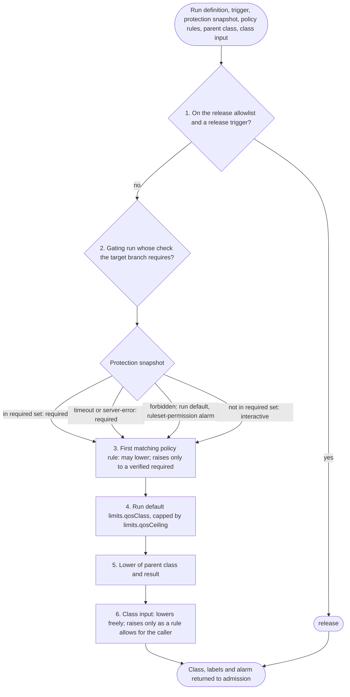

# Profile

FlareDispatch's application profile on mameko: the class catalogue P0 to P3, `resolveClass`, dedup and supersession recipes, pool and device slot values, placement constraints, the outcome mapping onto check-run conclusions, the intent kinds, delivery and gate policy, the approval floor, egress profiles, signing purposes, reason kinds and the spend configuration. mameko's [profiles.md](https://github.com/fractalboxdev/mameko/blob/2c3041335db0cf4a2193e5b11827f20631d54e87/specs/profiles.md) fixes the schema and the profile validator; this file states FlareDispatch's values, and `packages/profile/src/document.ts` holds them as the document the configuration source delivers.

## Scope

This file covers every value FlareDispatch sets in mameko's `Profile` schema, the spend amounts the class `reserve` and `line` fields name, the per-device slot defaults and the pool admission caps. The mechanisms that read these values are mameko's: admission, class resolution, placement constraints, queue-then-fail and supersession in [admission-qos.md](https://github.com/fractalboxdev/mameko/blob/2c3041335db0cf4a2193e5b11827f20631d54e87/specs/admission-qos.md); delayed cloud claim, leases, the slot ledger and preemption in [placement-leases.md](https://github.com/fractalboxdev/mameko/blob/2c3041335db0cf4a2193e5b11827f20631d54e87/specs/placement-leases.md); holds, lines and burn lanes in [spend.md](https://github.com/fractalboxdev/mameko/blob/2c3041335db0cf4a2193e5b11827f20631d54e87/specs/spend.md); intents and the drainer in [outbox.md](https://github.com/fractalboxdev/mameko/blob/2c3041335db0cf4a2193e5b11827f20631d54e87/specs/outbox.md). It depends on:

- [github-output.md](github-output.md) for what each intent kind and conclusion does on GitHub;
- [intake.md](intake.md) for the triggers that reach class resolution and for check re-runs;
- [spend.md](spend.md) for FlareDispatch's spend decisions beyond these values;
- [isolation-egress.md](isolation-egress.md) for the `gha` runner rules beside the approval floor and egress profiles;
- [provenance.md](provenance.md) for the reproduction execution and the signed statement;
- [model-gateway.md](model-gateway.md) for `needsModel` and confidentiality modes.

The decisions behind the mechanisms are mameko's [ADR-0007](https://github.com/fractalboxdev/mameko/blob/2c3041335db0cf4a2193e5b11827f20631d54e87/specs/adr/0007-classes-queue-then-fail.md) (classes and queue-then-fail), [ADR-0008](https://github.com/fractalboxdev/mameko/blob/2c3041335db0cf4a2193e5b11827f20631d54e87/specs/adr/0008-executor-aware-spend.md) (executor-aware spend), [ADR-0009](https://github.com/fractalboxdev/mameko/blob/2c3041335db0cf4a2193e5b11827f20631d54e87/specs/adr/0009-fenced-execution-leases.md) (fenced execution leases) and [ADR-0017](https://github.com/fractalboxdev/mameko/blob/2c3041335db0cf4a2193e5b11827f20631d54e87/specs/adr/0017-application-profiles.md) (policy as data).

## Model

### The profile document

`ConfigurationSourceLive` in `packages/profile` implements mameko's configuration source port: it delivers one document, the committed `profile` value of `document.ts`, under the policy version `flare-dispatch.v2.0`. `loadProfile` decodes it under mameko's `Profile` schema and runs the profile validator before any value takes effect ([MAMEKO-PROF-003](https://github.com/fractalboxdev/mameko/blob/2c3041335db0cf4a2193e5b11827f20631d54e87/specs/profiles.md)). The spend amounts and the per-device slot defaults sit beside the document in `spendDefaults` and `deviceSlotDefaults`, because mameko reads spend amounts from the spend configuration and slot counts from the executor's registry row.

| Item | Value |
| --- | --- |
| `policy_version` | `flare-dispatch.v2.0` |
| Tenant scope | A GitHub repository, `<owner>/<repo>`; an `exec.lease` names it as the scope id and carries the commit SHA in its inputs |
| `host` | `host-cloudflare`, features `cloudflare-containers` and `durable-object-alarms` |
| `registration` | `key_stores: [secure-enclave]`, `attestation: verifier` |
| `cache_namespaces` | Binding `cacheNamespaces` ([cache-artifacts.md](cache-artifacts.md)) |
| `capacity` | `grant: capacityGrant`; `isolation` absent, so `vm` |
| `member_partition` | `true` |
| `supersession_key` | Binding `supersessionKey` |

### Class catalogue

Four classes, all guaranteed. `required` is the one firm class. Every class lists `gha` last in `cloud_kinds`; the declared constraints of § Placement remove `gha` from every run except an `apple-build` run of class `required` and a release-matrix job.

| Class | Rank | Claim deadline | Cloud kinds, in preference order | Line | Reserve |
| --- | --- | --- | --- | --- | --- |
| `release` (P0) | 0 | `none`: cloud at admission | `cloudflare`, `gha` | `budget` | `release-reserve` |
| `required` (P1) | 1 | 60 s; 0 s on a predicted miss | `cloudflare`, `aws`, `gha` | `next-above-less-reserve` | `measured` |
| `interactive` (P2) | 2 | 300 s; 0 s on a predicted miss | `cloudflare`, `gha` | `next-above-less-reserve` | absent: 0 |
| `batch` (P3) | 3 | `staleness`: `stale_after` fraction 0.5, 43200 s (12 h) without a schedule | `cloudflare`, `gha` | `general_band_ratio` 0.45, `floor_ratio` 0.1 | absent: 0 |

| Class | Queue age | Bounds (global, per scope) | Sheddable | Retries | Terminal outcome | Queue-full alarm |
| --- | --- | --- | --- | --- | --- | --- |
| `release` | `run` | 16, 8 | no | `run` | `failure`, `budget: release reserve exhausted` | `p0-breach` |
| `required` | `run` | 150, 60 | no | 1 | `failure`, `budget: required reserve exhausted` | — |
| `interactive` | 1800 s | 40, 10 | yes | 1 | `failure`, `budget` | — |
| `batch` | `staleness` | 30, 1 per (run, repository) | yes | `local-only` | `deferred` | — |

No class declares `device_eligible`, `deadline_offset` or `isolation`, so every class may run on a device and every device execution runs in a sandbox with its own kernel. `reclaim_policy` is `restart` for every class. The tenant scope is a GitHub repository, `<owner>/<repo>`. Ops runs (the canaries and the verdict audit) take class `required` for rank ordering and admit against its line ([MAMEKO-SPD-036](https://github.com/fractalboxdev/mameko/blob/2c3041335db0cf4a2193e5b11827f20631d54e87/specs/spend.md)). FlareDispatch keeps mameko's defaults for lease wait (600 s) and settle margin (300 s) ([MAMEKO-ADM-052](https://github.com/fractalboxdev/mameko/blob/2c3041335db0cf4a2193e5b11827f20631d54e87/specs/admission-qos.md)).

### Class resolution

`resolveClass` is the class-resolution binding. Its declared inputs are `protection-snapshot`, the target branch's ruleset and branch-protection required set, and `policy-rules`, the repository's policy rules; its default class is `batch`. It applies six steps in order.

| Step | Rule |
| --- | --- |
| 1 | A run on the in-code `release` allowlist triggered by a release trigger resolves to `release`. The release triggers are a push of a tag a ruleset protects, a `check_suite` or `deployment_status` event on the default branch, a `push` to a ruleset-protected branch named by `workerDeploy.branch`, an Actions dispatch whose OIDC `ref` is that branch, and a follow-on intent of a `release` execution |
| 2 | A gating run (`check`, `oxlint`, `offload-test`) on `pull_request`, `merge_group` or a `gh-readonly-queue/*` push resolves to `required` when its check name is in the target branch's required set, and to `interactive` when it is not |
| 3 | The first matching policy rule may lower the class, and raises it only to a `required` that step 2 verified and only up to the run's `limits.qosCeiling`, unless the rule lifts the ceiling |
| 4 | The run default `limits.qosClass`, capped at `limits.qosCeiling`; a run that declares no `limits.qosClass` resolves to `batch` with the `local-only` constraint |
| 5 | A child takes the lower of its parent's class and its own result |
| 6 | The dispatch `class` input lowers freely, and raises only as a policy rule allows for the caller's OIDC identity scoped to (repository, workflow ref) on a protected branch |

*resolveClass: the release allowlist first, then the required set, policy rules, the run's own bounds, the parent and the caller's class input; a snapshot that times out or answers a server error fails toward `required`.*

Besides the class, `resolveClass` returns the label `untrusted-input` for a request with trigger `fork-pr`, and the alarm `ruleset-permission` or `required-check-clamped` where FD-PROF-016 or FD-PROF-023 raises one.

### Dedup recipes and supersession

| Recipe | Binding | Returns |
| --- | --- | --- |
| `idempotency-key` | `idempotencyKeyRecipe` | `idem:<owner>/<repo>:<Idempotency-Key>` when the dispatch carries an `Idempotency-Key` header of 1 to 128 characters from `[A-Za-z0-9._:-]`; `none` otherwise. Declares a `digest` binding over the dispatch body and `on_mismatch: conflict` |
| `follow-on` | `followOnRecipe` | `<execution_id>/<intent_key>` for a request a `dispatch.followOn` intent raises; `none` otherwise |
| `commit`, total | `commitRecipe` | `<run>[:<label>]:<owner>/<repo>:<sha>`, without the trigger kind |

`supersessionKey` returns `<owner>/<repo>:<pull request number>:<run>[:<label>]` for a pull-request request of a run that declares `supersede`, and `none` for every other request. The recipes `check`, `oxlint`, `offload-test` and `pr-review` declare `supersede`. FlareDispatch's own cancel causes are `pr-closed` and `merge-group-destroyed`.

### Pools and browser sessions

Each Container pool's admission cap is the runtime adapter's configuration, strictly below its Container class's `max_instances`. The profile's `pools` partitions it by class.

| Pool | Admission cap | `batch` at most | `interactive` at most | `required` | Other |
| --- | --- | --- | --- | --- | --- |
| `lean` | 48 | 4 | 8 | no class cap | — |
| `agent` | 8 | 6 | 6 | at most 8, at least 2 kept | — |
| `browser` | 16 | 4 | 10 | at most 16, at least 2 kept | — |
| `release` | 8 | — | — | — | `reserved_for: release` |
| `control` | 16 | — | — | — | no class cap |

`browser_sessions` caps the hosted browser sessions at 10 in total: `batch` at most 1, `interactive` at most 2, `required` at most 10 with 1 kept.

### Device slot defaults

The registry row of each device carries these defaults for an 8-slot share; each device's row may replace them.

| Setting | Default |
| --- | --- |
| Share total | 8 slots |
| Headroom kept for `required`, the highest-rank device class | 2 |
| `interactive` claim slots | at most 3 |
| `batch` claim slots | at most 5 |
| `interactive` + `batch` claim slots | at most 6 |

### Placement

The generic constraints of [admission-qos.md](https://github.com/fractalboxdev/mameko/blob/2c3041335db0cf4a2193e5b11827f20631d54e87/specs/admission-qos.md) § Placement constraints take these parameters:

| Parameter | Value |
| --- | --- |
| `cloud_pinned` | Class `release`, except a request with the label `release-matrix` |
| `cloud_pinned_kinds` | `cloudflare` |
| `cloud_only` | Trigger `tag-push` |
| `local_only` | A run that declares no class |
| `launcher_kinds` | `gha`, the GitHub Actions launcher |

The profile declares five constraints:

| Constraint | Holds for | Removes | Posture |
| --- | --- | --- | --- |
| `release-matrix` | Label `release-matrix`: a release-matrix job that declares `macos-arm64` | `cloudflare`, `aws`, `device` | — |
| `apple-build` | Label `apple-build`: a run built in a macOS guest | `cloudflare`, `aws` | — |
| `apple-build-gha` | Label `apple-build`, class not `required`, no label `release-matrix` | `gha` | — |
| `gha-apple-only` | Neither label `apple-build` nor label `release-matrix` | `gha` | — |
| `reproduction` | Label `reproduction`: a reproduction execution ([provenance.md](provenance.md) FD-PROV-064) | `cloudflare`, `aws`, `gha` | `attested-dedicated` |

A release-matrix job that declares `macos-arm64` keeps exactly `gha` at every class: `release-matrix` removes every other kind and `cloud-pinned` does not hold for it. An `apple-build` run of class `required` keeps `gha` and `device`; at every other class it keeps `device` alone. `placement.required` lists the release-matrix job, so the profile validator rejects a profile that leaves it unplaceable. `placement.unreachable` lists a reproduction run with `untrusted-input`, `cloud-only` or `expose-port`, and an `apple-build` run with `expose-port`: FlareDispatch creates a reproduction execution from the release, never from a fork pull request or the tag push.

### Outcome mapping

The surface is the check run. Surface values `success`, `failure`, `cancelled` and `neutral`; silent value `neutral`, because branch protection treats a `neutral` conclusion as passing; surface kind `check.conclude`. [github-output.md](github-output.md) FD-GH-021 to FD-GH-029 specify `checkConclusion`, which applies this map.

| Outcome | Conclusion |
| --- | --- |
| `success` | `success` |
| `failure(reason)`, every category (`finding`, `infra`, `budget`, `capacity`, `deadline`, `halt`, `placement`, `unrecorded`, `config`, `policy`) | `failure` |
| `cancelled(cause)`, for `superseded`, `parent-ended`, `operator-cancel`, `pr-closed` and `merge-group-destroyed` | `cancelled` |
| `skipped-listed`: `skipped(not-applicable: <detail>)` with a listed detail | `neutral` |
| `skipped-other`: any other skip | `failure` |
| `deferred` | `{ opened: failure, unopened: none }` |
| `expired` | `failure`; no FlareDispatch class declares it |

The listed details are `draft-pr`, `author-excluded`, `path-filter`, `not-configured`, `nothing-to-lint`, `every-job-skipped` and `empty-range`. A `batch` execution that opened a check run and ends `deferred` concludes it `failure` with the reason `capacity: deferred`.

### Intent kinds

No kind is `reconcile-only` and no kind is `gated`. `check.conclude` is the one kind of tier `outcome` and `check.progress` the one kind of tier `progress`; every other kind is tier `effect`. The marker column is the idempotency marker the applier's `lookup` searches by.

| Kind | Origin | Generated | Priority | Applied for | Flags | Effect class | Applier | Marker | GitHub behaviour |
| --- | --- | --- | --- | --- | --- | --- | --- | --- | --- |
| `check.open` | `control-plane` | `on: admitted`, payload `checkOpenPayload` | 0 | `any` | `opens_surface`, `draws_reserve`, `in_order` | `adoptable` | `checkRun` | `external_id` equal to the execution id | FD-GH-005 |
| `check.start` | `control-plane` | `on: lease-granted`, payload `checkStartPayload` | 1 | `any` | `void_after_outcome`, `in_order` | `adoptable` | `checkRun` | as `check.open` | FD-GH-011 |
| `check.progress` | `control-plane` | `on: progress`, payload `checkProgressPayload`, coalesce key `executionProgressKey` | 0 | `any` | `void_after_outcome`, `in_order` | `adoptable` | `checkRun` | as `check.open` | FD-GH-012 |
| `check.conclude` | `control-plane` | `on: terminal` | 0 | `any` | `in_order`; draws the reserve as an `outcome` kind | `adoptable` | `checkRun` | as `check.open` | FD-GH-014 |
| `check.summary` | `run` | — | 2 | `any` | — | `adoptable` | `checkRun` | The check run found by `external_id` | FD-GH-015 |
| `check.annotations` | `run` | — | 2 | `any` | — | `adoptable` | `checkRun` | Annotations read back by check-run id | FD-GH-018 |
| `comment` | `run` | — | 2 | `any` | — | `adoptable` | `issueComment` | `<!-- flare-dispatch:intent <execution_id>/<intent_key> -->` in the body | FD-GH-092 |
| `review` | `run` | — | 2 | `any` | — | `adoptable` | `pullReview` | as `comment` | FD-GH-092 |
| `issue` | `run` | — | 2 | `any` | — | `adoptable` | `issue` | as `comment` | FD-GH-092 |
| `pr.propose` | `control-plane` | `on: accepted`, payload `prProposePayload` | 2 | `success` | — | `adoptable` | `pullRequest` | The head branch name | FD-GH-080 to FD-GH-084 |
| `release.draft` | `run` | — | 2 | `success` | — | `adoptable` | `release` | The tag name | FD-GH-085 |
| `release.publish` | `run` | — | 2 | `success` | — | `adoptable` | `release` | The tag name | FD-GH-086 |
| `canary.push` | `control-plane` | ops intent | 2 | `any` | `ops` | `adoptable` | `canary` | The tick time in the commit message | FD-GH-089 |
| `delivery.redeliver` | `control-plane` | ops intent | 2 | `any` | `ops` | `adoptable` | `webhookRedelivery` | The delivery's attempts, read back before a repeat | FD-GH-089 |
| `label` | `run` | — | 2 | `any` | — | `replay-safe` | `labels` | — | — |
| `pr.close` | `run` | — | 2 | `any` | — | `replay-safe` | `pullRequest` | — | FD-GH-087 |
| `dispatch.followOn` | `run` | — | 2 | `any` | — | `replay-safe` | `followOn` | — | FD-GH-088 |
| `notify.email` | `both` | — | 2 | `any` | — | `replay-safe` | `notifyEmail` | — | FD-GH-078 |
| `notify.slack` | `both` | — | 2 | `any` | — | `replay-safe` | `notifySlack` | — | FD-GH-078, FD-GH-079 |
| `notice.publish` | `both` | — | 2 | `any` | — | `replay-safe` | `notice` | — | FD-GH-078 |

`delivery` keys the applier rate limit by GitHub App installation through the `installationOf` binding, gives ops intents the class `required`, and names the undelivered-outcome alarm `undelivered-verdict`. `gate_policy` lists no key and caps a decision's expiry at 86400 s.

### Approval floor, egress profiles and signing purposes

The approval floor is mameko's default list ([isolation-egress.md](https://github.com/fractalboxdev/mameko/blob/2c3041335db0cf4a2193e5b11827f20631d54e87/specs/isolation-egress.md) § Approval floor) plus FlareDispatch's release surface:

| Category | Patterns |
| --- | --- |
| mameko default | `git push`, `npm publish`, `pnpm publish`, `yarn publish`, `cargo publish`, `wrangler deploy`, `terraform apply`, `kubectl apply`, `kubectl delete`, `terraform destroy`, `wrangler secret`, `iptables`, `nft`, `pfctl`, `networksetup` |
| FlareDispatch | `wrangler d1`, `gh release` |

| Egress phase | Base grants | Other granted hosts |
| --- | --- | --- |
| `setup` | `package-registries`, `git-remote` | `declared-methods` |
| `agent` | `model-gateway`, `git-remote` | `read-only` |

`signing_purposes` adds `statement`, for the provenance statement a device signs after a job ([provenance.md](provenance.md)), and `cache-entry`, for a cache entry a device writer signs ([cache-artifacts.md](cache-artifacts.md)).

### Reason kinds

`reason_kinds` declares `provenance` in category `policy`: the result-acceptance check rejects a result with `provenance: <check>`, and the execution concludes `failure` with that reason ([MAMEKO-LEASE-090](https://github.com/fractalboxdev/mameko/blob/2c3041335db0cf4a2193e5b11827f20631d54e87/specs/placement-leases.md)).

### Spend configuration

All amounts are micro-USD in the configuration; the tables give them in USD. The operator overlay replaces each default.

| Term | Configuration key | Default |
| --- | --- | --- |
| `B`, the monthly budget and the `release` line | `budget` | 50 USD |
| `F`, fixed monthly charges inside `B` | `fixed` | 0 USD |
| `R(release)`, the release reserve | `reserves.release-reserve` | 10 USD |
| `R_ops`, the ops-run reserve inside `R_m` | `ops_reserve` | 5 USD |
| `R_m,min`, the lower bound of the measured reserve of `required` | `measured_reserve_min` | 20 USD |
| `D`, days of cloud execution during fleet downtime `R_m` covers | `measured_reserve_days` | 10 days |
| Overhead factor | `overhead_factor` | 1.1 |
| `lineRatio`, `floorRatio` of `batch` | the `batch` class `line` | 0.45, 0.1 |

The lines nest as [spend.md](https://github.com/fractalboxdev/mameko/blob/2c3041335db0cf4a2193e5b11827f20631d54e87/specs/spend.md) § Budget, reserves and lines defines them: `release` at `B`, `required` at `B − R(release)`, `interactive` at `B − R(release) − R_m`, and `batch` at 0.45 × `G` with a floor `φ` of 0.1 × `G`, where `G = B − F − R(release) − R_m`. `r`, the metered rate per lean-minute, is one minute on the `lean` pool's instance type.

| Spend setting | Value |
| --- | --- |
| Burn lanes, list USD per hour | `batch` 0.41, `interactive` 0.81, `required` 2.01, `release` 2.82 |
| Firm-hold look-ahead of `required` | 5 queued entries |
| Warn ratio of `B` | 0.8 |
| Unresolved-spend threshold | 5 USD |
| Default price of a hosted model id without a price entry | 75 USD per million tokens |

The rate card has one entry per executor kind:

| Executor kind | Executor time | Model tokens | Phase |
| --- | --- | --- | --- |
| `cloudflare` | The instance type's provisioned vCPU, memory and disk per second from admission to settle, plus the Container Durable Object's duration and egress at the configured per-GB rate | Counted | 0 |
| `device` | 0 | Counted for hosted models; 0 for models on owned hardware | 1 |
| `aws` | Task vCPU and memory rate, public IPv4 per hour, and a network estimate per execution; at least the 60 s minimum charge | Counted | 3 |
| `gha` | The runner's per-minute rate, with a billing increment of 1 min; a per-scope override of 0 for standard runners on public repositories | Counted | 4 |

Workers AI models price at a per-token rate derived from their Neurons price.

### Differences from the reference CI profile

mameko's [profiles.md](https://github.com/fractalboxdev/mameko/blob/2c3041335db0cf4a2193e5b11827f20631d54e87/specs/profiles.md) § The reference CI profile states the values of a CI application on `host-cloudflare`. FlareDispatch's profile differs from it in these values only:

| Item | Reference CI profile | FlareDispatch |
| --- | --- | --- |
| Marker of `comment`, `review`, `issue` | `<!-- ci:intent <execution_id>/<intent_key> -->` | `<!-- flare-dispatch:intent <execution_id>/<intent_key> -->` |
| `browser_sessions.cap` | Not stated | 10 |
| `gate_policy.max_expiry_seconds` | Not stated | 86400 |
| `reason_kinds` | None | `provenance` in category `policy` |
| `idempotency-key` recipe | No `digest`; `on_mismatch` defaults to `duplicate` | `digest` over the dispatch body; `on_mismatch: conflict` |

## Requirements

### Profile document

- **FD-PROF-001** · phase 0 · `V-UNIT` — FlareDispatch's configuration source, the implementation of mameko's configuration source port ([MAMEKO-PROF-002](https://github.com/fractalboxdev/mameko/blob/2c3041335db0cf4a2193e5b11827f20631d54e87/specs/profiles.md)), must deliver the committed profile of `packages/profile/src/document.ts` as one document under policy version `flare-dispatch.v2.0`, holding the values this file states.
- **FD-PROF-002** · phase 0 · `V-UNIT` — FlareDispatch's CI must compare the profile of `document.ts` with mameko's § The reference CI profile at the pinned mameko commit, and must fail on any difference that § Differences from the reference CI profile does not list.
- **FD-PROF-063** · phase 0 · `V-UNIT` — When the control plane grants an execution lease, it must send in `exec.lease` the execution's repository as `<owner>/<repo>` for the scope id and the commit SHA the execution verifies among the inputs ([MAMEKO-PROTO-032](https://github.com/fractalboxdev/mameko/blob/2c3041335db0cf4a2193e5b11827f20631d54e87/specs/executor-protocol.md)).

### Class catalogue

- **FD-PROF-003** · phase 0 · `V-UNIT` — The profile must declare exactly the classes `release` (P0, rank 0), `required` (P1, rank 1), `interactive` (P2, rank 2) and `batch` (P3, rank 3), each guaranteed, with `required` the one firm class, and with the cloud kinds, lines and reserves of § Class catalogue, which admission assigns once per execution ([MAMEKO-ADM-004](https://github.com/fractalboxdev/mameko/blob/2c3041335db0cf4a2193e5b11827f20631d54e87/specs/admission-qos.md)).
- **FD-PROF-004** · phase 0 · `V-UNIT` — The profile must give `release` the claim deadline `none`, `required` 60 s, `interactive` 300 s, and `batch` the claim deadline `staleness` with `stale_after` fraction 0.5 and 43200 s for a run without a schedule, which [MAMEKO-LEASE-020](https://github.com/fractalboxdev/mameko/blob/2c3041335db0cf4a2193e5b11827f20631d54e87/specs/placement-leases.md), [MAMEKO-LEASE-021](https://github.com/fractalboxdev/mameko/blob/2c3041335db0cf4a2193e5b11827f20631d54e87/specs/placement-leases.md) and [MAMEKO-ADM-056](https://github.com/fractalboxdev/mameko/blob/2c3041335db0cf4a2193e5b11827f20631d54e87/specs/admission-qos.md) apply.
- **FD-PROF-005** · phase 0 · `V-UNIT` — The profile must give `release` and `required` the queue age `run`, `interactive` 1800 s and `batch` `staleness` ([MAMEKO-ADM-052](https://github.com/fractalboxdev/mameko/blob/2c3041335db0cf4a2193e5b11827f20631d54e87/specs/admission-qos.md)).
- **FD-PROF-006** · phase 0 · `V-UNIT` — The profile must bound the queue at 16 global and 8 per repository for `release`, 150 and 60 for `required`, 40 and 10 for `interactive`, and 30 global and 1 per (run, repository) for `batch` ([MAMEKO-ADM-040](https://github.com/fractalboxdev/mameko/blob/2c3041335db0cf4a2193e5b11827f20631d54e87/specs/admission-qos.md)).
- **FD-PROF-007** · phase 0 · `V-UNIT` `V-LIVE` — The profile must name `p0-breach` as the `queue_full_alarm` of `release`, and of no other class ([MAMEKO-ADM-085](https://github.com/fractalboxdev/mameko/blob/2c3041335db0cf4a2193e5b11827f20631d54e87/specs/admission-qos.md)).
- **FD-PROF-008** · phase 0 · `V-UNIT` — The profile must give `release` the terminal outcome `failure` with reason `budget: release reserve exhausted`, `required` `failure` with `budget: required reserve exhausted`, `interactive` `failure` with `budget`, and `batch` `deferred`.
- **FD-PROF-009** · phase 0 · `V-UNIT` — The profile must give `release` the retry bound `run`, `required` 1, `interactive` 1 and `batch` `local-only` ([MAMEKO-ADM-077](https://github.com/fractalboxdev/mameko/blob/2c3041335db0cf4a2193e5b11827f20631d54e87/specs/admission-qos.md)).
- **FD-PROF-010** · phase 0 · `V-UNIT` — The profile must mark `interactive` and `batch` sheddable and no other class, and must give every class the reclaim policy `restart` ([MAMEKO-LEASE-052](https://github.com/fractalboxdev/mameko/blob/2c3041335db0cf4a2193e5b11827f20631d54e87/specs/placement-leases.md)).

### Class resolution

- **FD-PROF-011** · phase 0 · `V-UNIT` — The profile must name `resolveClass` as the class-resolution binding with the inputs `protection-snapshot` and `policy-rules` and the default class `batch`, and `resolveClass` must apply the six steps of § Class resolution in order, with no clock, store or service ([MAMEKO-ADM-005](https://github.com/fractalboxdev/mameko/blob/2c3041335db0cf4a2193e5b11827f20631d54e87/specs/admission-qos.md)).
- **FD-PROF-012** · phase 0 · `V-UNIT` — `resolveClass` must not return `release` except for a run on the in-code `release` allowlist triggered by one of the release triggers of step 1.
- **FD-PROF-013** · phase 0 · `V-UNIT` — When a gating run (`check`, `oxlint` or `offload-test`) is triggered by `pull_request`, `merge_group` or a `gh-readonly-queue/*` push, `resolveClass` must return `required` when its check name is in the target branch's required set, unless a later step lowers it, and `interactive` when it is not, whatever its run default.
- **FD-PROF-014** · phase 0 · `V-UNIT` `V-E2E-LOCAL` — FlareDispatch must cache each branch's required set, the `protection-snapshot` input, for at most 10 min, and must refresh it on every `repository_ruleset` and `branch_protection_rule` webhook for that repository.
- **FD-PROF-015** · phase 0 · `V-UNIT` — If the `protection-snapshot` input is `Unavailable` with reason `timeout` or `server-error`, then `resolveClass` must treat the gating run as required.
- **FD-PROF-016** · phase 0 · `V-UNIT` — If the `protection-snapshot` input is `Unavailable` with reason `forbidden`, then `resolveClass` must take the run default and return the alarm `ruleset-permission` ([MAMEKO-ADM-088](https://github.com/fractalboxdev/mameko/blob/2c3041335db0cf4a2193e5b11827f20631d54e87/specs/admission-qos.md)).
- **FD-PROF-017** · phase 0 · `V-UNIT` — A policy rule may lower any class, and may raise a class to `required` only when step 2 verified the check as required and only up to the run's `limits.qosCeiling`, unless the rule lifts the ceiling.
- **FD-PROF-018** · phase 0 · `V-UNIT` — `resolveClass` must cap the run default `limits.qosClass` at `limits.qosCeiling`, and must return `batch` with the label `local-only` for a run whose definition declares no `limits.qosClass`.
- **FD-PROF-019** · phase 0 · `V-UNIT` — `resolveClass` must give a child execution the lower of its parent's class and its own result, before mameko's rank clamp ([MAMEKO-ADM-006](https://github.com/fractalboxdev/mameko/blob/2c3041335db0cf4a2193e5b11827f20631d54e87/specs/admission-qos.md)).
- **FD-PROF-020** · phase 0 · `V-UNIT` — Where a dispatch carries the `class` input, `resolveClass` must apply a lower class as given, and must apply a higher class only up to what a policy rule allows for the caller's OIDC identity scoped to (repository, workflow ref) on a protected branch, logging the requested and the assigned class whenever it clamps.
- **FD-PROF-021** · phase 0 · `V-UNIT` — `resolveClass` must not raise a class above `interactive` because of a pull-request label.
- **FD-PROF-022** · phase 0 · `V-UNIT` — When a check re-run creates a new attempt, the control plane must give it the class of the family's first attempt.
- **FD-PROF-023** · phase 0 · `V-UNIT` `V-LIVE` — If a required check's run makes hosted model calls and its ceiling is below `required`, then `resolveClass` must return its ceiling and the alarm `required-check-clamped`.
- **FD-PROF-024** · phase 0 · `V-UNIT` — When a request has trigger `fork-pr`, `resolveClass` must return the label `untrusted-input` with its class ([MAMEKO-ADM-084](https://github.com/fractalboxdev/mameko/blob/2c3041335db0cf4a2193e5b11827f20631d54e87/specs/admission-qos.md)).
- **FD-PROF-025** · phase 4 · `V-UNIT` `V-DEPLOY` — FlareDispatch's policy sync must reject a policy rule that sets a repository to confidentiality mode `confidential-compute` unless the rule sets `acceptsFailingRequiredCheck: true`, in addition to the device count of [MAMEKO-ADM-020](https://github.com/fractalboxdev/mameko/blob/2c3041335db0cf4a2193e5b11827f20631d54e87/specs/admission-qos.md).

### Dedup and supersession

- **FD-PROF-026** · phase 0 · `V-UNIT` — The profile must declare the dedup recipes `idempotency-key`, `follow-on` and `commit` in that order, `commit` total, with `idempotency-key` declaring a `digest` binding over the dispatch body and `on_mismatch: conflict`, so that a reused `Idempotency-Key` with a different body answers `conflict` ([MAMEKO-ADM-028](https://github.com/fractalboxdev/mameko/blob/2c3041335db0cf4a2193e5b11827f20631d54e87/specs/admission-qos.md), [MAMEKO-ADM-089](https://github.com/fractalboxdev/mameko/blob/2c3041335db0cf4a2193e5b11827f20631d54e87/specs/admission-qos.md)).
- **FD-PROF-027** · phase 0 · `V-UNIT` `V-CONF` — `supersessionKey` must return `<owner>/<repo>:<pull request number>:<run>[:<label>]` for a pull-request request of a run that declares `supersede`, and `none` for every other request ([MAMEKO-ADM-062](https://github.com/fractalboxdev/mameko/blob/2c3041335db0cf4a2193e5b11827f20631d54e87/specs/admission-qos.md)).
- **FD-PROF-028** · phase 0 · `V-UNIT` — The recipes `check`, `oxlint`, `offload-test` and `pr-review` must declare `supersede`.
- **FD-PROF-029** · phase 0 · `V-UNIT` — When a check re-run arrives, `supersessionKey` must return `none`, so that the re-run cancels no member of its run's supersession group.
- **FD-PROF-030** · phase 0 · `V-UNIT` — When a pull request closes, FlareDispatch must cancel every supersession group of that pull request with cause `pr-closed` through [MAMEKO-ADM-065](https://github.com/fractalboxdev/mameko/blob/2c3041335db0cf4a2193e5b11827f20631d54e87/specs/admission-qos.md), and the profile must declare `pr-closed` and `merge-group-destroyed` as its cancel causes ([github-output.md](github-output.md) FD-GH-076).
- **FD-PROF-031** · phase 2 · `V-UNIT` — The profile must set `member_partition` to `true` ([MAMEKO-ADM-076](https://github.com/fractalboxdev/mameko/blob/2c3041335db0cf4a2193e5b11827f20631d54e87/specs/admission-qos.md)).

### Pools and browser sessions

- **FD-PROF-032** · phase 0 · `V-UNIT` `V-CONF` — The profile's `pools` must partition the Container pools as § Pools and browser sessions states: `lean` with `batch` at most 4 and `interactive` at most 8; `agent` with `batch` at most 6, `interactive` at most 6 and `required` at most 8 with 2 kept; `browser` with `batch` at most 4, `interactive` at most 10 and `required` at most 16 with 2 kept; `release` reserved for `release`; and `control` with no class cap ([MAMEKO-ADM-046](https://github.com/fractalboxdev/mameko/blob/2c3041335db0cf4a2193e5b11827f20631d54e87/specs/admission-qos.md)).
- **FD-PROF-033** · phase 0 · `V-DEPLOY` — The deploy drift check must fail a deploy in which a pool's admission cap (`lean` 48, `agent` 8, `browser` 16, `release` 8, `control` 16 by default) is at or above its Container class's `max_instances` ([MAMEKO-ADM-047](https://github.com/fractalboxdev/mameko/blob/2c3041335db0cf4a2193e5b11827f20631d54e87/specs/admission-qos.md)).
- **FD-PROF-034** · phase 0 · `V-UNIT` `V-CONF` — The profile must cap browser sessions at 10 in total, `batch` at most 1, `interactive` at most 2 and `required` at most 10 with 1 kept ([MAMEKO-ADM-048](https://github.com/fractalboxdev/mameko/blob/2c3041335db0cf4a2193e5b11827f20631d54e87/specs/admission-qos.md)).

### Device slot defaults

- **FD-PROF-035** · phase 1 · `V-UNIT` — FlareDispatch must write a device's registry row with 2 headroom slots kept for `required` on an 8-slot share, unless the operator sets another count for that device ([MAMEKO-LEASE-071](https://github.com/fractalboxdev/mameko/blob/2c3041335db0cf4a2193e5b11827f20631d54e87/specs/placement-leases.md)).
- **FD-PROF-036** · phase 1 · `V-UNIT` — FlareDispatch must write a device's registry row with claim caps of 3 for `interactive`, 5 for `batch` and 6 for their sum on an 8-slot share, unless the operator sets other caps for that device ([MAMEKO-LEASE-072](https://github.com/fractalboxdev/mameko/blob/2c3041335db0cf4a2193e5b11827f20631d54e87/specs/placement-leases.md)).

### Placement

- **FD-PROF-037** · phase 0 · `V-UNIT` — The profile must make `cloud-pinned` hold for class `release` except a request labelled `release-matrix`, keep `cloud_pinned_kinds` at `cloudflare`, make `cloud-only` hold for trigger `tag-push` and `local-only` for a run that declares no class, so that no `release` request, fork pull request or tag push reaches a device ([MAMEKO-ADM-008](https://github.com/fractalboxdev/mameko/blob/2c3041335db0cf4a2193e5b11827f20631d54e87/specs/admission-qos.md), [MAMEKO-ADM-010](https://github.com/fractalboxdev/mameko/blob/2c3041335db0cf4a2193e5b11827f20631d54e87/specs/admission-qos.md)).
- **FD-PROF-038** · phase 4 · `V-UNIT` — The profile must register the launcher kind `gha`, which FlareDispatch's launcher port starts, cancels and authenticates ([MAMEKO-HOST-044](https://github.com/fractalboxdev/mameko/blob/2c3041335db0cf4a2193e5b11827f20631d54e87/specs/hosts.md), [executors.md](executors.md)).
- **FD-PROF-039** · phase 4 · `V-UNIT` — The profile must declare the constraint `release-matrix`, holding for label `release-matrix` and removing `cloudflare`, `aws` and `device`, and must list a release-matrix request in `placement.required`, so that a release-matrix job that declares `macos-arm64` keeps exactly `gha` at every class and the profile validator rejects a profile that leaves it unplaceable ([MAMEKO-PROF-014](https://github.com/fractalboxdev/mameko/blob/2c3041335db0cf4a2193e5b11827f20631d54e87/specs/profiles.md)).
- **FD-PROF-040** · phase 4 · `V-UNIT` — The profile must declare the constraints `apple-build` (removes `cloudflare` and `aws`), `apple-build-gha` (an `apple-build` run of a class other than `required` and without label `release-matrix`; removes `gha`) and `gha-apple-only` (a run with neither label; removes `gha`), so that an `apple-build` run runs on a device with a free `macos-arm64` slot ([MAMEKO-EXEC-054](https://github.com/fractalboxdev/mameko/blob/2c3041335db0cf4a2193e5b11827f20631d54e87/specs/executors.md)) or, for class `required`, on `gha`.
- **FD-PROF-041** · phase 4 · `V-UNIT` — The profile must declare the constraint `reproduction`, holding for label `reproduction`, removing `cloudflare`, `aws` and `gha`, with `requires_posture: attested-dedicated` ([MAMEKO-LEASE-084](https://github.com/fractalboxdev/mameko/blob/2c3041335db0cf4a2193e5b11827f20631d54e87/specs/placement-leases.md)).
- **FD-PROF-042** · phase 4 · `V-UNIT` — The profile must list as `placement.unreachable` a request labelled `reproduction` together with `untrusted-input`, `cloud-only` or `expose-port`, and a request labelled `apple-build` together with `expose-port`.
- **FD-PROF-043** · phase 1 · `V-UNIT` — The `checkOpenPayload` binding must return `none` for an execution that carries `local-only`, so that FlareDispatch posts no check run for it ([MAMEKO-ADM-013](https://github.com/fractalboxdev/mameko/blob/2c3041335db0cf4a2193e5b11827f20631d54e87/specs/admission-qos.md)).

### Outcome mapping

- **FD-PROF-044** · phase 0 · `V-UNIT` — The profile's `outcome_mapping` must hold the surface values `success`, `failure`, `cancelled` and `neutral`, the silent value `neutral`, the surface kind `check.conclude`, the listed not-applicable details and the map of § Outcome mapping, so that no capacity outcome concludes `neutral` ([MAMEKO-PROF-018](https://github.com/fractalboxdev/mameko/blob/2c3041335db0cf4a2193e5b11827f20631d54e87/specs/profiles.md)).
- **FD-PROF-045** · phase 0 · `V-UNIT` — The profile must map `deferred` to the pair `{ opened: failure, unopened: none }`, so that a `batch` execution that opened a check run concludes it `failure` with reason `capacity: deferred` and one that opened none shows nothing ([MAMEKO-ADM-087](https://github.com/fractalboxdev/mameko/blob/2c3041335db0cf4a2193e5b11827f20631d54e87/specs/admission-qos.md)).

### Intent kinds, delivery and gate policy

- **FD-PROF-046** · phase 0 · `V-UNIT` — The profile's `intent_kinds` must declare exactly the kinds of § Intent kinds, each with the origin, lifecycle trigger, payload and coalesce bindings, priority, applied-for outcomes, flags, effect class, applier and marker that table gives ([MAMEKO-PROF-013](https://github.com/fractalboxdev/mameko/blob/2c3041335db0cf4a2193e5b11827f20631d54e87/specs/profiles.md)).
- **FD-PROF-047** · phase 0 · `V-UNIT` `V-LIVE` — The profile's `delivery` must key the applier rate limit by installation through `installationOf`, set the ops class to `required` and name the undelivered-outcome alarm `undelivered-verdict` ([MAMEKO-OUT-046](https://github.com/fractalboxdev/mameko/blob/2c3041335db0cf4a2193e5b11827f20631d54e87/specs/outbox.md), [github-output.md](github-output.md) FD-GH-056).
- **FD-PROF-048** · phase 0 · `V-UNIT` — The profile's `gate_policy` must list no key and set `max_expiry_seconds` to 86400, and no kind may declare `gated`.

### Isolation and signing

- **FD-PROF-049** · phase 1 · `V-UNIT` `V-E2E-LOCAL` — The profile's approval floor must hold mameko's default list plus `wrangler d1` and `gh release` ([MAMEKO-ISO-046](https://github.com/fractalboxdev/mameko/blob/2c3041335db0cf4a2193e5b11827f20631d54e87/specs/isolation-egress.md)).
- **FD-PROF-050** · phase 1 · `V-UNIT` — The profile's egress profiles must grant `setup` the `package-registries` and `git-remote` grants with other hosts for their declared methods, and `agent` the `model-gateway` and `git-remote` grants with every other granted host read-only.
- **FD-PROF-051** · phase 1 · `V-UNIT` — The profile must add the signing purposes `statement` and `cache-entry` and no other.
- **FD-PROF-052** · phase 1 · `V-UNIT` `V-CONF` — The profile must admit only the `secure-enclave` key store at device registration and must require the attestation verifier ([MAMEKO-LEASE-088](https://github.com/fractalboxdev/mameko/blob/2c3041335db0cf4a2193e5b11827f20631d54e87/specs/placement-leases.md)).
- **FD-PROF-062** · phase 0 · `V-UNIT` `V-CONF` — The profile must name `cacheNamespaces` as the `cache_namespaces` binding, which assigns cache namespaces per executor kind at lease grant ([MAMEKO-LEASE-085](https://github.com/fractalboxdev/mameko/blob/2c3041335db0cf4a2193e5b11827f20631d54e87/specs/placement-leases.md), [cache-artifacts.md](cache-artifacts.md)), and `capacityGrant` as the `capacity.grant` binding, which gives each capacity lease its cache namespaces ([MAMEKO-LEASE-086](https://github.com/fractalboxdev/mameko/blob/2c3041335db0cf4a2193e5b11827f20631d54e87/specs/placement-leases.md)).
- **FD-PROF-053** · phase 4 · `V-UNIT` — The profile must declare the reason kind `provenance` in category `policy`, so that a result the result-acceptance check rejects concludes `failure` with reason `provenance: <check>` ([MAMEKO-PROF-032](https://github.com/fractalboxdev/mameko/blob/2c3041335db0cf4a2193e5b11827f20631d54e87/specs/profiles.md), [MAMEKO-LEASE-090](https://github.com/fractalboxdev/mameko/blob/2c3041335db0cf4a2193e5b11827f20631d54e87/specs/placement-leases.md)).

### Spend configuration

- **FD-PROF-054** · phase 0 · `V-UNIT` `V-DEPLOY` — FlareDispatch must deliver `B`, `F`, the release reserve, `R_ops`, `R_m,min`, `D` and the overhead factor from the operator overlay, with the defaults of § Spend configuration where the overlay sets none ([MAMEKO-SPD-033](https://github.com/fractalboxdev/mameko/blob/2c3041335db0cf4a2193e5b11827f20631d54e87/specs/spend.md)).
- **FD-PROF-055** · phase 0 · `V-UNIT` — FlareDispatch must set the overhead factor to 1.1 unless the operator overlay sets another ([MAMEKO-SPD-011](https://github.com/fractalboxdev/mameko/blob/2c3041335db0cf4a2193e5b11827f20631d54e87/specs/spend.md)).
- **FD-PROF-056** · phase 0 · `V-UNIT` — FlareDispatch must set the rate card's default price for a hosted model id without a price entry to 75 USD per million tokens ([MAMEKO-SPD-012](https://github.com/fractalboxdev/mameko/blob/2c3041335db0cf4a2193e5b11827f20631d54e87/specs/spend.md)).
- **FD-PROF-057** · phase 0 · `V-UNIT` — FlareDispatch must set the unresolved-spend threshold to 5 USD ([MAMEKO-SPD-030](https://github.com/fractalboxdev/mameko/blob/2c3041335db0cf4a2193e5b11827f20631d54e87/specs/spend.md)).
- **FD-PROF-058** · phase 0 · `V-UNIT` `V-SIM` — FlareDispatch must set the burn lanes to 0.41 USD per hour for `batch`, 0.81 for `interactive`, 2.01 for `required` and 2.82 for `release` ([MAMEKO-SPD-046](https://github.com/fractalboxdev/mameko/blob/2c3041335db0cf4a2193e5b11827f20631d54e87/specs/spend.md)).
- **FD-PROF-059** · phase 3 · `V-UNIT` `V-SIM` — FlareDispatch must set the firm-hold look-ahead of `required` to 5 queued entries ([MAMEKO-SPD-044](https://github.com/fractalboxdev/mameko/blob/2c3041335db0cf4a2193e5b11827f20631d54e87/specs/spend.md)).
- **FD-PROF-060** · phase 0 · `V-UNIT` — FlareDispatch must set the warn ratio to 0.8 of `B` ([MAMEKO-SPD-060](https://github.com/fractalboxdev/mameko/blob/2c3041335db0cf4a2193e5b11827f20631d54e87/specs/spend.md)).
- **FD-PROF-061** · phase 4 · `V-UNIT` — FlareDispatch's rate card must price `gha` at the runner's per-minute rate with a billing increment of 1 min and a per-scope override of 0 for standard runners on public repositories ([MAMEKO-SPD-064](https://github.com/fractalboxdev/mameko/blob/2c3041335db0cf4a2193e5b11827f20631d54e87/specs/spend.md), [MAMEKO-SPD-065](https://github.com/fractalboxdev/mameko/blob/2c3041335db0cf4a2193e5b11827f20631d54e87/specs/spend.md)).

## Open items

- TODO(maintainer): `required` keeps `min: 2` in the `agent` and `browser` pools alone; a minimum kept for `release` and `required` together waits on mameko's decision on group minimums ([profiles.md](https://github.com/fractalboxdev/mameko/blob/2c3041335db0cf4a2193e5b11827f20631d54e87/specs/profiles.md) § Open items).
- TODO(maintainer): the signing purpose `statement` signs a DSSE envelope; it declares `format: dsse` once mameko's signing purposes carry a format ([profiles.md](https://github.com/fractalboxdev/mameko/blob/2c3041335db0cf4a2193e5b11827f20631d54e87/specs/profiles.md) § Open items), before phase 4.
- TODO(maintainer): FD-PROF-002 compares against the prose of mameko's reference CI profile; it compares against a committed fixture document once mameko ships one ([profiles.md](https://github.com/fractalboxdev/mameko/blob/2c3041335db0cf4a2193e5b11827f20631d54e87/specs/profiles.md) § Open items).
- TODO(operator): confirm the `interactive` claim deadline of 300 s and queue age of 1800 s against measured time to verdict before phase 2 starts.
