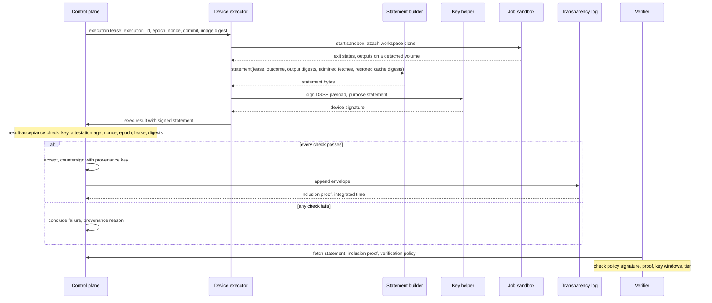
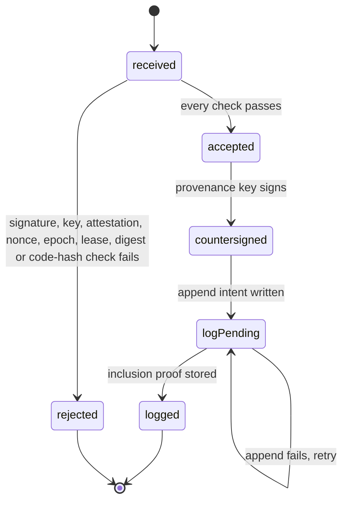
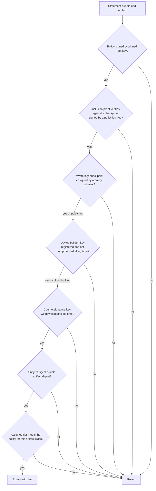
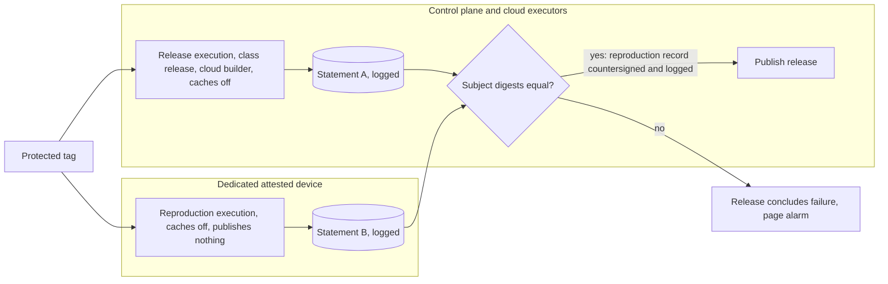

# Provenance

This file specifies the provenance statements that FlareDispatch's statement builder and the control plane produce, the nonce and epoch that bind each statement to one lease, the control plane's countersignature, the transparency log, the three provenance tiers, the verification policy a verifier checks a statement against, the release rule and the verdict audit.

## Scope

A statement answers two questions about an output: which machine built it, and from which inputs by which process. A third question, whether the output is honest, has an answer only from an independent rebuild, so the `reproduced` tier requires one. The decision and its costs are in [ADR-0015](adr/0015-provenance-tiers.md); the Tamarin model is in [ADR-0018](adr/0018-formal-models.md).

This file depends on:

- mameko's [placement-leases.md](https://github.com/fractalboxdev/mameko/blob/2c3041335db0cf4a2193e5b11827f20631d54e87/specs/placement-leases.md) for the execution lease, the epoch, the reclaim, the capacity lease, device registration ([MAMEKO-LEASE-088](https://github.com/fractalboxdev/mameko/blob/2c3041335db0cf4a2193e5b11827f20631d54e87/specs/placement-leases.md), [MAMEKO-LEASE-089](https://github.com/fractalboxdev/mameko/blob/2c3041335db0cf4a2193e5b11827f20631d54e87/specs/placement-leases.md)) and the result-acceptance check ([MAMEKO-LEASE-090](https://github.com/fractalboxdev/mameko/blob/2c3041335db0cf4a2193e5b11827f20631d54e87/specs/placement-leases.md));
- mameko's [executor-protocol.md § Intents and results](https://github.com/fractalboxdev/mameko/blob/2c3041335db0cf4a2193e5b11827f20631d54e87/specs/executor-protocol.md#intents-and-results) for the result submission that carries a statement;
- mameko's [executors.md § Run user and device extensions](https://github.com/fractalboxdev/mameko/blob/2c3041335db0cf4a2193e5b11827f20631d54e87/specs/executors.md#run-user-and-device-extensions) for the device extension whose statement builder writes a device statement and the key helper that signs it ([MAMEKO-EXEC-112](https://github.com/fractalboxdev/mameko/blob/2c3041335db0cf4a2193e5b11827f20631d54e87/specs/executors.md));
- [isolation-egress.md](isolation-egress.md) for the egress proxy log and the per-lease credentials;
- [local-scheduler.md](local-scheduler.md) for `local.register`, the registration that binds local work;
- [profile.md](profile.md) for the `cloud-pinned` constraint on `release`, the `untrusted-input` label on fork pull requests and the `reproduction` constraint;
- [github-output.md](github-output.md) for the check summary;
- [model-gateway.md](model-gateway.md) for the metering records that name each model call.

Not specified: a search endpoint, push feed or bulk export over statements, verdicts or execution history. Statements and the transparency log are a verification surface, read by execution id or subject digest only (FD-PROV-071).

## Model

### Keys

| Key | Holder | Algorithm | Signs | Published in |
| --- | --- | --- | --- | --- |
| Device key | The key helper, inside the Secure Enclave, non-exportable, erased on restore | ECDSA P-256 (ES256) | Statements written on that device, under the `statement` signing purpose | The device registry of the verification policy |
| Provenance key | The control plane, as a Worker secret | ES256 | Countersignatures, cloud-builder statements, reproduction records | The provenance key history of the verification policy |
| Log key | The control plane, as a Worker secret | ES256 | Checkpoints of the private log | The log entries of the verification policy |
| Witness key | An external witness the operator names | Set by the witness | Cosignatures of private-log checkpoints | The log entries of the verification policy |
| OIDC key | The control plane, as a Worker secret | ES256 | Per-execution identity tokens | `/.well-known/jwks.json` |
| Policy root key | The operator, outside the control plane | ES256 | Each version of the verification policy | Pinned by each verifier out of band |

### Statement

A statement is an in-toto Statement v1 inside a DSSE envelope with payload type `application/vnd.in-toto+json`. Its `subject` lists each output artifact by name and `sha256` digest. Build recipes use the SLSA provenance v1 predicate (`https://slsa.dev/provenance/v1`); gate recipes use the in-toto test-result predicate (`https://in-toto.io/attestation/test-result/v0.1`).

Every statement carries a **lease binding**: `execution_id`, `epoch`, `nonce`, `executor_id` and `binding_kind` (`execution-lease` or `registration`). The SLSA predicate holds it at `buildDefinition.internalParameters.lease`; the test-result predicate holds it as the `configuration` resource descriptor named `lease`.

| Field | Source | SLSA predicate path |
| --- | --- | --- |
| Run name, run-definition digest, repository, ref, commit SHA, inputs digest | The lease or the registration | `buildDefinition.externalParameters` |
| Lease binding, class, placement `policy_version`, confidentiality mode | The lease or the registration | `buildDefinition.internalParameters` |
| Commit, image digest, lockfile digest | The lease; the device executor passes the lockfile digest to the statement builder | `buildDefinition.resolvedDependencies` |
| Each dependency the job fetched, with digest and digest source (`proxy` or `lockfile`) | The egress proxy's records of admitted fetches ([MAMEKO-ISO-038](https://github.com/fractalboxdev/mameko/blob/2c3041335db0cf4a2193e5b11827f20631d54e87/specs/isolation-egress.md)) | `buildDefinition.resolvedDependencies` |
| Each restored cache entry: namespace, key, digest | The cache entries the device executor reports restored | `buildDefinition.resolvedDependencies` |
| Builder id `<executor kind>:<executor_id>` and the device's code hash | The registration record ([MAMEKO-LEASE-089](https://github.com/fractalboxdev/mameko/blob/2c3041335db0cf4a2193e5b11827f20631d54e87/specs/placement-leases.md)) | `runDetails.builder` |
| `invocationId` = `execution_id` | The lease | `runDetails.metadata` |
| Egress proxy log digest, step log digest | The device executor | `runDetails.byproducts` |
| Each model id with its token count | The gateway metering records | `runDetails.byproducts` |

### Statement flow

The job sandbox never holds the device key. The device executor starts the job sandbox and passes the lease, the outcome and the output digests to FlareDispatch's statement builder in the device extension; the builder writes the statement, the device executor signs it through the key helper, and the control plane's result-acceptance check verifies it against the lease before the accept compare-and-set, then countersigns and logs it.

*Statement flow · one lease, one nonce, one statement; the verifier trusts only the policy root key it pinned.*

### Acceptance

FlareDispatch's result-acceptance check runs the checks below on every statement, in order, inside the accept compare-and-set, and stops at the first failure ([MAMEKO-LEASE-090](https://github.com/fractalboxdev/mameko/blob/2c3041335db0cf4a2193e5b11827f20631d54e87/specs/placement-leases.md)). A failure concludes the execution `failure` with the reason `provenance: <reason>`, the reason kind the profile declares in category `policy`. Each check has a negative conformance test (FD-PROV-072).

*Statement lifecycle · a rejected statement concludes the execution it came with `failure`.*

| Order | Check | Reason on failure |
| --- | --- | --- |
| 1 | The device signature verifies over the DSSE payload | `bad-signature` |
| 2 | The signing key is in the device registry | `unknown-key` |
| 3 | The signing key is not revoked | `revoked-key` |
| 4 | The device's last attestation is younger than `attestation_max_age` | `attestation-expired` |
| 5 | The `execution_id` names a lease or registration the control plane issued | `unissued-lease` |
| 6 | That lease or registration was issued to the signing device's executor | `wrong-executor` |
| 7 | The epoch equals the execution's current epoch | `stale-epoch` |
| 8 | The nonce equals the nonce issued for that execution and epoch | `nonce-mismatch` |
| 9 | The nonce has not been consumed by an accepted statement | `nonce-reused` |
| 10 | The subject digests equal the artifact digests in the result submission | `digest-mismatch` |
| 11 | The key helper's code-signing hash equals the code hash recorded at the device's registration | `code-hash-mismatch` |
| 12 | The model list equals the gateway metering records for that execution and epoch | `model-mismatch` |

### Provenance tiers

| Tier | Proves | Conditions the verifier checks | Used for |
| --- | --- | --- | --- |
| `device-signed` | This attested device produced the statement, unaltered since | Device signature by a key valid at log time; countersignature; inclusion proof; `binding_kind` = `registration` | Test verdicts, logs and internal artifacts of local work |
| `platform` | These inputs and this process, under a lease the control plane issued; the job could not reach the signer | Device builder: device signature and countersignature. Cloud builder: provenance-key signature as builder. Both: `binding_kind` = `execution-lease`, inclusion proof | Pull-request artifacts, preview deploys, required-check verdicts |
| `reproduced` | The source produces exactly this output | Two `platform` statements with equal subject digests and zero restored cache entries, one from a cloud builder; a logged reproduction record countersigned over both | Releases, published packages and images, where a release rule asks for it |

A verifier assigns the highest tier whose conditions all hold.

### Verification policy

The verification policy is a JSON document in a DSSE envelope signed by the policy root key. Each version holds:

- `policy_version` and `issued_at`;
- the provenance key history: `kid`, public JWK, `not_before`, `not_after` (absent for the active key);
- the logs: kind (`rekor` or `private`), the log key history, and for a private log the witnesses with their keys;
- the device registry: device key thumbprint, `executor_id`, posture tier (`attested-dedicated` or `managed-workstation`), `registered_at`, `revoked_at`, `compromised_from`;
- the required tier per artifact class: `release`, `package`, `image`, `pr-artifact`, `preview`, `verdict`;
- the SLSA Build level each builder tier may claim.

A verifier runs the procedure below. `fd verify` implements it with no network access when given the policy and a statement bundle.

*Verifier procedure · time comes from the log, so a retired or revoked key fails on its window, not on the signer's clock.*

### Reproduction

A release rule may set `reproduce: true`. The release itself always builds in the cloud; a reproduction execution builds the same inputs cold on a dedicated device, and the release publishes only when the two digests match.

*Reproduced tier · a forgery requires compromising both the cloud builder and the device; the release still pays for its cloud build.*

## Requirements

### Statements

- **FD-PROV-001** · phase 4 · `V-UNIT` `V-E2E-LOCAL` — The statement builder must take every subject digest from the output digests the device executor passes it, which the device executor computes from the detached output volume after the job sandbox exits, and must take no statement field from the job sandbox other than its exit status.
- **FD-PROV-002** · phase 4 · `V-E2E-LOCAL` — The device extension that holds the statement builder must be unreachable from every job sandbox, and the device key must stay in the key helper ([MAMEKO-EXEC-109](https://github.com/fractalboxdev/mameko/blob/2c3041335db0cf4a2193e5b11827f20631d54e87/specs/executors.md), [MAMEKO-EXEC-112](https://github.com/fractalboxdev/mameko/blob/2c3041335db0cf4a2193e5b11827f20631d54e87/specs/executors.md)).
- **FD-PROV-003** · phase 4 · `V-UNIT` `V-E2E-LOCAL` — When the device executor hashes an output volume for the statement builder, it must not follow symbolic links.
- **FD-PROV-004** · phase 4 · `V-UNIT` — The statement builder must produce each statement as the payload of a DSSE envelope with payload type `application/vnd.in-toto+json`, which the device executor signs through the key helper under the `statement` signing purpose ([MAMEKO-EXEC-112](https://github.com/fractalboxdev/mameko/blob/2c3041335db0cf4a2193e5b11827f20631d54e87/specs/executors.md)).
- **FD-PROV-005** · phase 4 · `V-UNIT` — The statement builder must include in every statement the lease binding, the run-definition digest, the commit SHA, the image digest, the lockfile digest, every restored cache entry, the egress proxy log digest and the step log digest.
- **FD-PROV-006** · phase 4 · `V-UNIT` — The statement builder must mark each resolved dependency with the source of its digest: `proxy` when the egress proxy hashed the fetched bytes, `lockfile` otherwise.
- **FD-PROV-007** · phase 4 · `V-UNIT` — The statement builder must use the SLSA provenance v1 predicate for statements of build recipes and the in-toto test-result predicate for statements of gate recipes.
- **FD-PROV-008** · phase 4 · `V-UNIT` `V-CONF` — When a cloud executor's result submission is accepted, the control plane must write the statement, compute each subject digest from the artifact bytes it stores in R2, and sign the statement with the provenance key as the cloud builder.
- **FD-PROV-009** · phase 4 · `V-CONF` `V-PROOF` — The control plane must sign a statement as the cloud builder only for an execution whose current placement is a cloud executor and whose result arrived from that executor at the current epoch.

### Nonce and epoch

- **FD-PROV-010** · phase 4 · `V-UNIT` `V-PROOF` — When the control plane grants an execution lease, the control plane must issue a nonce of 128 random bits bound to the `execution_id` and the epoch.
- **FD-PROV-011** · phase 4 · `V-SIM` `V-PROOF` — When the control plane reclaims an execution, the control plane must issue a fresh nonce with the new epoch and must invalidate the nonce of the previous epoch.
- **FD-PROV-012** · phase 4 · `V-UNIT` `V-PROOF` — When the control plane answers `local.register`, the control plane must issue a nonce of 128 random bits bound to the returned `execution_id`, the capacity lease id and the capacity-lease epoch.

### Acceptance

- **FD-PROV-013** · phase 4 · `V-CONF` `V-PROOF` — If a statement's device signature does not verify over its DSSE payload, then the control plane must reject the statement with `bad-signature`.
- **FD-PROV-014** · phase 4 · `V-CONF` `V-PROOF` — If a statement's signing key is not in the device registry, then the control plane must reject the statement with `unknown-key`.
- **FD-PROV-015** · phase 4 · `V-CONF` `V-PROOF` — If a statement's signing key is revoked, then the control plane must reject the statement with `revoked-key`.
- **FD-PROV-016** · phase 4 · `V-CONF` — If the signing device's last accepted attestation ([MAMEKO-LEASE-089](https://github.com/fractalboxdev/mameko/blob/2c3041335db0cf4a2193e5b11827f20631d54e87/specs/placement-leases.md)) is older than `attestation_max_age` (default 10 days, set in the operator overlay), then the control plane must reject the statement with `attestation-expired`.
- **FD-PROV-077** · phase 4 · `V-UNIT` `V-DEPLOY` — If the operator overlay sets `attestation_max_age` below `reattest_interval` plus 48 h, then the config validator must reject the overlay.
- **FD-PROV-017** · phase 4 · `V-CONF` `V-PROOF` — If a statement's `execution_id` names no lease or registration the control plane issued, then the control plane must reject the statement with `unissued-lease`.
- **FD-PROV-018** · phase 4 · `V-CONF` `V-PROOF` — If a statement's lease or registration was issued to an executor other than the signing device's, then the control plane must reject the statement with `wrong-executor`.
- **FD-PROV-019** · phase 4 · `V-CONF` `V-SIM` `V-PROOF` — If a statement's epoch differs from the execution's current epoch, then the control plane must reject the statement with `stale-epoch`.
- **FD-PROV-020** · phase 4 · `V-CONF` `V-PROOF` — If a statement's nonce differs from the nonce issued for its execution and epoch, then the control plane must reject the statement with `nonce-mismatch`.
- **FD-PROV-021** · phase 4 · `V-CONF` `V-PROOF` — If a statement's nonce was consumed by an accepted statement, then the control plane must reject the statement with `nonce-reused`.
- **FD-PROV-022** · phase 4 · `V-CONF` — If a statement's subject digests differ from the artifact digests in its result submission, then the control plane must reject the statement with `digest-mismatch`.
- **FD-PROV-023** · phase 4 · `V-CONF` — If a statement's key helper code-signing hash differs from the code hash recorded at the device's registration ([MAMEKO-LEASE-089](https://github.com/fractalboxdev/mameko/blob/2c3041335db0cf4a2193e5b11827f20631d54e87/specs/placement-leases.md)), then the control plane must reject the statement with `code-hash-mismatch`.
- **FD-PROV-024** · phase 4 · `V-CONF` — If a statement's model list differs from the gateway metering records for its execution and epoch, then the control plane must reject the statement with `model-mismatch`.
- **FD-PROV-025** · phase 4 · `V-UNIT` — If a statement comes from capacity-lease work with no registration, then the control plane must not countersign it and must keep its result advisory.
- **FD-PROV-026** · phase 4 · `V-CONF` `V-SIM` — If a check of the acceptance table fails, then FlareDispatch's result-acceptance check must reject the result with the reason `provenance: <reason>`, so that the execution concludes `failure` with that reason ([MAMEKO-LEASE-090](https://github.com/fractalboxdev/mameko/blob/2c3041335db0cf4a2193e5b11827f20631d54e87/specs/placement-leases.md)).
- **FD-PROV-027** · phase 4 · `V-UNIT` — When the control plane rejects a statement with `bad-signature`, `revoked-key`, `wrong-executor` or `code-hash-mismatch`, the control plane must quarantine the signing executor and raise a page alarm.

### Enrollment and attestation

- **FD-PROV-028** · phase 4 · `V-CONF` — FlareDispatch's attestation verifier, which the profile selects with `registration.attestation: verifier` ([MAMEKO-LEASE-088](https://github.com/fractalboxdev/mameko/blob/2c3041335db0cf4a2193e5b11827f20631d54e87/specs/placement-leases.md)), must accept a device key's evidence only as a Managed Device Attestation that chains to the Apple Enterprise Attestation Root CA.
- **FD-PROV-029** · phase 4 · `V-CONF` — If a device's attestation reports SIP disabled or a Secure Boot level other than full, then the attestation verifier must reject the evidence with `posture-failed`.
- **FD-PROV-030** · phase 4 · `V-SIM` — While a device key is registered, the control plane must request re-attestation with a fresh freshness code every `reattest_interval`, set in the operator overlay with a default and a minimum of 7 days, the interval at which a device generates a new `DeviceInformation` attestation.
- **FD-PROV-031** · phase 4 · `V-UNIT` — The attestation verifier must return as the device's code hash the key helper's code-signing hash from the code-signing requirement it checks at registration, never from the device's own report ([MAMEKO-LEASE-089](https://github.com/fractalboxdev/mameko/blob/2c3041335db0cf4a2193e5b11827f20631d54e87/specs/placement-leases.md)).

### Countersignature and transparency log

- **FD-PROV-032** · phase 4 · `V-UNIT` `V-PROOF` — When the control plane accepts a statement, the control plane must add a countersignature with the active provenance key to the envelope's signature list.
- **FD-PROV-033** · phase 4 · `V-UNIT` `V-DEPLOY` — The control plane must keep the provenance key distinct from the OIDC key, the log key and every capability-token key.
- **FD-PROV-034** · phase 4 · `V-UNIT` `V-REPLAY` — When the control plane countersigns a statement, the control plane must append the envelope to the transparency log through an intent keyed by the envelope digest.
- **FD-PROV-035** · phase 4 · `V-UNIT` `V-LIVE` — Where a repository's GitHub visibility is `public`, the control plane must append its statements to the public Rekor log.
- **FD-PROV-036** · phase 4 · `V-UNIT` — Where a repository's GitHub visibility is other than `public` or cannot be read, the control plane must append its statements to the private log in R2.
- **FD-PROV-037** · phase 4 · `V-UNIT` `V-CONF` — The control plane must store the private log as an append-only Merkle tree with RFC 9162 leaf and node hashing, and must publish a checkpoint signed by the log key no later than 60 s after each append.
- **FD-PROV-038** · phase 4 · `V-UNIT` — If a private-log write would change an existing leaf or reduce the tree size, then the control plane must refuse the write and raise a page alarm.
- **FD-PROV-074** · phase 4 · `V-UNIT` `V-CONF` — One `TransparencyLog` Durable Object must be the only writer of the private log: it must assign each leaf index in its SQLite storage, write leaves and tiles to R2 with create-only `onlyIf` puts, and sign each checkpoint from its alarm within 60 s of an append.
- **FD-PROV-039** · phase 4 · `V-E2E-LOCAL` — When the control plane publishes a private-log checkpoint, the control plane must send it to every witness named in the verification policy and store each cosignature returned.
- **FD-PROV-040** · phase 4 · `V-UNIT` — The control plane must take a statement's time from its log entry's integrated time, never from an executor's clock.
- **FD-PROV-041** · phase 4 · `V-SIM` — If a log append fails, then the control plane must retry it with exponential backoff from 5 s to 10 min until it succeeds, and must show the statement as `log-pending` in the check summary meanwhile.
- **FD-PROV-042** · phase 4 · `V-UNIT` — When a statement for an execution with a check run is logged, the control plane must link the statement, its inclusion proof and its subject digests from the check summary.
- **FD-PROV-043** · phase 4 · `V-UNIT` — The control plane must write only digests, ids, names, timestamps and verdicts into statements and log entries, never source, file contents, diffs, logs, prompts or completions.
- **FD-PROV-075** · phase 4 · `V-UNIT` — The control plane must keep each artifact that a logged statement names as a subject with `expires_at` no earlier than the statement's integrated time plus the statement retention, default 400 days, set in the operator overlay, extending the artifact retention of [cache-artifacts.md](cache-artifacts.md) FD-CACHE-079.
- **FD-PROV-076** · phase 4 · `V-UNIT` — When the control plane applies a model-authored commit with the `Drafted-With:` trailer of [runs/agentic.md](runs/agentic.md) FD-AGT-040, it must record the commit SHA and the trailer's model entry ids in the execution's statement under `runDetails.byproducts`, and the two lists must be equal.

### Verification policy and key history

- **FD-PROV-044** · phase 4 · `V-UNIT` `V-E2E-LOCAL` — The control plane must serve the current verification policy at `/.well-known/flare-dispatch/provenance-policy.json` and every earlier version by its `policy_version`.
- **FD-PROV-045** · phase 4 · `V-DEPLOY` — The control plane must not hold the policy root key.
- **FD-PROV-046** · phase 4 · `V-UNIT` — When the operator publishes a policy version, the control plane must append it to the transparency log before serving it.
- **FD-PROV-047** · phase 4 · `V-UNIT` `V-PROOF` — The control plane must keep every provenance key and log key it has used in the policy's key history with its validity window, and must never remove an entry.
- **FD-PROV-048** · phase 4 · `V-UNIT` `V-PROOF` — When the provenance key rotates, the control plane must set the retired key's `not_after` to the new key's `not_before` and must countersign only with the new key from that instant.
- **FD-PROV-049** · phase 0 · `V-UNIT` — When the OIDC key rotates, the control plane must keep the retired key in `/.well-known/jwks.json` for at least 3600 s, the longest token lifetime.
- **FD-PROV-050** · phase 0 · `V-UNIT` — The control plane must issue OIDC tokens with `sub` set to `<run>:<execution_id>`, a lifetime of at most 3600 s with a default of 900 s, and must refuse a run's request to set a reserved claim.
- **FD-PROV-051** · phase 4 · `V-UNIT` — When the operator revokes a device key, the control plane must record `compromised_from`, defaulting to the time of that device's last successful attestation unless the operator names an earlier time.
- **FD-PROV-052** · phase 4 · `V-UNIT` — The control plane must refuse to serve a verification policy that lets a builder of the `managed-workstation` posture tier claim a SLSA Build level above L1.

### Verifier

- **FD-PROV-053** · phase 4 · `V-CONF` — If a verification policy does not verify against the policy root key the verifier pinned, then the verifier must reject every statement checked against it.
- **FD-PROV-054** · phase 4 · `V-CONF` `V-PROOF` — If a statement has no inclusion proof that verifies against a checkpoint signed by a log key in the policy, then the verifier must reject the statement.
- **FD-PROV-055** · phase 4 · `V-CONF` — If a private-log checkpoint carries no cosignature from a witness named in the policy, then the verifier must reject every statement proved against it.
- **FD-PROV-056** · phase 4 · `V-CONF` `V-PROOF` — If a statement's countersignature or cloud-builder signature uses a provenance key whose validity window excludes the statement's log time, then the verifier must reject the statement.
- **FD-PROV-057** · phase 4 · `V-CONF` `V-PROOF` — If a statement's log time falls before its device key's `registered_at` or at or after its `compromised_from`, then the verifier must reject the statement.
- **FD-PROV-058** · phase 4 · `V-UNIT` — If a statement's subject digest differs from the digest of the artifact being verified, then the verifier must reject the statement.
- **FD-PROV-059** · phase 4 · `V-UNIT` — If the tier a verifier assigns is below the policy's required tier for the artifact class, then the verifier must reject the artifact.
- **FD-PROV-060** · phase 4 · `V-UNIT` — If a statement's `binding_kind` is `registration`, then the verifier must not assign a tier above `device-signed`.
- **FD-PROV-061** · phase 4 · `V-CONF` `V-PROOF` — The verifier must not assign `reproduced` unless one of the two statements is signed by a provenance key as a cloud builder.

### Releases

- **FD-PROV-062** · phase 4 · `V-UNIT` `V-E2E-LOCAL` — If a release recipe's publish step finds no logged `platform` statement from a cloud builder for an artifact's digest, then the control plane must refuse the publish and conclude the release `failure` with reason `provenance: release statement missing`.
- **FD-PROV-063** · phase 4 · `V-UNIT` — If a release statement lists a restored cache entry, then the control plane must refuse the publish and conclude the release `failure` with reason `provenance: release built warm`.
- **FD-PROV-064** · phase 4 · `V-UNIT` — Where a release rule sets `reproduce: true`, the control plane must create a reproduction execution with the release's recipe, commit, run-definition digest and image digest, caches off, at class `interactive` with the `reproduction` placement constraint, which removes `cloudflare`, `aws` and `gha` and every device below the `attested-dedicated` posture tier ([profile.md](profile.md) § Placement).
- **FD-PROV-065** · phase 4 · `V-UNIT` `V-REPLAY` — The control plane must apply no intent from a reproduction execution other than appending its statement.
- **FD-PROV-066** · phase 4 · `V-UNIT` — When the release statement and the reproduction statement are both logged with equal subject digests, the control plane must countersign a reproduction record naming both envelope digests and append it to the transparency log.
- **FD-PROV-067** · phase 4 · `V-UNIT` — If the release statement and the reproduction statement differ in any subject digest, then the control plane must refuse the publish, conclude the release `failure` with reason `provenance: reproduction mismatch` and raise a page alarm.
- **FD-PROV-068** · phase 4 · `V-SIM` — If no reproduction statement is logged by the release's `deadline_at`, then the control plane must conclude the release `failure` with reason `provenance: reproduction unavailable`.

### Verdict audit

- **FD-PROV-069** · phase 1 · `V-UNIT` `V-MEASURE` — When a device execution of a gate recipe concludes, the control plane must select it for a verdict audit with probability `audit_rate` (default 5%, set in the operator overlay) and admit a cloud execution of the same run, commit and inputs as an ops run charged to the ops reserve ([MAMEKO-SPD-063](https://github.com/fractalboxdev/mameko/blob/2c3041335db0cf4a2193e5b11827f20631d54e87/specs/spend.md)).
- **FD-PROV-070** · phase 1 · `V-UNIT` `V-MEASURE` — When an audit verdict differs from the device verdict, the control plane must write a `verdict_audits` row naming both executions and executors and raise a notify alarm, and must leave the posted conclusion unchanged.

### Read access

- **FD-PROV-071** · phase 4 · `V-UNIT` — The control plane must serve statements only by lookup on `execution_id` or subject digest, and must not serve a search, bulk export or push feed over statements, verdicts or execution history.

### Formal model

- **FD-PROV-072** · phase 4 · `V-PROOF` `V-CONF` — The conformance suite must hold a negative test for each acceptance check in the acceptance table and for each verifier rejection in FD-PROV-053 to FD-PROV-061, and a Tamarin lemma counts toward a phase gate only while every check it assumes has that test passing.
- **FD-PROV-073** · phase 4 · `V-PROOF` — CI must run `tamarin-prover --prove` on `formal/provenance.spthy` with a pinned prover version and fail unless every lemma is `verified`, with each expected attack stated as an `exists-trace` lemma.

| Lemma | Property | Requirements it covers |
| --- | --- | --- |
| S7a | Injective agreement: an accepted statement for (execution, epoch, digests) was signed by the device the lease was issued to, and no other accepted statement carries its nonce, unless that device key was revealed before it signed | FD-PROV-010, FD-PROV-013, FD-PROV-014, FD-PROV-017, FD-PROV-018, FD-PROV-020, FD-PROV-021, FD-PROV-032 |
| S7b | Freshness: no statement for epoch k is accepted after a reclaim to k+1, and no statement produced before its lease existed is accepted | FD-PROV-011, FD-PROV-012, FD-PROV-019 |
| S7c | Compromise scope: a revealed device key yields countersignatures only for leases issued to that device while registered and not revoked, and never the `reproduced` tier | FD-PROV-009, FD-PROV-015, FD-PROV-057, FD-PROV-061 |
| S7d | Misuse detection: every statement a verifier accepts has a log entry. The `exists-trace` lemma shows the attack when a verifier skips the inclusion proof | FD-PROV-054 |
| S7e | Rotation: a countersignature by a retired provenance key is rejected outside its validity window. The `exists-trace` lemma shows the attack when no key history exists | FD-PROV-047, FD-PROV-048, FD-PROV-056 |

[verification.md](verification.md) § Formal properties lists these properties with their lemma names and the acceptance checks each one assumes. The model trusts the Apple attestation root and treats signatures as ideal, so ES256 itself stays outside the proof. Root on a running device still signs: S7a and S7c bound what that attacker gains to statements for that device's leases while it is registered, all of them in the log.

## Open items

- TODO(operator): name the external witness for the private log (FD-PROV-039, FD-PROV-055).
- TODO(maintainer): decide whether the egress proxy installs a TLS interception CA inside the job sandbox; without one, HTTPS dependencies carry `lockfile` digests only (FD-PROV-006).
