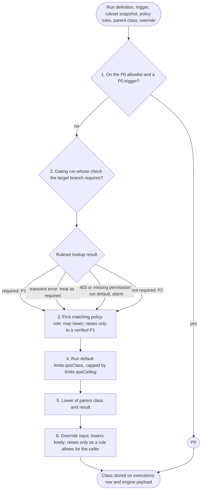
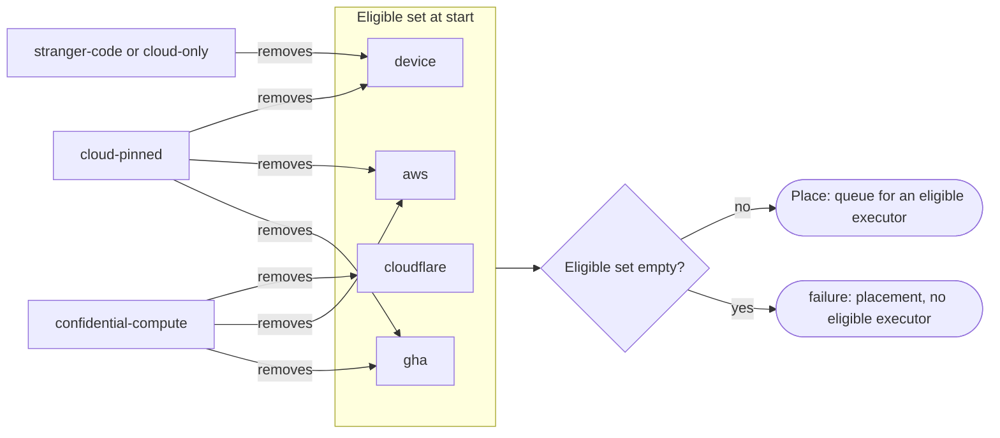
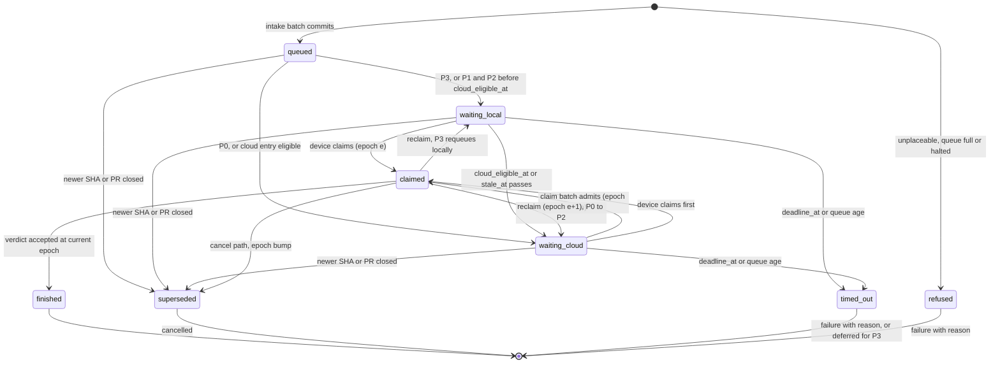
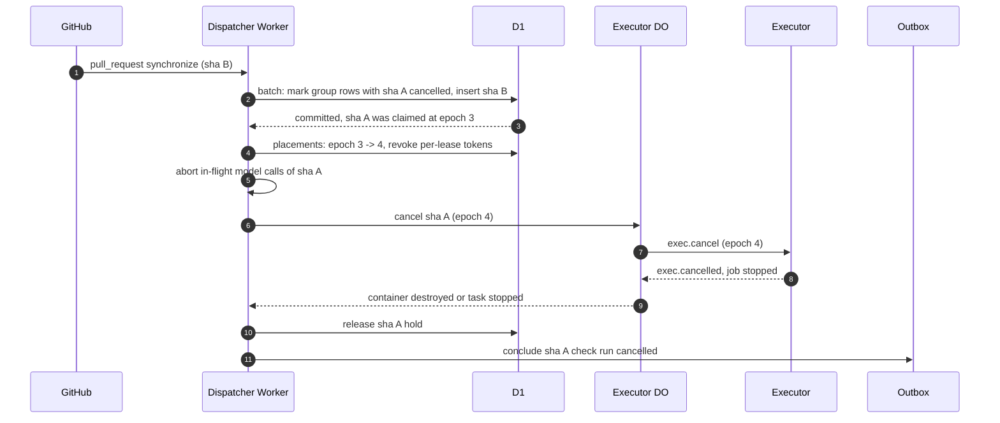

# QoS and admission

Every execution carries one class, P0 to P3, set once at intake; the class sets queue order, the claim deadline and which reservation the execution may draw on. Placement constraints narrow where it may run without changing its rank. Admission bounds the queue, orders claims, enforces one absolute deadline, cancels superseded work, serializes groups, and concludes every capacity outcome `failure` with a named reason, never `neutral`.

## Scope

This file covers classes and `resolveClass`; placement constraints and the `placementPolicy` kernel; the policy validator; intake bounds and `shed` rows; the cloud claim batch and per-pool class slots; `deadline_at` and per-class claim deadlines; queue-then-fail and the verdict mapping for capacity outcomes; supersession, serial groups and parent-ended children; load shedding, fairness, retries and recovery mode. It depends on [spend.md](spend.md) for lines, holds, burn lanes and the operator halt; on [placement-leases.md](placement-leases.md) for the placement row's compare-and-set, `local_open` and `cloud_eligible_at` per class and constraint, epochs, claim order, the device slot ledger and preemption; on [executors.md](executors.md) § Breakers and spill order for breakers and the cloud spill order; on [github-output.md](github-output.md) for the conclusion mapping and the check summary; and on [intake.md](intake.md) for the path that calls `resolveClass`.

Not specified: the run-definition fields `limits.maxConcurrency`, `limits.requiresBrowser` and `RunSpec.image`. Placement constraints, capability labels, per-class pool slots and browser-session claims are derived from capability use.

## Model

### Classes

| Class | `QosClass` | Covers | Local claim deadline | At its line or deadline |
| --- | --- | --- | --- | --- |
| P0 | `release` | `worker-deploy`, `deploy-smoke`, release recipes on a P0 trigger (FD-QOS-003) | None: cloud at admission | `failure`, reason named |
| P1 | `required` | Gating runs (`check`, `oxlint`, `offload-test`) whose check name the target branch requires, on `pull_request`, `merge_group` or a `gh-readonly-queue/*` push | 60 s; 0 s on a predicted miss | Waits for a local claim until `deadline_at`, then `failure` |
| P2 | `interactive` | `pr-review`, `self-heal-pr` and every gating run whose check is not required | 300 s; 0 s on a predicted miss | `failure` at its queue age |
| P3 | `batch` | Scheduled runs, `improve-pr`, triage runs, every new or unclassified run | Staleness point: half the run's schedule period | Recorded `deferred`; the next tick recovers it |

Ops runs (canaries and the verdict audit) rank as P1 for queue order, admit against the P1 line and draw on the ops reserve ([spend.md](spend.md)). The claim deadlines per class are the `cloud_eligible_at` values of [placement-leases.md](placement-leases.md) § Delayed cloud claim. A rank comparison treats P0 as highest and P3 as lowest; "the lower of two classes" means the one nearer P3.

### `resolveClass`

`resolveClass` is a pure function that runs once at intake. Its result is stored on the `executions` row and in the engine payload, and children read it from there.

*resolveClass: hard pins first, then the required set, rules, the run's own bounds, the parent and the caller's override; a lookup error fails toward P1.*

### Placement constraints

A placement constraint removes executor kinds from the eligible set and never changes the class. `placementPolicy` starts every request at `{cloudflare, device, aws, gha}` and applies each constraint that holds for it; because every constraint only removes kinds, the order of application does not change the result.

| Constraint | Holds for | Removes |
| --- | --- | --- |
| `cloud-pinned` | Class P0, except a release-matrix job that declares `macos-arm64`; runs that declare the `expose-port` label | `device`, `aws`, `gha` |
| `stranger-code` | Trigger `fork-pr` | `device`; the execution receives no per-repository secrets |
| `cloud-only` | A tag-push trigger; a policy rule that selects cloud-only mode | `device` |
| `confidential-compute` | Repository confidentiality mode `confidential-compute` | `cloudflare`, `aws`, `gha` |
| `local-only` | Trigger `local`; new or unclassified runs | `cloudflare`, `aws`, `gha` |
| `apple-build` | Runs built in a macOS guest | `cloudflare`, `aws`; `gha` too, except for P1 and for a release-matrix job |
| `needs-local-model` | A run that declares `needsModel` in a repository whose confidentiality mode is not `non-confidential` ([model-gateway.md](model-gateway.md) FD-MDL-016) | `cloudflare`, `aws`, `gha`; label filtering then keeps only devices that advertise `local-model` |
| `reproduction` | A reproduction execution ([provenance.md](provenance.md) FD-PROV-064) | `cloudflare`, `aws`, `gha`; the claim then keeps only devices of posture tier `attested-dedicated` |

Runs that declare the `browser`, `detached-process` or `container-artifact` label carry no placement constraint; label filtering ([placement-leases.md](placement-leases.md) FD-LEASE-007) places them on an executor that advertises the label ([executors.md](executors.md) § Capability labels).

`confidential-model` does not remove an executor kind: it removes the hosted model route ([model-gateway.md](model-gateway.md)). Repositories in mode `unclassified` take `confidential-model`.

Some combinations leave no eligible kind. `confidential-compute` with `stranger-code`, `cloud-only` or class P0 removes every kind. `local-only` with `stranger-code` or `cloud-only` does too, so an unclassified run triggered by a fork pull request or a tag push is unplaceable. `apple-build` with `stranger-code` or `cloud-only` leaves nothing at P2 and P3. `needs-local-model` with `stranger-code`, `cloud-only` or class P0 removes every kind, so a fork-PR run that declares `needsModel` on a repository in the default mode `unclassified` is unplaceable. The policy validator reports every such combination (FD-QOS-084). The control plane creates a reproduction execution from the release, not from the tag push, so `cloud-only` does not hold for it. A release-matrix job that declares `macos-arm64` keeps exactly `gha` at every class, because `cloud-only` removes `device`, `apple-build` removes `cloudflare` and `aws`, and `cloud-pinned` does not hold for it (FD-QOS-085).

The cloud spill order (P2 and P3 to `cloudflare` only, P1 to `cloudflare` and then `aws`) is a preference applied after eligibility ([executors.md](executors.md) FD-EXEC-098). It never empties the set: `aws` is eligible only where `cloudflare` is too.

*placementPolicy: a fork PR, tag or P0 request in a `confidential-compute` repository loses every kind, and intake refuses it at once.*

### Admission lifecycle

*Admission lifecycle: every path out of waiting ends in a verdict with a named reason; none ends `skipped` from capacity.*

### Supersession

*Supersession: the older execution is marked in the same batch that inserts the newer one, then fenced, stopped through its executor DO and released in that order.*

### Verdicts for capacity outcomes

| Cause | P0, P1, and any check in the required set | P2 | P3 |
| --- | --- | --- | --- |
| Budget line, burn-lane wait, queue full, `deadline_at`, cloud degraded, gateway breaker wait | `failure`, reason named | `failure`, reason named | `deferred` row; a P3 that owns a check run concludes it `failure` with reason `capacity: deferred` |
| Operator halt | `failure`, `halt: operator halted` | `failure`, `halt: operator halted` | `failure`, `halt: operator halted` |
| No eligible executor (unplaceable), concluded at intake before any row is queued ([intake.md](intake.md) FD-INT-013) | `failure`, `placement: no eligible executor` | `failure`, `placement: no eligible executor` | `failure`, `placement: no eligible executor` |
| Run-internal capacity bow-out (`context-overflow` after its shrink retries, `rate-limited` after its gateway breaker wait) | `failure`, `capacity: context overflow` or `capacity: model unavailable` | `failure`, `capacity: context overflow` or `capacity: model unavailable` | `failure`, `capacity: context overflow` or `capacity: model unavailable` |
| Superseded, superseded serial waiter, pull request closed, parent ended | `cancelled` with cause `superseded`, `pr-closed` or `parent-ended` | `cancelled` with cause `superseded`, `pr-closed` or `parent-ended` | `cancelled` with cause `superseded`, `pr-closed` or `parent-ended` |
| Not applicable (draft pull request, path filter, dependency-update bot) | `skipped` | `skipped` | `skipped` |

A `deferred` row is a terminal `executions.status` that carries no `RunResult` and posts no conclusion ([architecture.md](architecture.md) FD-ARCH-034, [run-model.md](run-model.md) FD-RUN-030).

The capacity reasons form one closed union, `CapacityReason`: `budget`, `budget: release reserve exhausted`, `budget: required reserve exhausted`, `capacity: queue full`, `capacity: cloud degraded`, `capacity: aws launch failed`, `capacity: context overflow`, `capacity: model unavailable`, `capacity: deferred`, `capacity: confidential executor unavailable`, `deadline`, `deadline: capacity`, `halt: operator halted` and `placement: no eligible executor`. Each member is a reason of the reason table in [run-model.md](run-model.md) § Verdict partition, in category `budget`, `capacity`, `deadline`, `halt` or `placement`.

## Requirements

### Classes and `resolveClass`

- **FD-QOS-001** · phase 0 · `V-UNIT` — The control plane must assign every execution exactly one class from `release` (P0), `required` (P1), `interactive` (P2) and `batch` (P3) at intake, and store it on the `executions` row and in the engine payload.
- **FD-QOS-002** · phase 0 · `V-UNIT` — `resolveClass` must be a pure function of the run definition, the trigger, the ruleset snapshot, the policy rules, the parent class and the override input, and must apply its six steps in the order the `resolveClass` diagram shows.
- **FD-QOS-003** · phase 0 · `V-UNIT` — `resolveClass` must not assign P0 except to a run on the in-code P0 allowlist triggered by a P0 trigger: a push of a tag that a ruleset protects, a `check_suite` or `deployment_status` event on the default branch, a `push` to a ruleset-protected branch named by `workerDeploy.branch`, an Actions dispatch whose OIDC `ref` is that branch, or a follow-on intent of a P0 execution.
- **FD-QOS-004** · phase 0 · `V-UNIT` — When a gating run (`check`, `oxlint` or `offload-test`) is triggered by `pull_request`, `merge_group` or a `gh-readonly-queue/*` push and its check name is in the target branch's ruleset or branch-protection required set, `resolveClass` must assign P1 unless a later step lowers it, and must assign P2 to such a gating run whose check name is not in the required set, whatever its run default.
- **FD-QOS-005** · phase 0 · `V-UNIT` `V-E2E-LOCAL` — The control plane must cache each branch's required set for at most 10 min and must refresh it on every `repository_ruleset` and `branch_protection_rule` webhook for that repository.
- **FD-QOS-006** · phase 0 · `V-UNIT` — If the required-set lookup fails with a `5xx`, a timeout or a rate-limit response, `resolveClass` must treat the gating run as required.
- **FD-QOS-007** · phase 0 · `V-UNIT` — If the required-set lookup fails with `403` or a missing `administration: read` permission, `resolveClass` must use the run default and raise the `ruleset-permission` alarm.
- **FD-QOS-008** · phase 0 · `V-UNIT` — A policy rule may lower any class, and may raise a class to P1 only when step 2 verified the check as required and only up to the run's `limits.qosCeiling`, unless the rule explicitly lifts the ceiling.
- **FD-QOS-009** · phase 0 · `V-UNIT` — `resolveClass` must cap the run default `limits.qosClass` at `limits.qosCeiling`, and must assign P3 with the `local-only` constraint to a run whose definition declares no `limits.qosClass`.
- **FD-QOS-010** · phase 0 · `V-UNIT` — `resolveClass` must give a child execution the lower of its parent's class and its own result, together with the root's `enqueued_at`.
- **FD-QOS-011** · phase 0 · `V-UNIT` — Where a dispatch carries the `class` input, `resolveClass` must apply a lower class as given, and must apply a higher class only up to what a policy rule allows for the caller's OIDC identity scoped to (repository, workflow ref) on a protected branch, logging the requested and the assigned class whenever it clamps.
- **FD-QOS-012** · phase 0 · `V-UNIT` — `resolveClass` must not raise a class above P2 because of a pull-request label.
- **FD-QOS-013** · phase 0 · `V-UNIT` — When a check re-run creates a new attempt, the control plane must give it the class of the family's first attempt.
- **FD-QOS-014** · phase 0 · `V-UNIT` `V-LIVE` — If a required check's run makes hosted model calls and its ceiling is below P1, the control plane must run it at its ceiling and raise the `required-check-clamped` alarm.

### Placement constraints and the policy validator

- **FD-QOS-015** · phase 0 · `V-UNIT` `V-PROOF` `V-DIFF` — `placementPolicy` must be a pure function `(eligible set, constraint) → eligible set` over the executor kinds `cloudflare`, `device`, `aws` and `gha`, with no Effect services, whose fold over a request's constraints from the full set equals `Placement.eligible` for the kinds `cloudflare`, `device` and `aws` on every request the Lean model covers.
- **FD-QOS-016** · phase 0 · `V-UNIT` `V-PROOF` `V-DIFF` — `placementPolicy` must not leave `device` eligible for a request with trigger `fork-pr`, a tag-push trigger or class P0 (`Placement.fork_never_owned`, `Placement.p0_never_owned`).
- **FD-QOS-017** · phase 0 · `V-UNIT` `V-PROOF` `V-DIFF` — `placementPolicy` must leave only `device` eligible for a request from a repository in confidentiality mode `confidential-compute` (`Placement.compute_stays_owned`).
- **FD-QOS-018** · phase 0 · `V-UNIT` `V-PROOF` `V-DIFF` — `placementPolicy` must leave only `cloudflare` eligible for a P0 request, or only `gha` for a P0 release-matrix job that declares `macos-arm64`.
- **FD-QOS-019** — Removed; see [executors.md](executors.md) FD-EXEC-098.
- **FD-QOS-020** — Removed; see [model-gateway.md](model-gateway.md) FD-MDL-008.
- **FD-QOS-021** · phase 0 · `V-UNIT` `V-CONF` — When a request carries `stranger-code`, the control plane must give its execution no per-repository secret.
- **FD-QOS-022** · phase 0 · `V-UNIT` — When a run declares the `expose-port` label, `placementPolicy` must apply `cloud-pinned` and leave at most `cloudflare` eligible.
- **FD-QOS-023** · phase 1 · `V-UNIT` — When a request carries `local-only`, the control plane must post no GitHub check for it and admit no cloud spend for it.
- **FD-QOS-024** · phase 4 · `V-UNIT` — When a request carries `apple-build`, the control plane must place it on a device with a free macOS-guest slot, at most 2 per device, or on `gha` for P1 and for a release-matrix job.
- **FD-QOS-087** · phase 4 · `V-UNIT` — When a request carries `needs-local-model`, `placementPolicy` must leave only `device` eligible, and the control plane must add the label `local-model` to the labels that [placement-leases.md](placement-leases.md) FD-LEASE-007 checks.
- **FD-QOS-088** · phase 4 · `V-UNIT` — When a request carries `reproduction`, `placementPolicy` must leave only `device` eligible, and the control plane must grant its execution lease only to a device whose `posture_tier` is `attested-dedicated`.
- **FD-QOS-085** · phase 4 · `V-UNIT` `V-PROOF` `V-DIFF` — When a release-matrix job declares `macos-arm64`, `placementPolicy` must leave exactly `gha` eligible for it, whatever its class, and the policy validator must reject a release matrix whose macOS jobs have no eligible kind.
- **FD-QOS-025** · phase 0 · `V-PROOF` `V-DIFF` — For the constraints the Lean model covers, `placementPolicy` must return an empty set exactly when the request is `confidential-compute` and also has trigger `fork-pr`, a tag-push trigger or class P0 (`Placement.placeable_iff`).
- **FD-QOS-026** · phase 0 · `V-UNIT` `V-PROOF` `V-DEPLOY` — The policy validator must reject a rule set under which any run in a branch's required set has an empty eligible set for any combination of trigger kind, confidentiality mode and class that the rule set assigns to it, with every constraint of the Placement constraints table applied, `needs-local-model` included.
- **FD-QOS-084** · phase 0 · `V-UNIT` `V-DEPLOY` — The policy validator must report, for every run in the registry, each combination of trigger kind, confidentiality mode and class under which `placementPolicy` returns an empty set, and must reject the rule set when any such combination is reachable for a run that a repo manifest enables.
- **FD-QOS-027** · phase 4 · `V-UNIT` `V-DEPLOY` — The policy validator must reject a `confidential-compute` rule unless at least 2 managed devices are eligible for the repository and the rule sets `acceptsFailingRequiredCheck: true`.
- **FD-QOS-028** · phase 0 · `V-UNIT` `V-DEPLOY` — The policy validator must reject a serial group whose members resolve to different classes for any trigger the group's runs answer.
- **FD-QOS-029** · phase 0 · `V-UNIT` `V-DEPLOY` — The policy validator must reject a rule that lifts a run with hosted model calls to P1 unless the P1 reserve covers the run's model allowance times its trailing 30-day daily volume without tripping the `budget-too-small` alarm ([spend.md](spend.md)).
- **FD-QOS-030** · phase 0 · `V-DEPLOY` — If the policy validator rejects a rule set, the deploy or the policy sync must fail and the previously accepted rule set must stay in force.

### Intake bounds

- **FD-QOS-031** · phase 0 · `V-CONF` `V-SIM` — The control plane must insert each queued execution with one conditional statement that succeeds only while the class's global, repository and team counts are under their bounds, so that concurrent intakes cannot exceed a bound.
- **FD-QOS-032** · phase 0 · `V-UNIT` — The control plane must apply the configurable queue bounds, with defaults P0 16 global and 8 per repository, P1 150 and 60, P2 40 and 10, and P3 30 global and 1 per (run, repository).
- **FD-QOS-033** · phase 0 · `V-UNIT` `V-LIVE` — If a P0, P1 or P2 execution exceeds a queue bound, the control plane must conclude it `failure` with reason `capacity: queue full`, and for P0 also raise the `p0-breach` alarm.
- **FD-QOS-034** · phase 0 · `V-UNIT` — If a P3 execution meets a queued P3 of the same (run, repository), the control plane must record the queued one `deferred` and queue the new one in its place.
- **FD-QOS-035** · phase 0 · `V-UNIT` — If a P3 execution exceeds the P3 global bound, the control plane must record it `deferred` and queue nothing.
- **FD-QOS-036** · phase 0 · `V-UNIT` `V-SIM` — While a global bound is full, the control plane must shed first from a repository above its guaranteed minimum of max(10, ⌊global bound ÷ active repositories⌋) queued executions in that class.
- **FD-QOS-037** · phase 0 · `V-UNIT` — When the control plane rejects, coalesces or drops a trigger, it must write a `shed` row with the class, repository, run, reason and estimated cost in micro-USD.

### Claim batch and pool slots

- **FD-QOS-038** · phase 0 · `V-CONF` `V-SIM` — The control plane must admit an execution to a cloud executor with one D1 batch, the claim batch, whose first statement is a conditional `INSERT INTO reservations ... SELECT ... WHERE` `qos_control` = `run`, committed spend + hold ≤ the class line, the family allowance holds, the class burn lane holds, the pool's class slot cap holds, the browser-session cap holds and the placement row is `queued` at the expected epoch, and whose later statements (the placement compare-and-set to `leased`, the browser-session decrement) each carry `WHERE EXISTS (SELECT 1 FROM reservations WHERE execution_id = ? AND epoch = ? AND state = 'held')`, so that no write commits unless the guarded insert inserted a row and no two admissions read the same balance.
- **FD-QOS-039** · phase 0 · `V-UNIT` `V-CONF` — The control plane must partition each cloud pool's admission cap by class, with configurable defaults `lean` 48 (P3 at most 4, P2 at most 8), `agent` 8 (P3 at most 6, P2 at most 6, at least 2 for P0 and P1), `browser` 16 (P3 at most 4, P2 at most 10, at least 2 for P0 and P1), `release` 8 (P0 only; no other class takes a `release` slot, `stranger-code` executions included) and `control` 16 (no class cap).
- **FD-QOS-040** · phase 0 · `V-DEPLOY` — The deploy drift check must fail a deploy in which any pool's admission cap is at or above its container class's `max_instances`, so every cap is strictly below `max_instances`.
- **FD-QOS-041** · phase 0 · `V-UNIT` `V-CONF` — When a run that declares the `browser` label is admitted to `cloudflare`, the claim batch must take one browser session from a D1 counter, with configurable caps P3 at most 1 and P2 at most 2 and at least 1 session kept for P1.
- **FD-QOS-042** · phase 0 · `V-UNIT` — The control plane must place a run that makes no sandbox call in the `control` pool at a container rate of 0.
- **FD-QOS-043** · phase 0 · `V-CONF` `V-SIM` — The claim batch must order waiters by (class rank, the repository's admitted count in that class ascending, `enqueued_at`), and must not admit a waiter while a live earlier waiter of the same or a higher class in the same repository fits.

### Deadlines

- **FD-QOS-044** · phase 0 · `V-UNIT` — The control plane must set one absolute `deadline_at` per execution at intake, equal to intake time + queue age + serial bound + lease wait + `limits.maxDurationSec` + settle margin, where the serial bound is the group holder's ceiling plus lease wait for a serialized run and 0 otherwise.
- **FD-QOS-045** · phase 0 · `V-UNIT` — The control plane must use the configurable defaults lease wait 600 s, settle margin 300 s and P2 queue age 1800 s, the run's `limits.queueAgeSec` for P0 and P1, and for P3 a queue age equal to its staleness span (`stale_at` − intake time).
- **FD-QOS-086** · phase 0 · `V-UNIT` — Where a run definition declares a lease wait or a settle margin above the default, the control plane must use the declared value in `deadline_at` and in the hold ([spend.md](spend.md) FD-SPD-014).
- **FD-QOS-046** · phase 0 · `V-UNIT` `V-SIM` — Before an execution starts a stage, the control plane must check that the stage's ceiling, lease wait and settle margin end before `deadline_at`, and otherwise conclude the execution `failure` with reason `deadline` without running the stage.
- **FD-QOS-047** · phase 0 · `V-UNIT` — The control plane must set a child execution's `deadline_at` to the earlier of its own and its parent's `deadline_at` minus 60 s.
[placement-leases.md](placement-leases.md) § Delayed cloud claim (FD-LEASE-014 to FD-LEASE-019) sets `local_open` and `cloud_eligible_at` for every class and constraint.

- **FD-QOS-048** — Removed; see [placement-leases.md](placement-leases.md) FD-LEASE-014.
- **FD-QOS-049** · phase 0 · `V-UNIT` `V-SIM` — The control plane must set a P3 execution's `stale_at` to intake time plus half its schedule period, or plus 12 h for a run without a schedule, and every 10 min must start the cloud attempt of each P3 row whose `stale_at` has passed and whose `cloud_eligible_at` is not null.
- **FD-QOS-050** — Removed; see [placement-leases.md](placement-leases.md) FD-LEASE-016 and FD-LEASE-018.
- **FD-QOS-051** — Removed; see [placement-leases.md](placement-leases.md) FD-LEASE-017 and FD-LEASE-018.
- **FD-QOS-052** · phase 0 · `V-SIM` `V-REPLAY` — When an execution waits for `cloud_eligible_at`, `stale_at` or `deadline_at`, the `Execution` workflow must wake it with `DurableClock.sleep` for the journaled duration until that instant ([engine.md](engine.md) FD-ENG-050), and the control plane may poll only as a fallback at an interval of 20 s at the queue head rising to 60 s.

### Queue-then-fail

- **FD-QOS-053** · phase 0 · `V-UNIT` `V-SIM` — When a P1 or P2 execution reaches its class line or burn lane, the control plane must keep its local entry claimable and wait until `deadline_at` for P1 or its queue age for P2, then conclude it `failure` with a `budget` reason.
- **FD-QOS-054** · phase 0 · `V-UNIT` — When a P0 execution reaches its line, the control plane must wait until its queue age and then conclude it `failure` with reason `budget: release reserve exhausted`.
- **FD-QOS-055** · phase 0 · `V-UNIT` — When a P3 execution reaches the P3 line outside its floor, the control plane must start no cloud attempt for it, keep it claimable by a device, and record it `deferred` when the next tick of its schedule arrives.
- **FD-QOS-056** · phase 0 · `V-UNIT` `V-LIVE` — The control plane must not produce verdict `skipped` or conclusion `neutral` from any `CapacityReason` for an execution of class P0, P1 or P2 or for any check in the required set.
- **FD-QOS-057** · phase 0 · `V-UNIT` — The control plane must map every cause to a verdict through one exhaustive match over the closed unions of causes and classes that follows the table in Verdicts for capacity outcomes.
- **FD-QOS-058** — Removed; see [github-output.md](github-output.md) FD-GH-031.

### Supersession

- **FD-QOS-059** · phase 0 · `V-UNIT` `V-CONF` — Where a run declares `supersede`, the control plane must group its executions by (repository, pull request number, run, label).
- **FD-QOS-060** · phase 0 · `V-UNIT` — The recipes `check`, `oxlint`, `offload-test` and `pr-review` must declare `supersede`.
- **FD-QOS-061** · phase 0 · `V-UNIT` `V-CONF` — When an execution joins a supersession group, the control plane must mark every lower-ranked non-terminal member `cancelled` in the same D1 batch that inserts the new execution, release in that batch the hold of each member that holds no execution lease, and run the cancel path of FD-QOS-064 for each leased member, ranking members by declared order, then `registered_at`, then execution id.
- **FD-QOS-062** · phase 0 · `V-UNIT` — If an execution arrives ranked below a live member of its group, the control plane must conclude it `cancelled` before it queues.
- **FD-QOS-063** · phase 0 · `V-UNIT` — When a check re-run arrives, the control plane must cancel no member of its supersession group.
- **FD-QOS-064** · phase 0 · `V-UNIT` `V-SIM` — When the control plane cancels a claimed execution, it must mark the root `cancelled` before it reads the tree, then increment the epoch and revoke per-lease tokens, abort in-flight model calls, destroy the container or stop the task, and release the holds, in that order.
- **FD-QOS-065** · phase 0 · `V-UNIT` — When a pull request closes, the control plane must cancel every non-terminal execution of that pull request, queued or claimed, through the same cancel path.
- **FD-QOS-066** · phase 0 · `V-CONF` — The control plane must split every cancel and poll statement over a tree into statements of at most 100 bound parameters.

### Serial groups

- **FD-QOS-067** · phase 0 · `V-UNIT` `V-SIM` — Where a run declares `serialize`, the control plane must let at most one execution of the group hold the group at a time, and must not cancel the holder.
- **FD-QOS-068** · phase 0 · `V-UNIT` — When a newer execution joins a serial group, the control plane must conclude every older waiter `cancelled`, and an older execution that arrives after a newer waiter must conclude `cancelled` without superseding it.
- **FD-QOS-069** · phase 0 · `V-UNIT` `V-CONF` — While an execution waits for a serial group, the control plane must hold no pool slot for it, and must give the waiter at the queue head the highest class among the group's waiters.

### Parent-ended children

- **FD-QOS-070** · phase 0 · `V-UNIT` — Where a parent declares `joinsChildren`, when the parent becomes terminal the control plane must release each waiting child's placement row and hold and conclude the child `cancelled`.
- **FD-QOS-071** · phase 0 · `V-UNIT` — If the parent's state cannot be read, the control plane must keep the child waiting.

### Load shedding and fairness

- **FD-QOS-072** · phase 0 · `V-UNIT` `V-SIM` — While a class queue bound is full, committed spend is at or above the P2 line, or a cloud pool breaker is open, the control plane must shed in this order after supersession: stop new P3 cloud attempts outside the P3 floor, coalesce and then drop queued P3, reject new P2 at intake, fail queued P2 at its queue age; and must not shed P0 or P1 by class.
- **FD-QOS-073** · phase 0 · `V-UNIT` — The control plane must shed first from the repository holding the largest admitted share in the class, and must not stop an admitted cloud execution to make room.
- **FD-QOS-074** · phase 2 · `V-UNIT` `V-SIM` — While another repository has a P1 execution queued, the control plane must limit one repository to 50% of the P1 band, admitting its excess only from local claims or the general band.
- **FD-QOS-075** · phase 2 · `V-UNIT` — The control plane must limit one member to 40% of the general band.
- **FD-QOS-076** — Removed; see [placement-leases.md](placement-leases.md) FD-LEASE-025.

### Retries and executor loss

- **FD-QOS-077** · phase 0 · `V-UNIT` — If an infrastructure failure ends an attempt, the control plane must retry it at most the run's declared retries for P0, once for P1, once for P2 and never in the cloud for P3.
- **FD-QOS-078** · phase 0 · `V-UNIT` — If an attempt fails with a deterministic infrastructure error (out-of-memory kill, image pull `404`, full disk), the control plane must not retry it on the same executor kind.
- **FD-QOS-079** · phase 1 · `V-SIM` — When the control plane reclaims from a device a P1 or P2 execution whose eligible kinds hold a cloud kind, it must place it in the cloud from its first step under the re-admission of [spend.md](spend.md) FD-SPD-043; for a P3 it must requeue it locally without counting an attempt.

### Recovery mode

- **FD-QOS-080** · phase 0 · `V-SIM` — If the control plane's serving marker shows a gap of more than 300 s, the control plane must shift the `deadline_at` of every execution queued before the gap by the gap's length and keep only the newest SHA per pull request.
- **FD-QOS-081** · phase 0 · `V-SIM` — For 900 s after a serving gap, the control plane must admit P0 before P1 before every other class, and must keep retries to at most 10% of admissions over any 5 min.

### Placement record

- **FD-QOS-082** · phase 0 · `V-UNIT` — When the control plane places or refuses an execution, it must record on the `executions` row the class, the executor kind, the constraints that applied and the reason for the choice, which the check summary in [github-output.md](github-output.md) shows.
- **FD-QOS-083** — Removed; see [github-output.md](github-output.md) FD-GH-012.

## Open items

- TODO(maintainer): extend `Placement.lean` with the `gha` kind, the release-matrix macOS exception and the `cloud-pinned` (non-P0), `local-only`, `apple-build`, `needs-local-model` and `reproduction` constraints, so that `Placement.placeable_iff` covers every constraint `placementPolicy` applies; until then FD-QOS-022, FD-QOS-023, FD-QOS-024, FD-QOS-087 and FD-QOS-088 rest on `V-UNIT` only, and the `V-PROOF` tags on FD-QOS-018 and FD-QOS-085 name theorems that `formal/` does not yet contain.
- TODO(operator): confirm the P2 claim deadline of 300 s and the P2 queue age of 1800 s against measured time to verdict before phase 2 starts.
