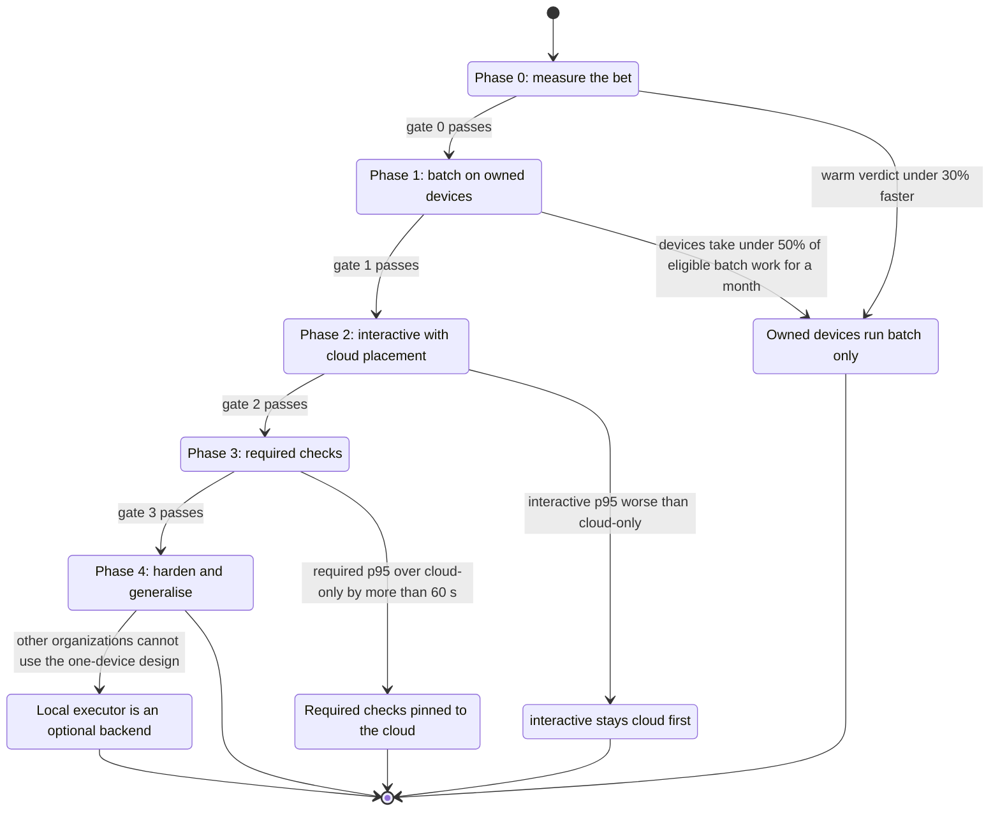
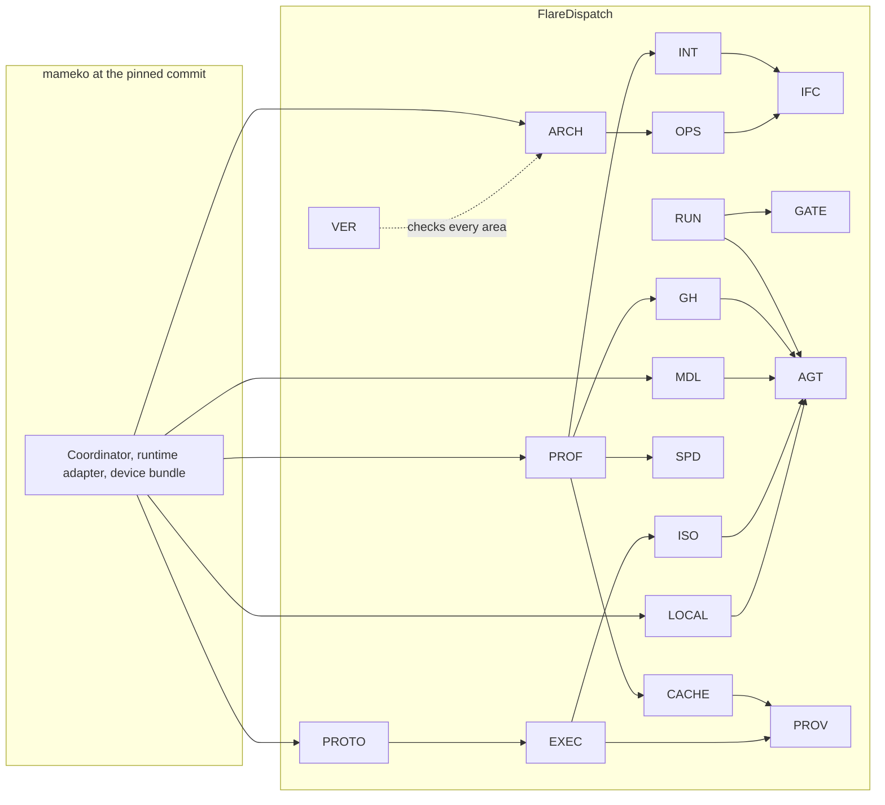

# Roadmap

FlareDispatch ships in five phases. Each phase hands owned devices a more latency-sensitive class of guaranteed work, and a phase starts only after the gate of the phase before it passes and the mameko phase it builds on has passed its own gate. This file specifies each phase's goal, the mameko phase it waits on, the requirements it closes, its gate and its kill lines.

## Scope

This file covers phases 0 to 4, the requirement counts and ID ranges each phase closes, the mameko phase and the deferred mameko items each one waits on, the gate between phases and the kill lines that stop or narrow the plan. It holds no requirements. It depends on [verification.md](verification.md) for the harnesses and the phase-gate job, on the requirement lines of every file in the [index](README.md) for the counts, on mameko's [roadmap.md](https://github.com/fractalboxdev/mameko/blob/88770c64b14818ad32aed9615f1cfaf4bbc1f591/specs/roadmap.md) for the mameko phases, and on [operability.md](operability.md), [provenance.md](provenance.md), [cache-artifacts.md](cache-artifacts.md) and mameko's placement measurement ([MAMEKO-LEASE-081](https://github.com/fractalboxdev/mameko/blob/88770c64b14818ad32aed9615f1cfaf4bbc1f591/specs/placement-leases.md)) for the metrics the gates read.

FlareDispatch's phase n waits on mameko's phase n: mameko's roadmap names, for each of its phases, the reference application's phase it unblocks. A FlareDispatch phase starts only on a mameko release whose phase gate for that phase passed, pinned as [README.md](README.md) states.

## Model

### Phases

Requirement counts and ID ranges come from the requirement lines under `specs/`; an ID range lists `NNN` numbers of `FD-<AREA>-NNN`, and FD-VER-009 keeps the counts equal to the files. The current phase is the digit in `.github/phase`. A pull request that raises it runs the `phase-gate` job of [verification.md](verification.md), which requires, for every requirement of the closing phase or lower, a passing harness entry for each tag, the nightly harnesses, the proofs with their assumption tests, a clean `V-LIVE` record and the `V-MEASURE` thresholds of this file.

| Phase | Goal | Requirements | Waits on | Gate to the next phase |
| --- | --- | --- | --- | --- |
| 0 | Measure the bet: the cloud path on `host-cloudflare` with the profile, the GitHub appliers and the installation rate limit, so no capacity path concludes `neutral`, and warm runs on an owned device measured against the best cloud setup | 520 | mameko phase 0 | A warm run reaches its verdict at least 30% faster than the best cloud setup |
| 1 | Batch on owned devices: mameko's device bundle and FlareDispatch's device extension, capacity leases and the local scheduler; only `batch` runs locally | 56 | mameko phase 1 | Owned devices take most eligible `batch` executions for 14 days with no verdict audit disagreement |
| 2 | Interactive with cloud placement: `interactive` runs local first with a 300 s claim deadline, egress profiles, staged writeback and rehearsal reuse | 56 | mameko phase 2 | `interactive` p95 time to verdict is no worse than cloud-only |
| 3 | Required checks: `required` runs local first with a 60 s claim deadline, firm cloud holds, preemption at step boundaries and the AWS launcher as a floor | 26 | mameko phase 3; the firm-hold rate | `required` p95 time to verdict is within 60 s of cloud-only |
| 4 | Harden and generalise: provenance tiers, confidential mode with local models, macOS VM jobs, the `gha` launcher and device-aware placement | 97 | mameko phase 4; the DSSE signing purpose | — |
| All | | 755 | | |

*Phases · each transition is a passed gate; each failed gate or crossed kill line ends the plan in a narrower state, and the phases above it do not start.*

### Kill lines

The kill-line monitor reads each metric daily and raises the `kill-line` notification when a line is crossed (FD-VER-030). While that notification is unresolved, no phase above the current one starts (FD-VER-031).

| Risk | Kill line | Read from | Fallback |
| --- | --- | --- | --- |
| Warm state saves less than assumed | Median time to verdict on owned devices is less than 30% below the best cloud setup | [MAMEKO-LEASE-081](https://github.com/fractalboxdev/mameko/blob/88770c64b14818ad32aed9615f1cfaf4bbc1f591/specs/placement-leases.md) | Owned devices run `batch` and Apple builds only; phases 2 to 4 do not start |
| Owned devices are too often unavailable | Devices take under 50% of eligible control-plane executions over 30 days | [MAMEKO-LEASE-081](https://github.com/fractalboxdev/mameko/blob/88770c64b14818ad32aed9615f1cfaf4bbc1f591/specs/placement-leases.md) | Owned devices run `batch` only |
| Operator toil | More than one manual intervention on a device in a week | Operator log of drain, revoke and restart actions | Freeze features and raise the device's self-healing gaps against mameko first |
| Warm state hides flaky tests | The verdict audit disagrees more than once in a week | FD-PROV-070 | A nightly clean-room cloud build of the default branch |
| Local placement slows required checks | `required` p95 time to verdict exceeds cloud-only p95 by more than 60 s over 14 days | [MAMEKO-LEASE-081](https://github.com/fractalboxdev/mameko/blob/88770c64b14818ad32aed9615f1cfaf4bbc1f591/specs/placement-leases.md), FD-OPS-070 | Pin required checks to the cloud |
| BYOC product fit | Other organizations cannot use a design that assumes one owned device | Operator decision | The local executor is one optional backend; Cloudflare stays the default |

### Area dependencies

*Area dependencies · an arrow points from the area that defines a mechanism or value to the area that builds on it; every area builds on mameko through the profile and the composed control plane.*

## Phase 0: measure the bet

**Goal.** Close every capacity path that concludes `neutral` and make the cloud path correct and metered before any owned device takes guaranteed work: FlareDispatch's profile on mameko's admission, spend and outbox, the check-run appliers and the installation rate limit, the cache trust tiers, the operator routes, the runbook and the staged-write proofs. Each Container class is locked down from this phase: `enableInternet` false with HTTPS interception, deny-all egress except the grants, and the containers' CA bundle in each image's trust store ([MAMEKO-ISO-017](https://github.com/fractalboxdev/mameko/blob/88770c64b14818ad32aed9615f1cfaf4bbc1f591/specs/isolation-egress.md), [MAMEKO-ISO-020](https://github.com/fractalboxdev/mameko/blob/88770c64b14818ad32aed9615f1cfaf4bbc1f591/specs/isolation-egress.md), [MAMEKO-ISO-021](https://github.com/fractalboxdev/mameko/blob/88770c64b14818ad32aed9615f1cfaf4bbc1f591/specs/isolation-egress.md)). Alongside, required suites run warm on an owned device by hand against the best cloud setup (the cold container cache plus prebuilt dependencies), with executor and cache columns on every execution.

**Waits on.** mameko phase 0: the kernels, the DO-SQLite engine backend, the `host-cloudflare` stores, admission, the outbox and the spend holds.

**Closes** 520 requirements:

| Area | Requirements | IDs |
| --- | --- | --- |
| `ARCH` | 9 | 001–005, 007, 019, 039–040 |
| `CACHE` | 71 | 001–003, 011–012, 015–017, 019–020, 022–024, 026, 028–029, 031–035, 037–042, 044–059, 061–064, 066–079, 081–087, 089–091 |
| `GH` | 63 | 001–018, 020–029, 031, 045–048, 052, 056–063, 065–068, 075–076, 078–092 |
| `INT` | 46 | 001, 003–004, 009–011, 015–036, 039–043, 049–058, 064–065, 067 |
| `IFC` | 67 | 001–030, 032–033, 035–047, 049–052, 055–062, 064–068, 070, 076, 082–084 |
| `MDL` | 5 | 020–022, 024, 067 |
| `OPS` | 59 | 001–017, 019–031, 036, 038–046, 050, 053, 056–057, 064, 067–070, 072–078, 083, 088–089 |
| `PROF` | 46 | 001–024, 026–030, 032–034, 037, 044–048, 054–058, 060, 062–063 |
| `PROV` | 2 | 049–050 |
| `RUN` | 6 | 008, 017, 054, 057, 061–062 |
| `AGT` | 28 | 002–003, 008–009, 011–014, 016–028, 034–035, 037–039, 041–042 |
| `GATE` | 79 | 001–008, 010–015, 017–080, 082 |
| `SPD` | 4 | 032, 057–058, 060 |
| `VER` | 35 | 001–016, 018–031, 033–037 |

**Gate 0.**

- `V-MEASURE`: the median time to verdict of each required suite run warm on an owned device is at least 30% below the best cloud setup over 14 days ([MAMEKO-LEASE-081](https://github.com/fractalboxdev/mameko/blob/88770c64b14818ad32aed9615f1cfaf4bbc1f591/specs/placement-leases.md)); the cache hit rate per tier and executor kind is reported (FD-CACHE-090); no `estimate-drift` notification is unresolved.
- Must pass: every phase 0 harness entry for `V-UNIT`, `V-CONF`, `V-SIM`, `V-REPLAY`, `V-E2E-LOCAL` (cloud path), `V-DEPLOY` and `V-DIFF`, the `profile-reference` diff (FD-VER-033) included; the formal gate with S3 · profile, S6 and S8 for their phase 0 requirements and their assumption tests passing; the `V-LIVE` canary and installation probe with no page unresolved for more than 24 h.

**Kill line.** If a warm run is less than 30% faster than the best cloud setup, owned devices run `batch` and Apple builds only, phase 1 proceeds for that scope, and phases 2 to 4 do not start.

## Phase 1: batch on owned devices

**Goal.** Run `batch` control-plane work on owned devices with no required check at risk. Each device enrolls through `POST /v1/executors/register` and installs mameko's device bundle, whose device executor connects to its `ExecutorChannel` with an upgrade the device key signs, beside FlareDispatch's device extension, which holds L1; `fd` is mameko's `<cli>` built with the name `fd`; capacity leases and the local scheduler run unguaranteed local work. A `batch` execution waits as a D1 row until a device claims it or its staleness point sends it to the cloud below its line; `release`, `required` and `interactive` placement is unchanged.

**Waits on.** mameko phase 1: the key helper, sandbox isolation with its probe, deny-all egress, per-lease credentials, capacity leases and the local scheduler on `host-cloudflare`.

**Closes** 56 requirements:

| Area | Requirements | IDs |
| --- | --- | --- |
| `ARCH` | 1 | 018 |
| `CACHE` | 18 | 004, 006–010, 013, 018, 021, 025, 027, 030, 036, 043, 060, 065, 080, 088 |
| `EXEC` | 2 | 007, 059 |
| `GH` | 1 | 019 |
| `INT` | 1 | 061 |
| `IFC` | 12 | 063, 069, 075, 077–081, 085–088 |
| `LOCAL` | 9 | 018–020, 038, 055, 067, 071–072, 075 |
| `OPS` | 1 | 071 |
| `PROF` | 7 | 035–036, 043, 049–052 |
| `PROV` | 2 | 069–070 |
| `RUN` | 1 | 063 |
| `VER` | 1 | 032 |

**Gate 1.**

- `V-MEASURE`: owned devices take more than 50% of eligible `batch` executions over 14 days ([MAMEKO-LEASE-081](https://github.com/fractalboxdev/mameko/blob/88770c64b14818ad32aed9615f1cfaf4bbc1f591/specs/placement-leases.md)) with zero verdict audit disagreements (FD-PROV-069, FD-PROV-070); executor channel duration in GB-s per connected executor per day is recorded for every day of the window; each preemption is reported.
- Must pass: every phase 1 harness entry, with `V-CONF` and `V-E2E-LOCAL` on the device path and mameko's conformance suite on the composed control plane (FD-VER-032); S3 · profile and S6 for their phase 1 requirements, each with its assumption tests passing.

**Kill lines.** Devices taking under 50% of eligible control-plane executions over 30 days keep owned devices on `batch`. More than one manual intervention on a device in a week freezes features until the device heals itself. More than one audit disagreement in a week adds a nightly clean-room cloud build of the default branch.

## Phase 2: interactive with cloud placement

**Goal.** Run `interactive` work local first. `pr-review` and the gating runs whose check is not required claim on a device within the 300 s claim deadline of `interactive` and go to the cloud after it; the control plane wakes eligible executor channels within 1 s of a placement; the `setup` and `agent` egress profiles, the local model route on devices, submission between devices over the tailnet, FlareDispatch's reuse policy for pull-request checks, its writeback gate for local staged writeback and the MCP server ship.

**Waits on.** mameko phase 2: interactive work local-first with cloud placement after its claim deadline, the egress profiles, the model gateway and the local model route on devices.

**Closes** 56 requirements:

| Area | Requirements | IDs |
| --- | --- | --- |
| `CACHE` | 1 | 014 |
| `GH` | 1 | 077 |
| `INT` | 2 | 062–063 |
| `IFC` | 3 | 072–074 |
| `LOCAL` | 14 | 077–089, 094 |
| `PROF` | 1 | 031 |
| `AGT` | 33 | 001, 005–007, 010, 029–033, 045–047, 049–062, 068–073 |
| `GATE` | 1 | 081 |

**Gate 2.**

- `V-MEASURE`: `interactive` p95 time to verdict over 14 days is no worse than the cloud-only `interactive` p95 ([MAMEKO-LEASE-081](https://github.com/fractalboxdev/mameko/blob/88770c64b14818ad32aed9615f1cfaf4bbc1f591/specs/placement-leases.md), FD-OPS-070); executor channels are signalled within 1 s of a `local_open` placement write.
- Must pass: every phase 2 harness entry; S8 for FD-LOCAL-094 proved with its assumption tests passing.

**Gate failure.** If `interactive` p95 is worse than cloud-only, `interactive` keeps a claim deadline of 0 s, so it is cloud first, and phase 3 does not start.

## Phase 3: required checks

**Goal.** Run `required` work local first with the cloud as the floor for every required check. A `required` placement opens its local entry with a 60 s claim deadline (0 s on a predicted miss), takes its firm cloud hold at admission and keeps it until a device verdict is accepted, and evicts the newest local `batch` execution when no slot is free by `return_by`. The AWS launcher takes `required` work while the `cloudflare` breaker is open, under the hold, task stop and reaper bounds of [executors.md](executors.md).

**Waits on.** mameko phase 3: the highest-rank device class local-first, firm cloud holds, preemption at step boundaries and the `aws` launcher as a floor. Before this phase opens, mameko's open item on the firm-hold rate (how a firm hold is covered in claim order by the burn lane's headroom or the look-ahead) is resolved, so FlareDispatch's look-ahead of 5 has one meaning.

**Closes** 26 requirements:

| Area | Requirements | IDs |
| --- | --- | --- |
| `ARCH` | 1 | 015 |
| `EXEC` | 1 | 083 |
| `INT` | 1 | 066 |
| `PROF` | 1 | 059 |
| `AGT` | 22 | 043–044, 063–067, 074–088 |

**Gate 3.**

- `V-MEASURE`: `required` p95 time to verdict over 14 days is within 60 s of the cloud-only `required` p95 ([MAMEKO-LEASE-081](https://github.com/fractalboxdev/mameko/blob/88770c64b14818ad32aed9615f1cfaf4bbc1f591/specs/placement-leases.md), FD-OPS-070); epoch discards per execution are recorded ([MAMEKO-LEASE-041](https://github.com/fractalboxdev/mameko/blob/88770c64b14818ad32aed9615f1cfaf4bbc1f591/specs/placement-leases.md)).
- Must pass: every phase 3 harness entry, with `V-CONF` on the `aws` executor and mameko's daily AWS launcher canary ([MAMEKO-OPS-019](https://github.com/fractalboxdev/mameko/blob/88770c64b14818ad32aed9615f1cfaf4bbc1f591/specs/operability.md)) with no page unresolved for more than 24 h.

**Kill line.** If `required` p95 exceeds cloud-only p95 by more than 60 s over 14 days, required checks are pinned to the cloud.

## Phase 4: harden and generalise

**Goal.** Make the fleet trustworthy beyond one organization's single device: device-signed, platform and reproduced provenance with the statement builder, the attestation verifier, the result-acceptance check, the transparency log and the signed verification policy; confidential mode with local model routes; macOS VM jobs; the `gha` launcher for macOS release jobs; and device-aware placement by owner.

**Waits on.** mameko phase 4: confidential mode with local models, macOS VM jobs, device-aware placement by owner, the statement builder and the result-acceptance check. Before this phase opens, mameko's open item on the signing purpose of the DSSE statement envelope is resolved, so the `statement` purpose FlareDispatch's profile lists signs the envelope FD-PROV-004 specifies.

**Closes** 97 requirements:

| Area | Requirements | IDs |
| --- | --- | --- |
| `PROTO` | 1 | 014 |
| `EXEC` | 8 | 085–092 |
| `IFC` | 3 | 053–054, 071 |
| `ISO` | 2 | 021–022 |
| `PROF` | 8 | 025, 038–042, 053, 061 |
| `PROV` | 73 | 001–048, 051–068, 071–077 |
| `AGT` | 2 | 004, 040 |

**Exit.**

- Must pass: every phase 4 harness entry, with `V-CONF` on the `gha` executor; S7a to S7e verified by `tamarin-prover --prove`, each expected attack as an `exists-trace` lemma, and every acceptance check they assume with a passing negative test (FD-PROV-072, FD-PROV-073); S5 · trifecta for FD-AGT-004 proved.

**Kill line.** If other organizations cannot use a design that assumes one owned device, the local executor becomes one optional backend and Cloudflare stays the default.

## Open items

- TODO(operator): confirm the 14-day windows of gates 0, 2 and 3 and the 30% threshold of gate 0 before phase 0 closes.
- TODO(operator): name the record that counts manual interventions on a device for the operator-toil kill line.
