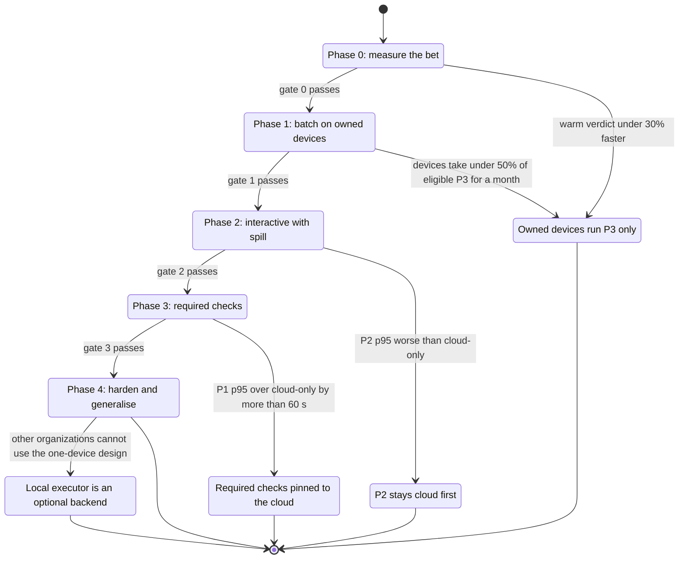
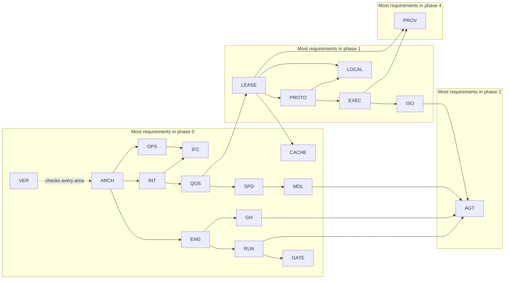

# Roadmap

FlareDispatch ships in five phases. Each phase hands owned devices a more latency-sensitive class of guaranteed work, and a phase starts only after the gate of the phase before it passes. This file specifies each phase's goal, the requirements it closes, its gate and its kill lines.

## Scope

This file covers phases 0 to 4, the requirement counts and ID ranges each phase closes, the gate between phases and the kill lines that stop or narrow the plan. It holds no requirements. It depends on [verification.md](verification.md) for the harnesses and the phase-gate job, on the requirement lines of every file in the [index](README.md) for the counts, and on [operability.md](operability.md), [placement-leases.md](placement-leases.md), [provenance.md](provenance.md) and [cache-artifacts.md](cache-artifacts.md) for the metrics the gates read.

## Model

### Phases

Requirement counts and ID ranges come from the requirement lines under `specs/`; an ID range lists `NNN` numbers of `FD-<AREA>-NNN`, and FD-VER-009 keeps the counts equal to the files. The current phase is the digit in `.github/phase`. A pull request that raises it runs the `phase-gate` job of [verification.md](verification.md), which requires, for every requirement of the closing phase or lower, a passing harness entry for each tag, the nightly harnesses, the proofs with their assumption tests, a clean `V-LIVE` record and the `V-MEASURE` thresholds of this file.

| Phase | Goal | Requirements | Gate to the next phase |
| --- | --- | --- | --- |
| 0 | Measure the bet: fix cloud QoS so no capacity path concludes `neutral`, and measure warm runs on an owned device against the best cloud setup | 853 | A warm run reaches its verdict at least 30% faster than the best cloud setup |
| 1 | Batch on owned devices: the agent, the executor protocol, the executor registry, VM-per-job isolation, capacity leases and the local scheduler; only P3 runs locally | 332 | Owned devices take most eligible P3 executions for 14 days with no verdict audit disagreement |
| 2 | Interactive with spill: P2 runs local first with a 300 s claim deadline, egress profiles, staged writeback and rehearsal | 83 | P2 p95 time to verdict is no worse than cloud-only |
| 3 | Required checks: P1 runs local first with a 60 s claim deadline, firm cloud holds, preemption at step boundaries and the AWS launcher as a floor | 49 | P1 p95 time to verdict is within 60 s of cloud-only |
| 4 | Harden and generalise: provenance tiers, confidential mode with local models, macOS VM jobs, the GitHub Actions launcher, device-aware placement and the portable control plane | 109 | — |
| All | | 1426 | |

*Phases · each transition is a passed gate; each failed gate or crossed kill line ends the plan in a narrower state, and the phases above it do not start.*

### Kill lines

The kill-line monitor reads each metric daily and raises the `kill-line` notification when a line is crossed (FD-VER-030). While that notification is unresolved, no phase above the current one starts (FD-VER-031).

| Risk | Kill line | Read from | Fallback |
| --- | --- | --- | --- |
| Warm state saves less than assumed | Median time to verdict on owned devices is less than 30% below the best cloud setup | FD-LEASE-066 | Owned devices run P3 and Apple builds only; phases 2 to 4 do not start |
| Owned devices are too often unavailable | Devices take under 50% of eligible control-plane executions over 30 days | FD-LEASE-066 | Owned devices run P3 only |
| Operator toil | More than one manual intervention on the agent in a week | Operator log of drain, revoke and restart actions | Freeze features and fix the agent's self-healing first |
| Warm state hides flaky tests | The verdict audit disagrees more than once in a week | FD-PROV-070 | A nightly clean-room cloud build of the default branch |
| Local placement slows required checks | P1 p95 time to verdict exceeds cloud-only p95 by more than 60 s over 14 days | FD-LEASE-066, FD-OPS-070 | Pin required checks to the cloud |
| BYOC product fit | Other organizations cannot use a design that assumes one owned device | Operator decision | The local executor is one optional backend; Cloudflare stays the default |

### Area dependencies

*Area dependencies · an arrow points from the area that defines a mechanism to the area that builds on it; areas group by the phase that holds most of their requirements.*

## Phase 0: measure the bet

**Goal.** Close every capacity path that concludes `neutral` and make the cloud path correct and metered before any owned device takes guaranteed work: QoS classes, admission, the executor-aware spend kernel, the outbox, check output, the cache trust tiers, operator controls, the runbook and the formal gate. Alongside, required suites run warm on an owned device by hand against the best cloud setup (the cold container cache plus prebuilt dependencies), with executor and cache columns on every execution.

**Closes** 853 requirements:

| Area | Requirements | IDs |
| --- | --- | --- |
| `VER` | 30 | 001–016, 018–031 |
| `ARCH` | 25 | 001–007, 011, 013, 019–023, 026–029, 031–037 |
| `RUN` | 57 | 001–008, 011–014, 016–060 |
| `ENG` | 45 | 001–022, 027–048, 050 |
| `INT` | 57 | 001–036, 039–043, 049–058, 064–065, 067–070 |
| `QOS` | 71 | 001–018, 021–022, 025–026, 028–047, 049, 052–057, 059–073, 077–078, 080–082, 084, 086 |
| `SPD` | 52 | 001–009, 011–014, 016–040, 046–048, 051–055, 057–061, 063 |
| `LEASE` | 22 | 001–002, 008–010, 012, 014–015, 019, 022, 027–029, 035, 037–040, 043–044, 062, 067 |
| `PROTO` | 20 | 012, 015–021, 031, 042–050, 060, 078 |
| `EXEC` | 14 | 001–004, 040, 042–046, 094, 096–098 |
| `ISO` | 2 | 060, 064 |
| `CACHE` | 71 | 001–003, 011–012, 015–017, 019–020, 022–024, 026, 028–029, 031–035, 037–042, 044–059, 061–064, 066–079, 081–087, 089–091 |
| `GH` | 87 | 001–018, 020–076, 078–089 |
| `MDL` | 47 | 001–011, 013, 019–036, 038, 043–050, 052–056, 064–065, 067 |
| `IFC` | 67 | 001–030, 032–033, 035–052, 055–068, 070, 076, 082 |
| `PROV` | 2 | 049–050 |
| `OPS` | 77 | 001–017, 019–050, 053–058, 063–064, 067–070, 072–085, 088–089 |
| `GATE` | 79 | 001–008, 010–015, 017–080, 082 |
| `AGT` | 28 | 002–003, 008–009, 011–014, 016–028, 034–035, 037–039, 041–042 |

**Gate 0.**

- `V-MEASURE`: the median time to verdict of each required suite run warm on an owned device is at least 30% below the best cloud setup over 14 days (FD-LEASE-066); the cache hit rate per tier and executor kind is reported (FD-CACHE-090); no `estimate-drift` notification is unresolved (FD-SPD-020).
- Must pass: every phase 0 harness entry for `V-UNIT`, `V-CONF`, `V-SIM`, `V-REPLAY`, `V-E2E-LOCAL` (cloud path), `V-DEPLOY` and `V-DIFF`; the formal gate with F1–F5, S1 (`Fence`), S2, S3, S6 and S8 proved for their phase 0 requirements and their assumption tests passing; the `V-LIVE` canary and installation probe with no page unresolved for more than 24 h.

**Kill line.** If a warm run is less than 30% faster than the best cloud setup, owned devices run P3 and Apple builds only, phase 1 proceeds for that scope, and phases 2 to 4 do not start.

## Phase 1: batch on owned devices

**Goal.** Run P3 control-plane work on owned devices with no required check at risk. The `flare-dispatchd` agent connects to its executor DO over the documented executor protocol; the executor registry, posture tiers, VM-per-job isolation, per-lease credentials and the device cache level ship; capacity leases and the local scheduler run unguaranteed local work. A P3 waits as a D1 row until a device claims it or its staleness point sends it to the cloud below the P3 line; P0 to P2 placement is unchanged.

**Closes** 332 requirements:

| Area | Requirements | IDs |
| --- | --- | --- |
| `VER` | 1 | 017 |
| `ARCH` | 10 | 008–010, 012, 014, 016–018, 024–025 |
| `RUN` | 1 | 015 |
| `ENG` | 3 | 023–024, 049 |
| `INT` | 3 | 059–061 |
| `QOS` | 2 | 023, 079 |
| `SPD` | 5 | 010, 043, 049–050, 064 |
| `LEASE` | 33 | 003–007, 011, 013, 024–025, 030–031, 033–034, 036, 042, 045–057, 061, 063–066 |
| `PROTO` | 54 | 001–011, 022–029, 032–041, 051–055, 057–059, 061–077 |
| `EXEC` | 56 | 005–018, 020–036, 038–039, 048–053, 056–057, 059–062, 064–065, 067–073, 101–102 |
| `ISO` | 53 | 001, 003–009, 011–019, 027–059, 061–063 |
| `CACHE` | 19 | 004–010, 013, 018, 021, 025, 027, 030, 036, 043, 060, 065, 080, 088 |
| `GH` | 1 | 019 |
| `MDL` | 6 | 018, 040–042, 051, 068 |
| `LOCAL` | 72 | 001–016, 018–027, 029–043, 049–067, 069–076, 090–093 |
| `IFC` | 7 | 069, 075, 077–081 |
| `PROV` | 2 | 069–070 |
| `OPS` | 4 | 052, 071, 086–087 |

**Gate 1.**

- `V-MEASURE`: owned devices take more than 50% of eligible P3 executions over 14 days (FD-LEASE-066) with zero verdict audit disagreements (FD-PROV-069, FD-PROV-070); executor DO duration in GB-s per connected executor per day is recorded for every day of the window (FD-PROTO-041); each preemption is reported (FD-LOCAL-056).
- Must pass: every phase 1 harness entry, with `V-CONF` and `V-E2E-LOCAL` on the device path; S1 in Veil (`LeaseProtocol.single_acceptance`), S4 and F6 proved, and S3 and S6 for their phase 1 requirements, each with its assumption tests passing; FD-VER-017 running in the `formal` job.

**Kill lines.** Devices taking under 50% of eligible control-plane executions over 30 days keep owned devices on P3. More than one manual intervention on the agent in a week freezes features until the agent heals itself. More than one audit disagreement in a week adds a nightly clean-room cloud build of the default branch.

## Phase 2: interactive with spill

**Goal.** Run P2 work local first. `pr-review` and the gating runs whose check is not required claim on a device within the 300 s P2 claim deadline and spill to the cloud after it; the control plane wakes eligible executor DOs within 1 s of a placement; the `setup` and `agent` egress profiles, the local model route on devices, submission between devices over the tailnet, rehearsal reuse for pull-request checks, local staged writeback and the MCP server ship.

**Closes** 83 requirements:

| Area | Requirements | IDs |
| --- | --- | --- |
| `INT` | 2 | 062–063 |
| `QOS` | 2 | 074–075 |
| `LEASE` | 6 | 016, 018, 020–021, 032, 060 |
| `PROTO` | 1 | 030 |
| `ISO` | 4 | 023–026 |
| `CACHE` | 1 | 014 |
| `GH` | 1 | 077 |
| `MDL` | 9 | 012, 037, 039, 057–060, 063, 066 |
| `LOCAL` | 20 | 044–048, 068, 077–089, 094 |
| `IFC` | 3 | 072–074 |
| `GATE` | 1 | 081 |
| `AGT` | 33 | 001, 005–007, 010, 029–033, 045–047, 049–062, 068–073 |

**Gate 2.**

- `V-MEASURE`: P2 p95 time to verdict over 14 days is no worse than the cloud-only P2 p95 (FD-LEASE-066, FD-OPS-070); executor DOs are signalled within 1 s of a `local_open` placement write (FD-PROTO-030).
- Must pass: every phase 2 harness entry; S5 for FD-ISO-024 and FD-ISO-025 and S8 for FD-LOCAL-094 proved with their assumption tests passing.

**Gate failure.** If P2 p95 is worse than cloud-only, P2 keeps a claim deadline of 0 s, so it is cloud first, and phase 3 does not start.

## Phase 3: required checks

**Goal.** Run P1 work local first with the cloud as the floor for every required check. A P1 placement opens its local entry with a 60 s claim deadline (0 s on a predicted miss), takes its cloud hold at admission and keeps it until a device verdict is accepted, and evicts the newest local P3 when no slot is free by `return_by`. The AWS launcher takes P1 while the `cloudflare` breaker is open, under the hold, task stop and reaper bounds of [executors.md](executors.md).

**Closes** 49 requirements:

| Area | Requirements | IDs |
| --- | --- | --- |
| `ARCH` | 1 | 015 |
| `INT` | 1 | 066 |
| `SPD` | 5 | 041–042, 044–045, 062 |
| `LEASE` | 3 | 017, 058–059 |
| `PROTO` | 1 | 013 |
| `EXEC` | 14 | 074–084, 095, 099–100 |
| `ISO` | 1 | 020 |
| `OPS` | 1 | 051 |
| `AGT` | 22 | 043–044, 063–067, 074–088 |

**Gate 3.**

- `V-MEASURE`: P1 p95 time to verdict over 14 days is within 60 s of the cloud-only P1 p95 (FD-LEASE-066, FD-OPS-070); epoch discards per execution are recorded (FD-LEASE-038).
- Must pass: every phase 3 harness entry, with `V-CONF` on the `aws` executor and the daily AWS launcher canary (FD-OPS-051) with no page unresolved for more than 24 h; F7 proved with its assumption tests passing.

**Kill line.** If P1 p95 exceeds cloud-only p95 by more than 60 s over 14 days, required checks are pinned to the cloud.

## Phase 4: harden and generalise

**Goal.** Make the fleet trustworthy beyond one organization's single device: device-signed, platform and reproduced provenance with the transparency log and the signed verification policy; confidential mode with local model routes; macOS VM jobs; the GitHub Actions launcher for macOS release jobs; device-aware placement by owner; and the portable control plane on the Postgres engine.

**Closes** 109 requirements:

| Area | Requirements | IDs |
| --- | --- | --- |
| `ARCH` | 1 | 038 |
| `ENG` | 2 | 025–026 |
| `QOS` | 5 | 024, 027, 085, 087–088 |
| `LEASE` | 1 | 026 |
| `PROTO` | 1 | 014 |
| `EXEC` | 11 | 037, 058, 085–093 |
| `ISO` | 3 | 002, 021–022 |
| `MDL` | 7 | 014–017, 061–062, 069 |
| `IFC` | 3 | 053–054, 071 |
| `PROV` | 73 | 001–048, 051–068, 071–077 |
| `AGT` | 2 | 004, 040 |

**Exit.**

- Must pass: every phase 4 harness entry, with `V-CONF` on the `gha` executor and on the Postgres engine; S7a to S7e verified by `tamarin-prover --prove`, each expected attack as an `exists-trace` lemma, and every acceptance check they assume with a passing negative test (FD-PROV-072, FD-PROV-073); S5 for FD-AGT-004 and S3 for FD-QOS-085 proved.

**Kill line.** If other organizations cannot use a design that assumes one owned device, the local executor becomes one optional backend and Cloudflare stays the default.

## Open items

- TODO(operator): confirm the 14-day windows of gates 0, 2 and 3 and the 30% threshold of gate 0 before phase 0 closes.
- TODO(operator): name the record that counts manual interventions on the agent for the operator-toil kill line.
