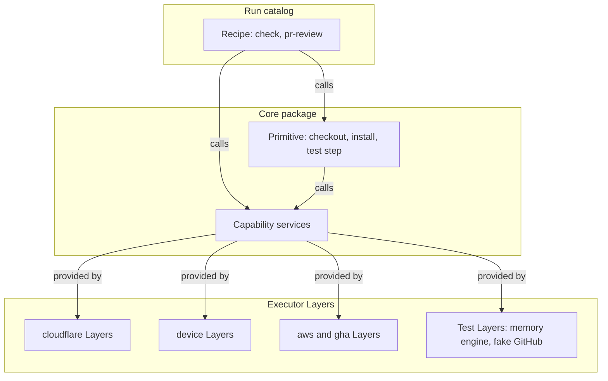
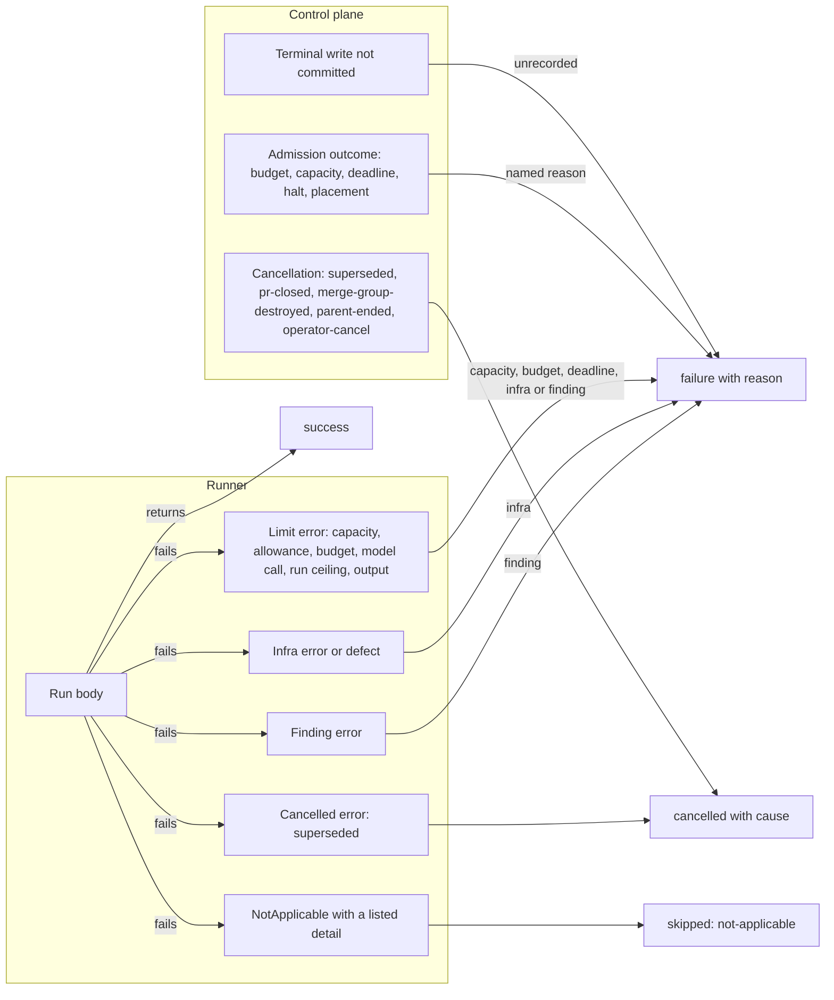
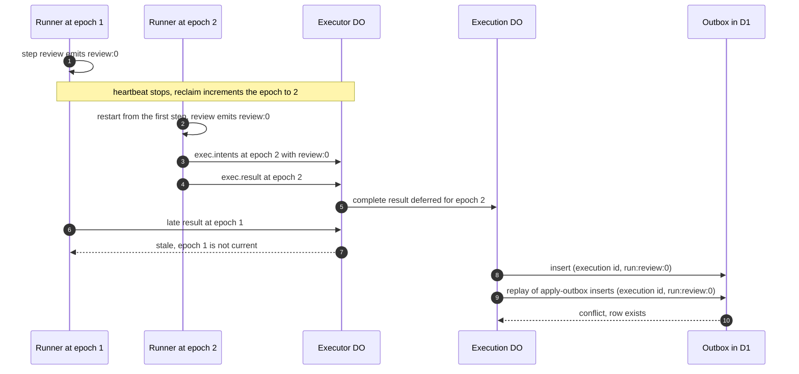

# Run model

A run is a typed Effect program written with `defineRun` on `effect/workflow`. It reads its inputs, runs steps against executor-neutral capability services, and ends with one verdict and a list of intents that the control plane applies. This file specifies `defineRun`, the capability → primitive → recipe layering, the `RunResult` verdict partition, the tagged error taxonomy, intents, the run ceiling and child executions.

## Scope

This file covers what a run author writes and what a runner guarantees about it. It depends on:

- [engine.md](engine.md) for the journal, determinism rules and the backends a run executes on;
- [architecture.md](architecture.md) for where the runner runs and how the `Execution` workflow accepts a result;
- [qos-admission.md](qos-admission.md) for classes P0–P3, placement constraints, deadlines and supersession groups;
- [github-output.md](github-output.md) for the conclusion each verdict maps to and how the outbox applies each intent;
- [runs/agentic.md](runs/agentic.md) for the staged-write gate that every `pr.propose` intent passes;
- [intake.md](intake.md) for the decoded `DispatchEvent` union that triggers read;
- [executors.md](executors.md) for the capability manifest, the capability labels and the `Exec` handle.
- [model-gateway.md](model-gateway.md) for the `ModelCallFailed` reasons.

[ADR-0002](adr/0002-effect-workflow-engine.md) records why runs are `effect/workflow` programs, and [ADR-0003](adr/0003-run-body-in-executor.md) why the run body executes in the executor and emits intents.

## Model

### Layers

A run is built from three layers. Capabilities are service interfaces declared in core with no executor import. Each executor kind supplies one Layer per capability it serves, and lists those capability services in its capability manifest ([executors.md](executors.md)). Primitives compose capabilities into reusable steps. Recipes are complete runs in the catalog ([runs/gate.md](runs/gate.md), [runs/agentic.md](runs/agentic.md)).

*run layers · recipes and primitives import only core; an executor kind serves a run only if its manifest lists every capability the run declares.*

| Capability | Serves | Fails with |
| --- | --- | --- |
| `Workspace` | A checkout of the execution's commit in the job sandbox, and reads of files under the declared output paths | `CheckoutFailed`, `ReadRefused` |
| `Exec` | A command in the job sandbox, with a handle and a receipt | `ExecFailed`, `ExecTimeout`, `SandboxProcessLost`, `OutputLimitExceeded` |
| `Cache` | Restore and save of cache entries in the namespace the lease names | `StoreUnavailable`, `CacheNamespaceDenied` on save; a restore miss is a value |
| `Artifact` | Upload and list of the execution's artifacts | `StoreUnavailable`, `InvalidArtifactName`, `ArtifactTooLarge` |
| `GithubRead` | Reads of the repository and its pull requests under the per-lease token | `GithubReadFailed`, `GithubUncredentialed` |
| `Intents` | Appends an intent to the execution's intent list | `DuplicateIntentKey`, `IntentLimitExceeded` |
| `ModelGateway` | Model calls through the gateway route under the execution's allowance | `ModelCallFailed`, `ModelRequestInvalid`, `ModelRouteRefused`, `StructuredOutputInvalid`, `AllowanceExhausted` |
| `Config` | Schema-decoded configuration keys for the run and repository | `ConfigInvalid`, `StoreUnavailable` |
| `IO` | Execution id, epoch, structured log, prior execution lookup | `StoreUnavailable` |
| `Progress` | A progress line that rides the next heartbeat | — |
| `Children` | Spawns child executions and waits for their verdicts | `StoreUnavailable` |

No capability returns a secret value. Credentials attach at the egress proxy per lease ([isolation-egress.md](isolation-egress.md)).

### Definition

`defineRun(spec, body)` decodes `spec` with `Schema` and returns a `Workflow` made with `Workflow.make`:

| Spec field | Type | Bound |
| --- | --- | --- |
| `name` | kebab-case string | `^[a-z][a-z0-9-]{1,47}$` |
| `version` | semver string | — |
| `input` | `Schema` | Decodes the run's inputs |
| `requires` | list of capability names | From the capability table |
| `labels` | list of capability labels | From the label set in [executors.md](executors.md); placement filters on them ([placement-leases.md](placement-leases.md) FD-LEASE-007) |
| `limits.maxDurationSec` | integer | 60 to 259200 |
| `limits.qosClass` | `P0` to `P3` | Not above `limits.qosCeiling` |
| `limits.qosCeiling` | `P0` to `P3` | — |
| `limits.queueAgeSec` | integer, optional | 60 to 86400; the queue age of P0 and P1 ([qos-admission.md](qos-admission.md) FD-QOS-045) |
| `limits.modelAllowanceUsd` | decimal USD, optional | At least 0; absent means 0 ([spend.md](spend.md) FD-SPD-017) |
| `limits.leaseWaitSec` | integer, optional | At least 600, the default ([qos-admission.md](qos-admission.md) FD-QOS-045) |
| `limits.settleMarginSec` | integer, optional | At least 300, the default ([qos-admission.md](qos-admission.md) FD-QOS-045) |
| `limits.progressTimeoutSec` | integer, optional | 60 to `limits.maxDurationSec`; default 300 ([placement-leases.md](placement-leases.md) FD-LEASE-030) |
| `retries` | integer | 0 to 2; default 0 ([qos-admission.md](qos-admission.md) FD-QOS-077, [spend.md](spend.md) FD-SPD-030) |
| `constraints` | list of placement constraints | From [qos-admission.md](qos-admission.md) |
| `supersede` | boolean, optional | [qos-admission.md](qos-admission.md) FD-QOS-059 |
| `serialize` | boolean, optional | [qos-admission.md](qos-admission.md) FD-QOS-067 |
| `joinsChildren` | boolean, optional | [qos-admission.md](qos-admission.md) FD-QOS-070 |
| `cooldown` | `{ seconds, scope }`, optional | `seconds` 60 to 86400; `scope` from [intake.md](intake.md) FD-INT-057 |
| `schedules` | list of `{ cron }`, optional | Five-field cron expression evaluated in UTC ([intake.md](intake.md) FD-INT-051) |
| `checkLabel` | string, optional | `^[A-Za-z0-9][A-Za-z0-9._-]{0,31}$` ([github-output.md](github-output.md) FD-GH-007) |
| `grants` | `{ setup: [name], agent: [name] }` | Names from the grant catalog ([isolation-egress.md](isolation-egress.md) FD-ISO-038) |
| `outputPaths` | list of globs | The only paths whose file contents the executor returns to the run ([executors.md](executors.md) FD-EXEC-010) |
| `needsModel` | boolean | [runs/agentic.md](runs/agentic.md) § Model |
| `dataClasses` | `{ privateData, untrustedInput, outbound }`, booleans | [runs/agentic.md](runs/agentic.md) § Model |
| `intentKinds` | list of intent kinds | From § Intents |
| `writeback` | `{ branch, base, allowlist, allowSensitivePaths, allowWorkflows, maxFiles, maxBytes }`, optional | `maxFiles` default 200, `maxBytes` default 5 MiB ([runs/agentic.md](runs/agentic.md)) |
| `triggers` | list of trigger functions | `DispatchEvent` → `Option<input>` |

The `Workflow` takes the `ExecutionPayload` as payload, `RunResult` as success schema and `Schema.Never` as error schema: the runner maps every `RunError` to a `RunResult` inside the workflow, so `poll` on a finished run returns `Complete` whose exit is a `RunResult` success; the runner maps a failure exit (a defect or an interrupt) to `failure(infra)` with `RunDefect` (FD-RUN-036). The runner starts the run with `executionId` set to `<execution id>:<epoch>` ([engine.md](engine.md)), so a reclaim at a new epoch starts a fresh journal. The workflow's `idempotencyKey` returns the same string, and no stored id derives from it.

`ExecutionPayload` carries: execution id, run name, run version, `workflow_version` (the integer the registered body dispatches on, [engine.md](engine.md) FD-ENG-038), repository, ref, commit SHA, installation id, class, epoch, `deadline_at`, parent execution id (optional), attempt and the encoded run inputs.

### Verdict partition

Every execution ends with one `RunResult`, except a P3 execution without a check run that [qos-admission.md](qos-admission.md) records `deferred` (FD-QOS-034, FD-QOS-035, FD-QOS-055); a deferred P3 execution that owns a check run ends `failure(capacity: deferred)`. A failure reason is written `<kind>[: <detail>]`: the kind is a fixed string from the reason table below, and the detail names the failing value. Each kind belongs to exactly one category of the closed union `finding`, `infra`, `budget`, `capacity`, `deadline`, `halt`, `placement`, `unrecorded`, `config`, `policy` and `provenance`, and `checkConclusion` matches on the category ([github-output.md](github-output.md)). A cancel cause is written the same way, `<cause>[: <detail>]`, with the cause from the cancel-cause table. A skip is written `not-applicable: <detail>`, with the detail from the not-applicable detail table.

| Verdict | Category or cause | Produced by |
| --- | --- | --- |
| `success` | — | The run body returns |
| `failure` | `finding` | A `Finding` error or a recipe's finding reason: the code under test fails the check |
| `failure` | `infra` | An `Infra` error, a defect in the run body, a `ModelCallFailed` error with a non-capacity reason, or an execution the settle sweep finds lost |
| `failure` | `budget` | The class line or burn lane stays closed past the class's wait ([qos-admission.md](qos-admission.md) FD-QOS-053), or `BudgetExhausted` or `AllowanceExhausted` from the run body |
| `failure` | `capacity` | A queue bound, a P3 deferral of an execution that owns a check run, a model call that ends `context-overflow` or `rate-limited`, or `CapacityExhausted` from the run body |
| `failure` | `deadline` | `deadline_at` passes, the run ceiling ends the body, or no executor slot by `deadline_at` (`deadline: capacity`) |
| `failure` | `halt` | An operator halt or a repository quarantine covers the execution |
| `failure` | `placement` | No executor is eligible under the placement constraints |
| `failure` | `unrecorded` | The terminal write of the verdict did not commit |
| `failure` | `config` | A recipe parameter or manifest field is outside its bound, and the recipe runs no command |
| `failure` | `policy` | The control plane or a recipe refuses under a policy: the trifecta rule, the staged-write gate, an undeclared intent kind, a release-tag rule |
| `failure` | `provenance` | A release's provenance check fails |
| `cancelled` | `superseded`, `pr-closed`, `merge-group-destroyed`, `parent-ended`, `operator-cancel` | The control plane cancels the execution |
| `cancelled` | `superseded` | The run body fails with a `Cancelled` error |
| `skipped` | `not-applicable: <detail>` | `NotApplicable`: the commit gives the run nothing to check |

Each reason kind, its category and the file that produces it:

| Kind | Category | Reasons | Produced in |
| --- | --- | --- | --- |
| `finding` | `finding` | `finding: 
` | This file |
| `exit` | `finding` | `exit: <code>`, `exit: signal <name>` | [runs/gate.md](runs/gate.md) |
| `timeout` | `finding` | `timeout: job` | [runs/gate.md](runs/gate.md) |
| `output` | `finding` | `output: over limit` | [runs/gate.md](runs/gate.md) |
| `install` | `finding` | `install: exit <code>` | [runs/gate.md](runs/gate.md) |
| `discover` | `finding` | `discover: exit <code>` | [runs/gate.md](runs/gate.md) |
| `jobs` | `finding` | `jobs: <keys>` | [runs/gate.md](runs/gate.md) |
| `smoke` | `finding` | `smoke: <host><path> <status or error>` | [runs/gate.md](runs/gate.md) |
| `image` | `finding` | `image: <name> <arch> <step>`, `image: unpinned input <name>`, `image: <name> linux/arm64 emulation unavailable` | [runs/gate.md](runs/gate.md) |
| `review` | `finding` | `review: changes requested` | [runs/agentic.md](runs/agentic.md) |
| `no-fix` | `finding` | `no-fix` | [runs/agentic.md](runs/agentic.md) |
| `infra` | `infra` | `infra: <error tag>`, `infra: execution lost`, `infra: no verdict`, `infra: edit loop unavailable` | This file, [github-output.md](github-output.md), [runs/gate.md](runs/gate.md), [runs/agentic.md](runs/agentic.md) |
| `internal` | `infra` | `internal: invalid intent key`, `internal: invalid skip reason` | [github-output.md](github-output.md) |
| `suppression` | `infra` | `suppression: read failed` | [runs/agentic.md](runs/agentic.md) |
| `budget` | `budget` | `budget`, `budget: release reserve exhausted`, `budget: required reserve exhausted` | [qos-admission.md](qos-admission.md), [spend.md](spend.md) |
| `capacity` | `capacity` | `capacity: queue full`, `capacity: cloud degraded`, `capacity: aws launch failed`, `capacity: model unavailable`, `capacity: context overflow`, `capacity: deferred`, `capacity: confidential executor unavailable` | [qos-admission.md](qos-admission.md), [executors.md](executors.md), [runs/agentic.md](runs/agentic.md), [model-gateway.md](model-gateway.md) |
| `deadline` | `deadline` | `deadline`, `deadline: capacity` | [qos-admission.md](qos-admission.md) |
| `halt` | `halt` | `halt: operator halted` | [qos-admission.md](qos-admission.md), [spend.md](spend.md) |
| `operator` | `halt` | `operator: repo quarantined` | [operability.md](operability.md) |
| `placement` | `placement` | `placement: no eligible executor` | [intake.md](intake.md), [qos-admission.md](qos-admission.md) |
| `unrecorded` | `unrecorded` | `unrecorded`, whose check title reads `internal: terminal write not recorded` | This file, [github-output.md](github-output.md) |
| `config` | `config` | `config: <field>` | [runs/gate.md](runs/gate.md) |
| `policy` | `policy` | `policy: trifecta` | [runs/agentic.md](runs/agentic.md) |
| `writeback` | `policy` | `writeback: <first reason kind>` | [runs/agentic.md](runs/agentic.md) |
| `intent` | `policy` | `intent: undeclared kind` | [runs/agentic.md](runs/agentic.md) |
| `release` | `policy` | `release: tag not on default branch`, `release: tag moved` | [runs/gate.md](runs/gate.md) |
| `provenance` | `provenance` | `provenance: <check>` | [provenance.md](provenance.md) |

The admission outcomes are the members of `CapacityReason` ([qos-admission.md](qos-admission.md) § Verdicts for capacity outcomes), and each member is a reason in this table.

Each cancel cause and the file that produces it:

| Cause | Produced when | Produced in |
| --- | --- | --- |
| `superseded` | A newer execution joins the supersession group or the serial group, or a run body fails with `Superseded` | [qos-admission.md](qos-admission.md) FD-QOS-061, FD-QOS-062, FD-QOS-068; this file |
| `pr-closed` | The pull request closes | [qos-admission.md](qos-admission.md) FD-QOS-065 |
| `merge-group-destroyed` | A `merge_group` event with action `destroyed` names the execution's head SHA | [github-output.md](github-output.md) FD-GH-076 |
| `parent-ended` | The parent execution ends | This file FD-RUN-053, [qos-admission.md](qos-admission.md) FD-QOS-070 |
| `operator-cancel` | An authorized identity cancels the execution through the HTTP API, the `fd` CLI or the MCP `cancel` tool | [interfaces.md](interfaces.md) FD-IFC-046, FD-IFC-072 |

Each not-applicable detail and the file that produces it. `checkConclusion` maps a skip with a detail in this set to `neutral` and any other skip to `failure` ([github-output.md](github-output.md) FD-GH-025, FD-GH-026).

| Detail | Produced when | Produced in |
| --- | --- | --- |
| `draft-pr` | The pull request is a draft | [runs/gate.md](runs/gate.md) FD-GATE-017, [runs/agentic.md](runs/agentic.md) FD-AGT-046 |
| `author-excluded` | The pull request's author is excluded by the repo manifest or is a bot | [runs/gate.md](runs/gate.md) FD-GATE-017, [runs/agentic.md](runs/agentic.md) FD-AGT-046 |
| `path-filter` | No changed path matches the run's path filter | [qos-admission.md](qos-admission.md) § Verdicts for capacity outcomes |
| `not-configured` | The repository opts out of the run, for example with the `skip-ai-review` label | [runs/agentic.md](runs/agentic.md) FD-AGT-046 |
| `nothing-to-lint` | The linter finds no file to lint | [runs/gate.md](runs/gate.md) FD-GATE-024 |
| `every-job-skipped` | Every job of a job matrix recorded `skipped` | [runs/gate.md](runs/gate.md) FD-GATE-039 |
| `empty-range` | The release commit range is empty | [runs/agentic.md](runs/agentic.md) FD-AGT-082 |

*verdict partition · `skipped` has one source; no capacity, budget, deadline or halt outcome reaches it.*

### Error taxonomy

Every error is a `Schema.TaggedError` class in one category. The categories are unions of tags, and the mapping from `RunError` to `RunResult` is one exhaustive match over them. A recipe may catch a tag and fail with a more specific reason from the reason table; `runs/gate.md` records `ExecTimeout` as `timeout: job`.

| Category | Tags | Verdict |
| --- | --- | --- |
| `Finding` | `CheckFailed`, `TestsFailed`, `ReviewBlocked`, and finding errors a recipe declares | `failure(finding)` |
| `Infra` | `ExecFailed`, `ExecTimeout`, `SandboxProcessLost`, `ContainerLaunchFailed`, `CheckoutFailed`, `ReadRefused`, `ImageNotPinned`, `RunNotInCatalog`, `ApprovalRequired`, `StoreUnavailable`, `CacheNamespaceDenied`, `InvalidArtifactName`, `ArtifactTooLarge`, `GithubReadFailed`, `GithubUncredentialed`, `WritebackRequiresRegistration`, `ConfigInvalid`, `ModelRequestInvalid`, `ModelRouteRefused`, `StructuredOutputInvalid`, `DuplicateIntentKey`, `IntentLimitExceeded`, `RunDefect` | `failure(infra: <tag>)` |
| `Limit` | `CapacityExhausted`, `AllowanceExhausted`, `BudgetExhausted`, `ModelCallFailed`, `RunDurationExceeded`, `OutputLimitExceeded` | `failure(capacity)`, `failure(budget)`, `failure(budget)`, the `ModelCallFailed` mapping below, `failure(deadline)`, `failure(output: over limit)` |
| `Cancelled` | `Superseded` | `cancelled(superseded)` |
| `Control` | `LeaseReclaimed`, `LeaseOffline` | No verdict. `LeaseReclaimed` ends the epoch and the `Execution` workflow returns to `place` ([architecture.md](architecture.md) FD-ARCH-025); `LeaseOffline` suspends the execution at that step and counts no attempt ([engine.md](engine.md) FD-ENG-049) |
| `NotApplicable` | `NotApplicable` | `skipped(not-applicable: <detail>)` |

`ModelCallFailed` carries a `reason` field ([model-gateway.md](model-gateway.md) FD-MDL-052), and the match reads it: `context-overflow` maps to `failure(capacity: context overflow)`, `rate-limited` to `failure(capacity: model unavailable)`, and `auth-failed`, `timeout`, `bad-response` and `refused` to `failure(infra: ModelCallFailed)`.

The control plane raises the admission and cancellation outcomes itself: `BudgetExhausted`, `CapacityExhausted`, `DeadlineExceeded` and `AdmissionHalted` map to `failure` with a reason of category `budget`, `capacity`, `deadline` and `halt` (`halt: operator halted`); a cancellation maps to `cancelled` with its cause. Intake raises `Unplaceable` and writes the terminal `failure(placement: no eligible executor)` row with no `Execution` workflow ([intake.md](intake.md) FD-INT-013).

These tags are raised outside any run body and never reach the `RunError` match:

| Tag | Raised by | Outcome |
| --- | --- | --- |
| `UnsupportedHost`, `HostNotIsolated` | The agent at start ([executors.md](executors.md), [isolation-egress.md](isolation-egress.md)) | The agent exits and registers no slot; no execution exists |
| `InvalidCheckLabel` | Run registration ([github-output.md](github-output.md) FD-GH-007) | The run definition is rejected |
| `JournalVersionUnsupported` | The engine on resume ([engine.md](engine.md) FD-ENG-030) | A defect; the execution stays `suspended` |
| `DuplicateActivityName` | The engine ([engine.md](engine.md) FD-ENG-035) | A defect in a failure exit, which the runner maps to `failure(infra)` with `RunDefect` |

### Intents

An intent is a side effect that the run requests and the control plane applies after it accepts the result. The run never performs one. A run declares the kinds it may emit in `intentKinds`; [github-output.md](github-output.md) § Intents adds the `check.open`, `check.start`, `check.progress`, `check.conclude`, `canary.push` and `delivery.redeliver` kinds that only the control plane generates, and gives each kind's stored key and apply call.

| Kind | Effect | Applied for verdict |
| --- | --- | --- |
| `check.summary` | Title and Markdown of the conclusion | Any |
| `check.annotations` | Annotations on the check run | Any |
| `comment` | A comment on an issue or pull request | Any |
| `review` | A pull-request review with event `COMMENT` | Any |
| `issue` | Opens, labels or closes an issue | Any |
| `label` | Adds or removes labels on an issue or pull request | Any |
| `pr.propose` | A branch commit and a pull request from the result's staged write, through the staged-write gate | `success` only |
| `pr.close` | Closes a pull request whose head branch is under `flare-dispatch/` | Any |
| `release.draft` | A draft release and its assets | `success` only |
| `release.publish` | Publishes the draft release for a tag | `success` only |
| `dispatch.followOn` | Submits a trigger to intake for a named run on the same commit | Any |
| `notify.email` | An email to a configured recipient | Any |
| `notify.slack` | A signed post to the configured chat endpoint | Any |
| `notice.publish` | A notice on the notice channel | Any |

The `Intents` capability keys each run-authored intent `<step name>:<index>`, where the index counts the intents that step emits in order, and the control plane stores that key as `run:<step name>:<index>` ([github-output.md](github-output.md) FD-GH-036). A key the control plane generates is `cp:<purpose>[:<qualifier>]`, for example `cp:check:open`, or `cp:writeback:<branch>` for the `pr.propose` intent it records when the staged-write gate accepts a result's staged write. A run-authored key is the same on a replay and on a restart at a new epoch, so `UNIQUE (execution_id, intent_key)` in the outbox applies each intent once.

*intent keys · the epoch check discards the stale result and the unique key absorbs the replayed insert.*

## Requirements

### Definition

- **FD-RUN-001** · phase 0 · `V-UNIT` — When a module calls `defineRun`, `defineRun` must decode the spec with `Schema` and fail the module import if the spec violates any bound in the definition table.
- **FD-RUN-002** · phase 0 · `V-UNIT` — `defineRun` must return a `Workflow` whose tag is the run name, whose payload schema is `ExecutionPayload` with the run's input schema, whose success schema is `RunResult` and whose error schema is `Schema.Never`.
- **FD-RUN-003** · phase 0 · `V-UNIT` — The workflow that `defineRun` returns must derive its `idempotencyKey` as `<execution id>:<epoch>` from the payload, and the runner must start it through `WorkflowEngine.execute` with `executionId` set to that same string ([engine.md](engine.md)).
- **FD-RUN-004** · phase 0 · `V-UNIT` — The requirement type of a run body must be exactly the union of the capability services in its `requires` list, so a body that uses an undeclared capability fails typecheck.
- **FD-RUN-005** · phase 0 · `V-UNIT` — If `limits.qosClass` ranks above `limits.qosCeiling`, then `defineRun` must fail the module import.
- **FD-RUN-006** · phase 0 · `V-UNIT` `V-DEPLOY` — The run catalog module must export one registry of runs, and the dispatcher Worker and every runner must import that registry and no other list of runs.
- **FD-RUN-007** · phase 0 · `V-UNIT` — If the run catalog exports a run that the registry omits, then the build must fail.
- **FD-RUN-008** · phase 0 · `V-UNIT` — A trigger must be a function from the decoded `DispatchEvent` union to `Option` of the run's decoded input, and the dispatcher Worker must not pass an undecoded payload to a trigger.
- **FD-RUN-009** — Removed.
- **FD-RUN-010** — Removed.
- **FD-RUN-011** · phase 0 · `V-UNIT` — The dispatcher Worker, child spawn and every runner must encode and decode the execution payload with the one `ExecutionPayload` schema.

### Capabilities and layers

- **FD-RUN-012** · phase 0 · `V-UNIT` — Every capability service must be declared in the core package, and the core package must import no executor package.
- **FD-RUN-013** · phase 0 · `V-UNIT` — A lint rule must reject an import of an executor package from `runs/` or from a primitive.
- **FD-RUN-014** · phase 0 · `V-CONF` — Each executor kind must publish a capability manifest ([executors.md](executors.md)) and supply a Layer for every capability service it lists, and the executor conformance suite must exercise each listed service.
- **FD-RUN-015** · phase 1 · `V-UNIT` — When the control plane places an execution, it must exclude every executor whose capability manifest lacks a service in the run's `requires` or a label in its `labels` ([placement-leases.md](placement-leases.md) FD-LEASE-007).
- **FD-RUN-016** · phase 0 · `V-UNIT` — A capability Layer that an executor kind lists in its manifest must not contain `Effect.die`; a method the kind does not serve must be absent from the service or fail with a tagged error.
- **FD-RUN-017** · phase 0 · `V-UNIT` `V-CONF` — If a capability read (`Config`, `IO` prior execution lookup, `GithubRead`, `Artifact` list) fails, then the capability must fail with a tagged error and must not return an empty list, `undefined` or `Option.none`.
- **FD-RUN-018** · phase 0 · `V-UNIT` — If a `Config` value fails to decode against its key's `Schema`, then `Config` must fail with `ConfigInvalid` naming the key.
- **FD-RUN-019** · phase 0 · `V-UNIT` — A capability service must not return a secret value to a run body, and the run context must contain no secrets service.
- **FD-RUN-020** · phase 0 · `V-UNIT` — When `IO` looks up a prior execution of a run family, it must match the family name exactly with escaped wildcards.

### Steps

- **FD-RUN-021** · phase 0 · `V-UNIT` `V-CONF` — `step(name, body, options)` must create one `Activity` with that name and Schema success and error, retried with `Activity.retry` only on the error tags in `options.retryOn`, at most `options.retries` times; `Activity.retry` takes no schedule, so a step that needs a delay between attempts must sleep with `DurableClock.sleep` in the workflow body between attempts.
- **FD-RUN-022** · phase 0 · `V-UNIT` — If a step declares no `timeoutSec`, then its timeout must equal the time left before the run ceiling.
- **FD-RUN-023** · phase 0 · `V-UNIT` — A step's success schema must not contain a `Redacted` value.
- **FD-RUN-024** · phase 0 · `V-CONF` — `Exec` must launch a command at most once per handle as [executors.md](executors.md) FD-EXEC-024 defines it, including when the default `interruptRetryPolicy` of `Activity.make` re-runs the step body within one attempt, and a finalized receipt must return unchanged on replay.
- **FD-RUN-025** · phase 0 · `V-UNIT` — When a command exits non-zero, `Exec` must return an `ExecResult` value with the exit code and must not retry the command.
- **FD-RUN-026** · phase 0 · `V-UNIT` — If a command fails with `ExecTimeout`, then the step must not retry it.

### Run ceiling

- **FD-RUN-027** · phase 0 · `V-UNIT` `V-SIM` — The runner must record the run's start time in a step and bound the body by `limits.maxDurationSec` minus the elapsed time since that start.
- **FD-RUN-028** · phase 0 · `V-UNIT` — If a replay starts after the run ceiling has passed, then the runner must fail the run with `RunDurationExceeded` without entering the body.
- **FD-RUN-029** · phase 0 · `V-UNIT` `V-SIM` — The runner must end the run no later than the execution lease's `deadline_at`, whichever of the run ceiling and `deadline_at` comes first.

### Verdicts

- **FD-RUN-030** · phase 0 · `V-UNIT` — Every execution must end with exactly one `RunResult` from the verdict table, except a P3 execution without a check run that [qos-admission.md](qos-admission.md) records `deferred`, which ends with no `RunResult` ([architecture.md](architecture.md) FD-ARCH-034).
- **FD-RUN-031** · phase 0 · `V-UNIT` — The mapping from `RunError` to `RunResult` must be one exhaustive match over the closed category unions, so a tag without a mapping fails typecheck.
- **FD-RUN-032** · phase 0 · `V-UNIT` — A run must produce `skipped` only from `NotApplicable`, raised when the commit gives the run nothing to check, with a detail from the not-applicable detail table.
- **FD-RUN-033** · phase 0 · `V-UNIT` — A capacity, budget, deadline or halt outcome must not produce `skipped`; it must produce `failure` with a reason of category `capacity`, `budget`, `deadline` or `halt`, and an operator halt must produce the reason `halt: operator halted`.
- **FD-RUN-034** · phase 0 · `V-UNIT` — When the control plane supersedes an execution, including a waiter in a serial group, the execution must end `cancelled(superseded)`.
- **FD-RUN-035** · phase 0 · `V-UNIT` — If the terminal write of a verdict does not commit, then the execution must end `failure(unrecorded)`, whatever verdict the run computed.
- **FD-RUN-036** · phase 0 · `V-UNIT` `V-SIM` — If the run body dies with a defect, then the runner must end the run `failure(infra)` with `RunDefect` carrying the defect's message, and must not leave the execution non-terminal.
- **FD-RUN-037** · phase 0 · `V-UNIT` — Every `failure` verdict must carry a summary that names the failing step and the error tag.
- **FD-RUN-057** · phase 0 · `V-UNIT` — Every `failure` verdict must carry a reason `<kind>[: <detail>]` whose kind is in the reason table, typed as a closed union of kinds so that a reason with an unlisted kind fails typecheck.
- **FD-RUN-058** · phase 0 · `V-UNIT` — When a run body fails with a `Cancelled` error, the runner must end the run `cancelled` with that error's cause, `superseded`.
- **FD-RUN-060** · phase 0 · `V-UNIT` — Every `cancelled` verdict must carry a cause from the cancel-cause table and every `skipped` verdict a detail from the not-applicable detail table, each typed as a closed union so that an unlisted cause or detail fails typecheck.

### Errors

- **FD-RUN-038** · phase 0 · `V-UNIT` — Every error that a run body or capability raises must be a `Schema.TaggedError` class that belongs to exactly one of the categories `Finding`, `Infra`, `Limit`, `Cancelled`, `Control` and `NotApplicable`.
- **FD-RUN-039** · phase 0 · `V-UNIT` `V-CONF` — Every error class must carry a `message` field and an optional `cause` field that both survive journal encoding and decoding.
- **FD-RUN-040** · phase 0 · `V-UNIT` — A run body must not throw and must not call `Effect.die` on invalid input; it must fail with a tagged error.

### Intents

- **FD-RUN-041** · phase 0 · `V-UNIT` `V-REPLAY` — A run must request every GitHub write and every outbound notification as an intent through the `Intents` capability, and a capability must not perform one.
- **FD-RUN-042** · phase 0 · `V-REPLAY` `V-PROOF` `V-DIFF` — The `Intents` capability must assign each intent the key `<step name>:<index>`, where the index counts that step's intents in emission order, and the control plane must store it under the key `run:<step name>:<index>` ([github-output.md](github-output.md) FD-GH-036).
- **FD-RUN-059** · phase 0 · `V-UNIT` — The control plane must give every intent it generates a key of the form `cp:<purpose>[:<qualifier>]`.
- **FD-RUN-043** · phase 0 · `V-UNIT` — If a run emits two intents with the same `intent_key`, then the runner must fail the run with `DuplicateIntentKey`.
- **FD-RUN-044** · phase 0 · `V-UNIT` — If a run emits more than 256 intents or more than 1 MiB of encoded intents, then the runner must fail the run with `IntentLimitExceeded`.
- **FD-RUN-045** · phase 0 · `V-UNIT` — The `Intents` capability must return no value derived from an intent's effect.
- **FD-RUN-046** · phase 0 · `V-UNIT` — The control plane must apply `pr.propose`, `release.draft` and `release.publish` intents only when the accepted verdict is `success`.

### Children

- **FD-RUN-047** · phase 0 · `V-UNIT` `V-REPLAY` — `Children` must derive a child's dedup key as `<parent dedup key>/<child run>:<sha256 of the canonical child input with sorted keys>` and submit the child through `intake.accept`, which assigns its ULID ([intake.md](intake.md) FD-INT-001, FD-INT-008).
- **FD-RUN-048** · phase 0 · `V-UNIT` `V-SIM` — `Children` must submit each child to the control plane over the execution's lease channel, and the control plane must create at most one execution per child dedup key.
- **FD-RUN-049** · phase 0 · `V-UNIT` — A child must inherit its parent's repository, ref, commit SHA and installation, and its class must not rank above its parent's class.
- **FD-RUN-050** · phase 0 · `V-SIM` — When a parent waits for its children, the wait must be a durable wait bounded by the parent's `deadline_at`.
- **FD-RUN-051** · phase 0 · `V-UNIT` — If a child's execution has ended without a terminal verdict row, then `Children` must report that child as `failure(unrecorded)`.
- **FD-RUN-052** · phase 0 · `V-UNIT` — If a read of a child's status fails, then the wait must fail with `StoreUnavailable` and must not report the child as missing.
- **FD-RUN-053** · phase 0 · `V-SIM` — When a parent execution ends, the control plane must end each non-terminal child `cancelled(parent-ended)` and release its placement row.

### Contracts and tests

- **FD-RUN-054** · phase 0 · `V-UNIT` — Every JSON Schema file the repository publishes for a boundary contract, `signals/v1` included, must be generated from its `Schema` definition, and CI must fail when a committed file differs from the generated one.
- **FD-RUN-055** · phase 0 · `V-UNIT` — The core package must provide a test runtime that supplies every capability as an in-memory Layer and runs a run on the memory engine with no network access.
- **FD-RUN-056** · phase 0 · `V-CONF` — A run program must execute unchanged on the memory engine in tests and on the SQLite engine in every runner, including a device's local rehearsal.

## Open items

- TODO(maintainer): confirm the intent bounds in FD-RUN-044 (256 intents, 1 MiB) against the largest result a catalog recipe emits.
- TODO(maintainer): decide whether `Finding` tags beyond `CheckFailed`, `TestsFailed` and `ReviewBlocked` live in core or in each recipe.
