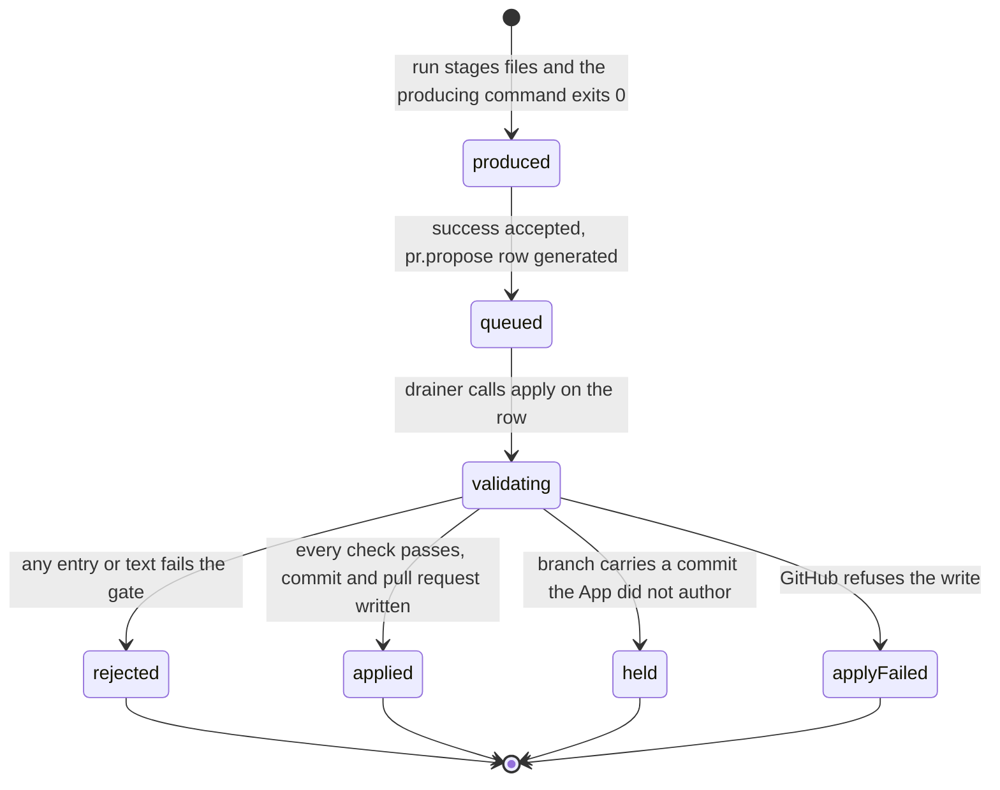
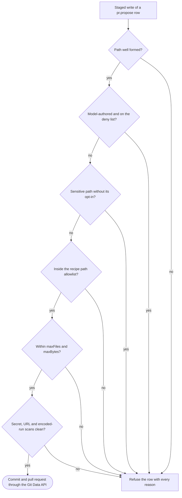
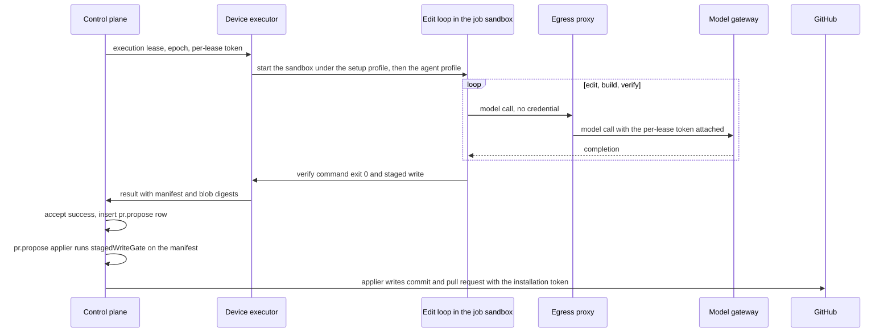
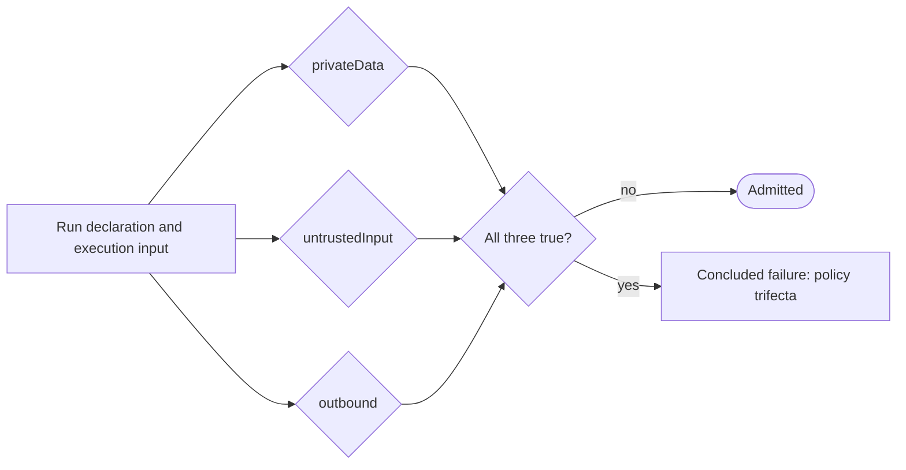

# Agentic recipes

Agentic recipes are the recipes in the catalog whose steps call a model: `pr-review`, `improve-pr`, `self-heal-pr`, `spec-drift-pr`, `triage-issues`, `triage-prs`, `ci-triage-pr` and `release-notes`. Model output is data. A recipe never writes to GitHub itself; it returns intents, and file changes reach a repository only as a staged write that the `pr.propose` applier checks against a path allowlist, a deny list and a secret and URL scan before any GitHub call. No run combines private data, untrusted input and outbound access. This file specifies each recipe's behavior, the staged-write gate, the trifecta rule and the credential boundary that keeps every write key in the control plane.

## Scope

This file covers the eight agentic recipes, the staged write and its gate, model-authored text in comments and pull requests, the trifecta rule, the author-trust filter and the suppression ledger. It depends on:

- [../model-gateway.md](../model-gateway.md) for task tiers, confidentiality routing and allowances;
- [../run-model.md](../run-model.md) for `defineRun`, the verdict partition and intents;
- [../github-output.md](../github-output.md) for the outbox, the check-run lifecycle, the quota and how the drain applies the `pr.propose`, `pr.close`, `comment`, `review`, `issue`, `label`, `release.draft` and `release.publish` intent kinds;
- [../profile.md](../profile.md) for classes, queue age and the staleness point, and mameko's [admission-qos.md](https://github.com/fractalboxdev/mameko/blob/da1249e8318d7ac67eae38c4d1419613590ad18e/specs/admission-qos.md) for `deadline_at` and supersession;
- [../isolation-egress.md](../isolation-egress.md) for the job sandbox, the `setup` and `agent` egress profiles and per-lease credentials;
- [../cache-artifacts.md](../cache-artifacts.md) for the artifact store that holds staged-write blobs;
- [../provenance.md](../provenance.md) for the record of model-authored changes.

[ADR-0016](../adr/0016-run-catalog-scope.md) records why these recipes ship in the tree; mameko's [ADR-0014](https://github.com/fractalboxdev/mameko/blob/da1249e8318d7ac67eae38c4d1419613590ad18e/specs/adr/0014-model-routing.md) records the model routing they rely on; [ADR-0018](../adr/0018-formal-models.md) records the formal model of the staged-write path allowlist.

Not specified: `finops-audit`, a model-written cost report, because the reservation and usage rows in D1 ([../spend.md](../spend.md)) hold the same numbers deterministically; `org-spec-audit`; a separate pull-request metadata file that overrides the staged write's `pr` field.

## Model

An **agentic recipe** declares, in its catalogue entry ([../run-model.md](../run-model.md) § Run definitions):

- the task tier of each model call site;
- `needsModel`, true when the recipe produces no verdict without a model call;
- its data classes `privateData`, `untrustedInput` and `outbound` (below);
- the intent kinds it may return;
- for a recipe that proposes file changes, a `writeback` block: branch, base branch, path allowlist, `allowSensitivePaths`, `allowWorkflows`, `maxFiles` and `maxBytes`.

The **edit loop** is the process inside the job sandbox that calls models, edits the checkout and runs the recipe's verify command. It reaches the model gateway and the local route only through the egress proxy, which attaches the execution's per-lease token ([isolation-egress.md](../isolation-egress.md)). The job sandbox holds no credential: no per-lease token, no GitHub App key, no write-scoped installation token and no provider key.

A **staged write** is the set of file changes an execution proposes: a manifest (branch, base branch, base commit, commit message, `pr` title, body, draft flag and labels, and entries of path, mode and SHA-256 blob digest) plus the blobs, stored byte for byte in the artifact store under the execution. A staged write is **model-authored** when the recipe declares a model call site, when the model gateway recorded at least one call for the execution, or when the device executor reported at least one local model call for it. The control plane decides this from its own records, never from the run's result.

The **staged-write gate** is the pure function `stagedWriteGate(manifest, writebackSpec, modelAuthored) → accept | reject(reasons)`, run by FlareDispatch's `pr.propose` applier on the manifest before any GitHub call. It evaluates every check on every entry and returns all rejection reasons at once.

A staged write reaches the outbox as one `pr.propose` row that the control plane generates `on: accepted` when it accepts a `success` result that carries one, keyed `cp:pr:propose` ([MAMEKO-OUT-058](https://github.com/fractalboxdev/mameko/blob/da1249e8318d7ac67eae38c4d1419613590ad18e/specs/outbox.md), [profile.md](../profile.md) § Intent kinds). Because the gate runs in the applier, a rejected manifest ends that row `refused` and leaves the execution's outcome as accepted ([MAMEKO-OUT-015](https://github.com/fractalboxdev/mameko/blob/da1249e8318d7ac67eae38c4d1419613590ad18e/specs/outbox.md)).

*Staged write · a rejection, a hold and an apply failure each end the `pr.propose` row `refused` and leave the verdict unchanged.*

*Staged-write gate · every check runs on every entry; one failed check rejects the manifest and the refusal lists all reasons.*

A model-authored change travels from the edit loop to GitHub without any write credential leaving the control plane.

*Write path · the job sandbox holds no credential and the device executor no GitHub write credential; only the control plane's appliers write to GitHub.*

### Data classes and the trifecta rule

Each execution has three data classes, computed by the control plane at admission:

| Class | True when |
| --- | --- |
| `privateData` | The repository is not public, or its confidentiality mode is not `non-confidential` |
| `untrustedInput` | The input holds text authored by a principal whose `author_association` is not `OWNER`, `MEMBER` or `COLLABORATOR`, or the head of a fork pull request |
| `outbound` | The egress profile admits a host other than the model gateway and the execution repository's git remote, or an intent targets a repository other than the execution's own |

*Trifecta rule · the registry validator rejects a declaration that sets all three classes, and admission refuses an execution whose computed classes are all true.*

### Recipes

| Recipe | Trigger | Default class | Model calls | Output |
| --- | --- | --- | --- | --- |
| `pr-review` | Pull request opened, synchronized or ready for review; Actions dispatch | `interactive` | `bulk` retrieval and pre-pass, `judgment` reviewers | One review comment, check-run annotations |
| `improve-pr` | Cron or dispatch, per dimension in the repo manifest | `batch` | `judgment` interpretation and edits | Draft pull request |
| `self-heal-pr` | Dispatch with an `incident/v1` pack | `interactive` | `judgment` edit loop | Draft pull request on a green verify |
| `spec-drift-pr` | Cron, default `0 5 * * *` | `batch` | `judgment` reconciliation | Rolling draft pull request on `specs/**` |
| `triage-issues` | Cron or dispatch | `batch` | `bulk` classification | Labels, templated comments, duplicate close |
| `triage-prs` | Cron or dispatch | `batch` | `bulk` digest lines | One digest staged write |
| `ci-triage-pr` | Cron, default `0 6 * * *` | `batch` | `bulk` classification, `judgment` write-up | Rolling draft pull request |
| `release-notes` | Cron per repo manifest, default `0 9 * * 1`, or dispatch; approval of its release pull request starts the publish execution | `batch` | `judgment` notes | Release pull request; the publish execution returns `release.draft` and `release.publish` intents |

## Requirements

### Declaration and catalog

- **FD-AGT-001** · phase 2 · `V-UNIT` — The run catalog must ship the agentic recipes `pr-review`, `improve-pr`, `self-heal-pr`, `spec-drift-pr`, `triage-issues`, `triage-prs`, `ci-triage-pr` and `release-notes`.
- **FD-AGT-002** · phase 0 · `V-UNIT` `V-DEPLOY` — If an agentic recipe's catalogue entry omits the task tier of a model call site, its data classes or its intent kinds, then the registry validator must reject the spec at deploy.
- **FD-AGT-003** · phase 0 · `V-UNIT` — If a run returns an intent whose kind its spec does not declare, then the control plane must apply none of that result's intents and must conclude the execution `failure` with the reason `intent: undeclared kind`.

### Trifecta rule

- **FD-AGT-004** · phase 4 · `V-DEPLOY` `V-PROOF` — If a run declaration sets `privateData`, `untrustedInput` and `outbound` together, then the registry validator must reject it at deploy.
- **FD-AGT-005** · phase 2 · `V-UNIT` `V-SIM` — If an execution's computed `privateData`, `untrustedInput` and `outbound` classes are all true, then the control plane must conclude it `failure` with the reason `policy: trifecta` before placement.
- **FD-AGT-006** · phase 2 · `V-UNIT` — The run must pass text from a principal outside `OWNER`, `MEMBER` and `COLLABORATOR` to a model only inside the user message, in a delimited block marked as untrusted data, and never in the system message.
- **FD-AGT-007** · phase 2 · `V-UNIT` — Where a recipe declares `untrustedInput` false, the run must drop text authored by a principal outside `OWNER`, `MEMBER` and `COLLABORATOR` before any model call.

### Credential boundary

- **FD-AGT-008** · phase 0 · `V-UNIT` `V-CONF` — The control plane must not send the GitHub App private key or a write-scoped installation token to an executor, the device executor or a job sandbox.
- **FD-AGT-009** · phase 0 · `V-UNIT` `V-CONF` — The control plane must apply every repository write of an agentic recipe as an intent through the outbox, of the kinds `comment`, `review`, `issue`, `label`, `pr.propose`, `pr.close`, `release.draft` and `release.publish` ([../run-model.md](../run-model.md) § Intents).
- **FD-AGT-010** · phase 2 · `V-UNIT` `V-E2E-LOCAL` — The edit loop must reach models only through the egress proxy to the model gateway or the local route, with the per-lease token the proxy attaches, and the job sandbox must hold no per-lease token and no provider credential.
- **FD-AGT-011** · phase 0 · `V-UNIT` — The run must not place a clone token, a per-lease token or any other credential in a model request.

### Staged write

- **FD-AGT-012** · phase 0 · `V-UNIT` `V-CONF` — The executor must build the staged write from the tracked changes against the base commit plus untracked files not matched by `.gitignore`, and must exclude its own staging directory.
- **FD-AGT-013** · phase 0 · `V-UNIT` `V-CONF` — The executor must store each blob byte for byte with its SHA-256 digest, and the control plane must commit each blob byte for byte.
- **FD-AGT-014** · phase 0 · `V-UNIT` — If a stored blob's SHA-256 digest differs from its manifest entry, then the staged-write gate must reject the manifest with reason `digest-mismatch`.
- **FD-AGT-016** · phase 0 · `V-UNIT` `V-PROOF` `V-DIFF` — When the drainer calls `apply` on a `pr.propose` row, the applier must run `stagedWriteGate` on the row's manifest before any GitHub call.
- **FD-AGT-017** · phase 0 · `V-UNIT` `V-PROOF` `V-DIFF` — If any entry fails any check, then the staged-write gate must reject the whole manifest and return every reason for every entry in one result.
- **FD-AGT-018** · phase 0 · `V-UNIT` `V-SIM` — If the staged-write gate rejects a manifest, then the applier must answer `refused` with the reason `writeback: <first reason kind>` and every reason in the refusal, and the control plane must show every reason on the execution's dashboard page.
- **FD-AGT-019** · phase 0 · `V-UNIT` `V-DIFF` — If an entry's path is absolute, is longer than 1024 bytes, contains a `..`, `.` or empty segment, a `.git` segment in any letter case, a backslash or a NUL byte, then the staged-write gate must reject it with reason `path-invalid`.
- **FD-AGT-020** · phase 0 · `V-PROOF` `V-DIFF` — If a staged write is model-authored, then the staged-write gate must reject every entry under `runs/`, `infra/` or `.github/workflows/`, and every entry whose file name is `wrangler.jsonc`, comparing paths without regard to letter case, whatever the recipe's opt-ins.
- **FD-AGT-021** · phase 0 · `V-UNIT` `V-DIFF` — If a staged write is model-authored, then the staged-write gate must reject every entry whose file name is `wrangler.json` or `wrangler.toml`, comparing without regard to letter case.
- **FD-AGT-022** · phase 0 · `V-UNIT` `V-DIFF` — If a staged write that is not model-authored has an entry under `.github/workflows/` and the recipe does not set `allowWorkflows`, then the staged-write gate must reject that entry with reason `workflows-not-opted-in`.
- **FD-AGT-023** · phase 0 · `V-UNIT` `V-DIFF` — If an entry is a sensitive path and the recipe does not set `allowSensitivePaths`, then the staged-write gate must reject it with reason `sensitive-not-opted-in`, where a sensitive path is a package manifest, a lockfile, a package-registry configuration file, a Dockerfile, a path under `.github/actions/` or `.circleci/`, `.gitlab-ci.yml`, `Jenkinsfile` or `azure-pipelines.yml`, compared without regard to letter case.
- **FD-AGT-024** · phase 0 · `V-UNIT` `V-DIFF` — If an entry's path matches no glob in the recipe's path allowlist, then the staged-write gate must reject it with reason `outside-allowlist`, and an empty allowlist must reject every entry.
- **FD-AGT-025** · phase 0 · `V-UNIT` — If a manifest has more entries than `maxFiles`, default 200, then the staged-write gate must reject it with reason `too-many-files`.
- **FD-AGT-026** · phase 0 · `V-UNIT` — If a manifest's blobs total more than `maxBytes`, default 5 MiB, then the staged-write gate must reject it with reason `too-large`.
- **FD-AGT-027** · phase 0 · `V-UNIT` — If an entry's mode is not `100644` or `100755`, then the staged-write gate must reject it with reason `mode-invalid`.
- **FD-AGT-028** · phase 0 · `V-UNIT` — If the manifest's branch does not start with `flare-dispatch/`, the prefix the drain enforces ([../github-output.md](../github-output.md) FD-GH-082), then the staged-write gate must reject it with reason `branch-invalid`.

### Secret and URL scan

- **FD-AGT-029** · phase 2 · `V-UNIT` — If an added line of a blob, the commit message, the pull-request title or the pull-request body matches a credential pattern (GitHub token prefixes `ghp_`, `gho_`, `ghs_`, `ghu_`, `ghr_` and `github_pat_`, an AWS access key id, a PEM private-key header, a Slack token prefix `xox`, a JSON Web Token) or contains a credential the control plane issued to the execution, then the staged-write gate must reject the manifest with reason `secret-detected`.
- **FD-AGT-030** · phase 2 · `V-UNIT` — When the staged-write gate reports `secret-detected`, it must name the path and line and must not include the matched value.
- **FD-AGT-031** · phase 2 · `V-UNIT` — If the commit message, the pull-request title or the pull-request body of a model-authored staged write contains a URL whose host is not in the recipe's link allowlist, then the staged-write gate must reject the manifest with reason `url-not-allowed`, where the link allowlist always holds the repository's GitHub host.
- **FD-AGT-032** · phase 2 · `V-UNIT` — If an added line of a model-authored blob contains a URL whose host appears neither in the link allowlist nor in that file at the base commit, then the staged-write gate must reject the manifest with reason `url-not-allowed`.
- **FD-AGT-033** · phase 2 · `V-UNIT` — If the commit message, the pull-request title or the pull-request body of a model-authored staged write contains a run of at least 64 base64 or hexadecimal characters, then the staged-write gate must reject the manifest with reason `encoded-run`.

### Applying a staged write

- **FD-AGT-034** · phase 0 · `V-UNIT` `V-REPLAY` — When the control plane accepts a `success` result that carries a staged write, the `pr.propose` payload binding must return the manifest, so that the control plane inserts exactly one `pr.propose` row for that execution ([MAMEKO-OUT-058](https://github.com/fractalboxdev/mameko/blob/da1249e8318d7ac67eae38c4d1419613590ad18e/specs/outbox.md)); for a result with no staged write it must return `none`.
- **FD-AGT-035** · phase 0 · `V-UNIT` — When the staged-write gate accepts a manifest, the `pr.propose` applier must create the blobs, the tree and the commit on the base commit, then create or update the branch ref and open or reuse the pull request.
- **FD-AGT-037** · phase 0 · `V-UNIT` — An agentic recipe must set the `draft` flag of every staged write it returns to true, except `release-notes`, which sets it to false on its release pull request ([../github-output.md](../github-output.md) FD-GH-083).
- **FD-AGT-038** · phase 0 · `V-UNIT` — If the `pr.propose` row ends `refused` or `expired`, then the control plane must show the reason on the execution's dashboard page and must not change the execution's verdict ([MAMEKO-OUT-015](https://github.com/fractalboxdev/mameko/blob/da1249e8318d7ac67eae38c4d1419613590ad18e/specs/outbox.md)).
- **FD-AGT-039** · phase 0 · `V-UNIT` — The control plane must offer no merge intent kind, and a recipe must not merge a model-authored pull request.
- **FD-AGT-040** · phase 4 · `V-UNIT` — When the `pr.propose` applier writes a model-authored commit, it must add a `Drafted-With:` trailer whose model entry ids come from the model gateway's records and the device executor's local-call report, never from the run's result.

### Model-authored text

- **FD-AGT-041** · phase 0 · `V-UNIT` — Before model-authored text enters a comment, a review, a check summary or a pull-request body, the control plane must escape every `@` that would form a mention, strip HTML tags, render link markup as inline code and close any open code fence.
- **FD-AGT-042** · phase 0 · `V-UNIT` — If a read that a recipe decides on fails (GitHub, the executions table, the suppression ledger), then the run must fail with the read's error and must not treat the read as empty.

### Suppression ledger

- **FD-AGT-043** · phase 3 · `V-UNIT` — Before a recipe opens a pull request or an issue, the run must look up the proposal's exact suppression key in the suppression ledger, and must open nothing while the key is declined or within the cooldown, default 30 days from the matching pull request's `closed_at`.
- **FD-AGT-044** · phase 3 · `V-UNIT` — If the suppression ledger read fails, then the run must open no pull request or issue and must conclude `failure` with the reason `suppression: read failed`.

### `pr-review`

- **FD-AGT-045** · phase 2 · `V-UNIT` — When a pull request is opened, synchronized or marked ready for review, or an Actions dispatch names `pr-review`, intake must start a `pr-review` execution for the head commit.
- **FD-AGT-046** · phase 2 · `V-UNIT` — If the pull request is a draft without the label `request-ai-review`, carries the label `skip-ai-review`, or has an author whose login ends in `[bot]`, then `pr-review` must conclude `skipped` with the reason `not-applicable: draft-pr`, `not-applicable: not-configured` or `not-applicable: author-excluded` respectively.
- **FD-AGT-047** · phase 2 · `V-UNIT` `V-SIM` — `pr-review` must run in class `interactive` by default, with that class's claim deadline of 300 s ([../profile.md](../profile.md) § Class catalogue) and a run ceiling of 1500 s set in the repo manifest.
- **FD-AGT-049** · phase 2 · `V-UNIT` — The executor must build the review diff with `git diff` in the checkout, drop lockfile, generated and vendored paths, cap it at `maxDiffChars` from the repo manifest, and add lint grounding of at most 60 files and 8000 characters.
- **FD-AGT-050** · phase 2 · `V-UNIT` — `pr-review` must classify the change as `full`, `lite` or `trivial` and run 7, 4 or 1 reviewers respectively, each reviewer in its own `Activity`.
- **FD-AGT-051** · phase 2 · `V-UNIT` — If one reviewer fails, then `pr-review` must keep the other reviewers' findings, and a step retry must re-run only the failed reviewer.
- **FD-AGT-052** · phase 2 · `V-UNIT` — `pr-review` must coordinate findings deterministically: any `failure` finding yields `request-changes`, otherwise any `warning` finding yields `comment`, otherwise `approve`.
- **FD-AGT-053** · phase 2 · `V-UNIT` `V-REPLAY` — `pr-review` must keep one review comment per pull request, identified by the marker `<!-- flare-dispatch: pr-review -->` and updated in place, holding at most 25 findings.
- **FD-AGT-054** · phase 2 · `V-UNIT` — `pr-review` must emit each finding that names a path and line as a check-run annotation, at most 50 per execution.
- **FD-AGT-055** · phase 2 · `V-UNIT` — While the repo manifest sets `pr-review` to `advisory`, the default, `pr-review` must conclude `success` whatever its coordinated outcome.
- **FD-AGT-056** · phase 2 · `V-UNIT` — While the repo manifest sets `pr-review` to `gating`, `pr-review` must conclude `failure` with the reason `review: changes requested` when its coordinated outcome is `request-changes`.
- **FD-AGT-057** · phase 2 · `V-UNIT` `V-SIM` — If every reviewer's call ends `rate-limited` after its wait bound, then `pr-review` must conclude `failure` with the reason `capacity: model unavailable` ([mameko admission-qos.md § Capacity outcomes](https://github.com/fractalboxdev/mameko/blob/da1249e8318d7ac67eae38c4d1419613590ad18e/specs/admission-qos.md#capacity-outcomes)).
- **FD-AGT-058** · phase 2 · `V-UNIT` — If every reviewer's call ends `context-overflow` after the shrink retries, then `pr-review` must conclude `failure` with the reason `capacity: context overflow`.
- **FD-AGT-059** · phase 2 · `V-UNIT` — `pr-review` must store its diff artifact readable only through the dashboard's authenticated artifact route.

### `improve-pr`

- **FD-AGT-060** · phase 2 · `V-UNIT` — For each dimension in the repo manifest, `improve-pr` must run that dimension's measurement command in the executor and pass only the measurement output to the model.
- **FD-AGT-061** · phase 2 · `V-UNIT` — If a dimension's measured gain is below its materiality floor in the repo manifest, then `improve-pr` must open no pull request and conclude `success`.
- **FD-AGT-062** · phase 2 · `V-UNIT` — `improve-pr` must stage a write only after the recipe's verify command exits 0 on the edited checkout, and must put the measurement in the pull-request body.

### `self-heal-pr`

- **FD-AGT-063** · phase 3 · `V-UNIT` — If a `self-heal-pr` dispatch carries no `incident/v1` pack of class `ci` with a command repro, then intake must reject it with HTTP `400`.
- **FD-AGT-064** · phase 3 · `V-UNIT` `V-E2E-LOCAL` — `self-heal-pr` must run the edit loop in the job sandbox under the `agent` egress profile, then re-run the repro command in the same job sandbox with a timeout of 600 s by default.
- **FD-AGT-065** · phase 3 · `V-UNIT` — When the repro command exits 0 after the edit loop, `self-heal-pr` must stage a write labelled `self-heal` and `self-heal:verified`.
- **FD-AGT-066** · phase 3 · `V-UNIT` — If the repro command exits non-zero after the edit loop, then `self-heal-pr` must open no pull request and conclude `failure` with the reason `no-fix`.
- **FD-AGT-067** · phase 3 · `V-UNIT` — If the edit loop's executable is missing or exits 126 or 127, then `self-heal-pr` must conclude `failure` with the reason `infra: edit loop unavailable`.

### `spec-drift-pr`

- **FD-AGT-068** · phase 2 · `V-UNIT` — For each repository its repo manifest enrolls, `spec-drift-pr` must read at most 40,000 characters of `specs/`, 12,000 characters of the file tree and 25 commit-log entries, and make one structured `judgment` call.
- **FD-AGT-069** · phase 2 · `V-UNIT` — `spec-drift-pr` must stage its write on the branch `flare-dispatch/spec-drift` with the path allowlist `specs/**`, refreshing the open pull request in place.
- **FD-AGT-070** · phase 2 · `V-UNIT` — When `spec-drift-pr` finds the specs in sync, it must return a `pr.close` intent for its open pull request, which the drain refuses while that branch carries a commit the GitHub App did not author ([../github-output.md](../github-output.md) FD-GH-087).

### `ci-triage-pr`

- **FD-AGT-071** · phase 2 · `V-UNIT` — `ci-triage-pr` must read failed executions from the executions table and their failed job logs over the last 24 h, classify each failure with a `bulk` call and write one triage report with a `judgment` call.
- **FD-AGT-072** · phase 2 · `V-UNIT` — `ci-triage-pr` must stage the report as `.flare-dispatch/ci-triage-<YYYY-MM-DD>.md` on the branch `flare-dispatch/ci-triage` with the path allowlist `.flare-dispatch/**`.
- **FD-AGT-073** · phase 2 · `V-UNIT` — When the executions read succeeds and returns no failure in the window, `ci-triage-pr` must return a `pr.close` intent for its open pull request, which the drain refuses while that branch carries a commit the GitHub App did not author ([../github-output.md](../github-output.md) FD-GH-087).

### `triage-issues`

- **FD-AGT-074** · phase 3 · `V-UNIT` — `triage-issues` must classify each open issue with one `bulk` call into exactly one of `duplicate`, `needs-repro`, `feature`, `question`, `bug-with-repro`, `bug-without-repro` and `unclassified`, considering at most 40 duplicate candidates.
- **FD-AGT-075** · phase 3 · `V-UNIT` — `triage-issues` must map verdicts to intents: `duplicate` to a templated comment naming the original and a close as duplicate; `needs-repro` to the label `triage:needs-repro` and a templated request; `feature` and `question` to `triage:not-actionable`; `bug-with-repro` to `triage:fix-pending` with the repro and the reporter's `author_association`; `bug-without-repro` to `triage:needs-human`; `unclassified` to no intent.
- **FD-AGT-076** · phase 3 · `V-UNIT` — `triage-issues` must build every comment from a template, taking from model output only the verdict and the original issue number.
- **FD-AGT-077** · phase 3 · `V-UNIT` — `triage-issues` must close an issue only for the verdict `duplicate`.

### `triage-prs`

- **FD-AGT-078** · phase 3 · `V-UNIT` — `triage-prs` must derive each open pull request's state (check health, review state, days since last update, labels) without a model call, and route it to exactly one of `auto-merge`, `nudge`, `unstick` and `ask`.
- **FD-AGT-079** · phase 3 · `V-UNIT` — `triage-prs` may write each pull request's digest line with one `bulk` call, and the route must not depend on that call's output.
- **FD-AGT-080** · phase 3 · `V-UNIT` — `triage-prs` must report its routes as one staged write to the repository its repo manifest names, with the path allowlist `.flare-dispatch/triage/**`, and must return no merge, assignment or close intent.

### `release-notes`

- **FD-AGT-081** · phase 3 · `V-UNIT` — `release-notes` must read the commit range from the newest `v<semver>` tag reachable from the default branch to the default-branch head inside an `Activity`.
- **FD-AGT-082** · phase 3 · `V-UNIT` — If the commit range is empty, then `release-notes` must conclude `skipped` with the reason `not-applicable: empty-range`.
- **FD-AGT-083** · phase 3 · `V-UNIT` — `release-notes` must compute the next version from Conventional Commits: a `!` or `BREAKING CHANGE` footer bumps major, `feat` bumps minor, and any other type bumps patch.
- **FD-AGT-084** · phase 3 · `V-UNIT` — `release-notes` must stage the notes as a release pull request with `draft` false on the branch `flare-dispatch/release`, with a marker naming its execution id, the computed version and the head of the commit range, and must then conclude `success`.
- **FD-AGT-085** · phase 3 · `V-UNIT` — When a principal with write permission merges the release pull request or applies the label `release:approve` within the approval window, default 72 h from the pull request's creation, intake must start one `release-notes` publish execution for the version in the marker at the approved commit.
- **FD-AGT-086** · phase 3 · `V-UNIT` — When a principal with write permission closes the release pull request unmerged or applies the label `release:reject`, intake must start no publish execution for that pull request.
- **FD-AGT-087** · phase 3 · `V-UNIT` — If a merge or a `release:approve` label arrives after the approval window, then intake must start no publish execution for that pull request.
- **FD-AGT-088** · phase 3 · `V-UNIT` — The publish execution must return one `release.draft` intent with the notes for the version in the marker at the approved commit, followed by one `release.publish` intent for that tag, and the drain must leave a published release unchanged ([../github-output.md](../github-output.md) FD-GH-085, FD-GH-086).

## Open items

- TODO(maintainer): decide whether the URL scan of added blob lines (FD-AGT-032) also accepts hosts present elsewhere in the repository at the base commit, which lowers false rejections on documentation edits.
- TODO(maintainer): set the default `maxDiffChars` for `pr-review` from measured diff sizes on enrolled repositories.
- TODO(operator): name the repository that receives the `triage-prs` digest in its repo manifest.
- TODO(maintainer): Until mameko gates an `on: accepted` kind before acceptance (mameko [outbox.md § Open items](https://github.com/fractalboxdev/mameko/blob/da1249e8318d7ac67eae38c4d1419613590ad18e/specs/outbox.md#open-items)), `pr.propose` is keyed `cp:pr:propose`, the staged-write gate runs in its applier, and a rejected manifest ends the row `refused` while the outcome stands; with that gate, the row is keyed `cp:writeback:<branch>` and a rejected manifest concludes the execution `failure` with `writeback: <first reason kind>`.
