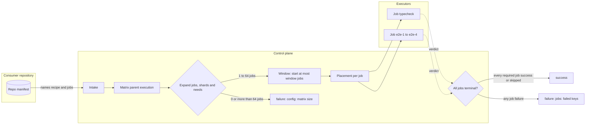
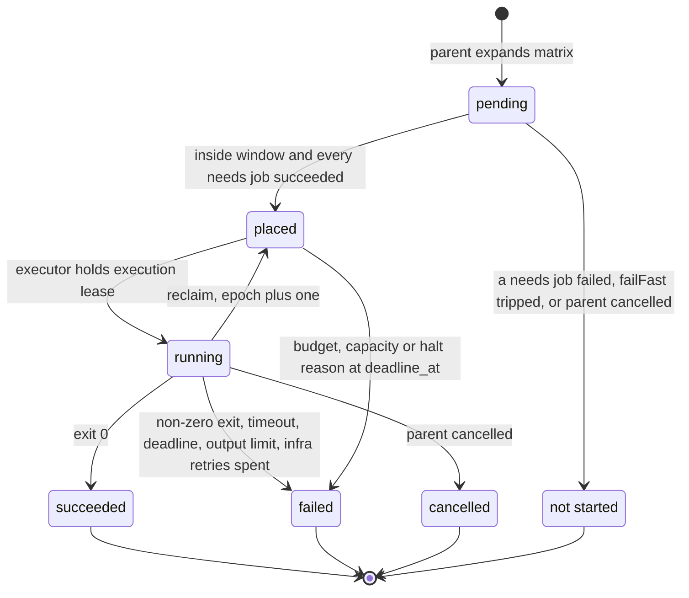
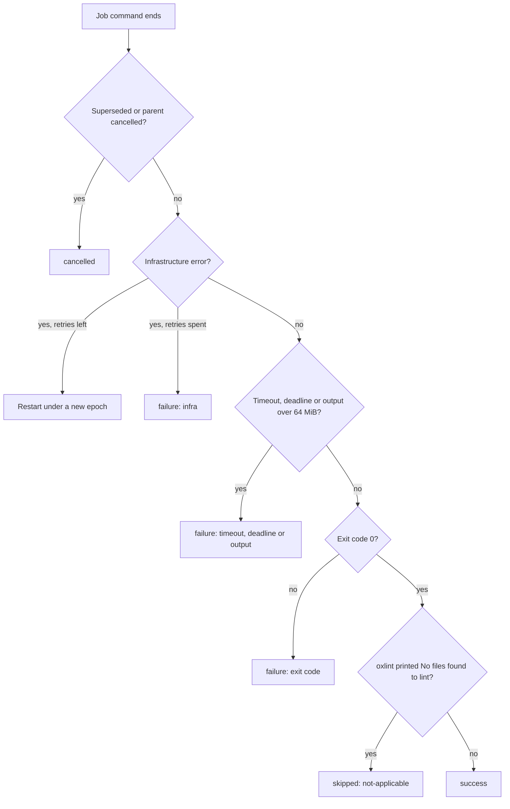
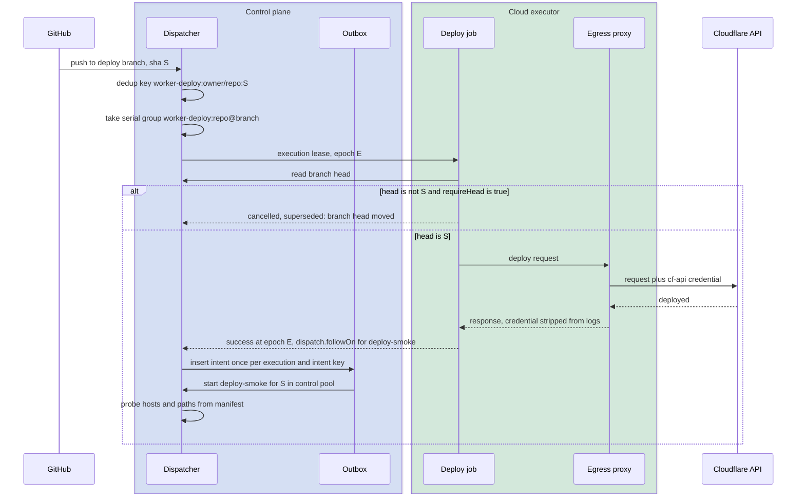

# Gate recipes

This file specifies the gate and test recipes in the catalog (`check`, `oxlint`, `offload-test`, `worker-deploy`, `deploy-smoke` and `sandbox-image`), the job-matrix primitive that fans one execution out into separately placed jobs, and the rule that maps each job's exit to a verdict. A red test never concludes `success`.

## Scope

This file covers what each gate recipe runs, which repo manifest fields it reads, how the job matrix expands, places and aggregates jobs, and which verdict and reason each job outcome produces. It depends on:

- [run-model.md](../run-model.md) for `defineRun`, `RunResult`, the error taxonomy and intents;
- [intake.md](../intake.md) for triggers, the repo manifest file and dedup keys;
- [qos-admission.md](../qos-admission.md) for classes, the child rule, placement constraints, supersession, serial groups and infrastructure retries;
- [spend.md](../spend.md) for holds and the budget reasons;
- [placement-leases.md](../placement-leases.md) for placement, the execution lease and reclaim;
- [github-output.md](../github-output.md) for check names and the verdict-to-conclusion mapping;
- [cache-artifacts.md](../cache-artifacts.md) for log artifacts and cache namespaces;
- [isolation-egress.md](../isolation-egress.md) for egress-attached grants;
- [runs/agentic.md](agentic.md) for staged writeback.

Consumer-specific gates, release graphs and browser suites are repo manifests in consumer repositories that compose these recipes and the job matrix ([ADR-0016](../adr/0016-run-catalog-scope.md)).

Not specified: `matrix-fanout` and `vitest-shard` (the job matrix replaces them); `demo-reel` (presentation lies outside CI/CD).

Deferred: dispatching `self-heal-pr` from a red `offload-test` follows [runs/agentic.md](agentic.md).

## Model

### Recipes

The class in this table is the recipe's default; `resolveClass` in [qos-admission.md](../qos-admission.md) sets the class of each execution. A gate whose check the target branch does not require runs at P2.

| Recipe | Default class | Run ceiling | Placement | Triggers | Manifest key |
| --- | --- | --- | --- | --- | --- |
| `check` | P1 | 4500 s | any eligible executor | `pull_request` (`opened`, `synchronize`, `reopened`, `ready_for_review`), `merge_group`, Actions dispatch | `check` |
| `oxlint` | P1 | 600 s | any eligible executor | as `check` | `oxlint` |
| `offload-test` | P1 | 3600 s | any eligible executor | as `check` | `offloadTest` |
| `worker-deploy` | P0 | 1800 s | `cloud-pinned` | `push` to the deploy branch, Actions dispatch | `workerDeploy` |
| `deploy-smoke` | P0 | 300 s | `control` pool, no container | `worker-deploy` success, `deployment_status` success | `deploySmoke` |
| `sandbox-image` | P1 on a pull request, P0 on publish | 3600 s | `cloud-pinned` on publish | `pull_request` and `push` to the default branch that change `sandboxImage.paths` | `sandboxImage` |

A repo manifest entry that these recipes read looks like this:

```yaml
check:
  - label: unit
    command: pnpm test
    timeoutSec: 900
oxlint:
  version: 1.79.0
offloadTest:
  install: pnpm install --frozen-lockfile
  window: 8
  jobs:
    - key: typecheck
      command: pnpm typecheck
    - key: e2e
      command: pnpm e2e --shard=$FD_SHARD_INDEX/$FD_SHARD_TOTAL
      shards: 4
      needs: [typecheck]
workerDeploy:
  branch: main
  command: pnpm wrangler deploy
  grants: [cf-api]
deploySmoke:
  hosts: [app.example.com]
  paths: [/, /health]
```

### Job matrix

A job matrix is one parent execution and 1 to 64 jobs. Each job is a child execution with its own placement, execution lease, hold and workspace. The parent makes no sandbox call: it expands the matrix, starts jobs inside its window, waits for their verdicts and returns one verdict.



*job matrix · one parent, separately placed jobs, one aggregated verdict.*

Each job moves through the states below. A reclaim keeps the job's execution and increments its epoch, so the job returns to `placed` and restarts from the beginning on another executor.



*job lifecycle · reclaim restarts a job; only exit 0 reaches success.*

### Exit to verdict

Every gate job outcome maps to exactly one verdict and reason. [github-output.md](../github-output.md) maps the verdict to a check-run conclusion.

| Job outcome | Verdict | Reason |
| --- | --- | --- |
| Exit code 0 | `success` | — |
| `oxlint` exit code 0 with the line `No files found to lint` | `skipped` | `not-applicable: nothing-to-lint` |
| Non-zero exit code | `failure` | `exit: <code>` |
| Killed by a signal | `failure` | `exit: signal <name>` |
| Killed at the job timeout | `failure` | `timeout: job` |
| Still running at `deadline_at` | `failure` | `deadline` |
| Output over 64 MiB | `failure` | `output: over limit` |
| Infrastructure error after the class's retries | `failure` | `infra: <error tag>` |
| Install command non-zero | `failure` | `install: exit <code>` |
| Invalid manifest entry | `failure` | `config: <field>` |
| Parent or execution superseded | `cancelled` | `superseded` |



*exit-to-verdict · no branch from a non-zero exit reaches success.*

### Deploy and smoke

`worker-deploy` and `deploy-smoke` form one deploy graph. The deploy holds its serial group, re-reads the branch head before the command starts and reaches the Cloudflare API only through the egress proxy, which attaches the credential. A successful deploy emits a `dispatch.followOn` intent that starts `deploy-smoke` on the same commit.



*deploy graph · serial group, head re-check, credential added outside the job.*

## Requirements

### Every gate recipe

- **FD-GATE-001** · phase 0 · `V-UNIT` — Where a gate recipe runs a command, the recipe must take that command only from the repository's repo manifest entry or from the dispatch inputs, and the control plane must not hold a default command that applies to every repository.
- **FD-GATE-002** · phase 0 · `V-UNIT` `V-E2E-LOCAL` — When a gate job's command exits with code 0, the recipe must record the verdict `success` for that job.
- **FD-GATE-003** · phase 0 · `V-UNIT` `V-E2E-LOCAL` — When a gate job's command exits with a non-zero code, the recipe must record the verdict `failure` with the reason `exit: <code>`.
- **FD-GATE-004** · phase 0 · `V-UNIT` — The gate recipes and the job matrix must not offer any manifest field, input or default that maps a non-zero exit, a failed job or a failed shard to `success`.
- **FD-GATE-005** · phase 0 · `V-UNIT` — If a gate job's command ends on a signal, then the recipe must record `failure` with the reason `exit: signal <name>`.
- **FD-GATE-006** · phase 0 · `V-UNIT` `V-E2E-LOCAL` — If a gate job's command runs past its job timeout, then the executor must kill its process group and the recipe must record `failure` with the reason `timeout: job`.
- **FD-GATE-007** · phase 0 · `V-UNIT` `V-SIM` — If a gate job's command is still running when the executor stops the job at the execution's `deadline_at` ([../executors.md](../executors.md) FD-EXEC-002), then the recipe must record `failure` with the reason `deadline`.
- **FD-GATE-008** · phase 0 · `V-UNIT` — If a gate job's combined stdout and stderr exceed 64 MiB, then the recipe must stop the command, record `failure` with the reason `output: over limit` and derive no verdict from the output.
- **FD-GATE-009** — Removed; see [../executors.md](../executors.md) FD-EXEC-014 and FD-EXEC-015.
- **FD-GATE-010** · phase 0 · `V-UNIT` `V-SIM` — If a gate job ends with an infrastructure error after the retries [qos-admission.md](../qos-admission.md) allows for its class, then the recipe must record `failure` with the reason `infra: <error tag>`.
- **FD-GATE-011** · phase 0 · `V-UNIT` — When a gate job ends, the recipe must upload the job's redacted output as the artifact `<job key>.log` before it returns its verdict.
- **FD-GATE-012** · phase 0 · `V-UNIT` — If a gate job's log upload fails, then the recipe must return the same verdict it would return after a successful upload.
- **FD-GATE-013** · phase 0 · `V-UNIT` `V-E2E-LOCAL` — The recipe must set `FD_REPO`, `FD_SHA`, `FD_REF` and `FD_JOB` in every gate job's environment.
- **FD-GATE-014** · phase 0 · `V-UNIT` `V-E2E-LOCAL` — The recipe must not place a secret in a gate job's environment, arguments or files; a job reaches a credentialed service only through an egress-attached grant ([isolation-egress.md](../isolation-egress.md)).
- **FD-GATE-015** · phase 0 · `V-UNIT` — Where a manifest entry names cache keys, the recipe must restore and save them only in the cache namespace the control plane assigns to the execution ([cache-artifacts.md](../cache-artifacts.md)).
- **FD-GATE-016** — Removed; see [../run-model.md](../run-model.md) FD-RUN-046.
- **FD-GATE-081** · phase 2 · `V-UNIT` — Where a manifest job declares `writeback { branch, paths }`, when the job's verdict is `success`, the recipe must stage the changed files that match `paths` as one staged write on a branch under `flare-dispatch/`, which the staged-write gate of [runs/agentic.md](agentic.md) checks; a `refresh-fixtures` job that regenerates test fixtures and proposes them as a pull request is the example.
- **FD-GATE-017** · phase 0 · `V-UNIT` — When a `pull_request` event names a draft pull request, or one whose author is in the manifest's `skipAuthors` list (default `dependabot[bot]`), the `check`, `oxlint` and `offload-test` recipes must run no command and conclude `skipped` with the reason `not-applicable: draft-pr` or `not-applicable: author-excluded`, which [github-output.md](../github-output.md) FD-GH-025 maps to `neutral`.
- **FD-GATE-018** · phase 0 · `V-UNIT` — If a manifest entry sets `timeoutSec` outside 1 s to the recipe's run ceiling, then the recipe must record `failure` with the reason `config: timeoutSec` and run no command.

### `check`

- **FD-GATE-019** · phase 0 · `V-UNIT` `V-E2E-LOCAL` — When a `check` execution starts, the recipe must run the manifest entry's `command` once in a checkout of the execution's commit, with a job timeout of the entry's `timeoutSec`, default 600 s.
- **FD-GATE-020** · phase 0 · `V-UNIT` — Where a `check` manifest entry has a `label`, the recipe must report under the check name `flare-dispatch/check:<label>`, and the label must match `^[A-Za-z0-9][A-Za-z0-9._-]{0,31}$`.
- **FD-GATE-021** · phase 0 · `V-UNIT` — If a `check` label does not match `^[A-Za-z0-9][A-Za-z0-9._-]{0,31}$`, then the recipe must record `failure` with the reason `config: label` and run no command.

### `oxlint`

- **FD-GATE-022** · phase 0 · `V-UNIT` — When an `oxlint` execution starts, the recipe must run `npx --yes oxlint@<version>` with no install step and a job timeout of 300 s, where `<version>` is the manifest's `oxlint.version` or else the version pinned in the recipe.
- **FD-GATE-023** · phase 0 · `V-UNIT` — If the `oxlint` version does not match `^[0-9]+\.[0-9]+\.[0-9]+$`, then the recipe must record `failure` with the reason `config: oxlint version` and run no command.
- **FD-GATE-024** · phase 0 · `V-UNIT` — When `oxlint` exits with code 0 and its output contains the line `No files found to lint`, the recipe must record `skipped` with the reason `not-applicable: nothing-to-lint`.

### `offload-test`

- **FD-GATE-025** · phase 0 · `V-UNIT` — When an `offload-test` execution starts, the recipe must run its manifest entry as a job matrix whose jobs are the entry's `jobs` list, or one job keyed `test` where the entry has a single `command`.
- **FD-GATE-026** · phase 0 · `V-UNIT` — If an `offload-test` execution has no command in its manifest entry or dispatch inputs, then the recipe must record `failure` with the reason `config: no command` and start no job.
- **FD-GATE-027** · phase 0 · `V-UNIT` `V-E2E-LOCAL` — Where an `offload-test` entry names an `install` command, each job must run it once in its own workspace before the job command, with a job timeout of 600 s.
- **FD-GATE-028** · phase 0 · `V-UNIT` — If an `offload-test` install command exits with a non-zero code, then the job must record `failure` with the reason `install: exit <code>` and run no job command.

### Job matrix

- **FD-GATE-029** · phase 0 · `V-UNIT` — If a job matrix expands, shards included, to 0 jobs or to more than 64 jobs, then the parent must record `failure` with the reason `config: matrix size` and start no job.
- **FD-GATE-030** · phase 0 · `V-UNIT` `V-SIM` — The parent must run each job as a child execution with its own placement, execution lease, hold and workspace, and two jobs must not share a workspace.
- **FD-GATE-031** · phase 0 · `V-UNIT` `V-REPLAY` — The parent must give each job the dedup key `<parent dedup key>/<job key>`, so a replay of the parent creates no second job.
- **FD-GATE-032** · phase 0 · `V-UNIT` — If a job key does not match `^[A-Za-z0-9][A-Za-z0-9._-]{0,31}$` or two jobs share a key, then the parent must record `failure` with the reason `config: job key` and start no job.
- **FD-GATE-033** · phase 0 · `V-UNIT` `V-SIM` — While a job matrix has `window` jobs that are placed or running, the parent must start no further job, where `window` defaults to 10 and ranges from 1 to 64.
- **FD-GATE-034** · phase 0 · `V-UNIT` — Where a job declares `shards: N` with N from 1 to 64, the parent must expand it into N jobs keyed `<key>-<i>` for i from 1 to N, each with `FD_SHARD_INDEX=i` and `FD_SHARD_TOTAL=N` in its environment.
- **FD-GATE-035** · phase 0 · `V-UNIT` — Where a job declares `needs`, the parent must start the job only after every named job records `success`.
- **FD-GATE-036** · phase 0 · `V-UNIT` — If a job named in another job's `needs` records a verdict other than `success`, then the parent must not start the dependent job and must record it as not started with the reason `needs: <key>`.
- **FD-GATE-037** · phase 0 · `V-UNIT` — If the `needs` declarations of a job matrix form a cycle or name an unknown key, then the parent must record `failure` with the reason `config: needs` and start no job.
- **FD-GATE-038** · phase 0 · `V-UNIT` — When every job is terminal, the parent must record `success` only if every job recorded `success` or `skipped` and at least one recorded `success`.
- **FD-GATE-039** · phase 0 · `V-UNIT` — When every job is terminal and every job recorded `skipped`, the parent must record `skipped` with the reason `not-applicable: every-job-skipped`.
- **FD-GATE-040** · phase 0 · `V-UNIT` — When every job is terminal and any job recorded `failure` or was not started, the parent must record `failure` with the reason `jobs: <keys>`, listing the first 25 failed or not-started keys in expansion order.
- **FD-GATE-041** · phase 0 · `V-UNIT` `V-SIM` — If a job's execution ends with no recorded verdict, then the parent must count the job as `failure` with the reason `infra: no verdict`.
- **FD-GATE-042** · phase 0 · `V-UNIT` `V-SIM` — When the parent is cancelled, the parent must cancel every placed or running job through the cancellation path in [qos-admission.md](../qos-admission.md) and record every pending job as not started.
- **FD-GATE-043** · phase 0 · `V-UNIT` — Where a job matrix sets `failFast: true` (default `false`), when a job records `failure`, the parent must start no further job and let running jobs reach their verdicts.
- **FD-GATE-044** · phase 0 · `V-SIM` — If a job records `failure` with a budget, capacity or operator-halt reason, then the parent must start no further job.
- **FD-GATE-045** · phase 0 · `V-UNIT` — The parent must make no sandbox call, so its hold carries a container rate of 0 USD per hour.
- **FD-GATE-046** · phase 0 · `V-UNIT` `V-REPLAY` — Where a job matrix sets `checkPerJob: true`, each job must report under the check name `flare-dispatch/<run>:<job key>`.
- **FD-GATE-047** · phase 0 · `V-UNIT` `V-REPLAY` — When the parent records its verdict, the control plane must conclude every job check that has not concluded as [github-output.md](../github-output.md) FD-GH-020 specifies.

### Discovered matrices

- **FD-GATE-048** · phase 0 · `V-UNIT` — Where a job matrix declares a `discover` command, the parent must run it on the head commit and on the base commit, each as a job with a job timeout of 600 s, before it expands the matrix.
- **FD-GATE-049** · phase 0 · `V-UNIT` — Where a job matrix declares a `discover` command, the parent must take as its job set the union of the jobs the head discovery names and the jobs the base discovery names, so a head commit cannot remove a job the base requires.
- **FD-GATE-050** · phase 0 · `V-UNIT` — If a discovery command exits with a non-zero code on either commit, then the parent must record `failure` with the reason `discover: exit <code>` and start no job.
- **FD-GATE-051** · phase 0 · `V-UNIT` — If a discovery output exceeds 4096 bytes, is not a JSON array of job objects or names more than 64 jobs, then the parent must record `failure` with the reason `config: discovery output` and start no job.
- **FD-GATE-052** · phase 0 · `V-UNIT` — Where a job declares `heavy: true`, the parent must not start it on a `pull_request` or `merge_group` trigger, and must start it on a `push` to the default branch at class P2.
- **FD-GATE-053** · phase 0 · `V-UNIT` — Where a repo manifest declares a `warm` job, when a `push` to the default branch arrives, the control plane must run it at class P3 writing only the protected namespace that [cache-artifacts.md](../cache-artifacts.md) FD-CACHE-017 or FD-CACHE-018 assigns for its executor kind, post no check for it, and supersede it with the next default-branch head.

### Release matrices

- **FD-GATE-054** · phase 0 · `V-UNIT` — Where a job matrix declares `release: true`, when a `refs/tags/v<semver>` push arrives, the parent must verify that the tag's commit is reachable from the default branch before it starts any job.
- **FD-GATE-055** · phase 0 · `V-UNIT` — If a release tag's commit is not reachable from the default branch, then the parent must record `failure` with the reason `release: tag not on default branch` and start no job.
- **FD-GATE-056** · phase 0 · `V-UNIT` `V-REPLAY` — Where a job matrix declares `release: true`, the parent must emit a `release.draft` intent before its first job starts and must not emit an intent that modifies a published release.
- **FD-GATE-057** · phase 0 · `V-UNIT` — Where a job matrix declares `release: true`, the parent must emit the `release.publish` intent only after every job records `success`.
- **FD-GATE-058** · phase 0 · `V-UNIT` — If a release tag points at a different commit when the parent re-reads it before the `release.publish` intent, then the parent must record `failure` with the reason `release: tag moved` and emit no `release.publish` intent.
- **FD-GATE-059** · phase 0 · `V-UNIT` `V-REPLAY` — When a `refs/tags/dry-run/v<semver>` push starts a release matrix, the parent must run every job and emit no `release.draft` or `release.publish` intent.
- **FD-GATE-060** · phase 0 · `V-UNIT` — Where a release job declares `retries` from 0 to 2 (default 2), if the job ends with an infrastructure error, then the parent must restart it at most `retries` times and must not restart it after a non-zero exit.

### `worker-deploy`

- **FD-GATE-061** · phase 0 · `V-UNIT` `V-PROOF` `V-DIFF` — The control plane must place every `worker-deploy` execution under the `cloud-pinned` constraint, and must not place one on an owned device.
- **FD-GATE-062** · phase 0 · `V-UNIT` — When a `push` to the manifest's `workerDeploy.branch` (default the default branch) or an Actions dispatch requests a deploy, intake must use the commit-scoped dedup key of [intake.md](../intake.md) FD-INT-009, `worker-deploy[:<label>]:<owner>/<repo>:<sha>`, so one commit deploys once across the push and the dispatch.
- **FD-GATE-063** · phase 0 · `V-UNIT` `V-SIM` — The control plane must run `worker-deploy` executions for one repository, branch and label in the serial group `worker-deploy:<repo>@<branch>[:<label>]`.
- **FD-GATE-064** · phase 0 · `V-UNIT` `V-SIM` — When a `worker-deploy` job starts in any epoch, the recipe must read the branch head before the deploy command starts.
- **FD-GATE-065** · phase 0 · `V-UNIT` `V-SIM` — If the branch head is not the execution's commit and the manifest does not set `requireHead: false`, then the recipe must record `cancelled` with the reason `superseded: branch head moved` and run no deploy command.
- **FD-GATE-066** · phase 0 · `V-E2E-LOCAL` `V-UNIT` — The `worker-deploy` job must reach the Cloudflare API only through the `cf-api` egress-attached grant, and the credential must not appear in the job's environment, files or logs.
- **FD-GATE-067** · phase 0 · `V-UNIT` — When a `worker-deploy` deploy command has started in an epoch, the recipe must not start it again in that epoch.
- **FD-GATE-068** · phase 0 · `V-UNIT` — The `worker-deploy` recipe must run the deploy command with a job timeout of the manifest's `timeoutSec`, default 900 s, and must set `FD_BRANCH` and `FD_BRANCH_HEAD_SHA` in the job's environment.

### `deploy-smoke`

- **FD-GATE-069** · phase 0 · `V-UNIT` `V-REPLAY` — When a `worker-deploy` execution records `success`, the recipe must emit one `dispatch.followOn` intent that starts `deploy-smoke` on the same commit ([../github-output.md](../github-output.md) FD-GH-088).
- **FD-GATE-070** · phase 0 · `V-UNIT` — When a `deployment_status` event with state `success` arrives for an environment in the manifest's `deploySmoke.environments` (default `[production]`) and carries an `environment_url`, intake must request a `deploy-smoke` execution.
- **FD-GATE-071** · phase 0 · `V-UNIT` — When a `deploy-smoke` execution starts, the recipe must probe each path in `deploySmoke.paths` (default `/` and `/health`) over HTTPS on each host in `deploySmoke.hosts`, and count an endpoint healthy only on a 2xx or 3xx status within 10 s.
- **FD-GATE-072** · phase 0 · `V-UNIT` — If an endpoint is unhealthy on 3 attempts 10 s apart, then the recipe must record `failure` with the reason `smoke: <host><path> <status or error>` for each unhealthy endpoint.
- **FD-GATE-073** · phase 0 · `V-UNIT` — If a `deploy-smoke` target host, an `environment_url` host included, is not in `deploySmoke.hosts`, then the recipe must record `failure` with the reason `config: host not allowed` and send no request to it.
- **FD-GATE-074** · phase 0 · `V-UNIT` — The `deploy-smoke` recipe must not follow a redirect to a host outside `deploySmoke.hosts`.
- **FD-GATE-075** · phase 0 · `V-UNIT` — The control plane must run `deploy-smoke` in the `control` pool ([../executors.md](../executors.md) FD-EXEC-094), with no container and a container rate of 0 USD per hour.

### `sandbox-image`

- **FD-GATE-076** · phase 0 · `V-UNIT` — When a `pull_request` changes a file that matches `sandboxImage.paths` (default `infra/**`), the recipe must build every image in the image family for `linux/arm64` and `linux/amd64`, run each image's smoke commands and publish nothing.
- **FD-GATE-077** · phase 0 · `V-UNIT` — When a `push` to the default branch changes a file that matches `sandboxImage.paths`, the recipe must build every image for `linux/arm64` and `linux/amd64`, run each image's smoke commands, publish each image by digest and upload the digests as the artifact `image-digests.json`.
- **FD-GATE-078** · phase 0 · `V-UNIT` — If an image's build inputs include a base image without an `@sha256:` digest, a download without a SHA-256 checksum or a toolchain named by a channel such as `stable`, then the recipe must record `failure` with the reason `image: unpinned input <name>` before any build starts.
- **FD-GATE-079** · phase 0 · `V-UNIT` — If any image build or smoke command fails on either architecture, then the recipe must publish no image and record `failure` with the reason `image: <name> <arch> <step>`.
- **FD-GATE-080** · phase 0 · `V-UNIT` `V-PROOF` `V-DIFF` — The control plane must place a publishing `sandbox-image` execution at class P0 under the `cloud-pinned` constraint on an executor that carries the label `container-artifact` ([executors.md](../executors.md) § Capability labels).
- **FD-GATE-082** · phase 0 · `V-UNIT` — When a `sandbox-image` execution runs the smoke commands of a `linux/arm64` image on an executor that does not advertise `linux-arm64`, the recipe must run them under QEMU user-mode emulation with `--platform linux/arm64`, and if emulation is unavailable on that executor, then the recipe must record `failure` with the reason `image: <name> linux/arm64 emulation unavailable` and publish no image.

## Open items

- TODO(maintainer): confirm that a Cloudflare Container can register QEMU `binfmt_misc` handlers for FD-GATE-082, and measure the emulated smoke slowdown against a native `linux-arm64` run.
- TODO(maintainer): decide whether `worker-deploy` waits for every required check on its commit to conclude `success` before the deploy command starts.
