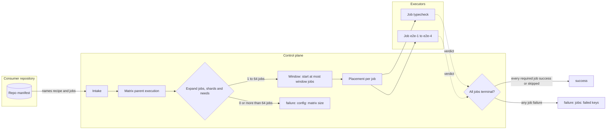
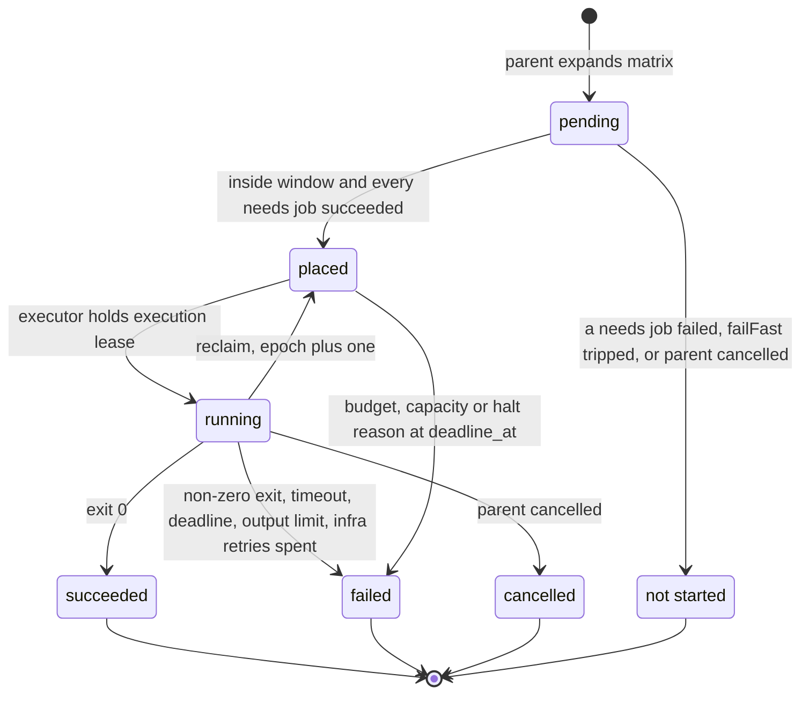
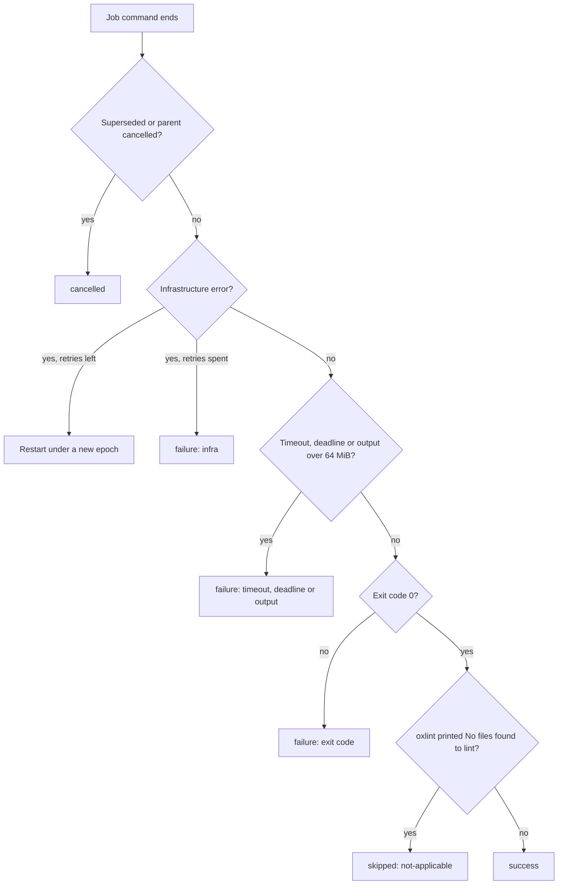
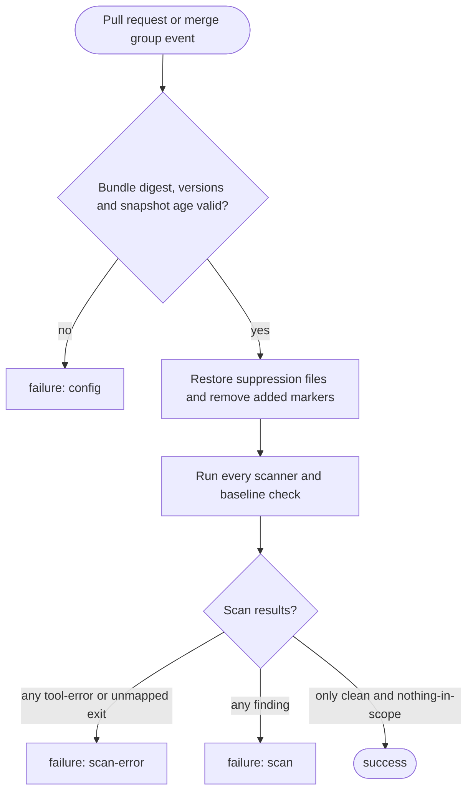
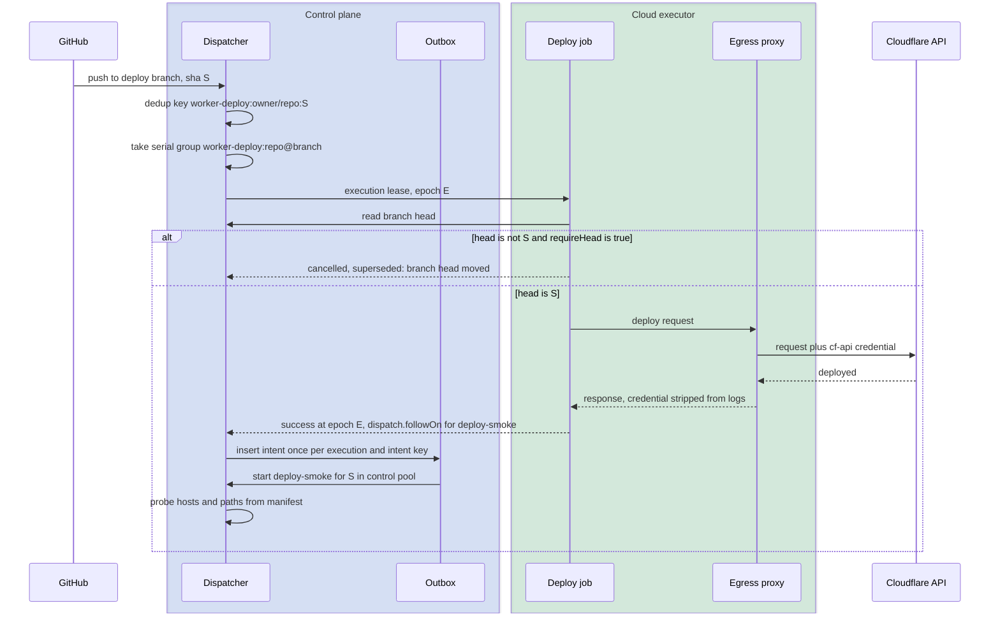
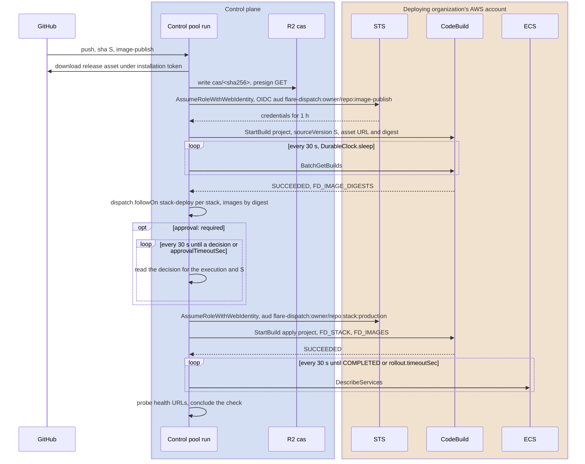

# Gate recipes

This file specifies the gate and test recipes in the catalog (`check`, `oxlint`, `offload-test`, `security-gate`, `security-rescan`, `worker-deploy`, `deploy-smoke`, `sandbox-image`, `image-publish` and `stack-deploy`), the job-matrix primitive that fans one execution out into separately placed jobs, and the rule that maps each job's exit to a verdict. A red test never concludes `success`.

## Scope

This file covers what each gate recipe runs, which repo manifest fields it reads, how the job matrix expands, places and aggregates jobs, and which verdict and reason each job outcome produces. It depends on:

- [run-model.md](../run-model.md) for `defineRun`, `RunResult`, the error taxonomy and intents;
- [intake.md](../intake.md) for triggers, the repo manifest file and dedup keys;
- [profile.md](../profile.md) for classes, placement constraints and each class's infrastructure retries, and mameko's [admission-qos.md](https://github.com/fractalboxdev/mameko/blob/92634b64cee2ffbd0e0e4b5ecb698783ba132d67/specs/admission-qos.md) for the child rule, supersession and serial groups;
- [spend.md](../spend.md) for holds and the budget reasons;
- mameko's [placement-leases.md](https://github.com/fractalboxdev/mameko/blob/92634b64cee2ffbd0e0e4b5ecb698783ba132d67/specs/placement-leases.md) for placement, the execution lease and reclaim;
- [github-output.md](../github-output.md) for check names and the verdict-to-conclusion mapping;
- [cache-artifacts.md](../cache-artifacts.md) for log artifacts and cache namespaces;
- [isolation-egress.md](../isolation-egress.md) for egress-attached grants;
- [runs/agentic.md](agentic.md) for staged writeback.

Consumer-specific gates, release graphs and browser suites are repo manifests in consumer repositories that compose these recipes and the job matrix ([ADR-0016](../adr/0016-run-catalog-scope.md)).

Not specified: `matrix-fanout` and `vitest-shard` (the job matrix replaces them); `demo-reel` (presentation lies outside CI/CD).

Deferred: dispatching `self-heal-pr` from a red `offload-test` follows [runs/agentic.md](agentic.md).

## Model

### Recipes

The class in this table is the recipe's default; `resolveClass` ([profile.md](../profile.md) § Class resolution) sets the class of each execution. A gate whose check the target branch does not require runs at `interactive`.

| Recipe | Default class | Run ceiling | Placement | Triggers | Manifest key |
| --- | --- | --- | --- | --- | --- |
| `check` | `required` | 4500 s | any eligible executor | `pull_request` (`opened`, `synchronize`, `reopened`, `ready_for_review`), `merge_group`, Actions dispatch | `check` |
| `oxlint` | `required` | 600 s | any eligible executor | as `check` | `oxlint` |
| `offload-test` | `required` | 3600 s | `control` pool, no container; each job any eligible executor | as `check` | `offloadTest` |
| `security-gate` | `required` | 1800 s | `cloud-only` | `pull_request` (`opened`, `synchronize`, `reopened`, `ready_for_review`), `merge_group`, check re-runs | `securityGate` |
| `security-rescan` | `batch` | 1800 s | `cloud-only` | Dispatch | `securityGate` |
| `worker-deploy` | `release` | 1800 s | `cloud-pinned` | `push` to the deploy branch, Actions dispatch | `workerDeploy` |
| `deploy-smoke` | `release` | 300 s | `control` pool, no container | `worker-deploy` success, `deployment_status` success | `deploySmoke` |
| `sandbox-image` | `required` on a pull request, `release` on publish | 3600 s | `cloud-pinned` on publish | `pull_request` and `push` to the default branch that change `sandboxImage.paths` | `sandboxImage` |
| `image-publish` | `release` | 7200 s | `control` pool, no container; the build in the deploying organization's AWS CodeBuild project | `push` to `imagePublish.branch` that changes `imagePublish.paths`, Actions dispatch | `imagePublish` |
| `stack-deploy` | `release` | 86400 s | `control` pool, no container; the apply in the stack's AWS CodeBuild project | `image-publish` success, Actions dispatch | `stackDeploy` |

A repo manifest entry that these recipes read looks like this:

```yaml
check:
  - label: unit
    command: pnpm test
    timeoutSec: 900
oxlint:
  version: 1.79.0
securityGate: {}
offloadTest:
  install: pnpm install --frozen-lockfile
  window: 8
  jobs:
    - key: typecheck
      command: pnpm typecheck
    - key: e2e
      command: pnpm e2e --shard=$FD_SHARD_INDEX/$FD_SHARD_TOTAL
      shards: 4
      needs: [typecheck]
workerDeploy:
  branch: main
  command: pnpm wrangler deploy
  grants: [cf-api]
deploySmoke:
  hosts: [app.example.com]
  paths: [/, /health]
imagePublish:
  branch: main
  region: us-east-1
  roleArn: arn:aws:iam::111122223333:role/fd-image-publish
  project: app-images
  registries: [111122223333.dkr.ecr.us-east-1.amazonaws.com/app]
  assets:
    - key: TOOL
      repo: example-org/tool
      tag: v1.4.0
      name: tool-linux-arm64.tar.gz
      sha256: 9f86d081884c7d659a2feaa0c55ad015a3bf4f1b2b0b822cd15d6c15b0f00a08
stackDeploy:
  - stack: staging
    after: image-publish
    region: us-east-1
    roleArn: arn:aws:iam::111122223333:role/fd-stack-staging
    project: app-deploy-staging
    rollout:
      cluster: app-staging
      services: [api, worker]
    health:
      urls: [https://staging.app.example.com/health]
  - stack: production
    after: image-publish
    approval: required
    region: us-east-1
    roleArn: arn:aws:iam::111122223333:role/fd-stack-production
    project: app-deploy-production
    rollout:
      cluster: app-production
      services: [api, worker]
    health:
      urls: [https://app.example.com/health]
```

### Job matrix

A job matrix is one parent execution and 1 to 64 jobs. Each job is a child execution with its own placement, execution lease, hold and workspace. The parent makes no sandbox call: it expands the matrix, starts jobs inside its window, waits for their verdicts and returns one verdict.



*job matrix · one parent, separately placed jobs, one aggregated verdict.*

Each job moves through the states below. A reclaim keeps the job's execution and increments its epoch, so the job returns to `placed` and restarts from the beginning on another executor.



*job lifecycle · reclaim restarts a job; only exit 0 reaches success.*

### Exit to verdict

Every gate job outcome maps to exactly one verdict and reason. [github-output.md](../github-output.md) maps the verdict to a check-run conclusion. A command-based job takes its verdict from its job command. The fixed scanner and baseline-check subprocesses of `security-gate` and `security-rescan` instead produce scan results under § Security gate; FD-GATE-089 to FD-GATE-091 aggregate those results into the recipe's verdict. For example, OSV-Scanner exit 128 means `nothing-in-scope`, so it permits a successful scan when every other result is `clean` or `nothing-in-scope`.

| Job outcome | Verdict | Reason |
| --- | --- | --- |
| Exit code 0 | `success` | — |
| `oxlint` exit code 0 with the line `No files found to lint` | `skipped` | `not-applicable: nothing-to-lint` |
| Non-zero job-command exit code | `failure` | `exit: <code>` |
| Killed by a signal | `failure` | `exit: signal <name>` |
| Killed at the job timeout | `failure` | `timeout: job` |
| Still running at `deadline_at` | `failure` | `deadline` |
| Output over 64 MiB | `failure` | `output: over limit` |
| Infrastructure error after the class's retries | `failure` | `infra: <error tag>` |
| Install command non-zero | `failure` | `install: exit <code>` |
| Invalid manifest entry | `failure` | `config: <field>` |
| Scan bundle or advisory snapshot unusable | `failure` | `config: <field>` |
| A scanner or baseline check reports a finding | `failure` | `scan: <scanner or control ids>` |
| A scanner or baseline check exit maps to `tool-error` or to nothing | `failure` | `scan-error: <scanner or control id> exit <code>` |
| A scanner or baseline check ends with no exit code: a signal, the job timeout, `deadline_at`, output over 64 MiB, or a binary that cannot start | `failure` | `scan-error: <scanner or control id> <end>` (FD-GATE-090) |
| Parent or execution superseded | `cancelled` | `superseded` |



*command-job exit-to-verdict · no branch from a non-zero job-command exit reaches success; scan subprocesses follow the scan-result decision below.*

### Security gate

`security-gate` reports whether a change adds a known-vulnerable dependency, a secret, an unsafe workflow or a failed baseline check. It is the required check for that question; [ADR-0019](../adr/0019-security-gate-scan-bundle.md) records why it takes this shape.

| Term | Meaning |
| --- | --- |
| **Scan bundle** | The DSSE envelope, with payload type `application/vnd.flare-dispatch.scan-bundle.v1+json`, whose payload holds the fields below. The overlay's `scan.bundleDigest` pins one envelope. |
| **Baseline check** | A bundle entry that decides one control from one change: `controlId`, `rule`, `tool`, `argv` and `exitMap`. |
| **Advisory snapshot** | One OSV `all.zip` archive per ecosystem in `cas/<sha256>`, with its digest and `Last-Modified` time in the control-plane store. |
| **Scan result** | What one scanner or baseline check reports: `clean`, `finding`, `tool-error` or `nothing-in-scope`. |
| **Read-only scan run** | A run whose declaration sets `readOnlyScan`, takes no command input, declares no model call site and declares no intent kind other than the `check.*` kinds. `security-rescan` is the one in the catalog. |

| Scan bundle field | Holds |
| --- | --- |
| `version` | The bundle's version string |
| `gitleaks.config`, `zizmor.config` | The configuration file each scanner runs with |
| `scanners.<name>.versions` | The accepted semver range for `gitleaks`, `zizmor` and `osv-scanner` |
| `scanners.<name>.exitMap`, `baselineChecks[].exitMap` | Each exit code's scan result |
| `suppression.files` | The base names the recipe restores from the base commit; at least `.gitleaksignore` and `osv-scanner.toml` |
| `suppression.markers` | The regular expressions the recipe removes from added lines; at least the one for `# zizmor: ignore[...]` |
| `baselineChecks[]` | The baseline checks |

A run takes these steps, and every scanner and baseline check runs even after an earlier one reports a finding:

1. Verify the scan bundle's digest, the scanner versions and the snapshot's age.
2. Check out the head commit and read the scan range: the merge base with the target branch, or `merge_group.base_sha`, to the head.
3. Restore each file named in `suppression.files` that the range changes, from the base commit, or delete the file where the base commit has none.
4. Remove each `suppression.markers` match from the lines the range adds, in the checkout.
5. Run each scanner on its scope, then each baseline check.
6. Conclude from the scan results.

A `security-rescan` dispatch scans the commit its authorization covers. Intake sets the input's repository URL, commit, ref and `<owner>/<repo>` from the dispatch's repository and the commit intake pins, and refuses with 400 `invalid_inputs` an input that names another. The scan reads its scanner configurations from the verified bundle: each `--config <bundle file>` is a read-only file the recipe writes from `gitleaks.config` or `zizmor.config`, outside the checkout.



*Security gate · no path ends `skipped` or `neutral`; a tool error outranks a finding in the reason.*

| Scanner | Scope | Invocation | A head input it would honour | How the recipe removes that input |
| --- | --- | --- | --- | --- |
| gitleaks | Every commit of the range | `gitleaks git --log-opts=<range> --config <bundle file> --ignore-gitleaks-allow --redact=100 --exit-code 42 --report-format json` | `.gitleaks.toml` | `--config` replaces it |
| | | | `gitleaks:allow` on an added line | `--ignore-gitleaks-allow`; the scope holds added lines only, so a target-branch marker on an unchanged line stays out of scope |
| | | | `.gitleaksignore` | Step 3; `--gitleaks-ignore-path` does not stop gitleaks reading the file in the scanned directory |
| zizmor | Each workflow and composite action the range changes | `zizmor --offline --no-progress --format json --config <bundle file> <files>` | `zizmor.yml`, `.github/zizmor.yml` | `--config` replaces them |
| | | | `# zizmor: ignore[...]` on an added line | Step 4; `--no-ignores` is not used because it also drops target-branch markers |
| OSV-Scanner | Each lockfile the range changes | `osv-scanner scan source --offline-vulnerabilities --format json -L <files>`, with `OSV_SCANNER_LOCAL_DB_CACHE_DIRECTORY` set to the snapshot and no `--download-offline-databases` | `osv-scanner.toml` beside a lockfile | Step 3; `--config` is not used because it also drops the target branch's file |

| Scanner | `clean` | `finding` | `tool-error` | `nothing-in-scope` | Fingerprint locator |
| --- | --- | --- | --- | --- | --- |
| gitleaks | 0 | 42 | 1 | No commit in the range | `<path>:<start line>` |
| zizmor | 0 | 11 to 14 | 1, 2, 3 | No workflow in the range | `<path>:<start line>` |
| OSV-Scanner | 0 | 1 | 127 | 128, or no lockfile in the range | `<lockfile path>:<package>@<version>` |

Each finding's `path` is relative to the checkout, and its `startLine` is the 1-based line gitleaks or zizmor reports; OSV-Scanner names no line, so an OSV finding's `startLine` is 1. Its `level` is `failure` for gitleaks and OSV-Scanner, and follows zizmor's severity for zizmor: `High` is `failure`, `Medium` is `warning` and any other is `notice`. Findings with the same fingerprint are one finding.

### Deploy and smoke

`worker-deploy` and `deploy-smoke` form one deploy graph. The deploy holds its serial group, re-reads the branch head before the command starts and reaches the Cloudflare API only through the egress proxy, which attaches the credential. Before the command starts, the run on a Container claims the deploy at the dispatcher's deploy-claim route with the token its lease carries; the dispatcher keeps one claim per execution, so a reclaimed epoch answers `infra: DeployAlreadyStarted` instead of deploying again. A successful deploy emits a `dispatch.followOn` intent that starts `deploy-smoke` on the same commit.



*deploy graph · serial group, head re-check, credential added outside the job.*

### AWS builds and stack deploys

`image-publish` and `stack-deploy` form a second deploy graph, for a repository that builds container images, pushes them to a registry in the deploying organization's AWS account and applies an infrastructure stack that rolls them out. Both run in the `control` pool. The build and the apply run in AWS CodeBuild projects that the organization owns, and the control plane starts and watches them through the AWS API:

- **No AWS credential is stored or leaves the control plane.** For each call the control plane mints an OIDC token (FD-PROV-050) and exchanges it with STS `AssumeRoleWithWebIdentity` for the role the manifest entry names. The token's `aud` is `flare-dispatch:<owner>/<repo>:<target>`, where `<target>` is `image-publish[:<label>]` or `stack:<stack>`, so the role's trust policy pins the repository and target, and `sub` is `<run>:<execution_id>`, so it pins the run. A manifest that names another repository's role cannot assume it.
- **The build runs on the architecture its project names.** A CodeBuild project on an `ARM_CONTAINER` environment runs `linux/arm64` build steps natively, in privileged mode, and pushes to ECR under the project's service role. A Cloudflare Container has neither: it runs no privileged container, so it cannot register QEMU `binfmt_misc` handlers, and it serves `linux-amd64` alone.
- **Waiting holds no container.** The run polls `BatchGetBuilds` and, for a rollout, ECS `DescribeServices` every 30 s, sleeping with `DurableClock.sleep` between polls ([MAMEKO-RUN-037](https://github.com/fractalboxdev/mameko/blob/92634b64cee2ffbd0e0e4b5ecb698783ba132d67/specs/run-model.md)).
- **One build per execution.** The control plane records the build it started for each execution and target before it reports the build as started, so a later epoch polls the recorded build and never starts a second one.
- **Release assets reach the build by digest.** The control plane downloads each release asset the manifest names under the installation token of the asset's repository, writes it to `cas/<sha256>` and passes the build a presigned GET URL and the digest. The build holds no GitHub token.
- **Approval is a recorded decision.** A stack whose entry sets `approval: required` waits before its apply for an `operators` identity to approve or reject the execution at `POST /v1/ops/stack-approvals` ([interfaces.md](../interfaces.md)). The decision binds the execution id and its commit.

The build reports its image digests in the exported environment variable `FD_IMAGE_DIGESTS`, a JSON object from image name to `<registry>/<repository>@sha256:<hex>`. A buildspec exports it with `env.exported-variables`.



*AWS deploy graph · the control plane holds every credential; each wait is a durable sleep.*

## Requirements

### Every gate recipe

- **FD-GATE-001** · phase 0 · `V-UNIT` — Where a gate recipe runs a command, other than `security-gate` or `security-rescan`, the recipe must take that command only from the repository's repo manifest entry or from the dispatch inputs, and the control plane must not hold a default command that applies to every repository.
- **FD-GATE-002** · phase 0 · `V-UNIT` `V-E2E-LOCAL` — When a command-based gate job's command exits with code 0, unless FD-GATE-024 applies, the recipe must record the verdict `success` for that job; scanner and baseline-check subprocesses follow FD-GATE-089 to FD-GATE-091.
- **FD-GATE-003** · phase 0 · `V-UNIT` `V-E2E-LOCAL` — When a command-based gate job's command exits with a non-zero code, the recipe must record the verdict `failure` with the reason `exit: <code>`; scanner and baseline-check subprocesses follow FD-GATE-089 to FD-GATE-091.
- **FD-GATE-004** · phase 0 · `V-UNIT` — The gate recipes and the job matrix must not offer any manifest field, input or default that maps a non-zero job-command exit, a failed job or a failed shard to `success`; the fixed scanner and baseline-check exit maps of the verified scan bundle must be interpreted only as FD-GATE-089 to FD-GATE-091 specify.
- **FD-GATE-005** · phase 0 · `V-UNIT` — If a gate job's command ends on a signal, then the recipe must record `failure` with the reason `exit: signal <name>`.
- **FD-GATE-006** · phase 0 · `V-UNIT` `V-E2E-LOCAL` — If a gate job's command runs past its job timeout, then the executor must kill its process group and the recipe must record `failure` with the reason `timeout: job`.
- **FD-GATE-007** · phase 0 · `V-UNIT` `V-SIM` — If a gate job's command is still running when the executor stops the job at the execution's `deadline_at` ([MAMEKO-EXEC-002](https://github.com/fractalboxdev/mameko/blob/92634b64cee2ffbd0e0e4b5ecb698783ba132d67/specs/executors.md)), then the recipe must record `failure` with the reason `deadline`.
- **FD-GATE-008** · phase 0 · `V-UNIT` — If a gate job's combined stdout and stderr exceed 64 MiB, then the recipe must stop the command, record `failure` with the reason `output: over limit` and derive no verdict from the output.
- **FD-GATE-010** · phase 0 · `V-UNIT` `V-SIM` — If a gate job ends with an infrastructure error after the retries its class allows ([profile.md](../profile.md) § Class catalogue), then the recipe must record `failure` with the reason `infra: <error tag>`.
- **FD-GATE-011** · phase 0 · `V-UNIT` — When a gate job ends, the recipe must upload the job's redacted output as the artifact `<job key>.log` before it returns its verdict.
- **FD-GATE-012** · phase 0 · `V-UNIT` — If a gate job's log upload fails, then the recipe must return the same verdict it would return after a successful upload.
- **FD-GATE-013** · phase 0 · `V-UNIT` `V-E2E-LOCAL` — The recipe must set `FD_REPO`, `FD_SHA`, `FD_REF` and `FD_JOB` in every gate job's environment.
- **FD-GATE-014** · phase 0 · `V-UNIT` `V-E2E-LOCAL` — The recipe must not place a secret in a gate job's environment, arguments or files; a job reaches a credentialed service only through an egress-attached grant ([isolation-egress.md](../isolation-egress.md)).
- **FD-GATE-015** · phase 0 · `V-UNIT` — Where a manifest entry names cache keys, the recipe must restore and save them only in the cache namespace the control plane assigns to the execution ([cache-artifacts.md](../cache-artifacts.md)).
- **FD-GATE-081** · phase 2 · `V-UNIT` — Where a manifest job declares `writeback { branch, paths }`, when the job's verdict is `success`, the recipe must stage the changed files that match `paths` as one staged write on a branch under `flare-dispatch/`, which the staged-write gate of [runs/agentic.md](agentic.md) checks; a `refresh-fixtures` job that regenerates test fixtures and proposes them as a pull request is the example.
- **FD-GATE-017** · phase 0 · `V-UNIT` — When a `pull_request` event names a draft pull request, or one whose author is in the manifest's `skipAuthors` list (default `dependabot[bot]`), the `check`, `oxlint` and `offload-test` recipes must run no command and conclude `skipped` with the reason `not-applicable: draft-pr` or `not-applicable: author-excluded`, which [github-output.md](../github-output.md) FD-GH-025 maps to `neutral`.
- **FD-GATE-018** · phase 0 · `V-UNIT` — If a manifest entry sets `timeoutSec` outside 1 s to the recipe's run ceiling, then the recipe must record `failure` with the reason `config: timeoutSec` and run no command.

### `check`

- **FD-GATE-019** · phase 0 · `V-UNIT` `V-E2E-LOCAL` — When a `check` execution starts, the recipe must run the manifest entry's `command` once in a checkout of the execution's commit, with a job timeout of the entry's `timeoutSec`, default 600 s.
- **FD-GATE-020** · phase 0 · `V-UNIT` — Where a `check` manifest entry has a `label`, the recipe must report under the check name `flare-dispatch/check:<label>`, and the label must match `^[A-Za-z0-9][A-Za-z0-9._-]{0,31}$`.
- **FD-GATE-021** · phase 0 · `V-UNIT` — If a `check` label does not match `^[A-Za-z0-9][A-Za-z0-9._-]{0,31}$`, then the recipe must record `failure` with the reason `config: label` and run no command.

### `oxlint`

- **FD-GATE-022** · phase 0 · `V-UNIT` — When an `oxlint` execution starts, the recipe must run `npx --yes oxlint@<version>` with no install step and a job timeout of 300 s, where `<version>` is the manifest's `oxlint.version` or else the version pinned in the recipe.
- **FD-GATE-023** · phase 0 · `V-UNIT` — If the `oxlint` version does not match `^[0-9]+\.[0-9]+\.[0-9]+$`, then the recipe must record `failure` with the reason `config: oxlint version` and run no command.
- **FD-GATE-024** · phase 0 · `V-UNIT` — When `oxlint` exits with code 0 and its output contains the line `No files found to lint`, the recipe must record `skipped` with the reason `not-applicable: nothing-to-lint`.

### `offload-test`

- **FD-GATE-025** · phase 0 · `V-UNIT` — When an `offload-test` execution starts, the recipe must run its manifest entry as a job matrix whose jobs are the entry's `jobs` list, or one job keyed `test` where the entry has a single `command`.
- **FD-GATE-026** · phase 0 · `V-UNIT` — If an `offload-test` execution has no command in its manifest entry or dispatch inputs, then the recipe must record `failure` with the reason `config: no command` and start no job.
- **FD-GATE-027** · phase 0 · `V-UNIT` `V-E2E-LOCAL` — Where an `offload-test` entry names an `install` command, each job must run it once in its own workspace before the job command, with a job timeout of 600 s.
- **FD-GATE-028** · phase 0 · `V-UNIT` — If an `offload-test` install command exits with a non-zero code, then the job must record `failure` with the reason `install: exit <code>` and run no job command.

### Job matrix

- **FD-GATE-029** · phase 0 · `V-UNIT` — If a job matrix expands, shards included, to 0 jobs or to more than 64 jobs, then the parent must record `failure` with the reason `config: matrix size` and start no job.
- **FD-GATE-030** · phase 0 · `V-UNIT` `V-SIM` — The parent must run each job as a child execution with its own placement, execution lease, hold and workspace, and two jobs must not share a workspace.
- **FD-GATE-031** · phase 0 · `V-UNIT` `V-REPLAY` — The parent must give each job the dedup key `<parent dedup key>/<job key>`, so a replay of the parent creates no second job.
- **FD-GATE-032** · phase 0 · `V-UNIT` — If a job key does not match `^[A-Za-z0-9][A-Za-z0-9._-]{0,31}$` or two jobs share a key, then the parent must record `failure` with the reason `config: job key` and start no job.
- **FD-GATE-033** · phase 0 · `V-UNIT` `V-SIM` — While a job matrix has `window` jobs that are placed or running, the parent must start no further job, where `window` defaults to 10 and ranges from 1 to 64.
- **FD-GATE-034** · phase 0 · `V-UNIT` — Where a job declares `shards: N` with N from 1 to 64, the parent must expand it into N jobs keyed `<key>-<i>` for i from 1 to N, each with `FD_SHARD_INDEX=i` and `FD_SHARD_TOTAL=N` in its environment.
- **FD-GATE-035** · phase 0 · `V-UNIT` — Where a job declares `needs`, the parent must start the job only after every named job records `success`.
- **FD-GATE-036** · phase 0 · `V-UNIT` — If a job named in another job's `needs` records a verdict other than `success`, then the parent must not start the dependent job and must record it as not started with the reason `needs: <key>`.
- **FD-GATE-037** · phase 0 · `V-UNIT` — If the `needs` declarations of a job matrix form a cycle or name an unknown key, then the parent must record `failure` with the reason `config: needs` and start no job.
- **FD-GATE-038** · phase 0 · `V-UNIT` — When every job is terminal, the parent must record `success` only if every job recorded `success` or `skipped` and at least one recorded `success`.
- **FD-GATE-039** · phase 0 · `V-UNIT` — When every job is terminal and every job recorded `skipped`, the parent must record `skipped` with the reason `not-applicable: every-job-skipped`.
- **FD-GATE-040** · phase 0 · `V-UNIT` — When every job is terminal and any job recorded `failure` or was not started, the parent must record `failure` with the reason `jobs: <keys>`, listing the first 25 failed or not-started keys in expansion order.
- **FD-GATE-041** · phase 0 · `V-UNIT` `V-SIM` — If a job's execution ends with no recorded verdict, then the parent must count the job as `failure` with the reason `infra: no verdict`.
- **FD-GATE-042** · phase 0 · `V-UNIT` `V-SIM` — When the parent is cancelled, the parent must cancel every placed or running job through mameko's cancellation path ([admission-qos.md § Supersession](https://github.com/fractalboxdev/mameko/blob/92634b64cee2ffbd0e0e4b5ecb698783ba132d67/specs/admission-qos.md#supersession)) and record every pending job as not started.
- **FD-GATE-043** · phase 0 · `V-UNIT` — Where a job matrix sets `failFast: true` (default `false`), when a job records `failure`, the parent must start no further job and let running jobs reach their verdicts.
- **FD-GATE-044** · phase 0 · `V-SIM` — If a job records `failure` with a budget, capacity or operator-halt reason, then the parent must start no further job.
- **FD-GATE-045** · phase 0 · `V-UNIT` — The parent must make no sandbox call, so its hold carries a container rate of 0 USD per hour.
- **FD-GATE-046** · phase 0 · `V-UNIT` `V-REPLAY` — Where a job matrix sets `checkPerJob: true`, each job must report under the check name `flare-dispatch/<run>:<job key>`.
- **FD-GATE-047** · phase 0 · `V-UNIT` `V-REPLAY` — When the parent records its verdict, the control plane must conclude every job check that has not concluded as [github-output.md](../github-output.md) FD-GH-020 specifies.

### Discovered matrices

- **FD-GATE-048** · phase 0 · `V-UNIT` — Where a job matrix declares a `discover` command, the parent must run it on the head commit and on the base commit, each as a job with a job timeout of 600 s, before it expands the matrix.
- **FD-GATE-049** · phase 0 · `V-UNIT` — Where a job matrix declares a `discover` command, the parent must take as its job set the union of the jobs the head discovery names and the jobs the base discovery names, so a head commit cannot remove a job the base requires.
- **FD-GATE-050** · phase 0 · `V-UNIT` — If a discovery command exits with a non-zero code on either commit, then the parent must record `failure` with the reason `discover: exit <code>` and start no job.
- **FD-GATE-051** · phase 0 · `V-UNIT` — If a discovery output exceeds 4096 bytes, is not a JSON array of job objects or names more than 64 jobs, then the parent must record `failure` with the reason `config: discovery output` and start no job.
- **FD-GATE-052** · phase 0 · `V-UNIT` — Where a job declares `heavy: true`, the parent must not start it on a `pull_request` or `merge_group` trigger, and must start it on a `push` to the default branch at class `interactive`.
- **FD-GATE-053** · phase 0 · `V-UNIT` — Where a repo manifest declares a `warm` job, when a `push` to the default branch arrives, the control plane must run it at class `batch` writing only the protected namespace that [cache-artifacts.md](../cache-artifacts.md) FD-CACHE-017 or FD-CACHE-018 assigns for its executor kind, post no check for it, and supersede it with the next default-branch head.

### Release matrices

A release job's infrastructure retries are the parent's restarts of FD-GATE-060, each a new child under the attempt's dedup key. The control plane retries a `release` child under its class's retry bound `run` ([profile.md](../profile.md) FD-PROF-009), which takes the `gate-job` run's declared retries, and `gate-job` declares none, so the two layers never both restart one job. A job of any other class takes the control plane's retries alone: the parent restarts none.

- **FD-GATE-054** · phase 0 · `V-UNIT` — Where a job matrix declares `release: true`, when a `refs/tags/v<semver>` push arrives, the parent must verify that the tag's commit is reachable from the default branch before it starts any job.
- **FD-GATE-055** · phase 0 · `V-UNIT` — If a release tag's commit is not reachable from the default branch, then the parent must record `failure` with the reason `release: tag not on default branch` and start no job.
- **FD-GATE-056** · phase 0 · `V-UNIT` `V-REPLAY` — Where a job matrix declares `release: true`, the parent must emit a `release.draft` intent before its first job starts and must not emit an intent that modifies a published release.
- **FD-GATE-057** · phase 0 · `V-UNIT` — Where a job matrix declares `release: true`, the parent must emit the `release.publish` intent only after every job records `success`.
- **FD-GATE-058** · phase 0 · `V-UNIT` — If a release tag points at a different commit when the parent re-reads it before the `release.publish` intent, then the parent must record `failure` with the reason `release: tag moved` and emit no `release.publish` intent.
- **FD-GATE-059** · phase 0 · `V-UNIT` `V-REPLAY` — When a `refs/tags/dry-run/v<semver>` push starts a release matrix, the parent must run every job and emit no `release.draft` or `release.publish` intent.
- **FD-GATE-060** · phase 0 · `V-UNIT` — Where a release job declares `retries` from 0 to 2 (default 2), if the job ends with an infrastructure error, then the parent must restart it at most `retries` times and must not restart it after a non-zero exit.

### `worker-deploy`

- **FD-GATE-061** · phase 0 · `V-UNIT` `V-PROOF` `V-DIFF` — The control plane must place every `worker-deploy` execution under the `cloud-pinned` constraint, and must not place one on an owned device.
- **FD-GATE-062** · phase 0 · `V-UNIT` — When a `push` to the manifest's `workerDeploy.branch` (default the default branch) or an Actions dispatch requests a deploy, intake must use the commit-scoped dedup key of [intake.md](../intake.md) FD-INT-009, `worker-deploy[:<label>]:<owner>/<repo>:<sha>`, so one commit deploys once across the push and the dispatch.
- **FD-GATE-063** · phase 0 · `V-UNIT` `V-SIM` — The control plane must run `worker-deploy` executions for one repository, branch and label in the serial group `worker-deploy:<repo>@<branch>[:<label>]`.
- **FD-GATE-064** · phase 0 · `V-UNIT` `V-SIM` — When a `worker-deploy` job starts in any epoch, the recipe must read the branch head before the deploy command starts.
- **FD-GATE-065** · phase 0 · `V-UNIT` `V-SIM` — If the branch head is not the execution's commit and the manifest does not set `requireHead: false`, then the recipe must record `cancelled` with the reason `superseded: branch head moved` and run no deploy command.
- **FD-GATE-066** · phase 0 · `V-E2E-LOCAL` `V-UNIT` — The `worker-deploy` job must reach the Cloudflare API only through the `cf-api` egress-attached grant, and the credential must not appear in the job's environment, files or logs.
- **FD-GATE-067** · phase 0 · `V-UNIT` — When a `worker-deploy` deploy command has started in an epoch, the recipe must not start it again in that epoch.
- **FD-GATE-068** · phase 0 · `V-UNIT` — The `worker-deploy` recipe must run the deploy command with a job timeout of the manifest's `timeoutSec`, default 900 s, and must set `FD_BRANCH` and `FD_BRANCH_HEAD_SHA` in the job's environment.

### `deploy-smoke`

- **FD-GATE-069** · phase 0 · `V-UNIT` `V-REPLAY` — When a `worker-deploy` execution records `success`, the recipe must emit one `dispatch.followOn` intent that starts `deploy-smoke` on the same commit ([../github-output.md](../github-output.md) FD-GH-088).
- **FD-GATE-070** · phase 0 · `V-UNIT` — When a `deployment_status` event with state `success` arrives for an environment in the manifest's `deploySmoke.environments` (default `[production]`) and carries an `environment_url`, intake must request a `deploy-smoke` execution.
- **FD-GATE-071** · phase 0 · `V-UNIT` — When a `deploy-smoke` execution starts, the recipe must probe each path in `deploySmoke.paths` (default `/` and `/health`) over HTTPS on each host in `deploySmoke.hosts`, and count an endpoint healthy only on a 2xx or 3xx status within 10 s.
- **FD-GATE-072** · phase 0 · `V-UNIT` — If an endpoint is unhealthy on 3 attempts 10 s apart, then the recipe must record `failure` with the reason `smoke: <host><path> <status or error>` for each unhealthy endpoint.
- **FD-GATE-073** · phase 0 · `V-UNIT` — If a `deploy-smoke` target host, an `environment_url` host included, is not in `deploySmoke.hosts`, then the recipe must record `failure` with the reason `config: host not allowed` and send no request to it.
- **FD-GATE-074** · phase 0 · `V-UNIT` — The `deploy-smoke` recipe must not follow a redirect to a host outside `deploySmoke.hosts`.
- **FD-GATE-075** · phase 0 · `V-UNIT` — The control plane must run `deploy-smoke` in the `control` pool ([MAMEKO-EXEC-057](https://github.com/fractalboxdev/mameko/blob/92634b64cee2ffbd0e0e4b5ecb698783ba132d67/specs/executors.md)), with no container and a container rate of 0 USD per hour.

### `sandbox-image`

- **FD-GATE-076** · phase 0 · `V-UNIT` — When a `pull_request` changes a file that matches `sandboxImage.paths` (default `infra/**`), the recipe must build every image in the image family for `linux/arm64` and `linux/amd64`, run each image's smoke commands and publish nothing.
- **FD-GATE-077** · phase 0 · `V-UNIT` — When a `push` to the default branch changes a file that matches `sandboxImage.paths`, the recipe must build every image for `linux/arm64` and `linux/amd64`, run each image's smoke commands, publish each image by digest and upload the digests as the artifact `image-digests.json`.
- **FD-GATE-078** · phase 0 · `V-UNIT` — If an image's build inputs include a base image without an `@sha256:` digest, a download without a SHA-256 checksum or a toolchain named by a channel such as `stable`, then the recipe must record `failure` with the reason `image: unpinned input <name>` before any build starts.
- **FD-GATE-079** · phase 0 · `V-UNIT` — If any image build or smoke command fails on either architecture, then the recipe must publish no image and record `failure` with the reason `image: <name> <arch> <step>`.
- **FD-GATE-080** · phase 0 · `V-UNIT` `V-PROOF` `V-DIFF` — The control plane must place a publishing `sandbox-image` execution at class `release` under the `cloud-pinned` constraint on an executor that carries the label `container-artifact` ([executors.md](../executors.md) § Capability labels).
- **FD-GATE-082** · phase 0 · `V-UNIT` — When a `sandbox-image` execution runs the smoke commands of a `linux/arm64` image on an executor that does not advertise `linux-arm64`, the recipe must run them under QEMU user-mode emulation with `--platform linux/arm64`, and if emulation is unavailable on that executor, then the recipe must record `failure` with the reason `image: <name> linux/arm64 emulation unavailable` and publish no image.

### AWS builds

These requirements hold for `image-publish` and `stack-deploy`, each of which runs a build in an AWS CodeBuild project.

- **FD-GATE-116** · phase 2 · `V-UNIT` — The control plane must run every `image-publish` and `stack-deploy` execution in the `control` pool ([MAMEKO-EXEC-057](https://github.com/fractalboxdev/mameko/blob/92634b64cee2ffbd0e0e4b5ecb698783ba132d67/specs/executors.md)), with no container and a container rate of 0 USD per hour.
- **FD-GATE-117** · phase 2 · `V-UNIT` — Before the recipe calls an AWS API, it must obtain the role's credentials with STS `AssumeRoleWithWebIdentity` for the entry's `roleArn`, presenting an OIDC token from the control plane's issuer whose `aud` is `flare-dispatch:<owner>/<repo>:<target>` and whose `sub` is `<run>:<execution_id>` (FD-PROV-050), where `<target>` is `image-publish`, `image-publish:<label>` or `stack:<stack>`.
- **FD-GATE-118** · phase 2 · `V-UNIT` — The control plane must hold the role's credentials only in the run's memory, and must not write them to an intent, a check summary, a log, the build's environment or the store.
- **FD-GATE-119** · phase 2 · `V-UNIT` — If `AssumeRoleWithWebIdentity` fails, then the recipe must start no build and record `failure` with the reason `aws: assume-role <error code>`.
- **FD-GATE-120** · phase 2 · `V-UNIT` — When the recipe starts a build, it must call CodeBuild `StartBuild` for the entry's `project` with `sourceVersion` equal to the execution's commit SHA and the environment overrides `FD_REPO`, `FD_SHA`, `FD_REF` and `FD_EXECUTION_ID`, and with no credential in any override.
- **FD-GATE-121** · phase 2 · `V-UNIT` `V-SIM` — The control plane must start at most one build per execution and target, recording the build id before it reports the build as started; when a later epoch of the execution runs, the recipe must poll the recorded build and must not call `StartBuild`.
- **FD-GATE-122** · phase 2 · `V-UNIT` — While a build runs, the recipe must read its status with `BatchGetBuilds` at 30 s intervals, sleeping with `DurableClock.sleep` between reads.
- **FD-GATE-123** · phase 2 · `V-UNIT` — When a build ends, the recipe must take the verdict from its `buildStatus`: `SUCCEEDED` continues the recipe; `FAILED` is `failure` with the reason `build: <first failed phase> failed`; `TIMED_OUT` is `failure` with the reason `timeout: build`; `FAULT` is `failure` with the reason `infra: build fault`; and `STOPPED` that the recipe did not request is `failure` with the reason `build: stopped`.
- **FD-GATE-124** · phase 2 · `V-UNIT` — If a build is still running 60 s before the execution's `deadline_at`, or the execution is cancelled while a build runs, then the recipe must call `StopBuild` for it and record `failure` with the reason `deadline`, or `cancelled` with the cancel cause.
- **FD-GATE-125** · phase 2 · `V-UNIT` — If a CodeBuild, ECS or STS call fails with a network error or a 5xx status 3 times in a row, then the recipe must record `failure` with the reason `infra: aws <service> <operation>`.
- **FD-GATE-126** · phase 2 · `V-UNIT` — When a build ends, the recipe must emit one `check.summary` intent naming the build id, its status, each phase's status and duration and the CloudWatch log group and stream, and must not copy any build log line into the summary.
- **FD-GATE-127** · phase 2 · `V-UNIT` — If a manifest entry's `region` is not an AWS region name, its `roleArn` is not an IAM role ARN, or its `project` is empty, then the recipe must record `failure` with the reason `config: <field>` and call no AWS API.

### `image-publish`

- **FD-GATE-128** · phase 2 · `V-UNIT` — When a `push` to the manifest's `imagePublish.branch` (default the default branch) changes a file that matches `imagePublish.paths` (default `**`), or an Actions dispatch requests it, intake must request `image-publish` with the dedup key `image-publish[:<label>]:<owner>/<repo>:<sha>`.
- **FD-GATE-129** · phase 2 · `V-UNIT` — Before it starts the build, for each entry of `imagePublish.assets` the control plane must download the asset named `name` of the release tagged `tag` in `repo` under the installation token for `repo`, write it to the object key `cas/<sha256>` and pass the build the overrides `FD_ASSET_<key>_URL`, a GET URL from the object-store presigner, and `FD_ASSET_<key>_SHA256`.
- **FD-GATE-130** · phase 2 · `V-UNIT` — If an asset's repository has no installation of the GitHub App, its release or asset is absent, it exceeds 512 MiB, or its SHA-256 differs from the entry's `sha256`, then the recipe must start no build and record `failure` with the reason `asset: <key> <uninstalled | not found | too large | digest mismatch>`.
- **FD-GATE-131** · phase 2 · `V-UNIT` — When an `image-publish` build succeeds, the recipe must read the build's exported variable `FD_IMAGE_DIGESTS` as a JSON object from image name to `<registry>/<repository>@sha256:<64 hex digits>`, and if it is absent, does not decode, is empty, or names a repository outside every prefix in `imagePublish.registries`, then the recipe must record `failure` with the reason `image: digests`.
- **FD-GATE-132** · phase 2 · `V-UNIT` `V-REPLAY` — When an `image-publish` execution records `success`, the recipe must emit one `dispatch.followOn` intent per `stackDeploy` entry whose `after` is `image-publish`, labelled with the entry's `stack` and carrying the image digests as the input `images`.

### `stack-deploy`

- **FD-GATE-133** · phase 2 · `V-UNIT` — When a `dispatch.followOn` intent of an `image-publish` execution starts `stack-deploy`, intake must take the stack's entry from the repo manifest at the parent's commit and the `images` from the intent, and must refuse the intent where an image is not `<registry>/<repository>@sha256:<64 hex digits>`.
- **FD-GATE-134** · phase 2 · `V-UNIT` `V-SIM` — The control plane must run `stack-deploy` executions for one repository and stack in the serial group `stack-deploy:<owner>/<repo>@<stack>`, with the dedup key `stack-deploy:<stack>:<owner>/<repo>:<sha>`.
- **FD-GATE-135** · phase 2 · `V-UNIT` — Before the apply build starts, the recipe must read the head of the manifest's `stackDeploy[].branch` (default the default branch), and if the head is not the execution's commit and `requireHead` is not `false`, then it must record `cancelled` with the cause `superseded: branch head moved` and start no build.
- **FD-GATE-136** · phase 2 · `V-UNIT` — Where a stack's entry sets `approval: required`, the recipe must emit a `check.summary` intent that names the execution id and the approval route, and must start no apply build until the control plane records a decision for that execution and its commit, reading it at 30 s intervals with `DurableClock.sleep` between reads.
- **FD-GATE-137** · phase 2 · `V-UNIT` — If the recorded decision is `reject`, then the recipe must record `failure` with the reason `approval: rejected`; if no decision is recorded within the entry's `approvalTimeoutSec` (60 s to 43200 s, default 14400 s), then the recipe must record `cancelled` with the cause `approval: timeout`.
- **FD-GATE-138** · phase 2 · `V-UNIT` — When the recipe starts the apply build, it must add to the overrides of FD-GATE-120 `FD_STACK`, the stack's name, and `FD_IMAGES`, the JSON of the execution's `images`.
- **FD-GATE-139** · phase 2 · `V-UNIT` — Where a stack's entry names `rollout`, after the apply build succeeds the recipe must read ECS `DescribeServices` for `rollout.services` in `rollout.cluster` at 30 s intervals until every service's `PRIMARY` deployment has `rolloutState` `COMPLETED` and `runningCount` equal to `desiredCount`, within `rollout.timeoutSec` (60 s to 3600 s, default 1800 s).
- **FD-GATE-140** · phase 2 · `V-UNIT` — If a rollout service is absent, its `PRIMARY` deployment's `rolloutState` is `FAILED`, or the rollout does not complete within `rollout.timeoutSec`, then the recipe must record `failure` with the reason `rollout: <service> <missing | failed | timeout>`.
- **FD-GATE-141** · phase 2 · `V-UNIT` — Where a stack's entry names `health.urls`, after the rollout completes the recipe must probe each URL as FD-GATE-071, FD-GATE-072 and FD-GATE-074 probe an endpoint, refuse a URL whose scheme is not `https` with the reason `config: health.urls`, and record `failure` with the reason `health: <url> <status or error>` for each unhealthy URL.

### Security gate

- **FD-GATE-083** · phase 2 · `V-UNIT` — The run catalog must ship the gate recipes `security-gate` and `security-rescan`, which a repo manifest enrolls with the key `securityGate`.
- **FD-GATE-084** · phase 2 · `V-UNIT` — The `securityGate` manifest entry and the input schemas of `security-gate` and `security-rescan` must hold no command, scanner, flag or skip field.
- **FD-GATE-085** · phase 2 · `V-UNIT` `V-E2E-LOCAL` — `security-gate` must run on every `pull_request` and `merge_group` trigger its table row names, whatever the pull request's author, labels or draft state.
- **FD-GATE-086** · phase 2 · `V-UNIT` — `security-gate` and `security-rescan` must not conclude `skipped` on any path.
- **FD-GATE-087** · phase 2 · `V-UNIT` — When a scan runs, the recipe must run every scanner and every baseline check, including those after a `finding`.
- **FD-GATE-088** · phase 2 · `V-UNIT` — When a scanner has no input in the scan range, the recipe must record `nothing-in-scope` for that scanner with no invocation.
- **FD-GATE-089** · phase 2 · `V-UNIT` — When every scan result is `clean` or `nothing-in-scope`, the recipe must record `success`.
- **FD-GATE-090** · phase 2 · `V-UNIT` — If a scanner or baseline check's exit code maps to `tool-error` or is absent from its exit map, or the subprocess ends with no exit code, then the recipe must record `failure` with the reason `scan-error: <scanner or control id> <end>`, ahead of any `scan:` reason, where `<end>` is `exit <code>`, `signal <name>`, `timeout`, `deadline`, `output over limit` or `not started`.
- **FD-GATE-091** · phase 2 · `V-UNIT` — If a scan result is `finding` and no result is `tool-error`, then the recipe must record `failure` with the reason `scan: <scanners and control ids>`.
- **FD-GATE-092** · phase 2 · `V-UNIT` — The recipe must fetch every commit of the scan range before any scanner runs.
- **FD-GATE-093** · phase 2 · `V-UNIT` `V-E2E-LOCAL` — Before any scanner runs, the recipe must restore from the base commit each file whose base name `suppression.files` lists and the range changes, and must delete that file where the base commit has none.
- **FD-GATE-094** · phase 2 · `V-UNIT` `V-E2E-LOCAL` — Before any scanner runs, the recipe must remove every `suppression.markers` match from the lines the scan range adds, in the checkout, and must leave every other line unchanged.
- **FD-GATE-095** · phase 2 · `V-UNIT` — The recipe must run gitleaks, zizmor and OSV-Scanner with exactly the invocation § Security gate gives, on the scope that table names.
- **FD-GATE-096** · phase 2 · `V-UNIT` — The recipe must report each finding with `scanner`, `ruleId`, `path`, `startLine`, `level` and `fingerprint`, where `ruleId` is the gitleaks rule id, the zizmor audit id or the OSV advisory id.
- **FD-GATE-097** · phase 2 · `V-UNIT` — The recipe must set each scan finding's `fingerprint` to the SHA-256 of the canonical JSON of its scanner, `ruleId` and fingerprint locator.
- **FD-GATE-098** · phase 2 · `V-UNIT` — The recipe must not derive a fingerprint from a matched secret's value, and must not write a matched value to a log, annotation, check summary, artifact or finding.
- **FD-GATE-099** · phase 2 · `V-UNIT` — The check summary must name the scan bundle's digest and version, each advisory snapshot's digest and `Last-Modified` time, each scanner's version and each scan result.
- **FD-GATE-100** · phase 2 · `V-UNIT` `V-CONF` — When a scan starts, the executor must read the scan bundle from `cas/<scan.bundleDigest>` and verify the SHA-256 of the bytes against that digest.
- **FD-GATE-101** · phase 2 · `V-UNIT` — If the deployment sets no `scan.bundleDigest`, then the recipe must record `failure` with the reason `config: scan bundle not pinned` and run no scanner.
- **FD-GATE-102** · phase 2 · `V-UNIT` `V-SIM` — If the scan bundle object is absent or unreadable, then the recipe must record `failure` with the reason `config: scan bundle missing` and run no scanner.
- **FD-GATE-103** · phase 2 · `V-UNIT` — If the scan bundle's digest differs from `scan.bundleDigest`, then the recipe must record `failure` with the reason `config: scan bundle digest` and run no scanner.
- **FD-GATE-104** · phase 2 · `V-UNIT` `V-CONF` — The executor must place the scan bundle and the advisory snapshot on a read-only path outside the checkout.
- **FD-GATE-105** · phase 2 · `V-UNIT` — If a scanner's version in the image falls outside `scanners.<name>.versions`, then the recipe must record `failure` with the reason `config: scanner version <name>` and run no scanner.
- **FD-GATE-106** · phase 2 · `V-UNIT` — If the scan range changes a lockfile of an ecosystem whose advisory snapshot is absent, then the recipe must record `failure` with the reason `config: advisory snapshot missing <ecosystem>` and run no scanner.
- **FD-GATE-107** · phase 2 · `V-UNIT` `V-SIM` — If the scan range changes a lockfile of an ecosystem whose advisory snapshot's `Last-Modified` time is older than `scan.advisoryMaxAgeHours`, then the recipe must record `failure` with the reason `config: advisory snapshot stale <ecosystem>` and run no scanner.
- **FD-GATE-108** · phase 2 · `V-UNIT` — The recipe must run each baseline check's `argv` with no shell, in the checkout, with a job timeout of 600 s.
- **FD-GATE-109** · phase 2 · `V-UNIT` — If a baseline check's `tool` is not a binary that the image's `/etc/flare-dispatch/scan-tools` file lists, then the recipe must record `failure` with the reason `config: baseline check <control id>` and run no scanner.
- **FD-GATE-110** · phase 2 · `V-UNIT` `V-CONF` — The control plane must give a `security-gate` or `security-rescan` job sandbox no tenant-scope secret, the repository's git host as its only egress host while the checkout runs, and no egress host once a scanner starts.
- **FD-GATE-111** · phase 2 · `V-UNIT` — `security-rescan` must start only from a dispatch, and must report under the check name `flare-dispatch/security-rescan`.
- **FD-GATE-112** · phase 2 · `V-UNIT` — When `security-rescan` runs, the recipe must use the merge base of the dispatched commit and the default branch head as the base of its scan range.
- **FD-GATE-113** · phase 2 · `V-UNIT` `V-DEPLOY` — If a run declaration sets `readOnlyScan` and holds a command input, a model call site or an intent kind other than the `check.*` kinds, then the registry validator must reject the declaration at deploy.
- **FD-GATE-114** · phase 2 · `V-UNIT` — When `sandbox-image` builds the image that holds the scanners, its smoke commands must run each scanner against a fixture with a planted finding and a head suppression, and must fail unless the exit code maps to `finding`.
- **FD-GATE-115** · phase 2 · `V-UNIT` — When `sandbox-image` builds the image that holds the scanners, its smoke commands must run each scanner on a tool-error fixture, and must fail unless the exit code maps to `tool-error`.

## Open items

- TODO(maintainer): FD-GATE-082 cannot pass on a Cloudflare Container, which runs no privileged container and so cannot register QEMU `binfmt_misc` handlers. Decide whether `sandbox-image` builds its `linux/arm64` images through `image-publish` or only on an executor that advertises `linux-arm64`.
- TODO(maintainer): decide whether the build ledger of FD-GATE-121 stops an orphaned build when an execution ends between `StartBuild` and the ledger write, or whether CodeBuild's `idempotencyToken`, which holds for 5 min, suffices.
- TODO(operator): register the control plane's issuer as an IAM OIDC identity provider in each AWS account that `image-publish` or `stack-deploy` reaches, with each `flare-dispatch:<owner>/<repo>:<target>` audience as a client id.
- TODO(maintainer): decide whether a finding that already exists at the base commit, in a lockfile or workflow the range changes, concludes `failure`, or whether the recipe subtracts the base commit's fingerprints. FD-GATE-091 concludes `failure` until this is decided.
- TODO(maintainer): set the default `scan.advisoryEcosystems` from measured archive sizes; the npm archive is 209 MiB.
- TODO(maintainer): the egress half of FD-GATE-110 on a Container pool, the git host as the only egress host while the checkout runs and none once a scanner starts, has no harness entry.
- TODO(maintainer): decide whether `worker-deploy` waits for every required check on its commit to conclude `success` before the deploy command starts.
