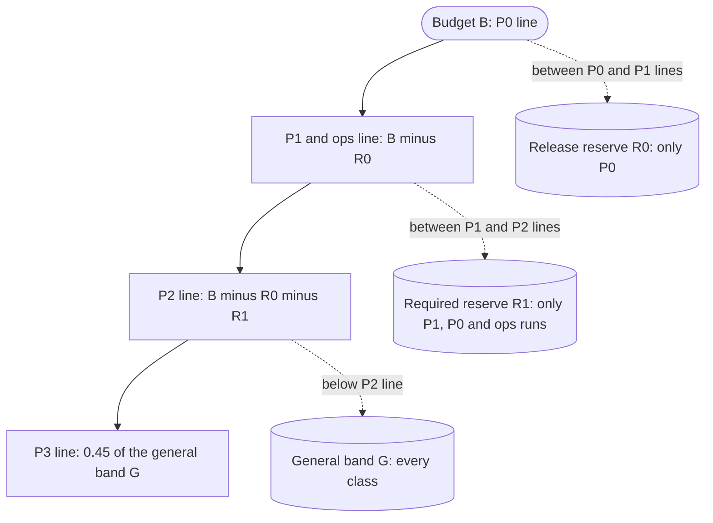
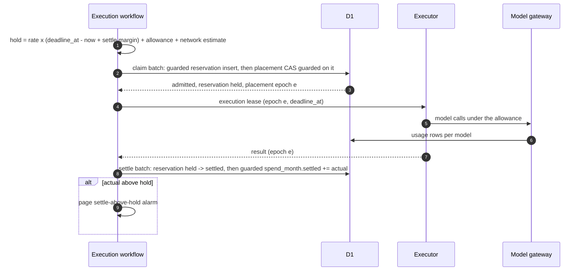
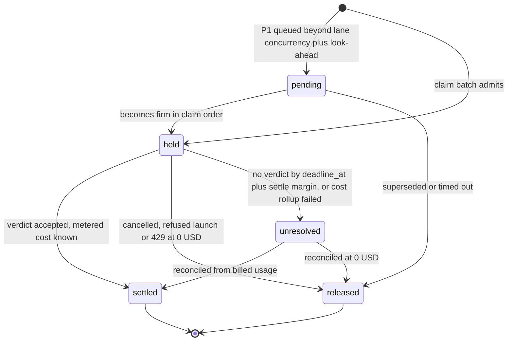

# Spend

The spend meter caps what the control plane lets executions spend in one UTC month. It prices each execution by the executor that runs it, reserves the worst-case cost as a hold before admission, replaces the hold with the metered cost when the execution settles, and stops each class at its own nested line, so the worst cloud month is the budget plus only the settle error the drift alarm reports.

## Scope

This file covers the executor-aware meter and its rate card; holds, reservations, settle, release and what the settle sweep does to a reservation; the budget, reserves and nested class lines; burn lanes; model allowances and capacity-lease allowances; the retry family allowance; the operator halt, force-admit and reserve top-up; the spend view and spend alarms. It depends on [qos-admission.md](qos-admission.md) for classes, the claim batch and queue-then-fail; on [executors.md](executors.md) for the rule that every executor stops a job at `deadline_at`; on [model-gateway.md](model-gateway.md) for refusing a model call past its allowance and for per-(provider, class) token buckets; on [placement-leases.md](placement-leases.md) for capacity leases and epochs; on [github-output.md](github-output.md) for the settle sweep and the guarded result-acceptance batch; and on [operability.md](operability.md) for the operator API, alarm delivery and the dashboard.

Metering of individual model calls inside the gateway is specified in [model-gateway.md](model-gateway.md).

## Model

### Units

All amounts are integers in micro-USD (1 USD = 1,000,000 micro-USD). Two units appear:

- **Metered micro-USD**: list rate × the overhead factor (configurable, default 1.1). Lines, reserves, holds and settled cost use it.
- **List micro-USD per hour**: the rate card's hourly rate with no overhead factor. Burn lanes use it.

### Rate card

| Executor kind | Container or task rate | Model tokens | Phase |
| --- | --- | --- | --- |
| `cloudflare` | Metered, not billed: the instance type's provisioned vCPU, memory and disk per second for the window from admission to settle (an upper bound; Cloudflare bills CPU on active use and only while the instance runs), plus the Container Durable Object's duration and egress at the configured per-GB rate | Counted | 0 |
| `device` | 0 | Counted for hosted models; 0 for models on owned hardware | 1 |
| `aws` | Task vCPU and memory rate, public IPv4 per hour, and a network estimate per execution; at least the 60 s minimum charge | Counted | 3 |
| `gha` | The runner's per-minute rate, rounded up to the minute; 0 for standard runners on public repositories | Counted | 4 |

A hosted model id without a price entry prices at a configurable default of 75 USD per million tokens. Workers AI models price at a per-token rate derived from their Neurons price.

### The spend kernel

`spendKernel` is the TypeScript copy of `FdFormal.Spend.step`. Its state is `{ settled, reserved }`, and `committed = settled + reserved`. Its events are `admit(class, hold)`, `settle(hold, actual)` and `release(hold)`.

| Event | Condition | Next state |
| --- | --- | --- |
| `admit(c, h)` | `committed + h ≤ line(c)` | `reserved + h` |
| `admit(c, h)` | otherwise | unchanged (refused) |
| `settle(h, a)` | `h ≤ reserved` | `settled + a`, `reserved − h` |
| `release(h)` | `h ≤ reserved` | `reserved − h` |
| `settle` or `release` | `h > reserved` | unchanged |

### Budget, reserves and lines

| Term | Definition | Default (configurable in the operator overlay) |
| --- | --- | --- |
| `B` | Monthly budget for execution spend, hosted model tokens included | 50 USD |
| `F` | Fixed monthly cloud charges inside `B` that no execution carries | 0 USD |
| `R0` | Release reserve | 10 USD |
| `R_ops` | Ops-run reserve: canaries and the verdict audit | 5 USD |
| `R1min` | Lower bound of the required-check reserve | 20 USD |
| `D` | Days of fleet-down spill the required-check reserve covers | 10 days |
| `M` | Trailing 30-day mean of required-check lean-minutes per day, on every executor | measured |
| `r` | Metered micro-USD per lean-minute on the `lean` pool's instance type | from the rate card |
| `R1` | `min(max(R1min, D × M × r) + R_ops, B − F − R0)` | computed daily |
| `G` | General band: `B − F − R0 − R1` | computed |
| `φ` | P3 floor: `p3FloorRatio × G` | ratio 0.1 |

| Class | Line on committed spend |
| --- | --- |
| P0 | `B` |
| P1 and ops runs | `B − R0` |
| P2 | `B − R0 − R1` |
| P3 | `p3LineRatio × G`, ratio 0.45; past it, P3 may spend up to `φ` of its own while committed spend is below the P2 line |

*Nested lines: P3 stops first and P0 last; the reserves between lines are spendable only by the classes above them (`Spend.lines_nest`).*

### Hold and claim

An execution's hold is its worst-case metered cost on the executor kind its admission places it on:

`hold = ⌈rate × (deadline_at − admission time + settle margin)⌉ + model allowance + network estimate`

Every executor stops a job at `deadline_at` ([executors.md](executors.md)), so the window from admission to `deadline_at` plus the settle margin is the longest any executor bills. On `aws` the time term is at least 60 s and the margin at least the reaper grace, the reaper period and the task's `stopTimeout` (FD-SPD-062). A reclaim replaces the hold with one that covers the earlier epochs' metered cost and the new executor's remaining window (FD-SPD-043).

*Hold and settle: the line check leads the claim batch and guards every later write in it; the settle batch swaps the hold for the metered cost.*

### Reservation lifecycle

*Reservation lifecycle: each reservation ends exactly once, as settled or released; an unresolved one stays counted until reconciliation.*

## Requirements

### Kernel and units

- **FD-SPD-001** · phase 0 · `V-UNIT` `V-DIFF` — The control plane must hold every amount of money as an integer number of micro-USD and must not use floating-point arithmetic in `spendKernel`, holds, lines or settle.
- **FD-SPD-002** · phase 0 · `V-UNIT` `V-PROOF` `V-DIFF` — `spendKernel` must be a pure function `(state, event) → state` over `{settled, reserved}` and the events `admit`, `settle` and `release`, with no Effect services, whose output equals the compiled `FdFormal.Spend` oracle on every generated trace.
- **FD-SPD-003** · phase 0 · `V-UNIT` `V-PROOF` `V-DIFF` — When `spendKernel` receives `admit(class, hold)`, it must add the hold to `reserved` only if `settled + reserved + hold` is at most the class line, and must otherwise leave the state unchanged and report the admission refused.
- **FD-SPD-004** · phase 0 · `V-UNIT` `V-CONF` — When an execution settles, the control plane must replace its reservation with the metered cost in one D1 batch, the settle batch: a conditional `UPDATE reservations SET state = 'settled', actual_micro_usd = ?, settled_by = ? WHERE id = ? AND state IN ('held', 'unresolved')`, then `UPDATE spend_month SET settled_micro_usd = settled_micro_usd + ? WHERE month = ? AND EXISTS (SELECT 1 FROM reservations WHERE id = ? AND state = 'settled' AND settled_by = ?)`, where `settled_by` is the id of that settle attempt.
- **FD-SPD-005** · phase 0 · `V-UNIT` `V-DIFF` — If a `settle` or `release` names a hold larger than `reserved`, `spendKernel` must leave the state unchanged and the control plane must raise the `unknown-hold` alarm.
- **FD-SPD-006** · phase 0 · `V-UNIT` `V-PROOF` `V-DIFF` — The control plane must compute the lines so that the P3 line ≤ the P2 line ≤ the P1 line ≤ the P0 line = `B` for every configuration the validator accepts (`Spend.lines_nest`).
- **FD-SPD-007** · phase 0 · `V-PROOF` `V-DIFF` `V-CONF` — While every settle is at most its hold, the control plane must keep `settled + reserved` at most `B` on every trace of admissions, settles and releases (`Spend.run_safe`), given the claim batch of [qos-admission.md](qos-admission.md) FD-QOS-038.
- **FD-SPD-008** · phase 0 · `V-PROOF` `V-DIFF` — When a P3 admission succeeds below the P3 line, the control plane must leave committed spend at most the P3 line, so a P3 never draws on `R0` or `R1` (`Spend.p3_keeps_reserves`).

### Meter and holds

- **FD-SPD-009** · phase 0 · `V-UNIT` `V-CONF` — The control plane must price an execution's container time from the rate card entry of the executor kind recorded on its placement row.
- **FD-SPD-010** · phase 1 · `V-UNIT` `V-PROOF` `V-DIFF` — When a device runs an execution, the control plane must price its container time at 0 and must still count its hosted model tokens against the class line.
- **FD-SPD-011** · phase 0 · `V-UNIT` — The control plane must compare lines, reserves and holds in metered micro-USD, the list rate times the configurable overhead factor (default 1.1), and burn lanes in list micro-USD per hour without the factor.
- **FD-SPD-012** · phase 0 · `V-UNIT` — If a hosted model id has no price entry, the control plane must price its tokens at the configurable default of 75 USD per million tokens.
- **FD-SPD-013** · phase 0 · `V-UNIT` — The control plane must price each model's tokens at that model's own rate when an execution calls more than one model.
- **FD-SPD-014** · phase 0 · `V-UNIT` `V-PROOF` `V-DIFF` — The control plane must set each execution's hold to ⌈rate × (`deadline_at` − admission time + settle margin)⌉ + its model allowance + its network estimate, rounded up to a whole micro-USD, where the rate is the rate card entry of the executor kind the admission places it on and the settle margin is the one [qos-admission.md](qos-admission.md) FD-QOS-045 sets.
- **FD-SPD-015** — Removed; see [qos-admission.md](qos-admission.md) FD-QOS-045.
- **FD-SPD-016** · phase 0 · `V-CONF` `V-SIM` — When a device claims an execution or the claim batch admits it to the cloud, the control plane must reserve the execution's hold (FD-SPD-014), model allowance included, against its class line in the same D1 batch, guarded by the reservation insert, that assigns the placement.
- **FD-SPD-062** · phase 3 · `V-UNIT` `V-PROOF` `V-DIFF` — Where the claim batch places an execution on `aws`, the control plane must hold at least max(⌈task rate × (`deadline_at` − admission time + max(settle margin, 360 s + the task's `stopTimeout`))⌉, task rate × 60 s) plus the model allowance and the network estimate, so that the hold covers the task from launch to `deadline_at` plus the reaper grace of 5 min, the reaper period of 1 min and the `stopTimeout`, and the 60 s minimum charge, which [executors.md](executors.md) FD-EXEC-079 requires before launch (property F7 in [verification.md](verification.md): the AWS worst case per task stays within its hold); the AWS launcher reserves no hold of its own.
- **FD-SPD-017** · phase 0 · `V-UNIT` — The control plane must treat a run that declares no `limits.modelAllowanceUsd` as having an allowance of 0, so the gateway refuses its hosted model calls.
- **FD-SPD-018** · phase 0 · `V-UNIT` `V-CONF` — When two model calls of one execution reserve against its allowance concurrently, the control plane must admit them only while their summed reservations fit the remaining allowance, and must deny every reservation made after the execution's allowance is killed.
- **FD-SPD-019** · phase 0 · `V-UNIT` `V-LIVE` — If an execution's metered cost exceeds its hold at settle, the control plane must record the metered cost unchanged and page the `settle-above-hold` alarm with the execution, recipe and executor kind.
- **FD-SPD-020** · phase 0 · `V-MEASURE` — If the mean settled cost of a recipe on one executor kind differs from its mean hold by more than 30% over 7 days, the control plane must raise the `estimate-drift` notification.

### Reservations, settle and release

- **FD-SPD-021** · phase 0 · `V-UNIT` `V-CONF` `V-SIM` `V-PROOF` `V-DIFF` — The control plane must end every reservation exactly once, as `settled` or `released`, by a state transition conditional on the reservation's current state.
- **FD-SPD-022** · phase 0 · `V-CONF` `V-REPLAY` — When an execution's verdict is accepted at the current epoch, the control plane must move its reservation to `settled` and add the metered cost to `spend_month.settled_micro_usd` for the UTC month of the settle through the settle batch of FD-SPD-004, with each settle statement also guarded in SQL on the batch's accept compare-and-set as [github-output.md](github-output.md) FD-GH-033 specifies, because a conditional `UPDATE` that matches 0 rows does not abort a D1 batch.
- **FD-SPD-023** · phase 0 · `V-UNIT` — The control plane must charge no container cost to an execution that was never admitted.
- **FD-SPD-024** · phase 0 · `V-UNIT` `V-SIM` — If the cost rollup of a finished execution fails, the control plane must keep its reservation counted as `unresolved` and must leave its verdict unchanged.
- **FD-SPD-025** · phase 0 · `V-UNIT` — When an upstream model provider answers `429`, the control plane must settle that call at 0.
- **FD-SPD-026** · phase 0 · `V-UNIT` `V-SIM` — When the cancel path of [qos-admission.md](qos-admission.md) ends an execution, the control plane must release its hold only after the container destroy or task stop is confirmed, and must settle any metered cost incurred before the cancel.
- **FD-SPD-027** · phase 0 · `V-SIM` — When the settle sweep of [github-output.md](github-output.md) FD-GH-072 runs, it must settle or release each reservation whose execution has been terminal for more than 10 min; for an execution it ends as lost (FD-GH-073), it must settle the reservation at the metered cost when that cost is known and otherwise mark it `unresolved`.
- **FD-SPD-028** · phase 0 · `V-UNIT` — The control plane must keep an `unresolved` reservation counted in committed spend until reconciliation from the executor's billed usage settles or releases it.
- **FD-SPD-029** · phase 0 · `V-UNIT` — If the sum of `unresolved` reservations exceeds a configurable 5 USD or the oldest is older than 48 h, the control plane must raise the `unresolved-spend` notification.

### Retry family allowance

- **FD-SPD-030** · phase 0 · `V-UNIT` `V-CONF` — The control plane must cap the settled plus reserved spend of a root execution and all its retries at max(1 + the run's declared retries, 2) × the first attempt's hold.
- **FD-SPD-031** · phase 0 · `V-UNIT` — When an execution retries, the control plane must reserve a new hold for the attempt inside the claim batch.
- **FD-SPD-032** · phase 0 · `V-UNIT` — If a GitHub check re-run exceeds its family allowance, the control plane must admit the attempt against the P2 line.

### Reserves and lines

- **FD-SPD-033** · phase 0 · `V-UNIT` `V-DEPLOY` — The control plane must read `B`, `F`, `R0`, `R_ops`, `R1min`, `D`, the overhead factor, `p3LineRatio`, `p3FloorRatio` and the burn lanes from the operator overlay, with the defaults in the Budget, reserves and lines table.
- **FD-SPD-034** · phase 0 · `V-UNIT` — The control plane must recompute `R1` as min(max(`R1min`, `D` × `M` × `r`) + `R_ops`, `B` − `F` − `R0`) at 00:00 UTC each day, and must not lower `R1` within a UTC month.
- **FD-SPD-035** · phase 0 · `V-UNIT` `V-PROOF` `V-DIFF` — While committed spend is at or above the P3 line, the control plane must admit a P3 to the cloud only if the month's P3-attributed spend plus its hold is at most `φ` and committed spend plus its hold is at most the P2 line.
- **FD-SPD-036** · phase 0 · `V-UNIT` — The control plane must admit ops runs against the P1 line and must stop them once their spend above the P2 line reaches `R_ops`.
- **FD-SPD-037** · phase 0 · `V-UNIT` — If `R0 + R1` exceeds half of `B − F`, the control plane must raise the `budget-too-small` notification.
- **FD-SPD-038** · phase 0 · `V-UNIT` `V-DEPLOY` — The config validator must reject a budget that is not a positive whole number of USD, a configuration with `R0 + R1min + R_ops > B − F`, a ratio outside (0, 1], or burn lanes that do not satisfy P3 ≤ P2 ≤ P1 ≤ P0.
- **FD-SPD-039** · phase 0 · `V-UNIT` `V-REPLAY` — The control plane must read spend configuration and month-to-date spend inside an engine step, so a replay sees the values the first run read.
- **FD-SPD-040** · phase 0 · `V-UNIT` — If the config store read fails, the control plane must use the operator overlay's committed values and must not treat the budget as unlimited.

### Required-check holds

- **FD-SPD-041** · phase 3 · `V-UNIT` `V-SIM` — When a P1 execution is placed local-first, the control plane must take its cloud hold at admission and keep it while a device runs the execution.
- **FD-SPD-042** · phase 3 · `V-UNIT` `V-SIM` — When a device's verdict for a P1 is accepted at the current epoch, the control plane must settle the hold at the device's metered cost: 0 for container time plus its hosted model usage.
- **FD-SPD-043** · phase 1 · `V-UNIT` `V-SIM` — When the control plane re-places a reclaimed execution, it must re-admit it in the claim batch with a hold of the metered cost of its earlier epochs plus ⌈rate of the new executor kind × (`deadline_at` − now + settle margin)⌉ plus the unused model allowance plus its network estimate, replacing the existing reservation in that batch and checking only the increase above the existing hold against the class line.
- **FD-SPD-044** · phase 3 · `V-UNIT` `V-SIM` — The control plane must count a P1 hold against the line only once it is firm, that is claimed by a device or within the P1 lane's concurrency plus a configurable look-ahead of 5, and must count every other queued P1 hold as pending, in the runway and reserve alarms only.
- **FD-SPD-045** · phase 3 · `V-SIM` — If a P1 claim cannot take a firm hold, or the pending P1 holds exceed the P1 band, the control plane must page the `reserve-breach` alarm.

### Burn lanes

- **FD-SPD-046** · phase 0 · `V-UNIT` `V-CONF` `V-SIM` `V-PROOF` `V-DIFF` — The claim batch must admit an execution of class c only while the summed list hourly rate of admitted executions of class c and every lower class, across all pools, plus the execution's own rate is at most the lane of c, with configurable defaults P3 0.41, P2 0.81, P1 2.01 and P0 2.82 USD per hour.
- **FD-SPD-047** · phase 0 · `V-UNIT` — Where no execution of class c or lower is admitted, the claim batch may admit one P0 or P1 execution whose own rate exceeds its lane, and must not do so for P2 or P3.
- **FD-SPD-048** · phase 0 · `V-UNIT` — The control plane must count `cloudflare` container and `aws` task rates in the burn lanes and must count `device` executions at 0.

### Capacity-lease allowances

- **FD-SPD-049** · phase 1 · `V-UNIT` `V-PROOF` — When the control plane grants or renews a capacity lease, it must reserve the lease's hosted-model allowance against the P3 line and must set its cloud-spend allowance to 0.
- **FD-SPD-050** · phase 1 · `V-UNIT` — While committed spend is at or above the P3 line, the control plane must grant capacity leases a hosted-model allowance of 0 beyond their metered usage.

### Operator halt and overrides

- **FD-SPD-051** · phase 0 · `V-CONF` `V-SIM` — The control plane must store the control state as one `qos_control` row in D1 with the values `run`, `halt-cloud` and `halt-all`, and the claim batch must read it, so a change applies to the next claim.
- **FD-SPD-052** · phase 0 · `V-UNIT` `V-SIM` — While the control state is `halt-cloud`, the control plane must admit no execution to a cloud executor.
- **FD-SPD-063** · phase 0 · `V-UNIT` `V-SIM` — While the control state is `halt-cloud`, the control plane must keep each P0 to P2 execution waiting for a device claim where a device is eligible for it.
- **FD-SPD-064** · phase 1 · `V-UNIT` — While the control state is `halt-cloud`, the control plane must cap every capacity lease's hosted-model allowance at its metered usage.
- **FD-SPD-053** · phase 0 · `V-UNIT` `V-SIM` — When the control state becomes `halt-all`, the control plane must admit nothing new, run the fence, stop and release steps of the cancel path ([qos-admission.md](qos-admission.md) FD-QOS-064) on every non-terminal root below P0 and conclude each `failure` with reason `halt: operator halted`, and revoke every capacity lease.
- **FD-SPD-054** · phase 0 · `V-UNIT` — When a halt ends an execution or keeps it waiting past its deadline, the control plane must conclude it `failure` with reason `halt: operator halted`.
- **FD-SPD-055** · phase 0 · `V-UNIT` `V-E2E-LOCAL` — When an operator force-admits a P1 above its line or tops up `R1`, the control plane must require an expiry of at most 7 days and write an audit row with the operator identity, the scope, the amount and the expiry.
- **FD-SPD-056** — Removed; see [operability.md](operability.md) FD-OPS-084.

### Spend view and alarms

- **FD-SPD-057** · phase 0 · `V-UNIT` `V-E2E-LOCAL` — When an authorized viewer requests `GET /v1/spend`, the control plane must return the month, `B`, settled, reserved and committed spend, each class line and lane, the admitted list rate per class, `R0`, `R1`, `φ`, the P1 runway in days, the control state and `resetsAt`.
- **FD-SPD-058** · phase 0 · `V-UNIT` — If D1 cannot be read for `GET /v1/spend`, the control plane must answer `503` with error `spend_unreadable` from the error-model table in [interfaces.md](interfaces.md).
- **FD-SPD-059** · phase 0 · `V-UNIT` `V-CONF` — When committed spend first reaches the configurable warn ratio (default 0.8) of `B` in a UTC month, the control plane must send exactly one `spend-warn` notification for that month.
- **FD-SPD-060** · phase 0 · `V-UNIT` — When the control plane debits a reserve, it must record the team, repository, member, run and reason on the reservation row.
- **FD-SPD-061** · phase 0 · `V-UNIT` — If the P1 runway, (`B − R0` − committed spend) ÷ (`M` × `r`), falls below the lesser of 14 days and the days left in the month, or the general band closes, the control plane must raise the `runway` notification, and must page when 75% of the P1 band is committed.

## Open items

- TODO(operator): decide whether `B` counts metered or billed dollars; the meter prices `cloudflare` containers at provisioned list rate, which reads several times the billed amount.
- TODO(maintainer): extend `Spend.lean` with the reservation lifecycle (FD-SPD-021, property F3), the hold formula over the window to `deadline_at` (FD-SPD-014, F5), the AWS worst case (FD-SPD-062, F7), executor kinds (FD-SPD-010, F6), the P3 floor `φ` (FD-SPD-035) and burn lanes (FD-SPD-046, F4); the `V-PROOF` tag on each of those IDs names a theorem that `formal/` does not yet contain.
