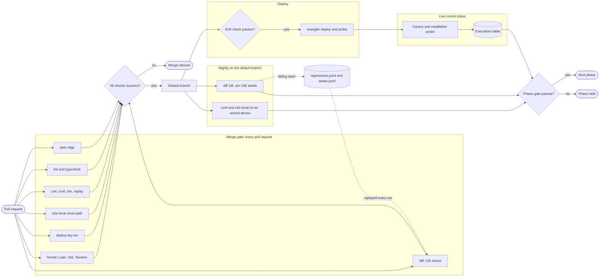
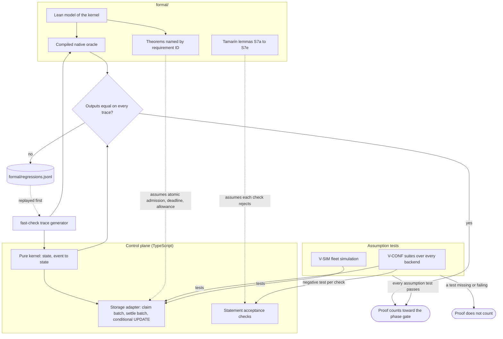

# Verification

This file specifies how FlareDispatch proves that each requirement holds: the harness behind each verification tag, where it lives and when it runs, the merge gate and the phase gates that read the harness results, the check that every `must` carries a tag, the map from the formal properties F1–F7 and S1–S8 to requirement IDs, theorems and the assumption tests each proof depends on, and the coverage of tags by area and phase.

## Scope

This file covers the ten verification tags of [README.md](README.md), the CI jobs that run them, the merge gate, the phase gates, the `spec-tags` check, the formal gate (Lean 4, Tamarin and differential testing) and the coverage counts. Tags are inline on each requirement, so this file holds no row per requirement: a requirement's tags name its harnesses, and its phase names the gate that requires those harnesses to pass. It depends on [README.md](README.md) for the requirement format, the area table and the tag table; on [roadmap.md](roadmap.md) for the phases, the `V-MEASURE` thresholds and the kill lines; on [operability.md](operability.md) for the deploy workflow, the drift check, the canary and the alarms; on [provenance.md](provenance.md) for the Tamarin gate (FD-PROV-072, FD-PROV-073); and on [adr/0018-formal-models.md](adr/0018-formal-models.md) for the choice of Lean 4, differential testing, Veil and Tamarin.

## Model

### From requirement to gate

A requirement line carries its phase and one or more tags. Each tag names one harness family. A harness entry covers a requirement when it names the requirement's ID: a test title that contains `[FD-<AREA>-NNN]`, a Lean theorem or a Veil invariant whose docstring lists the ID, or a Tamarin lemma whose comment lists it. The `spec-tags` check joins requirement lines to harness entries and reports, per tag, each requirement with no entry. The merge gate requires every harness that runs per pull request to pass. The phase gate for phase n requires, for every requirement of phase n or lower, a passing entry for each of its tags.

The current phase is the single digit in `.github/phase`. A pull request that changes it is a phase-gate pull request.

### Harness catalog

#### `V-UNIT`

- **Runs:** `@effect/vitest` suites over test Layers: the memory engine, a fake GitHub that records every call, and a fake executor that returns scripted results. It covers logic, verdict mapping, `resolveClass`, validators and pure functions.
- **Lives:** `test/unit/` in each workspace package and app, run by `pnpm test`.
- **Runs when:** every pull request and every push to the default branch, in the `unit` job.
- **Failure blocks:** the merge.

#### `V-CONF`

- **Runs:** one conformance suite per interface, run unchanged against every backend of that interface:
  - `WorkflowEngine`: DO-SQLite, SQLite, Postgres and memory;
  - executors: `cloudflare` Container, `device`, `aws`, `gha` and the fake executor;
  - stores: D1, SQLite and Postgres;
  - provenance acceptance: one negative test per acceptance check and per verifier rejection (FD-PROV-072).
- **Lives:** `packages/conformance/`, with one directory per interface and one backend adapter per backend.
- **Runs when:**
  - every pull request, in the `conf` job, for memory, SQLite, D1 under workerd, Postgres in a service container, the `cloudflare` executor under workerd and the fake executor;
  - nightly and on every phase-gate pull request, for the `device` executor on an owned device from phase 1, the `aws` executor from phase 3 and the `gha` executor from phase 4.
- **Failure blocks:** the merge for the per-pull-request backends; the phase gate for the nightly backends.

#### `V-SIM`

- **Runs:** a deterministic simulation of the fleet on `TestClock` with fault injection: sleep mid-step, executor DO restart during a deploy, a late result after reclaim, the claim-versus-spill race, clock skew, a socket drop, a D1 batch failure and a model call refused at its allowance. Each scenario takes a seed that fixes every interleaving.
- **Lives:** `test/sim/`, with failing seeds kept in `test/sim/seeds.jsonl`.
- **Runs when:** every pull request with 100 seeds per scenario plus every kept seed, in the `sim` job; nightly with 10,000 seeds per scenario.
- **Failure blocks:** the merge (per pull request); the phase gate (nightly).

#### `V-REPLAY`

- **Runs:** every workflow twice over the journal of its first run, counting GitHub calls, D1 writes and intents on the second run.
- **Lives:** `test/replay/`.
- **Runs when:** every pull request, in the `replay` job.
- **Failure blocks:** the merge. One extra GitHub call, D1 write or intent fails the job.

#### `V-E2E-LOCAL`

- **Runs:** the full stack on one machine: the Workers under workerd (`wrangler dev`), a local agent, a recorded GitHub fixture server and a local VM.
- **Lives:** `test/e2e-local/`, with the GitHub recordings in `test/e2e-local/fixtures/`.
- **Runs when:**
  - every pull request, in the `e2e-local` job, for the cloud path (workerd, the fixture server and a local container as the `cloudflare` executor);
  - nightly and on every phase-gate pull request, for the device path on an owned device from phase 1.
- **Failure blocks:** the merge for the cloud path; the phase gate for the device path.

#### `V-DEPLOY`

- **Runs:** `wrangler deploy --dry-run` for every Worker, the placement policy validator and the config validator over the committed configuration, and the overlay drift check of [operability.md](operability.md).
- **Lives:** the `deploy-dry-run` job and the deploy workflow in `.github/workflows/`; the drift check is `fd doctor`.
- **Runs when:** every pull request, against the committed placeholders; every deploy, against the operator overlay; every 24 h, as `fd doctor` (FD-OPS-025).
- **Failure blocks:** the merge (dry run and validators); the deploy (drift check).

#### `V-LIVE`

- **Runs:** the synthetic webhook canary every 15 min (FD-OPS-038, FD-OPS-040), the installation probe every 15 min (FD-OPS-041), the webhook delivery scan (FD-OPS-044), the post-deploy probe (FD-OPS-013), `pr-review` on this repository's pull requests, and from phase 3 the daily AWS launcher canary (FD-OPS-051).
- **Lives:** the control plane's cron and outbox rows; results reach the alert sink and the dashboard.
- **Runs when:** live, on every deploying organization's control plane.
- **Failure blocks:** no merge. It raises the page alarm the requirement names, and the phase gate reads the alarm record of its window.

#### `V-MEASURE`

- **Runs:** a metric computed from the executions table and its siblings (claim latency, spill rate, epoch discards, verdict audit disagreements, time to verdict per run and executor kind, cache hit rate, executor DO GB-s), compared with a threshold.
- **Lives:** the control plane's metric queries; the dashboard shows them (FD-OPS-070) and `GET /v1/spend` serves the spend metrics.
- **Runs when:** live. The phase gate reads each metric over its window; the kill-line monitor reads each metric daily.
- **Failure blocks:** the phase gate. A crossed kill line raises the `kill-line` notification and stops the next phase until the operator decides.

#### `V-PROOF`

- **Runs:** `lake build` over the Lean 4 project, the forbidden-term scan, `#print axioms` for every theorem, the Veil model checker over the lease protocols, and `tamarin-prover --prove` over the provenance model.
- **Lives:** `formal/` at the repository root: `formal/FdFormal/*.lean` for the kernels, `formal/FdFormal/Veil/` for the lease protocols, `formal/provenance.spthy` for provenance, `formal/lean-toolchain` and a pinned prover version for the tools.
- **Runs when:** every pull request and every push to the default branch, in the `formal` job.
- **Failure blocks:** the merge. A proof counts toward a phase gate only while every assumption test of its row in the formal property table passes on the same commit.

#### `V-DIFF`

- **Runs:** `fast-check` traces through a TypeScript kernel and through the native oracle compiled from the Lean model of that kernel, comparing outputs after every event. The kernels are `spendKernel`, `placementPolicy`, `fenceKernel`, `outboxKernel`, `stagedWriteGate` and `routeModelCall`.
- **Lives:** `test/diff/` for the generators and the comparison, the `oracle` executable built by `lake build oracle` in `formal/`, and `formal/regressions.jsonl` for every trace that ever differed.
- **Runs when:** every pull request with 10,000 traces per kernel, in the `diff` job; nightly with 1,000,000 traces per kernel. Every run first replays every line of `formal/regressions.jsonl`.
- **Failure blocks:** the merge (per pull request); the phase gate (nightly).

### Merge gate

The default branch's ruleset requires these checks on every pull request. A pull request merges only when every one concludes `success`.

| Check | Runs | Tags it serves |
| --- | --- | --- |
| `lint` | `pnpm lint` | — |
| `typecheck` | `pnpm typecheck` | — |
| `spec-tags` | The requirement-line check (FD-VER-001 to FD-VER-013) | all |
| `unit` | `pnpm test` over `test/unit/` | `V-UNIT` |
| `conf` | Conformance suites over the per-pull-request backends | `V-CONF` |
| `sim` | 100 seeds per scenario plus every kept seed | `V-SIM` |
| `replay` | Double run over cached journals | `V-REPLAY` |
| `e2e-local` | The cloud path of the end-to-end stack | `V-E2E-LOCAL` |
| `deploy-dry-run` | `wrangler deploy --dry-run` and the validators | `V-DEPLOY` |
| `formal` | `lake build`, the forbidden-term scan, `#print axioms`, Veil, `tamarin-prover --prove` | `V-PROOF` |
| `diff` | The regressions file, then 10,000 traces per kernel | `V-DIFF` |

`V-LIVE` and `V-MEASURE` run against a deployed control plane and are not merge checks.

### Phase gates

A phase-gate pull request moves `.github/phase` from n to n + 1. Its `phase-gate` job passes only when every condition holds:

1. Every requirement of phase n or lower has a passing harness entry for each of its tags other than `V-LIVE` and `V-MEASURE`, on the pull request's base commit.
2. Every nightly harness (`conf` device and launcher backends, `sim` with 10,000 seeds, `e2e-local` device path, `diff` with 1,000,000 traces) passed on the base commit or a later nightly run.
3. Every `V-PROOF` requirement of phase n or lower names a theorem or lemma that the formal gate proves, and every assumption test of its row passes.
4. No `V-LIVE` page alarm of a phase n or lower requirement stayed unresolved for more than 24 h in the gate window.
5. Every `V-MEASURE` threshold of gate n in [roadmap.md](roadmap.md) holds over its window.

*CI gates · a pull request merges on the per-pull-request harnesses; a phase moves only when the nightly harnesses, the proofs with their assumption tests and the live metrics all pass.*

### Formal gate

The `formal` job fails on any of these:

- `lake build` in `formal/` fails under the toolchain that `formal/lean-toolchain` pins exactly.
- A `.lean` file in `formal/` contains `sorry`, `admit`, `native_decide` or an `axiom` declaration.
- `#print axioms` for a theorem in `formal/` lists an axiom other than `propext`, `Classical.choice` and `Quot.sound`.
- The Veil model checker finds a counterexample to an invariant of `formal/FdFormal/Veil/`.
- `tamarin-prover --prove formal/provenance.spthy`, at the pinned prover version, reports a lemma other than `verified`. An expected attack is stated as an `exists-trace` lemma, so the attack trace that lemma finds is a pass (FD-PROV-073).

The `diff` job runs, per kernel, every line of `formal/regressions.jsonl` for that kernel, then 10,000 generated traces per pull request or 1,000,000 nightly, through the TypeScript kernel and the oracle built from the same commit. Each trace uses integer micro-USD and the Lean model's event alphabet. The first trace whose outputs differ fails the job; the harness shrinks it and writes it as one `regressions.jsonl` line.

*Proof to code · the oracle ties the theorem to the TypeScript kernel through differential testing, and the conformance and simulation tests tie the model's assumptions to the storage adapter and the acceptance checks.*

### Formal properties

Each row maps one property to the requirements it covers, the theorem or lemma that proves it and the `V-CONF` or `V-SIM` requirements that test the assumptions the proof uses. A name marked *proved* checks under the formal gate; a name marked *planned* is the theorem the requirement's `V-PROOF` tag names before it exists. Lean theorems live in `formal/FdFormal/`, Veil invariants in `formal/FdFormal/Veil/` and Tamarin lemmas in `formal/provenance.spthy`.

| Property | Statement | Requirements | Theorem or lemma | Assumption tests |
| --- | --- | --- | --- | --- |
| F1 | `settled + reserved ≤ B` on every trace of admissions, settles and releases | FD-SPD-002, FD-SPD-003, FD-SPD-007 | `Spend.step_safe`, `Spend.run_safe` *proved*; `Spend.unbounded_settle_overruns` *proved* (a settle above its hold overruns `B`, so the premise is necessary) | FD-QOS-038, FD-SPD-004, FD-SPD-016 (atomic admission and settle); FD-EXEC-002, FD-EXEC-043 (deadline enforced); FD-MDL-027, FD-MDL-033 (allowance enforced) |
| F2 | The class lines nest, each class stops at its own line, and P3 stops first | FD-SPD-006, FD-SPD-008, FD-SPD-035 | `Spend.lines_nest`, `Spend.line_le_budget`, `Spend.p3_keeps_reserves` *proved*; `Spend.p3_floor_bounded` *planned* | FD-QOS-038, FD-SPD-051 (the claim batch reads the lines and the control state) |
| F3 | Every reservation ends exactly once, as settled or released | FD-SPD-021, FD-ARCH-028 | `Spend.reservation_ends_once` *planned* | FD-SPD-004, FD-SPD-027, FD-GH-073 (settle batch and settle sweep) |
| F4 | The admitted list rate of a class and every lower class stays within that class's burn lane | FD-SPD-046 | `Spend.burn_lane_safe` *planned* | FD-QOS-038, FD-SPD-009 (rates read from the rate card at admission) |
| F5 | A hold is at least the worst-case cost to `deadline_at` plus the model allowance | FD-SPD-014 | `Spend.hold_covers_worst_case` *planned* | FD-EXEC-002, FD-EXEC-043 (deadline enforced); FD-MDL-026, FD-MDL-027 (allowance enforced) |
| F6 | Device container time costs 0, and hosted model tokens still count against the line | FD-SPD-010 | `Spend.device_container_free` *planned* | FD-SPD-009, FD-SPD-016 (executor kind on the placement row; allowance reserved at claim) |
| F7 | The AWS worst case per task stays within its hold | FD-SPD-062, FD-EXEC-079 | `Spend.aws_hold_covers_task` *planned* | FD-EXEC-080, FD-EXEC-081, FD-EXEC-082 (entrypoint exit, task stop, reaper) |
| S1 | At most one result is accepted per execution, and a result from a stale epoch is never accepted, under any delay, sleep or reorder | FD-LEASE-022, FD-LEASE-029, FD-LEASE-037, FD-LEASE-038, FD-LEASE-039, FD-LEASE-043, FD-ARCH-024, FD-GH-030, FD-PROTO-047 | `Fence.accepted_stable`, `Fence.accepted_is_current` *proved*; `LeaseProtocol.single_acceptance` (Veil) *planned* | FD-LEASE-012, FD-ARCH-032 (one conditional `UPDATE` per move; terminal status written once) |
| S2 | An intent applies at most once under engine replay | FD-GH-034, FD-GH-039, FD-GH-040, FD-RUN-042, FD-ARCH-027 | `Outbox.apply_at_most_once`, `Outbox.lifecycle_closed`, `Outbox.terminal_within_bound` *planned* | FD-GH-032, FD-GH-033, FD-GH-041, FD-ENG-006 (`UNIQUE` key, one batch, claim token, activity re-run on replay) |
| S3 · executors | Fork-PR, tag-push, P0 and cloud-pinned work never runs on a device; `confidential-compute` and `local-only` work never runs in the cloud; an unplaceable request fails at intake with a named reason | FD-QOS-015, FD-QOS-016, FD-QOS-017, FD-QOS-018, FD-QOS-025, FD-QOS-026, FD-QOS-085, FD-LEASE-009, FD-LEASE-010, FD-LEASE-011, FD-LEASE-014, FD-LEASE-019, FD-LEASE-034, FD-INT-013, FD-INT-014, FD-INT-030, FD-INT-061, FD-GATE-061, FD-GATE-080, FD-OPS-021 | `Placement.fork_never_owned`, `Placement.p0_never_owned`, `Placement.compute_stays_owned`, `Placement.fork_on_confidential_compute_unplaceable`, `Placement.placeable_iff` *proved*; `Placement.p0_cloud_only`, `Placement.local_only_stays_owned`, `Placement.validator_rejects_unplaceable_required` *planned* | FD-LEASE-012, FD-LEASE-013 (the claim CAS re-checks `eligible_kinds`) |
| S3 · models | Work of a repository that is not `non-confidential` never reaches a hosted model, and a failed local call never falls back to one | FD-MDL-006, FD-MDL-008, FD-MDL-010, FD-MDL-011 | `Placement.unclassified_not_hosted` *proved*; `Model.route_hosted_only_non_confidential` *planned* | FD-ISO-017 (the egress proxy is the job sandbox's only outbound path, so the gateway is the only route to a model) |
| S4 | A per-lease credential is valid only while its epoch is current, and a capacity lease holds no cloud-spend allowance | FD-ISO-048, FD-MDL-042, FD-LEASE-046, FD-LEASE-048, FD-SPD-049 | `LeaseProtocol.token_epoch_current` (Veil), `CapacityLease.no_cloud_allowance`, `CapacityLease.epoch_changes` *planned* | FD-ISO-047, FD-CACHE-051, FD-MDL-041 (revocation on reclaim, URL refusal at an old epoch, refusal under `halt-cloud`) |
| S5 | The `setup` egress profile closes before the `agent` phase and never reopens, and no run declaration combines private data, untrusted input and outbound access | FD-ISO-024, FD-ISO-025, FD-AGT-004 | `Egress.setup_closed_before_agent`, `Egress.setup_never_reopens`, `Egress.no_trifecta_declaration` *planned* | FD-ISO-017, FD-ISO-026, FD-AGT-005 (proxy-only egress, `agent` profile grants, runtime trifecta refusal) |
| S6 | A pull-request-namespace writer cannot change what a protected-trigger reader restores | FD-CACHE-015, FD-CACHE-017, FD-CACHE-018, FD-CACHE-019, FD-CACHE-022, FD-CACHE-023, FD-CACHE-027, FD-CACHE-029, FD-CACHE-058 | `Cache.pr_writer_noninterference` *planned* | FD-CACHE-005, FD-CACHE-016, FD-CACHE-041 (read-only mounts, namespaces from the lease, create-only manifests) |
| S7a | Injective agreement: an accepted statement was signed by the device its lease was issued to, and no other accepted statement carries its nonce, unless that device key was revealed before it signed | FD-PROV-010, FD-PROV-013, FD-PROV-014, FD-PROV-017, FD-PROV-018, FD-PROV-020, FD-PROV-021, FD-PROV-032 | `injective_agreement` *planned* | FD-PROV-013, FD-PROV-014, FD-PROV-017, FD-PROV-018, FD-PROV-020, FD-PROV-021 |
| S7b | Freshness: no statement for epoch k is accepted after a reclaim to k + 1, and no statement produced before its lease is accepted | FD-PROV-011, FD-PROV-012, FD-PROV-019 | `freshness` *planned* | FD-PROV-011, FD-PROV-019 |
| S7c | Compromise scope: a revealed device key yields countersignatures only for that device's leases while it is registered and not revoked, and never the `reproduced` tier | FD-PROV-009, FD-PROV-015, FD-PROV-057, FD-PROV-061 | `compromise_scope` *planned* | FD-PROV-009, FD-PROV-015, FD-PROV-057, FD-PROV-061 |
| S7d | Misuse detection: every statement a verifier accepts has a log entry | FD-PROV-054 | `misuse_detection` *planned*; `skip_inclusion_attack` (`exists-trace`) *planned* | FD-PROV-054 |
| S7e | Rotation: a countersignature by a retired provenance key is rejected outside its validity window | FD-PROV-047, FD-PROV-048, FD-PROV-056 | `rotation` *planned*; `no_key_history_attack` (`exists-trace`) *planned* | FD-PROV-056 |
| S7 · gate | Every lemma is `verified`, and each acceptance check a lemma assumes has a passing negative test | FD-PROV-072, FD-PROV-073 | Every lemma of `formal/provenance.spthy` | FD-PROV-013, FD-PROV-014, FD-PROV-015, FD-PROV-017, FD-PROV-018, FD-PROV-019, FD-PROV-020, FD-PROV-021, FD-PROV-054, FD-PROV-056, FD-PROV-057, FD-PROV-061 |
| S8 | A model-authored staged write never touches `runs/`, `infra/`, `.github/workflows/` or a `wrangler.jsonc`, and one failing entry rejects the whole manifest | FD-AGT-016, FD-AGT-017, FD-AGT-020, FD-LOCAL-094 | `StagedWrite.model_authored_protected_paths`, `StagedWrite.reject_whole_manifest` *planned* | FD-AGT-009, FD-AGT-012 (every write is an intent; the manifest holds every tracked and untracked change) |

A property that is an exhaustive mapping over a closed union, such as "no capacity outcome concludes `neutral`", has no row: an exhaustive `Match` and a `V-UNIT` test cover it.

### Coverage

Counts come from the requirement lines under `specs/`, the example line in [README.md](README.md) excluded; FD-VER-009 keeps them equal to the files. A requirement with several tags counts once under each tag, so a row's tag counts sum to more than its total.

**By phase**

| Phase | Requirements | `V-UNIT` | `V-CONF` | `V-SIM` | `V-REPLAY` | `V-E2E-LOCAL` | `V-DEPLOY` | `V-LIVE` | `V-MEASURE` | `V-PROOF` | `V-DIFF` |
| --- | --- | --- | --- | --- | --- | --- | --- | --- | --- | --- | --- |
| 0 | 853 | 702 | 114 | 118 | 43 | 36 | 60 | 28 | 6 | 53 | 45 |
| 1 | 332 | 207 | 48 | 87 | 5 | 63 | 8 | 9 | 6 | 12 | 3 |
| 2 | 83 | 72 | 3 | 14 | 1 | 8 | 0 | 0 | 1 | 3 | 2 |
| 3 | 49 | 33 | 3 | 15 | 0 | 2 | 3 | 3 | 0 | 2 | 2 |
| 4 | 109 | 63 | 33 | 14 | 2 | 9 | 6 | 1 | 0 | 23 | 1 |
| All | 1426 | 1077 | 201 | 248 | 51 | 118 | 77 | 41 | 13 | 93 | 53 |

**By area**

| Area | Total | By phase 0 · 1 · 2 · 3 · 4 | `V-UNIT` | `V-CONF` | `V-SIM` | `V-REPLAY` | `V-E2E-LOCAL` | `V-DEPLOY` | `V-LIVE` | `V-MEASURE` | `V-PROOF` | `V-DIFF` |
| --- | --- | --- | --- | --- | --- | --- | --- | --- | --- | --- | --- | --- |
| `VER` | 31 | 30 · 1 · 0 · 0 · 0 | 29 | 0 | 0 | 0 | 0 | 1 | 1 | 2 | 0 | 0 |
| `ARCH` | 37 | 25 · 10 · 0 · 1 · 1 | 18 | 8 | 9 | 5 | 12 | 1 | 0 | 0 | 3 | 3 |
| `RUN` | 58 | 57 · 1 · 0 · 0 · 0 | 52 | 6 | 6 | 3 | 0 | 1 | 0 | 0 | 1 | 1 |
| `ENG` | 50 | 45 · 3 · 0 · 0 · 2 | 11 | 34 | 11 | 10 | 1 | 2 | 0 | 0 | 0 | 0 |
| `INT` | 63 | 57 · 3 · 2 · 1 · 0 | 60 | 7 | 10 | 2 | 5 | 3 | 1 | 0 | 4 | 1 |
| `QOS` | 80 | 71 · 2 · 2 · 0 · 5 | 69 | 10 | 15 | 1 | 1 | 7 | 3 | 0 | 7 | 6 |
| `SPD` | 62 | 52 · 5 · 0 · 5 · 0 | 54 | 11 | 15 | 2 | 2 | 2 | 1 | 1 | 12 | 13 |
| `LEASE` | 65 | 22 · 33 · 6 · 3 · 1 | 38 | 15 | 34 | 1 | 0 | 1 | 0 | 2 | 14 | 6 |
| `PROTO` | 77 | 20 · 54 · 1 · 1 · 1 | 46 | 14 | 34 | 1 | 10 | 1 | 0 | 3 | 1 | 0 |
| `EXEC` | 95 | 14 · 56 · 0 · 14 · 11 | 43 | 23 | 20 | 2 | 18 | 8 | 3 | 0 | 1 | 1 |
| `ISO` | 63 | 2 · 53 · 4 · 1 · 3 | 34 | 12 | 3 | 1 | 17 | 5 | 8 | 0 | 3 | 0 |
| `CACHE` | 91 | 71 · 19 · 1 · 0 · 0 | 83 | 12 | 7 | 1 | 5 | 3 | 0 | 1 | 9 | 0 |
| `GH` | 89 | 87 · 1 · 1 · 0 · 0 | 81 | 7 | 15 | 8 | 2 | 1 | 3 | 0 | 4 | 4 |
| `MDL` | 69 | 47 · 6 · 9 · 0 · 7 | 53 | 8 | 21 | 3 | 3 | 4 | 0 | 0 | 5 | 6 |
| `LOCAL` | 92 | 0 · 72 · 20 · 0 · 0 | 68 | 1 | 24 | 1 | 17 | 0 | 0 | 1 | 1 | 1 |
| `IFC` | 80 | 67 · 7 · 3 · 0 · 3 | 79 | 2 | 0 | 0 | 7 | 4 | 2 | 0 | 0 | 0 |
| `PROV` | 77 | 2 · 2 · 0 · 0 · 73 | 46 | 26 | 6 | 2 | 6 | 3 | 1 | 2 | 21 | 0 |
| `OPS` | 82 | 77 · 4 · 0 · 1 · 0 | 51 | 1 | 4 | 0 | 2 | 28 | 18 | 1 | 1 | 1 |
| `GATE` | 80 | 79 · 0 · 1 · 0 · 0 | 79 | 0 | 10 | 6 | 8 | 0 | 0 | 0 | 2 | 2 |
| `AGT` | 85 | 28 · 0 · 33 · 22 · 2 | 83 | 4 | 4 | 2 | 2 | 2 | 0 | 0 | 4 | 8 |

`V-UNIT` carries most requirements in every area. `ENG` and `PROV` lean on `V-CONF` because each has several backends or acceptance checks; `LEASE` and `PROTO` lean on `V-SIM` because their failures are interleavings; `OPS` leans on `V-DEPLOY` and `V-LIVE` because its failures appear only against a deployed account.

## Requirements

### Requirement lines

- **FD-VER-001** · phase 0 · `V-UNIT` — On every pull request and every push to the default branch, CI must run the `spec-tags` check over every `.md` file under `specs/` except `specs/adr/`, ignoring lines inside fenced code blocks.
- **FD-VER-002** · phase 0 · `V-UNIT` — If a line that starts with `- **FD-` matches neither the requirement form `- **FD-<AREA>-NNN** · phase <0–4> · <tags> — <sentence>` nor the removed form `- **FD-<AREA>-NNN** — Removed.` or `- **FD-<AREA>-NNN** — Removed; see <link> FD-<AREA>-NNN[ and FD-<AREA>-NNN].`, then the `spec-tags` check must fail naming the file and line.
- **FD-VER-003** · phase 0 · `V-UNIT` — If a requirement's sentence contains `must` and its tag list holds no tag, then the `spec-tags` check must fail naming the ID.
- **FD-VER-004** · phase 0 · `V-UNIT` — If a tag list holds a tag outside the ten tags of the tag table in [README.md](README.md), or holds one tag twice, then the `spec-tags` check must fail naming the ID and the tag.
- **FD-VER-005** · phase 0 · `V-UNIT` — If a requirement's area is not in the area table of [README.md](README.md), or the requirement sits in a file other than the one that table names for its area, then the `spec-tags` check must fail naming the ID and the file.
- **FD-VER-006** · phase 0 · `V-UNIT` — If an ID occurs as a requirement line or a removed line more than once under `specs/`, then the `spec-tags` check must fail naming every occurrence.
- **FD-VER-007** · phase 0 · `V-UNIT` — If an ID that has a requirement line or a removed line on the pull request's base commit has neither on the head commit, then the `spec-tags` check must fail naming the ID.
- **FD-VER-008** · phase 0 · `V-UNIT` — If a reference of the form `FD-<AREA>-NNN` anywhere under `specs/` names an ID that has no requirement line and no removed line, then the `spec-tags` check must fail naming the file, the line and the ID.

### Coverage and traceability

- **FD-VER-009** · phase 0 · `V-UNIT` — The `spec-tags` check must compute the requirement count per area, phase and tag, and must fail if any count in the coverage tables of this file or in the phase tables of [roadmap.md](roadmap.md) differs from the computed count.
- **FD-VER-010** · phase 0 · `V-UNIT` — If an ID tagged `V-PROOF` is absent from the Requirements column of the formal property table, or an ID in that column does not carry `V-PROOF`, then the `spec-tags` check must fail naming the ID.
- **FD-VER-011** · phase 0 · `V-UNIT` — If an ID in the Assumption tests column of the formal property table carries neither `V-CONF` nor `V-SIM`, then the `spec-tags` check must fail naming the ID.
- **FD-VER-012** · phase 0 · `V-UNIT` — The `spec-tags` check must map each test title that contains `[FD-<AREA>-NNN]`, each Lean theorem or Veil invariant whose docstring lists an ID and each Tamarin lemma whose comment lists an ID to that ID, under the tag of the harness directory the entry lives in, and must report per tag each requirement of the current phase or lower that has no entry.
- **FD-VER-013** · phase 0 · `V-UNIT` — If the formal property table marks a theorem or lemma *proved* and `formal/` holds no theorem or lemma of that name whose docstring or comment lists every requirement ID of its row, then the `spec-tags` check must fail naming the theorem.

### Formal gate

- **FD-VER-014** · phase 0 · `V-UNIT` — On every pull request and every push to the default branch, the `formal` job must run `lake build` in `formal/` under the toolchain that `formal/lean-toolchain` pins to an exact version, and must fail on any build error.
- **FD-VER-015** · phase 0 · `V-UNIT` — If a `.lean` file in `formal/` contains `sorry`, `admit`, `native_decide` or an `axiom` declaration, then the `formal` job must fail naming the file and line.
- **FD-VER-016** · phase 0 · `V-UNIT` — If `#print axioms` for any theorem in `formal/` lists an axiom other than `propext`, `Classical.choice` and `Quot.sound`, then the `formal` job must fail naming the theorem and the axiom.
- **FD-VER-017** · phase 1 · `V-UNIT` — If the Veil model checker finds a counterexample to an invariant in `formal/FdFormal/Veil/` within its configured bound, then the `formal` job must fail and print the counterexample trace.
- **FD-VER-018** · phase 0 · `V-UNIT` — A `V-PROOF` requirement must count toward a phase gate only while its theorem or lemma passes the formal gate and every assumption test of its row in the formal property table passes on the same commit.

### Differential testing

- **FD-VER-019** · phase 0 · `V-UNIT` — On every pull request, the `diff` job must, for each of `spendKernel`, `placementPolicy`, `fenceKernel`, `outboxKernel`, `stagedWriteGate` and `routeModelCall`, replay every line of `formal/regressions.jsonl` for that kernel and then run 10,000 generated traces through the TypeScript kernel and the oracle built from the same commit, and must fail on the first trace whose outputs differ.
- **FD-VER-020** · phase 0 · `V-UNIT` — Every night, CI must run 1,000,000 generated traces per kernel against the oracle on the default branch's head commit.
- **FD-VER-021** · phase 0 · `V-UNIT` — When a trace differs, the `diff` job must shrink it and emit one JSON line holding the kernel, the seed, the shrunk trace and both outputs, and the nightly run must open a pull request that appends that line to `formal/regressions.jsonl`.
- **FD-VER-022** · phase 0 · `V-UNIT` — If a pull request removes or changes a line of `formal/regressions.jsonl`, then the `diff` job must fail.

### Merge gate

- **FD-VER-023** · phase 0 · `V-DEPLOY` — The default branch's ruleset must require the checks `lint`, `typecheck`, `spec-tags`, `unit`, `conf`, `sim`, `replay`, `e2e-local`, `deploy-dry-run`, `formal` and `diff`, and the drift check must fail if any of them is missing.
- **FD-VER-024** · phase 0 · `V-UNIT` — On every pull request, the `sim` job must run every `V-SIM` scenario with 100 seeds plus every seed in `test/sim/seeds.jsonl`, and the nightly run must run 10,000 seeds per scenario and append each failing seed to `test/sim/seeds.jsonl` through a pull request.
- **FD-VER-025** · phase 0 · `V-UNIT` — If a workflow's second run over its cached journal makes a GitHub call, a D1 write or an intent that its first run did not, then the `replay` job must fail naming the workflow and the extra effect.

### Phase gate

- **FD-VER-026** · phase 0 · `V-UNIT` — When a pull request changes `.github/phase` from n to n + 1, the `phase-gate` job must fail unless every requirement of phase n or lower has a passing harness entry for each of its tags other than `V-LIVE` and `V-MEASURE` on the pull request's base commit.
- **FD-VER-027** · phase 0 · `V-UNIT` — When a pull request changes `.github/phase` from n to n + 1, the `phase-gate` job must fail unless the nightly `conf`, `sim`, `e2e-local` and `diff` runs passed on the base commit or on a later nightly run.
- **FD-VER-028** · phase 0 · `V-UNIT` `V-MEASURE` — When a pull request changes `.github/phase` from n to n + 1, the `phase-gate` job must fail unless every `V-MEASURE` threshold of gate n in [roadmap.md](roadmap.md) holds over its window, read from the executions table of the control plane that this repository's deploy workflow targets.
- **FD-VER-029** · phase 0 · `V-UNIT` `V-LIVE` — When a pull request changes `.github/phase` from n to n + 1, the `phase-gate` job must fail if a page alarm of a `V-LIVE` requirement of phase n or lower stayed unresolved for more than 24 h within the gate window.
- **FD-VER-030** · phase 0 · `V-MEASURE` — If a kill line of [roadmap.md](roadmap.md) is crossed over its window, then the control plane must raise the `kill-line` notification naming the risk, the metric, its value and the threshold.
- **FD-VER-031** · phase 0 · `V-UNIT` — While a `kill-line` notification is unresolved, the `phase-gate` job must fail for every phase above the current one.

## Open items

- TODO(maintainer): pin the Veil release and the Tamarin prover version in `formal/` before FD-VER-017 and FD-PROV-073 run in CI.
- TODO(maintainer): choose the owned device that runs the nightly device-path `conf` and `e2e-local` harnesses, and the runner label CI uses to reach it.
- TODO(maintainer): set the Veil bound (executors, epochs and messages in flight) that FD-VER-017 checks.
